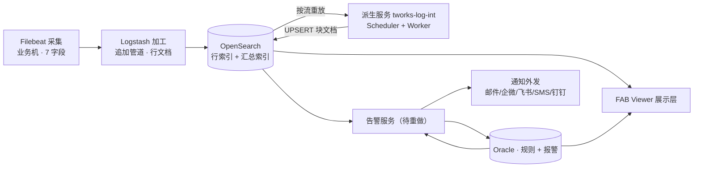

# FAB Viewer · 项目说明

> 本文是**项目地图与状态台账**：项目是什么、文档体系怎么分工、各篇状态如何、当前推进到哪。
> **口径一律以各权威文档为准，本文不复述、只导航** —— 同一件事写两遍是两份会失同步的账。
>
> 记录基准：**2026-09-29**。

---

## 一、项目一句话

为半导体 **MES（300Works）** 做**日志检索、分析与监控告警** —— 把现有自研系统 Halo 的重点功能**分阶段迁移**到新架构上：

| 层 | 方案 | 与 Halo 的关键差别 |
|---|---|---|
| 后台三层 | **Filebeat（采集）→ Logstash（加工）→ OpenSearch（存储检索）** | 全量日志不再存文件系统（查不动）、聚合日志不再存 Oracle（查询慢） |
| 自研服务 | **派生服务**（切块，`tworks-log-int`）+ **告警服务**（待重做） | — |
| 告警存储 | **Oracle 只存规则与告警状态**，不存日志正文 | Halo 的 Oracle 还存聚合日志（慢的根源之一），这条边界不能破 |
| 展示层 | **FAB Viewer** 全新重做 | 不沿用 Halo 页面 |

背景与方法论见 `docs/02-项目背景.md`（v0.2 待补）、`docs/00-推进方法论.md`（原型逼需求 → 再固化 PRD）、`docs/01-模块沟通模板.md`（七问卡片）、`docs/03-Halo功能盘点.md`（一期范围的来源）。

---

## 二、推进状态总览

一期只迁 Halo 盘点里**等级 1** 的 16 项，按依赖排沟通顺序（`03-Halo功能盘点.md` §三）。

**后台链路（先于前端模块冻结交付）：**

| 交付物 | 状态 |
|---|---|
| `04` 链路与数据模型 | **已结项、冻结**（动刀先与薛建明确认） |
| `06` 派生服务工程实现 + `06-附录A` | **已结项、冻结**；`06` 现有一处**未提交改动**（见 §六） |
| `09` 索引模板 + `deploy/` 三层配置 | 已交付，追加部署口径 |

**前端模块：**

| # | 模块 | 一期内容 | 性质 | 状态 |
|---|---|---|---|---|
| 1 | 日志检索与分析 | Rule 信息检索 / Rule 实效分析 / 原始日志下载 | 迁移 | **已收口**（2026-09-14）；功能 2 留 1 项待办 |
| 2 | 日志监控与报警 | 关键字监控 / Server Hang 监控 / RV QUEUE（仅展示） | 迁移 | **沟通中**：功能 1 已收口、功能 2 已核两轮（2026-09-24）、功能 3 暂挂（数据源非日志） |
| 3 | 性能报告 | Server / Rule / Loading 等五项报告 | 迁移 | 未开工 |
| 4 | Home 页 | 关键 Server Dashboard / 告警 Dashboard | 迁移 | 未开工（报警卡片指标与模块 2 联动，留到此阶段定） |
| 5 | 系统管理 | 用户权限 / 连接配置 / Misc / Server Hang 配置 | **重做** | 未开工（各配置页候选值依赖它） |

**告警层：** `07-告警服务工程实现.md` 与 `08-告警详情设计.md` **已清空**（2026-09-21 告警层重做）—— 配置模型改为「**可复用配置表 + 发送规则**」两层，待新口径定稿后重写。链路口径三件事（规则进 Oracle、报警进 Oracle 不进 OpenSearch、数据源取自链路已产出的日志）已在 `04` §六 定死，重写时以此为边界。

---

## 三、文档体系全景

「git」列：✅ = 已进 `.gitignore` 白名单被管控；⬜ = 在盘上、未入白名单。

### 3.1 链路层（权威口径）

| 文档 | 角色 | 状态 | git |
|---|---|---|---|
| `docs/04-后台链路与数据模型.md` | **链路与数据模型唯一权威**：四层各吃吐什么、行/块文档字段、索引与 ILM、§六告警链路口径、§七业务字段解析细则 | 已结项冻结 | ✅ |
| `docs/06-派生服务工程实现.md` | **派生层实现权威**：Scheduler/Worker、快慢轮次、四路+路5、Oracle 四表、幂等、配置六段、拉行分页、§十逐行重放 | 已结项冻结（有未提交改动） | ✅ |
| `docs/06-附录A-块首行解析方案.md` | 块首行解析**执行细则**（剥壳/切块/合成 KV/XML/TXN 取 TxnName），**派生层与前端两端同一套算法** | 定稿 | ✅ |
| `docs/09-OpenSearch索引模板.md` | `04` §5.2/§5.3 的**可执行版本**：2 个可组合模板 + 2 个 ISM 策略与取值理由 | 定稿 | ✅ |
| `deploy/` | **部署操作层**：filebeat / logstash / opensearch 三份配置 + README + 截图；派生层源码**不在**本仓库（自研服务 `tworks-log-int`） | 已交付 | ✅ |

### 3.2 告警层

| 文档 | 角色 | 状态 | git |
|---|---|---|---|
| `docs/08-告警详情设计.md` | 判定设计（每轮做什么、取数、时间窗、Oracle 表结构、幂等去重、通知合并） | **已清空待重写** | ⬜ |
| `docs/07-告警服务工程实现.md` | 工程实现（怎么做成能长期跑的服务） | **已清空待重写** | ⬜ |

### 3.3 全局规范与背景

| 文档 | 角色 | 状态 | git |
|---|---|---|---|
| `docs/05-视觉与交互规范.md` | 全部模块原型与界面的**唯一视觉依据**：AntD 5 基准、高级绿 `#2F7D5A`、深浅双模式、中英双语、表单校验 §4.8、文案克制 §4.9 | 已确认主色等 | ⬜ |
| `docs/00-推进方法论.md` / `01-模块沟通模板.md` / `02-项目背景.md` / `03-Halo功能盘点.md` | 怎么干 / 怎么谈 / 为什么做 / 迁移范围从哪来 | 背景类 | ⬜ |

### 3.4 模块文档

| 文档 | 内容 | 状态 | git |
|---|---|---|---|
| `模块1/00-模块概览.md` | 功能清单与依赖 | 收口 | ✅ |
| `模块1/01-MES Rule信息检索.md` | 16 条件 + 列表 + 4 按钮 + 9 接口 | **需求已冻结**（2026-09-22） | ✅ |
| `模块1/02-MES Rule实效分析.md` | Source/Target 对比 + Compare 双框 | 需求沟通中（2026-09-22 重梳） | ✅ |
| `模块1/03-原始日志下载.md` | 无列表直下 zip、命名与目录规则 | 需求已冻结（头部状态行滞后，见 §七） | ⬜ |
| `模块1/prototype/` | 功能 1 标注原型 HTML + `build.mjs` 生成源 | — | ✅ |
| `模块2/00-模块概览.md` | 功能清单、告警处置 C 档（状态闭环+复盘）、状态机初稿 | 沟通中 | ⬜ |
| `模块2/01-MES关键字监控与告警.md` | 三道检查、规则/行两级配置、A 方案固定窗口+重叠、限流与通知 | 已收口（23 条口径已确认，3 项待定） | ⬜ |
| `模块2/02-MES Server Hang 监控与告警.md` | 两类 Hang（List 展示 / 报警推送）、落点分析 | 沟通中（首轮 2026-09-24，未收口） | ⬜ |
| `模块2/04-原型页面清单.md` | P1/P2/D1/D2（当前仅功能 1） | — | ⬜ |

### 3.5 权威关系（冲突时以谁为准）

1. **链路与数据模型** → `04` 唯一权威；冻结，动刀先与薛建明确认。
2. **派生层机制**（四个终态、静默期、水位线、切块重放流程）→ `06`；`04` 只留三样：块文档字段定义（§5.3.2）、不切块名单（§4.2.1）、边界来源（§4.2.2）。
3. **块首行解析** → `06-附录A`；派生层（Go）与前端（JS）照同一套伪代码各自实现，产物必须逐字节一致。
4. **索引模板**：`deploy/opensearch/*.json`（可执行）← `09`（带理由）← `04` §5（权威）；三者冲突以 `04` 为准并回头改齐。
5. **部署操作** → `deploy/` 三份 README；口径全在 `docs/`。
6. **视觉与交互** → `05`；模块文档只记「哪个条件触发」，不记呈现。
7. **字段与取值** → 模块文档一律引用 `04`，不另立字段口径。
8. **告警** → 判定设计归 `08`、工程实现归 `07`（均待重写）；链路口径归 `04` §六。

---

## 四、后台链路速览

| 层 | 干什么 | 一句话要点 |
|---|---|---|
| 采集 Filebeat | 逐行读、只加物理定位 | 多行合并只开一处（`COMM_SND`）；环境名写在配置里；归档件不回采 |
| 加工 Logstash | 单行可判的三件事：粗解析前缀、造两个行键、打 `MSG_KIND` | 不解析业务参数（归派生层）；字段白名单兜 `dynamic: strict` |
| 派生服务 | 跨行归并 + 解析块首行：切块、闭口、耗时分解 | Scheduler 只做计划（Oracle 调度态），Worker 单线程拉活重放 |
| 存储 OpenSearch | 行索引按天（360 天删）、汇总索引按月（永久归档） | 读走别名、写走物理索引名；块写进「块首行时刻」那个月 |
| 告警服务 | 定时扫日志 → 报警进 Oracle → 通知外发 | 独立应用层，不在链路四层之内 |

**核心概念速查**（详口径见 `04` / `06` 对应节）：

| 概念 | 一句话 |
|---|---|
| 流（锁流三元组） | `ENV + HOSTIP + SERVER_ID`；一条流固定一个 Worker（哈希环） |
| 行文档 | 一条物理行一篇，`_id = LOG_LINE_ID`，写一次不改，21 字段，**不含业务参数** |
| 块文档 | 一次请求执行一篇，`_id = REQUEST_EXEC_ID`，三批长出来（建块①/重放②/闭口③），32 字段 |
| `SORT_KEY` | 16 位厘秒时间串，**只做区间粗筛与翻页**，不承担顺序 |
| 两级重排 | inode 分堆 → 堆间按首行 `LOG_TIME` → 堆内按 `LOG_OFFSET`；**全系统唯一排序方案**（重放与还原共用） |
| `MSG_KIND` | 加工层打的行标签；派生层全部跨行判断的唯一输入，规则外置 `fabviewer.yaml` 热加载 |
| 四终态 | 进行中 / 已完成 / 中断 / 超时封口 |
| 五路 | 路 1 无块翻找建块 · 路 2 进行中（入口静默探测+主体走完区间）· 路 3 已闭合往后翻 · 路 4 超时封口重启 · 路 5 老块收尾封`中断` |
| 快慢轮次 | 快 30s 扫增量（谁刚写日志）；慢 60s 扫存量（谁静默超期）；同一套处理代码 |
| 静默期 N=5min | 块 `LAST_LINE_TIME` 距今 ≥ N ⇒ 封 `超时封口`（临时终态，可被尾行重开） |
| 水位线 L=32s | 只读 `@timestamp < now − L` 的行；硬约束 `L ≥ 快轮次周期` |
| 单位行 | 一次取行 ≤ 20000 行、每页 1000；内存同时只驻留一个 |
| 三个时间 | `LOG_TIME`（日志自身，耗时与排序用）/ `@timestamp`（入库，**一切时间窗**）/ 墙钟（仅审计） |

---

## 五、关键事实卡

| 项 | 值 |
|---|---|
| 环境 | `PIRUN` / `PROD`；日志目录 `/mes/<env>/systemlogs/`；同一台机器可并存两套环境 |
| 系统名 | `system.name = MES-300Works`（常量，**大小写敏感**，每条查询都带） |
| 版本矩阵 | OpenSearch **3.8.0**（可组合模板、ISM 靠 `ism_template` 挂）/ Logstash **9.5.0**（`api.http.*`、ECS 关）/ logstash-output-opensearch **2.x** / Filebeat 待确认 |
| 现场形态 | OpenSearch 与 Logstash **已存在、别的系统在用** → 三层全部**追加部署**；上线顺序 **存储 → 加工 → 采集**（顺序不能反） |
| 索引 | 行 `mes-log-line-{env}-{yyyy.MM.dd}`（`{env}` 小写）360 天删；块 `mes-log-exec-{env}-{yyyy.MM}` 永久归档 |
| Oracle（派生层调度态） | 四表：`FabViewerTurn`（轮次，恒两行）/ `FabViewerTask`（待办，一行一流）/ `FabViewerNode`（心跳）/ `FabViewerStream`（哈希环落点） |
| 共用配置 | `deploy/logstash/fabviewer.yaml` 六段：`msg_kinds`（加工层唯一消费段）/ `cost_items` / `biz_fields` / `derive` / `worker_health` / `alert` |
| 派生服务部署 | Logstash 服务器同机；起步 **3 台 × 5 Worker**；Worker 容器拉起，`NODE_ID` 由部署层注入 |
| 关键参数档位 | 心跳 10s ＜ 判死 30s ＝ 摘环 30s ＜ 进度刷新 100s ＜ 回收 300s ＜ 降级退出 900s |

---

## 六、当前工作状态（2026-09-29）

| 项 | 说明 |
|---|---|
| `06` 未提交改动 | §1.3 四路对照表、§1.3.1 各路描述与 mermaid：**路 1 / 路 3 的「翻找单位行」语义细化**（一格一格取、不带 `REQ_BEGIN` 的放弃、只处理命中的那 1 个单位行）+ 路 2 主体压缩界线改为「本行最后一个 `REQ_BEGIN`」。已通读核对，与 §1.3.1 各路、§十分工自洽 —— 待提交 |
| git 白名单缺口 | `docs/00~03`、`05`、`07`、`08`、`模块1/03`、`模块2` 全部**未入白名单**（见 §3.4）；按「收口一份收一份」的节奏补 |

---

## 七、未决事项（按归口）

**告警层（当前主战场）：**

- `07` / `08` 按新口径「可复用配置表 + 发送规则」两层重写；定稿前不对外引用。
- `04` §六 现只登记「MES 日志关键字监控与告警」一项；**Server Hang 报警**（模块 2 功能 2 第二类）定稿后需回补 `04`（冻结文档，动前先与薛建明确认）。

**Server Hang（模块 2 功能 2）：**

- 第一类（Hang List）落块文档新字段 ⇒ 连带改 `04` §5.3.2 / `06` §2.2 / `09` / `deploy/opensearch/12-template-exec.json` —— **动 04 前必须拍板**。
- 跨层约束：告警 delay 与派生层静默期 `silence_minutes`（5min）的关系（delay ≥ 静默期，否则静默失效）。
- 待确认：连续同类怎么配、模糊匹配程度、`RULENAME` 多值取哪个、真实样例；第二类「只报一次」作用范围、恢复口径、等级作用范围、配置一张表还是两张。
- Hang 落库的字段命名与形态：**待业务方给料**（模块 1 `01` §3.6，落库前列恒置灰）。

**链路侧（`06` §九，共 18 条编号 1~18）：** 重型项为第 1（扩容阈值压测）、2（L 最终取值）、17（**TXN 参数业务口径 —— 业务方稍后提供材料**）、18（`unit_rows` 取值与「块行数 > 单位行」的原地踏步）；其余多为压测回填与告警抑制策略。

**模块侧：**

- 模块 1 功能 2 遗留 1 项：对比表是否把 `总耗时` / `Rule Result` / `Error Code` 提前。
- 模块 2 功能 1 待定 3 项：单规则每轮硬上限条数（建议 50）、「上次 Report 时间」定义、「特殊 Rule Name」改名。
- 模块 2 功能 3（RV QUEUE）暂挂：数据源非日志。

---

## 八、已知文档间不一致（待修）

| # | 不一致 | 位置 |
|---|---|---|
| 1 | 功能 3 状态：概览写「需求已冻结」，文档头部写「需求沟通中」 | `模块1/00` vs `模块1/03` 头部 |
| 2 | 模块 2 功能 1 状态：概览写「需求已收口」，文档头部写「需求沟通中」 | `模块2/00` vs `模块2/01` 头部 |
| 3 | 概览待办引用 `prototype/index.html`（三功能齐），该文件现不在 `prototype/`（现存为功能 1 标注原型 + `build.mjs`） | `模块1/00` 待办 |

---

## 九、仓库规则

- `.gitignore` 采用**白名单**制：`/*` 全忽略、逐条 `!` 放行 —— **本仓库只收录交付物**。新文档要进 git，须在白名单加一行。
- 已入：`04` / `06` / `06-附录A` / `09` / 模块 1（00/01/02 + prototype 两文件）/ `deploy` 全部 / 本 README。
- `deploy/assets/_src/` 放截图生成源（`shot.js` / 页面骨架），产物 PNG 在 `assets/`。

---

## 更新记录

| 日期 | 记录 |
|---|---|
| 2026-09-29 | 初版：全量盘点 git 管控文件与盘上未入白名单文档，建立项目地图、权威关系、推进状态与未决清单 |
