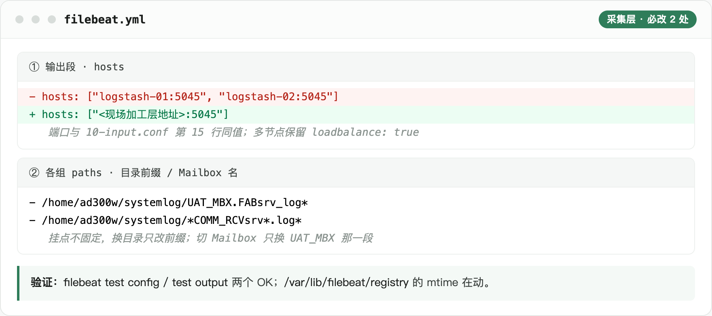
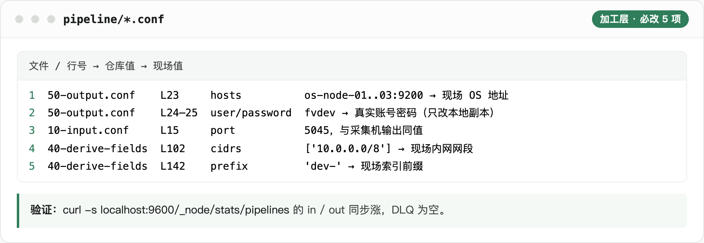

# deploy · MES 日志链路部署包

FAB Viewer 日志链路的部署目录：**Filebeat 采集 → Logstash 加工 → OpenSearch 存储**。里面是配置成品 + 两套落地方案，首次部署不用写脚本、不用 Python。

## 1. 先看哪份

| 场景 | 文档 |
|---|---|
| 本机 Docker / Docker Desktop 单机 | [DEPLOY-DOCKER.md](DEPLOY-DOCKER.md) |
| RHEL 8/9 裸机（已有组件追加 / 全新安装） | [DEPLOY-REDHAT.md](DEPLOY-REDHAT.md) |
| 上线前逐条过坑 | [REMINDERS.md](REMINDERS.md) |

**上线顺序固定：存储 → 加工 → 采集**。加工层没起来就开采集，事件会堵在 Filebeat 内存队列。

## 2. 目录

```
deploy/
├── README.md            本文件：总说明、必改项速查、存储层装入、截图
├── DEPLOY-DOCKER.md     Docker 单机方案
├── DEPLOY-REDHAT.md     RHEL 裸机方案
├── REMINDERS.md         踩坑清单
├── opensearch/          4 个 JSON：2 个 ISM policy + 2 个 index template
├── logstash/            加工层配置：pipeline/ conf/ patterns/ + 规则源与渲染脚本
├── filebeat/            采集层配置：filebeat.yml（每台业务机一份）
├── docker/              两套 compose 封装：Dockerfile / docker-compose.yml / logstash.docker.yml
└── assets/              2 张部署截图 + _src/ 生成源
```

- `opensearch/` 只交 4 个 JSON，仓库里 pattern 是通用 `mes-log-line-*` / `mes-log-exec-*`，装入时按现场前缀替换（第 4 节）。
- `logstash/` 是可直接部署的目录：`pipeline/30-msgkind.conf` 是生成好的成品，首次部署不跑渲染脚本；改 `MSG_KIND` 标签规则才动 `fabviewer.yaml` + `tools/render_msgkinds.py`，改完用 `--check` 校一致。
- `filebeat/` 当前启用 UAT（`ENV: UAT`），DEV 两组整组注释；日志目录 DEV / UAT 共用 `/home/ad300w/systemlog/`，业务族文件名 `UAT_MBX.<族>srv_log*` / `DEV_MBX.<族>srv_log*`（**Mailbox 名与服务族之间是点，不是下划线**）。COMM 两族 glob 不带环境段，同目录别同时启用两套 COMM 组。

## 3. 现场必改项速查

加工层 5 项，全在 `logstash/pipeline/` 内、**不读环境变量**：

| # | 位置 | 仓库值 → 现场值 |
|---|---|---|
| 1 | `50-output.conf` 第 23 行 `hosts` | `["https://os-node-01:9200", ...03]` → 现场 OS 地址 |
| 2 | 同上第 24–25 行 `user` / `password` | `fvdev` → 真实账号密码，**只改本地副本、不进仓库** |
| 3 | `10-input.conf` 第 15 行 `port` | `5045`，与采集机输出同值 |
| 4 | `40-derive-fields.conf` 第 102 行 `cidrs` | `['10.0.0.0/8']` → 现场内网网段 |
| 5 | 同文件第 142 行 `prefix` | `'dev-'` → 现场索引前缀，与存储层三处一致 |

采集层 2 处（`filebeat/filebeat.yml`）：输出段 `hosts`；每组 `paths` 的目录前缀（挂点不固定 `/home/ad300w/systemlog`，切 Mailbox 换文件名前缀那一段）。Docker 方案另有 1 处：输出改 `host.docker.internal:5045` 并删 `loadbalance`。细节见对应方案文档。

## 4. 存储层：装入模板与 ISM（两套方案共用，一次性）

```bash
OS='https://<OS_HOST>:<OS_PORT>'; AUTH='<账号>:<密码>'

sed 's/mes-log-line-/dev-mes-log-line-/g' opensearch/11-template-line.json \
  | curl -s -u "$AUTH" -XPUT "$OS/_index_template/dev-mes-log-line-tpl" -H 'Content-Type: application/json' -d @-
sed 's/mes-log-line-/dev-mes-log-line-/g' opensearch/01-ism-line-360d.json \
  | curl -s -u "$AUTH" -XPUT "$OS/_plugins/_ism/policies/dev-mes-log-line-policy" -H 'Content-Type: application/json' -d @-

curl -s -o /dev/null -w '%{http_code}\n' -u "$AUTH" "$OS/_index_template/dev-mes-log-line-tpl"            # 200
curl -s -o /dev/null -w '%{http_code}\n' -u "$AUTH" "$OS/_plugins/_ism/policies/dev-mes-log-line-policy" # 200
```

删数据索引不影响模板 / ISM / 别名。行索引按天 `dev-mes-log-line-{env}-{yyyy.MM.dd}`（`{env}` 取采集配置 `ENV` 的小写，当前 `uat`），360 天删；块索引按月 `dev-mes-log-exec-{env}-{yyyy.MM}`，由派生服务创建、360 天转冷不删。Logstash 写**物理索引名**，读走别名 `dev-mes-log-line-read`（模板 `aliases` 段自带）。模板 `dynamic: strict`，多一个字段整篇写入失败。

## 5. 部署截图

两张，只留必改项与验证判据：





图里的地址 / 端口是示例值，与配置、正文三处一致。`fb.html` / `ls.html` 各含一张 `.shot` 卡片，`shot.js` 按 `data-name` 命名并覆盖同名 PNG。重出命令：

```bash
cd deploy/assets/_src
NODE_PATH=<playwright-core 所在 node_modules> node shot.js fb.html ..
NODE_PATH=<playwright-core 所在 node_modules> node shot.js ls.html ..
```

没装 playwright 自带浏览器时，加 `CHROME_PATH` 指向本机 Chrome 可执行文件即可。

## 6. 口径

- 真实地址与凭据不进仓库，仓库用示例值占位；不读环境变量、不用 keystore。
- 配置注释只写自包含的配置事实，不引用设计文档。
- 设计文档里的 PIRUN / PROD 是正式环境口径，`deploy/` 的 DEV / UAT 是开发测试环境部署口径，两套并存，不互相替换。
