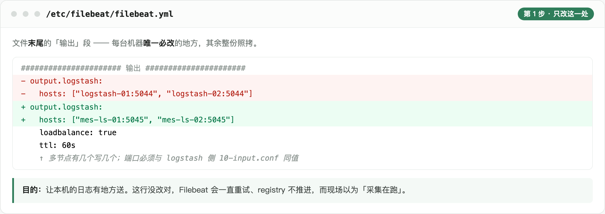
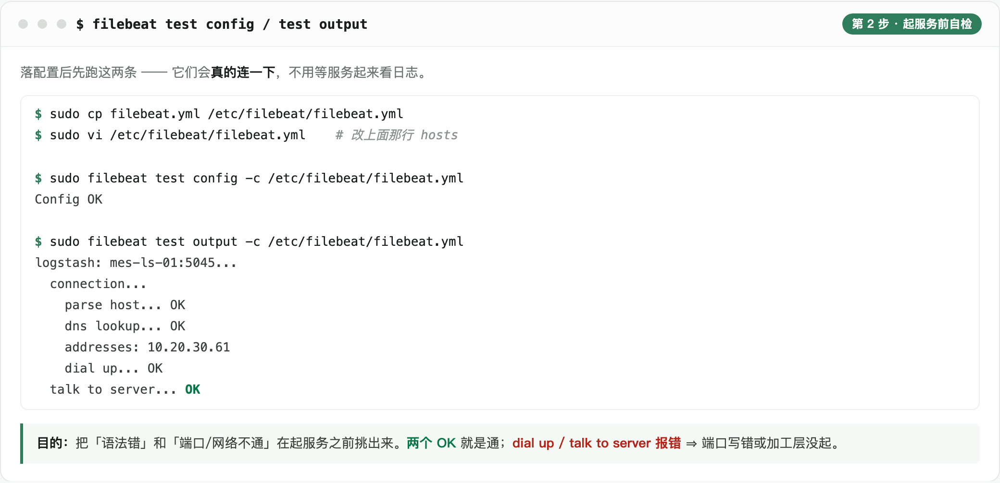
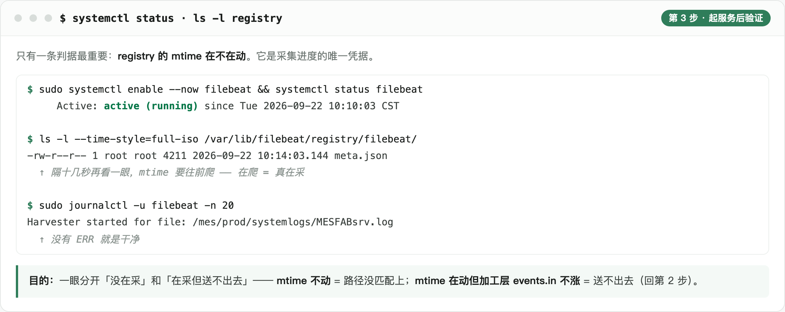

# filebeat · 采集层部署（每台业务机一份）

本层是**新装**（业务机上原本没有 Filebeat）。三步：**改 1 行 → 拷 + 自检 → 起服务 + 验证**。

一台机器一份配置，覆盖该机上的**全部环境与全部服务族** —— 同一台机器上 PIRUN 与 PROD 可能并存，日志目录统一 `/mes/<env>/systemlogs/`。

---

## 第一步：改 1 行



| 文件 | 位置 | 改成什么 |
|---|---|---|
| `filebeat.yml` | 末尾「输出」段 | `hosts` → 现场的加工层地址（多节点有几个写几个）。**端口必须与 logstash 侧 `10-input.conf` 同值** |

其余整份照拷。只有这两种机器要多改：

| 情况 | 改哪 |
|---|---|
| 日志盘没挂在 `/mes` | 各组 `paths` 的前缀 |
| 单环境机器（只有 PROD 或只有 PIRUN） | 删掉另一环境的两组 input。留着只是空跑，日志里会提示路径不存在 |

**四组 input 的职责**（`id` 别随手改 —— `id` 变了等于换了一个采集器，registry 会另起一份、从头重读）：

| input id | 采什么 | 多行合并 |
|---|---|---|
| `mes-pirun-plain` | PIRUN 业务族 + `POLL` + `COMM_RCV` | 否 |
| `mes-pirun-comm-snd` | PIRUN 的 `*COMM_SNDsrv*.log*` | **是** |
| `mes-prod-plain` | PROD 同左 | 否 |
| `mes-prod-comm-snd` | PROD 的 `*COMM_SNDsrv*.log*` | **是** |

---

## 第二步：拷 + 自检



```bash
sudo cp filebeat.yml /etc/filebeat/filebeat.yml
sudo vi /etc/filebeat/filebeat.yml                          # 改上面那行 hosts

sudo filebeat test config -c /etc/filebeat/filebeat.yml     # 期望 Config OK
sudo filebeat test output -c /etc/filebeat/filebeat.yml     # 期望 talk to server... OK
```

`-c` 不能省 —— 不带它读的是默认路径，可能跟你手上这份不是同一个文件。

**起服务之前先做两件事**：

1. **估数据量** —— `du -sh /mes/*/systemlogs/`。配置里 `ignore_older: 0` + `tail_files: false` 是**有意的**：首次启动会把现存的滚动件**全部回灌**。历史量大时加工层会先吃到一波集中写入，必要时先开一个环境、稳了再开另一个。
2. **放开文件句柄** —— 要求 `ulimit -n ≥ 4096`，官方 systemd unit 不一定给。加一段覆盖：

   ```ini
   # /etc/systemd/system/filebeat.service.d/override.conf
   [Service]
   LimitNOFILE=65536
   ```

   然后 `sudo systemctl daemon-reload`。

---

## 第三步：起服务 + 验证



```bash
sudo systemctl enable --now filebeat
```

**只有一条判据：`registry` 的 mtime 在不在动。**

| 现象 | 含义 | 下一步 |
|---|---|---|
| mtime 在爬 | 真在采 | —— |
| mtime 不动 | 路径没匹配上 | 核 `paths` 与 `ls /mes/*/systemlogs/` 里的真实文件名（Linux 区分大小写） |
| mtime 在动，但加工层 `events.in` 不涨 | 采到了、送不出去 | 回第二步看 `test output` |

---

## 常见故障

| 现象 | 原因 | 处置 |
|---|---|---|
| **漏行**（滚动之后丢一段） | `close.on_state_change.renamed` 被设成 `true`，改名即关 harvester | 必须 `false`；`file_identity.inode` 保持开启 |
| 采到归档件（`.log.1.gz`） | 通配把压缩件匹配进来了 | `prospector.scanner.exclude_files` 里要有压缩与改名两类 |
| `HOSTIP` 为空、锁流三元组缺一段 | `add_host_metadata.netinfo.enabled` 是 `false` | 改 `true`。这个开关管的就是往事件里带不带 `host.ip` |
| `too many open files` | `harvester_limit` 或 `ulimit -n` 太小 | 见第二步第 2 条 |
| 重启后重复投递 | registry flush 后重读（正常） | 不用管：行文档按 `LOG_LINE_ID` 做 `_id`，重复投递覆盖同一篇。**纯文本行除外** —— 它取不到行首时间戳、时间改用采集时刻，重投会多出一篇（04 §3.2.2） |
| 采集明显滞后 | 文件滚太快，harvester 跟不上 | 确认 `check_interval: 5s`，再看是不是被 `harvester_limit` 排队挡住 |

**升级与回滚**：动之前先 `sudo tar czf /root/filebeat-registry-$(date +%F).tgz /var/lib/filebeat`。丢了 registry 会**全量重读**（不丢数据，靠幂等覆盖，但会灌一批重复事件）。多台机器**滚动升级**，不要一次全停 —— 采集是幂等的（**纯文本行除外**，会被重复投递，见 04 §3.2.2）。

---

## 口径在哪

| 内容 | 出处 |
|---|---|
| 输入字段、加工逻辑（含多行合并） | `docs/04` §2.1、§2.2 |
| 输出字段（7 项） | `docs/04` §2.3 |
| 采集配置与每个参数的取值理由 | `docs/04` §2.4 |
| 归档件不回采、挂载点约定 | `docs/04` §2.4 |
