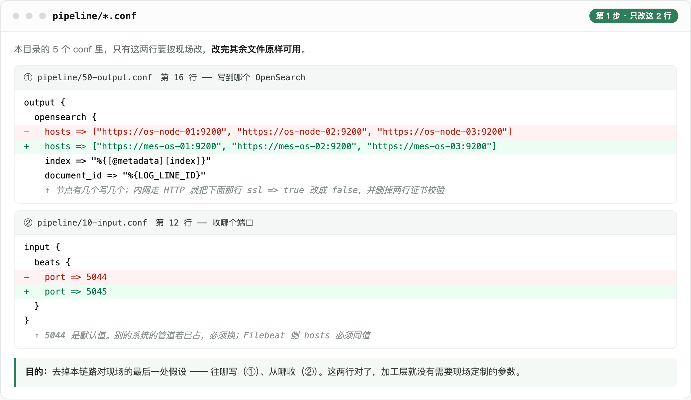
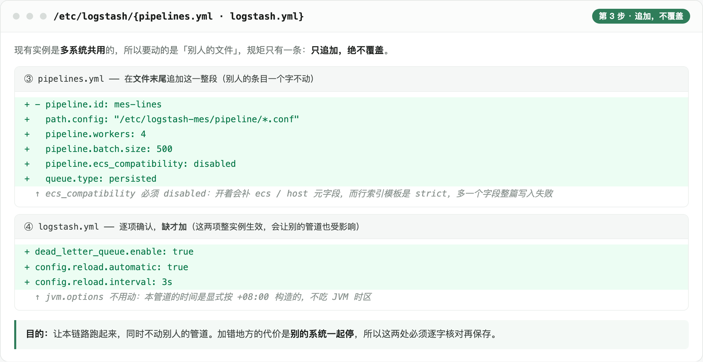
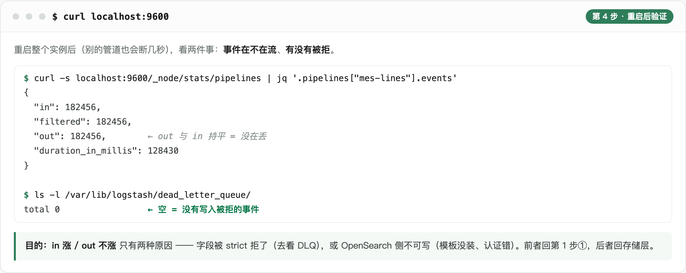

# logstash · 加工层部署（追加到已有实例）

现场 Logstash 已多节点在跑、别的系统在用。本方案**不装 Logstash、不覆盖已有配置**，只往里加一条管道。

本链路自己的文件全放**新目录 `/etc/logstash-mes/`**，与现有系统互不干扰。

四步：**改 2 行 → 拷文件 + 渲染 → 追加两处 → 重启 + 验证**。

---

## 版本前提：Logstash 9.5

本方案的配置按 **9.x** 写。新装或从 8.x 升上来，下面几条必须知道 —— 都不是警告：

| 变化 | 影响 | 本方案 |
|---|---|---|
| `http.host` / `http.port` 被移除 | 改名 `api.http.host` / `api.http.port`；留旧名**启动即失败** | `conf/logstash.yml` 已改 |
| pipeline 默认 `ecs_compatibility: v8` | 会给事件补元字段，撞上行索引模板的 `dynamic: strict` | `pipelines.yml` + `logstash.yml` **两处**都是 `disabled` |
| buffer 默认堆外（direct）→ 堆内（heap） | 内存模型变了，堆要留够 | 保持 9.x 默认；回退写法在 `conf/logstash.yml` 注释里 |
| 默认不以超级用户运行 | 以 root 起的实例会失败，需要 `allow_superuser: true` | **现场实例若是 root 起的，升级前先确认** |
| 移除 netflow / fb_apache / azure / arcsight / ingest-converter 模块 | 用了这些模块的实例会起不来 | 本方案不用模块 |
| Beats input 移除旧 SSL 参数 | 开 TLS 要改用 `ssl_enabled` / `ssl_certificate` / `ssl_key` / `ssl_certificate_authorities` | 本链路不开 TLS |

**`manage_template => false` 不是可选项。** 除了「模板由我们统一部署」，还有一条硬的：`logstash-output-opensearch` 2.1.x 的模板管理器用了 `File.exists?`，而 Logstash 9.x 带的 JRuby 10（Ruby 3.4）已把它移除 —— 开着会在每次启动时报模板安装失败。

**装插件**：必须 2.x 系列（1.x 不支持 Logstash 8+）。也可以用 OpenSearch 官方打包的 `logstash-9.x-with-output-opensearch`，省掉装插件这步。

**不要设 `override_main_response_version`** —— 那是通用 ES 输出插件的兼容开关，本插件原生认 OpenSearch，设了反而误导排障。

---

## 第一步：改 2 行



| 文件 | 行 | 改成什么 |
|---|---|---|
| `pipeline/50-output.conf` | 23 | `hosts` → 现场 OpenSearch 地址。走 HTTPS 保留 `ssl => true`；内网 HTTP 改成 `false` 并删掉两行证书校验 |
| `pipeline/10-input.conf` | 12 | `port => 5044` → 现场**没被占用**的端口。别的系统的管道若已占 5044 就必须换，且 Filebeat 侧 `hosts` 同值 |

改完这 2 行，本目录其余文件原样可用。

---

## 第二步：拷文件 + 渲染

```bash
sudo mkdir -p /etc/logstash-mes/pipeline /etc/logstash-mes/tools
sudo cp pipeline/*.conf                /etc/logstash-mes/pipeline/
sudo cp fabviewer.yaml                 /etc/logstash-mes/
sudo cp tools/render_msgkinds.py       /etc/logstash-mes/tools/
sudo cp patterns/mes                   /etc/logstash/patterns/mes
sudo chown -R logstash:logstash /etc/logstash-mes

cd /etc/logstash-mes
sudo -u logstash python3 tools/render_msgkinds.py      # 生成 pipeline/30-msgkind.conf
```

三条规矩：

- `patterns/mes` 进的是**现有的** `/etc/logstash/patterns/` —— `20-parse.conf` 里 `patterns_dir` 写死了这个路径。该目录若已有同名 `mes` 文件，换个名字（如 `mes-fab`）并同步改 `20-parse.conf` 里**两处** `patterns_dir`。
- 渲染脚本按**自身位置**找文件（读上一级的 `fabviewer.yaml`、写上一级的 `pipeline/30-msgkind.conf`），所以 `/etc/logstash-mes/` 下这三者的相对结构不能动，脚本本身不用改。
- 渲染只在改规则时需要；运行时不依赖 python（前提是现场有 `python3` + `pyyaml`）。

---

## 第三步：追加两处（不覆盖别人的）



**3.1** `pipelines.yml` 末尾追加这一整段，**别人的条目一个字不动**：

```yaml
- pipeline.id: mes-lines
  path.config: "/etc/logstash-mes/pipeline/*.conf"
  pipeline.workers: 4
  pipeline.batch.size: 500
  pipeline.ecs_compatibility: disabled
  queue.type: persisted
```

`ecs_compatibility` 必须 `disabled`：开着会补 `ecs` / `host` 等元字段，而行索引模板是 `dynamic: strict`，多一个字段整篇写入失败。

**3.2** `logstash.yml` 逐项确认，**缺才加**（都是整实例生效）：

| 项 | 值 | 影响 |
|---|---|---|
| `dead_letter_queue.enable` | `true` | 写不进索引的事件落 DLQ、不静默丢。会让**别的管道**也多出一份 DLQ 目录 |
| `config.reload.automatic` / `.interval` | `true` / `3s` | 不加的话，改规则要重启整个实例才生效 |

**`jvm.options` 不动** —— 本管道的时间全部在管道里显式按 `+08:00` 构造，不吃 JVM 时区，**不改现场实例的整实例设置**。顺带看一眼 `file.encoding`：不是 UTF-8、locale 也没配好时中文会乱码（真碰上再跟对方商量）。另：新管道与现有管道**共用同一个 JVM 堆**，堆偏小要一起调。

**3.3** 在 `/etc/default/logstash` 里补两行（已有别的内容就追加）：

```bash
OS_USER=admin
OS_PASSWORD=改成实际密码
```

`50-output.conf` 用 `${OS_USER}` 引用它；这个文件是整实例共享的。

---

## 第四步：重启 + 验证

```bash
sudo -u logstash /usr/share/logstash/bin/logstash -t      # 期望 Configuration OK
sudo systemctl restart logstash                          # 重启整个实例，别的管道会一起断几秒
```



多节点时**逐个重启**，不要一次全停 —— Filebeat 侧配了 `loadbalance` 与 `ttl: 60s`，一个实例下来，一分钟内事件自动压到还在的实例上。

`in` 涨、`out` 不涨只有两种原因：字段被 `strict` 拒了（去看 DLQ）、或 OpenSearch 侧不可写（模板没装、认证错）。

---

## 日常改规则：只动 `fabviewer.yaml`

```bash
sudo vi /etc/logstash-mes/fabviewer.yaml               # 第 1 段 msg_kinds
sudo -u logstash python3 /etc/logstash-mes/tools/render_msgkinds.py
# 有 config.reload.automatic ⇒ 3 秒内生效，不重启
```

**不要手改 `30-msgkind.conf`** —— 它是生成物，下次渲染会覆盖，`--check` 也会报不一致。只有改 conf 结构才需要重启。

---

## 常见故障

| 现象 | 原因 | 处置 |
|---|---|---|
| 启动即失败、报端口占用 | 第一步的端口与别的管道撞了 | 换端口，Filebeat 侧同步改 |
| 文档全 400、堆在 DLQ | `dynamic: strict` 下多写了字段 | 核 `40-derive-fields.conf` 末段白名单与 `11-template-line.json` |
| 同上，但字段名带 `ecs` / `host` | `pipeline.ecs_compatibility` 没关 | 确认 `pipelines.yml` 与 `logstash.yml` **两处**都是 `disabled`（管道级优先） |
| 大批 `_mes_plain_line` 标签 | grok 没匹配上 | 对比 `patterns/mes` 与真实行首；末段必须 `GREEDYDATA` |
| `HOSTIP` 为空 | 上游 `host.ip` 没带上来 | 查采集层 `add_host_metadata.netinfo.enabled` 是否 `true` |
| 中文乱码 | 实例的 `file.encoding` 不是 UTF-8、locale 也没配好 | 是整实例设置，跟对方商量后再动（第三步 3.2 末） |
| 启动即失败、报 unknown setting `http.host` | 实例配置还是 8.x 的 `http.*` | 换成 `api.http.host` / `api.http.port` |
| TLS 报证书校验失败 | 开了 `ssl_certificate_verification` 但没给 CA | 加 `cacert`，或把 CA 装进 JVM truststore |

---

## 口径在哪

| 内容 | 出处 |
|---|---|
| 加工逻辑三段（粗解析 / 行键 / 标签） | `docs/04` §3.2 |
| 行文档字段清单（22 个） | `docs/04` §3.3、§5.3.1 |
| 关键参数与取值理由 | `docs/04` §3.4 |
| `fabviewer.yaml` 六段的结构 | `docs/06-派生服务工程实现.md` §四 |

`conf/` 下那三个文件（`logstash.yml` / `pipelines.yml` / `jvm.options`）是**新装一套独立 Logstash 实例**时才用的完整配置，本方案用不上 —— 这里只从它们里面挑出第三步要追加的那几项。
