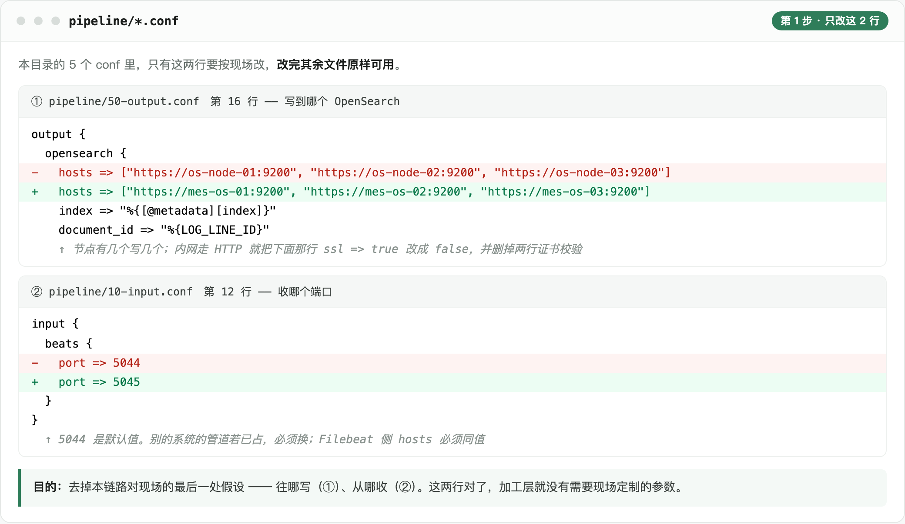
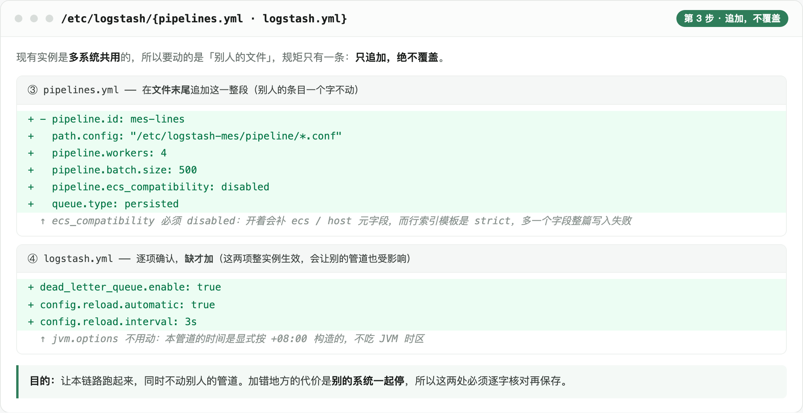
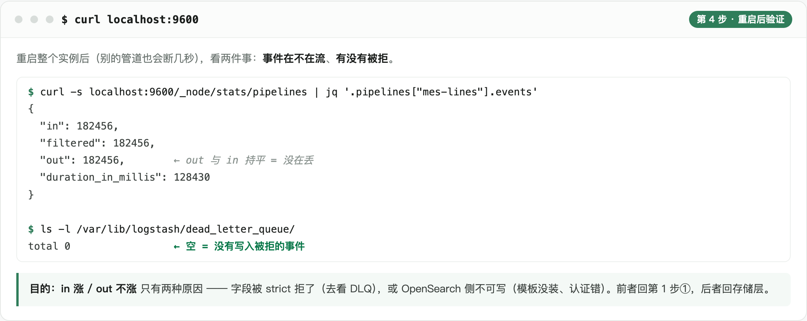

# logstash · 加工层部署包

在现有 Logstash 实例上追加一条 `mes-lines` 管道：不装 Logstash、不覆盖已有配置。前提 Logstash 9.x + `logstash-output-opensearch` 2.x。

---

## 部署用哪几个文件

| 组 | 文件 | 部署动作 |
|---|---|---|
| **必需 7 个** | `pipeline/` 下 6 个 `.conf`、`patterns/mes` | 拷到现场 |
| **追加 1 段** | `conf/pipelines.yml` | 把那 6 行管道声明追加到现场 `pipelines.yml` 末尾 |
| **备着不读 2 个** | `fabviewer.yaml`、`tools/render_msgkinds.py` | 以后改 `msg_kinds` 规则时才用；首次部署不需要 Python |
| **不用 3 个** | `README.md`、`conf/logstash.yml`、`conf/jvm.options` | 手册 / 独立新装一套实例时才用；`logstash.yml` 只挑下面 2 个开关 |

最小集 = 6 个 `pipeline/*.conf` + `patterns/mes` + 一段管道声明。

---

## 1. 现场必改 4 项



| # | 文件 | 改成什么 |
|---|---|---|
| 1 | `pipeline/50-output.conf` 第 23 行 | `hosts` → 现场 OpenSearch 地址；内网 HTTP 时 `ssl => false` 并删掉两行证书校验 |
| 2 | `/etc/default/logstash`（包外，已有内容就追加） | `OS_USER` / `OS_PASSWORD` —— `50-output.conf` 用环境变量引用，整实例共享 |
| 3 | `pipeline/10-input.conf` 第 15 行 | `port => 5045` 核对没被占用；换值要与 Filebeat 的 `output.logstash.hosts` 同值 |
| 4 | `pipeline/40-derive-fields.conf` 第 102 行 | `cidrs` → 现场内网网段 |

其余文件原样可用。

---

## 2. 拷文件

```bash
sudo mkdir -p /etc/logstash-mes/pipeline /etc/logstash-mes/tools
sudo cp pipeline/*.conf          /etc/logstash-mes/pipeline/
sudo cp fabviewer.yaml           /etc/logstash-mes/
sudo cp tools/render_msgkinds.py /etc/logstash-mes/tools/
sudo cp patterns/mes             /etc/logstash/patterns/mes
sudo chown -R logstash:logstash /etc/logstash-mes
```

`20-parse.conf` 的 `patterns_dir` 写死 `/etc/logstash/patterns`；该目录已有同名 `mes` 就改名（如 `mes-fab`），并同步改 `20-parse.conf` 两处。渲染脚本按自身位置找上级的 `fabviewer.yaml` 和 `pipeline/30-msgkind.conf`，三者相对结构别动 —— 但首次部署不用跑它，`30-msgkind.conf` 已是成品。

---

## 3. 追加两处



**现场 `pipelines.yml` 末尾追加**（别人的条目一个字不动）：

```yaml
- pipeline.id: mes-lines
  path.config: "/etc/logstash-mes/pipeline/*.conf"
  pipeline.workers: 4
  pipeline.batch.size: 500
  pipeline.ecs_compatibility: disabled
  queue.type: persisted
```

`ecs_compatibility: disabled` 不能省：开着会补 `ecs` / `host` 元字段，行索引模板是 `dynamic: strict`，多一个字段整篇写入失败。

**现场 `logstash.yml` 逐项确认，缺才加**（整实例生效）：`dead_letter_queue.enable: true`、`config.reload.automatic: true` + `config.reload.interval: 3s`。不要用 `conf/logstash.yml` 整份覆盖。

---

## 4. 重启 + 验证

```bash
sudo -u logstash /usr/share/logstash/bin/logstash -t      # 期望 Configuration OK
sudo systemctl restart logstash                          # 别的管道会一起断几秒；多节点逐个重启
```



判据：`curl -s localhost:9600/_node/stats/pipelines | jq '.pipelines["mes-lines"].events'`，`in` 与 `out` 都涨即正常；`in` 涨、`out` 不涨去查 DLQ 与 OpenSearch 认证 / 模板。
