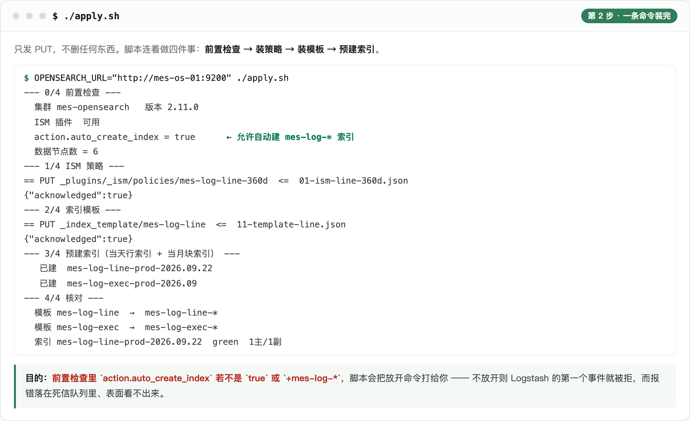
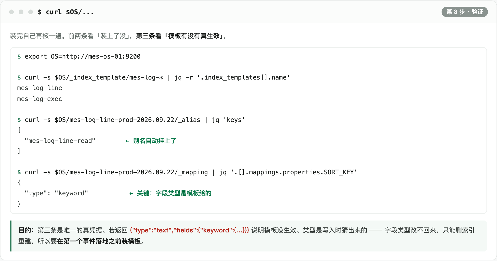

# opensearch · 存储层部署（追加到已有集群）

现场 OpenSearch 已多节点在跑、别的系统在用。本方案**不装集群、不动任何现有索引与设置**，只往集群里装 4 个对象：

| 产物 | 文件 | 作用 |
|---|---|---|
| ISM 策略 `mes-log-line-360d` | `01-ism-line-360d.json` | 行索引：热 0~30d / 温 30~180d / 冷 180~360d / 360d 删除 |
| ISM 策略 `mes-log-exec-keep` | `02-ism-exec-keep.json` | 块索引：热 0~360d / 之后只读归档，**不删** |
| 索引模板 `mes-log-line` | `11-template-line.json` | `mes-log-line-*`：21 字段、1 主 1 副、读别名 `mes-log-line-read` |
| 索引模板 `mes-log-exec` | `12-template-exec.json` | `mes-log-exec-*`：32 字段（含 2 个 `nested`）、读别名 `mes-log-exec-read` |

命令里的 `$OS` = `OPENSEARCH_URL` 的值。三步：**确认一条设置 → 跑脚本 → 验证**。

**先知道一件事：这里没有「建表」这个动作。** 索引是**首次写入时自动创建**的 —— 行索引 `mes-log-line-{env}-{yyyy.MM.dd}` 每天一个、块索引 `mes-log-exec-{env}-{yyyy.MM}` 每月一个；模板只在这建出来的**一刻**被读一次。所以「装索引」就是：装策略 → 装模板 → 让索引建出来时自动带上这两样。

---

## 版本前提：OpenSearch 3.8

| 变化 | 影响 | 本方案 |
|---|---|---|
| legacy `_template` API 在 3.0 移除 | 只剩可组合模板 `_index_template` 一条路 | `apply.sh` 用的就是它 |
| **不再支持用索引模板挂 ISM 策略** | `plugins.index_state_management.policy_id` 已弃用，3.x 下还可能让索引创建被 unknown setting 拒掉 | 模板里**已删**这条；策略靠策略自带的 `ism_template` 按 `mes-log-*` 匹配 |
| JDK 21 起 / Lucene 10 | 只影响服务端 | 不涉及（本方案只 PUT 对象，不用 Java 客户端） |
| bulk 的 `_id` 512 字节上限生效 | 超长 `_id` 会被拒 | 不涉及：行 `_id` 约 70 字节、块 `_id` 约 80 字节 |

**策略真的挂上了吗**：装完后 `curl $OS/_plugins/_ism/explain/mes-log-line-prod-<当天>`，看 `policy_id = mes-log-line-360d`。这是唯一凭据 —— 策略没挂上不会报错，只会一直不转档、不删除。

## 第一步：确认一条集群设置

`action.auto_create_index` 必须允许自动创建 `mes-log-*` 索引。别的系统既然在往这个集群写，这开关大概率已经放开；**脚本会自己查**，不允许时直接把放开命令打给你。

不放开会怎样：Logstash 的第一个事件就被拒，而报错落在死信队列里，表面看不出来。

---

## 第二步：跑脚本



```bash
cd deploy/opensearch

./apply.sh --dry-run            # 先看要发哪些请求，不连集群

OPENSEARCH_URL="http://mes-os-01:9200" ./apply.sh

# 带认证 + 自签证书
OPENSEARCH_URL="https://mes-os-01:9200" \
OPENSEARCH_USER=admin OPENSEARCH_PASSWORD='xxx' OPENSEARCH_INSECURE=1 ./apply.sh

# 只装策略和模板，不预建索引（索引会在首次写入时自动创建）
MES_ENVS="" ./apply.sh
```

**顺序不能换**：索引一建出来就把别名和策略带上了 —— 带什么取决于当时的策略与模板，所以两者必须排在建索引之前。

**全是 PUT，不删任何东西，可重复执行。** 预建索引那一步只是为了「装完立刻能验」；环境名默认 `prod pirun`，单环境现场用 `MES_ENVS=prod`。执行机需要 `jq`。

---

## 第三步：验证



| 验什么 | 命令 | 期望 |
|---|---|---|
| 两个策略在 | `curl $OS/_plugins/_ism/policies` | 有 `mes-log-line-360d`、`mes-log-exec-keep` |
| 两个模板在 | `curl $OS/_index_template/mes-log-*` | 有 `mes-log-line`、`mes-log-exec`，pattern 正确 |
| 索引自动带别名 | `curl $OS/mes-log-line-prod-<当天>/_alias` | 含 `mes-log-line-read` |
| 索引自动挂策略 | `curl $OS/_plugins/_ism/explain/mes-log-line-prod-<当天>` | `policy_id = mes-log-line-360d` |
| **字段类型是模板给的** | `curl $OS/mes-log-line-prod-<当天>/_mapping` 看 `SORT_KEY` | `keyword` |

**最后一条是唯一的真凭据**：出现 `text` + `fields.keyword` 就说明模板没生效、类型是写入时**猜**出来的 —— 字段类型一旦被猜出来就**改不回来**，只能删索引重建。所以模板必须在第一个事件落地**之前**装好，这也是上线顺序把存储排在第一的原因。

---

## 改什么、影响面多大

| 想改 | 怎么做 | 对已有索引 |
|---|---|---|
| 保留期（天数、热温冷档位） | 改 `0x-ism-*.json` → 重跑 `apply.sh` | **立即生效**，不重建 |
| 副本数、`refresh_interval`、codec | 改 `1x-template-*.json` → 重跑 | 只对新索引生效 |
| 加字段 | 改模板 JSON **＋** `docs/04` 字段表 **＋** 加工层白名单 | 只对新索引生效 |
| 改字段类型 | **改不了** | 必须重建索引 + 重灌 |

加字段必须三处同步。漏掉加工层那处会因 `strict` 整篇写入失败 —— 这是有意设计的：宁可立刻报错，也不要悄悄多出一个查不到的字段。

**装完之后，本方案在集群里留下的东西只有**：`mes-log-*` 索引、2 个模板、2 个 ISM 策略、2 个读别名。别的系统的索引与集群设置一概不碰。

---

## 回滚

只装不删，没有「卸载」动作。

- **装错了**：把 JSON 改回去再跑一次 `apply.sh`（PUT 幂等覆盖）。已建索引不受影响，它们在建的时候已经定型。
- **要清空重来**：**先停 Logstash**，再删：

```bash
curl -X DELETE "$OS/mes-log-line-*"
curl -X DELETE "$OS/mes-log-exec-*"
curl -X DELETE "$OS/_index_template/mes-log-line"
curl -X DELETE "$OS/_index_template/mes-log-exec"
curl -X DELETE "$OS/_plugins/_ism/policies/mes-log-line-360d"
curl -X DELETE "$OS/_plugins/_ism/policies/mes-log-exec-keep"
```

---

## 口径在哪

| 内容 | 出处 |
|---|---|
| 索引划分、读 / 写别名、`{env}` 大小写 | `docs/04` §5.2.1 |
| 行文档字段清单（21 个） | `docs/04` §5.3.1 |
| 块文档字段清单（32 个） | `docs/04` §5.3.2 |
| 保留策略三档 | `docs/04` §5.2.5 |
| 模板全文与取值理由 | `docs/09-OpenSearch索引模板.md` |

本目录的 JSON 是**可执行版本**，`docs/09` 是**带理由的版本**，`docs/04` 是**权威口径**。三者冲突时以 `docs/04` 为准，并回头把另外两处改齐。
