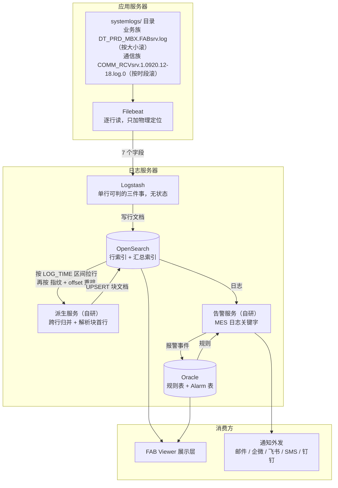
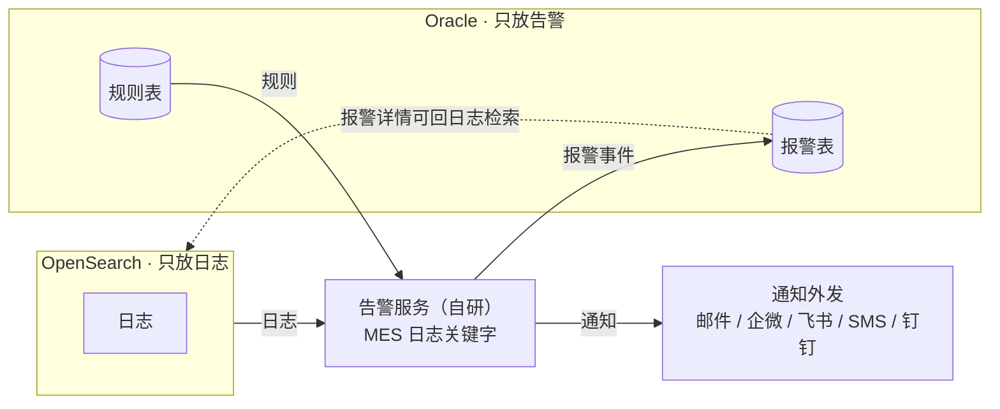

# 后台链路与数据模型

> **状态：已结项。** 这篇文档是**链路与数据模型**的唯一权威口径，内容已冻结；**任何要动这篇文档的改动，先与薛建明确认。**
>
> 后续改 `06-派生服务工程实现.md` / `07` / `08` 时，**凡是不要动这篇的，就不要动这篇**；确实要动的，回到这里改，再把受影响的从属文档一起同步掉。
>
> **派生层是唯一的例外。** 它的**实现与论证以 `06-派生服务工程实现.md` 为权威**；这篇只留三样东西——**块文档的字段定义**（§5.3.2）、**哪些流不切块**（§4.2.1）、**边界从哪来**（§4.2.2）。四个终态、静默期、水位线、切块与重放的流程，一律在 06 里写全，**不回灌这篇**——同一件事写两遍，就是两份迟早对不上的账。
>
> **无未闭合项。** 待补料已全部清空。

这篇文档说两件事：一条日志从业务服务器一路走到「查得出来的结果」，中间经过哪几站；以及每一站上，数据长什么样。

链路一共四层：**采集（Filebeat）→ 加工（Logstash）→ 派生（自研服务）→ 存储（OpenSearch）**。

告警不在这四层里，它是盖在四层产出之上的**应用层**。**这篇涉及的告警服务只有一个：「MES 日志关键字监控与告警」，不含任何其他告警服务。** 本文只在 §六 交代它的链路口径（规则进 Oracle、报警进 Oracle、数据源取自链路已产出的日志）；**它自己怎么加工，不在本文定义**——判定设计看 `08-告警详情设计.md`，工程实现看 `07-告警服务工程实现.md`。

**阅读约定**

- 每一层都按同一个套路讲：**输入字段 → 加工逻辑 → 输出字段**。字段名就是落库名。
- 两个自研服务的**工程实现**另外成篇：派生服务看 `06-派生服务工程实现.md`，告警服务看 `07-告警服务工程实现.md`。
- 派生层**块首行解析的规则细则**（剥壳切块、合成 KV 集合、XML 转对象、TXN 取 TxnName）也另外成篇：`06-附录A-块首行解析方案.md`；§七 只定字段口径。
- 采集层和加工层能多薄就多薄，别给现成组件压解析的活：只用简单的正则；那些要靠关系库或缓存的复杂事，一律推给**派生层**去解决。

---

## 一、链路总览

### 1.1 链路图



图的上半部分（采集 → 加工 → 派生 → 存储）是本文的范围；告警那一支只交代口径，见 §六。

### 1.2 每层的输入字段 / 加工逻辑 / 输出字段

| 层 | 组件 | 输入字段 | 加工逻辑 | 输出字段 |
|---|---|---|---|---|
| **采集** | Filebeat | 应用服务器 `systemlogs/` 下的 `.log` 与**全部**滚动件（业务族 `.log.N` 按大小滚、通信族按时段滚；FAB / LIST / COMM_RCV / COMM_SND / POLL 等多类 Server，各文件独立策略，§2.1） | 逐行读文件，**只有 `COMM_SND` 一族按时间戳做多行合并**；其余不改内容、不解析时间、不跨行、不认业务语义，只附物理定位与系统名 | 事件 7 字段（§2.3） |
| **加工** | Logstash | 采集层 7 字段 | 单行内可判的三件事：粗解析前缀、造两个行键、打消息类型标签 | **行文档**，一条物理行一篇。**不含任何业务参数**（§3.3） |
| **派生** | 派生服务（自研） | 行文档（含 `LOG_BODY` 原文） | 按流重放，做单行做不到的事：切块、闭口、**解析块首行**、块级归并、耗时分解 | **块文档**，一次请求执行一篇（§4.3） |
| **存储** | OpenSearch | 行文档、块文档 | 切索引；行文档写一次、块文档原地 UPSERT；查询侧按区间捞块、按 inode + offset 还原顺序 | 两份可查询文档（§5.3） |
| **告警** | 告警服务（自研） | 链路已产出的日志 + Oracle 规则表 | **不在本文定义**。本文只交代链路口径（§六），判定设计见 `08-告警详情设计.md`，工程实现见 `07-告警服务工程实现.md` | **Oracle Alarm 表** + 通知外发 |

**怎么分工，只看一条判据：这件事，光看一行能不能办完。**

- 一行能判完 → 加工层。只算一次，重放也不会再算一遍。
- 要看见整块才能做 → 派生层。

> 这条判据看的是「**语义上依赖什么**」，不只是「字面上要不要跨行」。业务参数解析字面上单行就能做（不用看下一行），但它**只在请求开始行上有意义**——而「这行是不是请求开始行」，单行看不出来。所以参数解析归派生层（§四，判据见 `06-派生服务工程实现.md` §八）。

### 1.3 一条请求执行的完整旅程

后文各节都拿这条**真实日志**来对照（业务方给料原文，`FABsrv.10`，PROD）：

```text
08/11/26 17:19:49.38 FABsrv.10:FwEventManager:message to process: :>>L FwSrvExecuteRuleTxn msgTag=_INBOX.0A14232E.5C00D2590D367AF20D.1 ruleName=AMAJPJIJORULE attributes={ { class=ASSOC { class=A1 "PARAMETER" } { class=A1 "VALUE" } } … }
```

> 上面截到 `attributes` 的首段，完整原文见 §7.4。它同时是**请求开始行**和**块首行**，后文所有取值都出自这一行。

环境元信息（示意，只为把链路串起来；日志原文见上）：`PROD` 环境，主机 `10.20.30.40`，文件 `FABsrv.log`（inode `88250`），该行的字节偏移 `8012000`。

| 阶段 | 产出 |
|---|---|
| 采集 | `message` = 原文一字不改；`log.file.fingerprint` = 88250；`log.offset` = 8012000；`host.ip` = 10.20.30.40；`ENV` = PROD；`system.name` = MES-300Works |
| 加工 · 粗解析 | `LOG_TIME` = 2026/08/11 17:19:49.380；`SERVER_ID` = FABsrv.10；`LOG_BODY` = 去掉前缀的本体 |
| 加工 · 行键 | 行 `_id` = `PROD_10.20.30.40_3f2a9c1d0b7e4f68_8012000_20260811171949380`（行身份串 = `ENV` + `HOSTIP` + 指纹前 16 位 + `LOG_OFFSET` + 17 位毫秒，§3.2.2；**不另存字段**，比对直接读 `hit._id`）；区间粗筛与翻页打 `LOG_TIME` |
| 加工 · 标签 | `MSG_KIND` = `REQ_BEGIN`（只判「这里是一条边界」，不分类） |
| 加工 · 写入 | 行文档以行身份串作 `_id`，写一次，此后不再修改。**行文档到此为止，不含任何业务参数** |
| 派生 · 建块 | 块文档 `_id` = `REQUEST_EXEC_ID`（= `ENV` + `HOSTIP` + `SERVER_ID` + 该行身份串，§5.3.2）；`START_TIME` = 该行 `LOG_TIME`；`EXEC_STATUS` = 进行中 |
| 派生 · 解析首行 | 拿本行 `LOG_BODY` 跑块首行解析（§七）→ `REQUEST_TYPE` = Rule；`RULENAME` = AMAJPJIJORULE；`EQPID` = ADUMA01；`CARRIERID` = FPB08765；`USERID` = AMAS2；`TID` = AMA_10.20.34.23_1312612287，连同建块一起写进块文档 |
| 派生 · 闭口 | `END_TIME` 定格为**本块末行的 `LOG_TIME`**（未闭口期间随重放一路推进到当前末行，闭口不推进右端）；`EXEC_STATUS` = 已完成。末行时间未闭口期间记在 `LAST_LINE_TIME` 上（§5.3.2） |
| 告警 · 命中 | 这一行若命中 MES 关键字规则，告警服务产出一条报警事件写入 Oracle（判定与落库见 `08-告警详情设计.md`） |
| 告警 · 通知 | 报警事件按等级路由收件人，通知外发（见 `07-告警服务工程实现.md`） |

最后两行只是点出告警服务的存在；它怎么加工，不在本文范围。

---

## 二、采集层（Filebeat）

采集器直接跑在应用服务器上，它多吃掉的每一口都是业务的风险。所以这一层什么都不做：不做跨行的事，不做要缓存的事，不做要懂业务的事。

### 2.1 输入字段

**采什么**

| 项 | 内容 |
|---|---|
| 部署位置 | **多台物理独立主机，各自挂各自的日志盘**，采集路径统一为 `/mes/<env>/systemlogs/`。它们跑 `FABsrv` / `LISTsrv` / `QUERYsrv` / `OCAPsrv` / `TRANSsrv` / `XSITEsrv` / `IDEsrv` / `RTDLOGsrv` 等业务服务，以及 `COMM_RCVsrv` / `COMM_SNDsrv` / `POLLsrv` |
| 目录 | 各机器日志盘上的 `/mes/<env>/systemlogs/` —— `PIRUN` → `/mes/pirun/systemlogs/`、`PROD` → `/mes/prod/systemlogs/`。**一个目录里并存多类 Server 的日志文件**（`FABsrv.log` / `LISTsrv.log` / `EDCsrv.log` …）。某台机器若挂到别处，只改该机器那份配置里的路径前缀（§2.4） |
| 文件 | `.log` 及其**全部滚动件** `.log.1` … `.log.N`，**一并纳入、不挑份数**。**两族命名并存**：**业务族** `<MBX 名>.<类别>srv.log[.N]`（如 `DT_PRD_MBX.FABsrv.log` / `.log.1`），**按大小滚**；**通信族** `<类别>srv.<编号>.<MMDD>.<起小时>-<止小时>.log.<编号>`（如 `COMM_RCVsrv.1.0920.12-18.log.0`），**按时段滚**。滚多大、滚多长、保留几份，由**各文件自己的配置**决定，彼此不同（10MB 只是其中一批的取值） |
| 归档件 | 各自达到最大归档数后打包到文件存储服务器的文件 —— **最大归档数每个文件也不同**。**不回采**：只采 `systemlogs/` 下的活动件，被打包搬走的路径够不着；若在**原地**压缩或改名，由采集配置的排除表挡掉（§2.4） |
| 不采 | 非 `systemlogs` 目录、不符合 `.log` 命名规则的文件、**已归档的文件**（打包搬走，或原地压缩 / 改名） |

**`systemlogs/` 里有什么，就采什么。** 一个目录、多类 Server，分三族：

| 族 | 服务 | 形态 | 是否切块 |
|---|---|---|---|
| **业务族** | `FAB` / `LIST` / `QUERY` / `OCAP` / `TRANS` / `XSITE` / `IDE` / `RTDLOG` | 请求-响应，行首 `MM/dd/yy HH:mm:ss.cc <类别>srv.<编号>:` | 切 |
| **通信族** | `COMM_RCVsrv` / `COMM_SNDsrv` | MES 与外部之间的通信层，行首是另一套前缀（§3.2.1） | **不切**（§4.2.1） |
| **定时器族** | `POLL` | 格式同业务族，**本期不经过派生服务加工** | **不切** |

- **每个文件一套自己的滚动策略，两种触发方式。** 业务族按**大小**滚（`.log` → `.log.1` …）；通信族按**时段**滚——每到一个时段就换一个新文件，文件名里写清是哪天哪几个小时（`COMM_RCVsrv.1.0920.12-18.log.0`）。保留几份、时段多长，都由各 Server 自己配置，彼此不同——**统一按 10MB 理解是错的**。采集侧不读这些配置，也不假设大家一样。
- **采集规则是一个一个 Server 点名列出来的，不用目录通配。** 每个 Server 在采集配置里各占一行（`*FABsrv.log*` / `*LISTsrv.log*` / …，见 §2.4 的四组 input），**不写 `systemlogs/*.log*` 这种一把捞的写法**——没点到名的文件，躺在一个目录里也不会被采走。**每多一个 Server，就要在配置里加一行**（§2.4 有提醒）；漏加不报错，只是那个 Server 的日志一直没人采。每行盖住该 Server 的 `.log` 与**全部滚动件** `.log.N`（N 不写死，到该文件实际的份数为止，可能出现 `.log.10`；通信族编号**从 0 起**，也会有 `.log.0`）。
- **首次部署会自动补齐滚动件里的历史。** registry 为空时，Filebeat 会从头读每个现存文件，所以上线不用为 `.log.N` 单独跑一趟补采。注意 `ignore_older` 一旦设了值，比它更老的滚动件会被跳过。

**通信族（`COMM_RCV` / `COMM_SND`）单独说一句。** 它们不是业务 Service，采进来只为**全量留存与关键字检索**：

- 一条记录的行数固定：`COMM_RCV` 一个请求两行（收到、转发）；`COMM_SND` 一次发送多行（报文跨行）。
- 采集侧只多做一件事：**`COMM_SND` 要做多行合并**（§2.2）；其余照采、照给那 7 个字段。
- **它们的行在派生层不切块**——与 `POLL` 一起列在 §4.2.1 的「不切块的流」名单里。

**`POLL` 的定性。** 它**本期不经过派生服务加工**：行照采、照落行文档、照可检索，但派生层不给它归流、不切块、不派活。这是**定下来的决定，不是缺样例**；后续真有加工需求，再单独提。

**读到的原料**

| 输入 | 说明 |
|---|---|
| 文件行原文 | 一行一条，含行首时间戳前缀 |
| 文件元信息 | 路径、inode、当前读到的字节偏移 |
| 主机信息 | Filebeat 自动采集的主机 IP、主机名。**多网卡取哪一张已定**：内网地址的前两段 / 前三段是固定的（如 `10.18.100.2` 与 `10.18.100.3`），**用 CIDR 匹配取落在该网段内的那个地址**，不按网卡名或顺序硬编码 |
| 环境名 | `PIRUN` / `PROD`，**在 Filebeat 配置的 `fields` 里按日志目录写死**。理由：环境变量与链路口径的环境名不是一回事，且这类 source 变量**不是自动注入**的——读它等于把「采到的是哪个环境」押在运维当时有没有 source 过。**同一台 AP（共享 IP）上两套环境并存时，一份 `filebeat.yml` 里按目录分两组 input、各带各的 `ENV`**（§2.4）。**不能拿文件名当环境名**——业务族文件名里的 `DT_PRD_MBX` 那个 `PRD`，与链路口径的 `PROD` 不是一回事 |
| 系统名 | 采集器配置里的**常量** `MES-300Works`，随每行事件发出。用来把本系统的日志与其他系统的日志分开（§2.3） |

滚动带来一个必须满足的前提：**Filebeat 必须跟得上滚动**。文件改名（`.log` → `.log.1`）的那一瞬间，采集要是正好落后，就会漏行。靠 Filebeat filestream 的文件身份（device + inode）跟踪改名，不靠路径。

**全采滚动件不会把顺序搞乱。** 同一个 Server 的行会散在 `.log`、`.log.1` 好几个文件里；一次执行正好跨滚动点，它的行也就跨文件。这不影响切块——重放时**先把行按 `LOG_FINGERPRINT` 分堆、堆间按文件时序排、堆内按 `LOG_OFFSET` 排**，拼出来就是写入顺序，与文件级还原同一套逻辑（§5.2.4）；到达顺序交错无所谓。同一行被两个文件同时采到，也不会变成两条：滚动是改名不是复制，`.log` 与 `.log.1` 装的是不同的行。**通信族按时段切文件同理**：换时段就是换文件，两份文件装的是不同时段的行，顺序一样由「组内首行 `LOG_TIME`」给出。

**部署注意。** 目录里的文件数是「服务族数 × 各自的滚动份数」，比只采 `.log` 时多好几倍——`harvester_limit` 按最佳实践取 **256**（依据见 §2.4），**部署前确认进程 fd 上限 `ulimit -n ≥ 4096`**。另外，**首次部署是一次性写入洪峰**：目录里所有现存滚动件会被一起读进来，上线窗口要留出写入余量。完整采集配置与逐项理由见 §2.4。

### 2.2 加工逻辑

只做物理标注，不做任何语义加工：按行切，给每行标上「它来自哪个文件的哪个字节位置」，然后发送。三条约束：

| # | 约束 | 原因 |
|---|---|---|
| 1 | **按文件分组做多行处理：业务族不做，`COMM_SND` 要做** | 业务族与 `COMM_RCV` 每行自带前缀、不含跨行结构，不做 multiline 配置（§3.2.1）；**`COMM_SND` 的 XML 报文跨多行，必须合并**——规则是**行首是时间戳就另起一条，不是时间戳的行并入上一行** |
| 2 | 不解析时间戳 | 行首时间戳在加工层解析，采集层只搬字节 |
| 3 | 不缓存业务状态 | 唯一允许的状态是 Filebeat 自己的 registry（记录读到哪个位置） |

**不识别 Server ID / Rule 这类业务语义**——一旦识别，就等于把业务规则绑进了跑在应用服务器上的组件，业务一改，它就得跟着改。

**多行合并只在一个地方开、也只对它开。** 合并放在 Filebeat 的 `multiline` 配置上，**按 input 分开写**：业务族与 `COMM_RCV` 不配；`COMM_SND` 配 `pattern: '^\d{4}/\d{2}/\d{2} '` + `negate: true` + `match: after`（行首不是时间戳，就并进上一行）。合并之后，一条记录仍是一条事件：`message` 里含换行，`log.offset` 取这条记录**首行**的偏移，`@timestamp` 也落在首行。加工层的行首解析因此只会见到「以时间戳开头」的行——这条约束是「一条物理行 = 一篇文档」在通信族身上的唯一例外，写进了 §3.3 的粒度说明。

### 2.3 输出字段（全部产出，共 7 项）

| 输出字段 | 来源 | 说明 | 落到行文档 |
|---|---|---|---|
| `message` | 文件行原文 | 一字不改，含行首前缀 | `LOG_RAW` |
| `log.file.path` | Filebeat | 原文件绝对路径 | `LOG_FILE`（取文件名部分）。**通信族的 `SERVER_ID` 就是从这里推出来的**（§3.2.1）：文件名开头到月日之前那一截 —— `COMM_RCVsrv.1.0920.12-18.log.0` → `COMM_RCVsrv.1` |
| `log.file.fingerprint` | Filebeat filestream（≥ 9.5，默认输出） | 文件身份 = **文件头 1KiB 内容的 SHA-256**。指纹跨滚动改名稳定、永不复用 —— 新文件即使复用旧 inode，内容头不同即不同指纹，**inode 复用问题在采集侧根除**（§2.4）。**二级重排的第一步 —— 按它分堆**（§5.2.4） | `LOG_FINGERPRINT`（keyword，64 hex；行身份串里取前 16 位） |
| `log.offset` | Filebeat | 该行在文件中的字节偏移。**二级重排的第三步 —— 同一堆内按它升序就是写入顺序**（§5.2.4） | `LOG_OFFSET` |
| `host.ip` | Filebeat | 主机 IP。**多网卡取哪张已定**：内网前两段 / 前三段固定，**按 CIDR 匹配**取落在该网段内的地址（§2.1） | `HOSTIP` |
| `ENV` | 采集器配置 | 采集配置里的**常量**，跟日志目录绑定：哪组 input 采的就是哪个环境的日志（§2.1、§2.4） | `ENV` |
| `system.name` | 采集器配置 | 系统名，固定值 `MES-300Works`。不是从日志里解析出来的，也不随日志内容变 | `system.name` |

**为什么要有 `system.name`。** 这套链路的集群只服务 MES 一个系统，但采集器是**通用组件**——哪天别的系统也往同一个 OpenSearch 送日志，索引里就会混进两份来源。与其事后靠索引名或字段特征去认，不如在**源头**就标死：每行都带系统名，查询侧一律带上这个 `term`，混进来什么都不影响结果。它是个常量、不是解析出来的，所以归采集层管，不归加工层。

**大小写敏感，统一写 `MES-300Works`。** `system.name` 落库是 `keyword`，`MES-300Works` 与 `MES-300works` 是两个不同的值，查询过滤会对不上。定值只此一处，采集配置与查询条件都照它写。

### 2.4 采集配置（Filebeat）

**落地位置**：`deploy/filebeat/filebeat.yml`。**部署形态**：多台**物理独立主机**，每台机器**挂自己的日志盘**，采集路径**统一是 `/mes/<env>/systemlogs/`**；同一台机器上，`PIRUN` 与 `PROD` 两套环境的日志可能并存（共享 IP）。所以是**一台机器一份配置**——一份配置盖住这台机器上的**全部环境与全部服务族**，机器之间只差 `output.logstash` 的地址（哪台机器把盘挂到别处，只改那台那份的路径前缀）。

**环境名为什么写在配置里、不读环境变量。** 环境变量与链路口径的环境名不是一回事，而且这类 MBX 的 source 变量**不是自动注入**的——采集器去读它，等于把「采到的是哪个环境」押在运维当时有没有 source 过。**环境名是采集配置里的常量，跟日志目录绑死**——哪组 input 采哪个目录，就在那组里写死哪个 `ENV`。

**四组 input**（按「环境 × 处理方式」拆：两组 plain、两组 `COMM_SND`）：

| input id | 采什么 | 多行合并 | `ENV` |
|---|---|---|---|
| `mes-pirun-plain` | `PIRUN` 的**业务族 + `POLL` + `COMM_RCV`**（逐族显式列，天然不含 `COMM_SND`） | 否 | `PIRUN` |
| `mes-pirun-comm-snd` | `PIRUN` 的 `COMM_SNDsrv`（`*COMM_SNDsrv*.log*`） | **是**（§2.2） | `PIRUN` |
| `mes-prod-plain` | `PROD` 同左 | 否 | `PROD` |
| `mes-prod-comm-snd` | `PROD` 的 `COMM_SNDsrv`（`*COMM_SNDsrv*.log*`） | **是**（§2.2） | `PROD` |

- **`COMM_SND` 单独列出来，不靠排除规则**：plain 组把服务族**一条一条写出**（`*FABsrv.log*` / `*LISTsrv.log*` / … / `*RTDLOGsrv.log*` / `*POLLsrv.log*` / `*COMM_RCVsrv*.log*`），`COMM_SND` 根本不在清单里，两组路径天然不重叠、同一文件不会被两组同时采——少依赖一层 glob 排除语义，读配置也能一眼看出各采什么。
- **新增 Server 要跟着加配置（提醒）。** `paths` 是**逐条枚举**的，不是目录通配——**每多一个 Server（或新增一个服务族），就得在对应那组 input 的 `paths` 里补一条**；漏加不会报错，只是那个 Server 的日志一直不被采集（§2.1）。同一台机器两个环境各一组，**两边都要加**。
- **单环境机器**：删掉另一环境的两组 input 就行；留着也只是空跑（路径不存在时，只在 Filebeat 日志里提示一声）。
- **共享 IP 不影响流的唯一性**：两环境 `HOSTIP` 相同、`ENV` 不同，流三元组仍唯一（§5.3.2）。

**机器与挂载点。** 主机是**物理独立**的、日志盘**各挂各的**，但**挂载点统一**：日志盘挂到 `/mes`，日志目录就是 `/mes/<env>/systemlogs/`（`/mes/pirun/systemlogs` 与 `/mes/prod/systemlogs`）。所以 `paths` 里写的就是这两个根，**一台机器一份配置**；哪台机器把盘挂到别处，只改那台那份的前缀。同一台机器上两个环境各占一个目录，目录名只是给人看的——**`ENV` 由它所在的那组 input 写死，不从路径反推**，目录叫什么名字都不影响口径。

**归档件不回采。** 采集范围只到 `/mes/<env>/systemlogs/` 下的**活动日志**（`.log` 与滚动件 `.log.N`）。三种归档形态分开处置：

| 形态 | 怎么挡住 |
|---|---|
| 打包后**搬到文件存储服务器**（业务约定） | 天然不在范围内——`paths` 只盖住 `systemlogs/` 这一级目录，搬走了就够不着 |
| 留在原地**被压缩**（`FABsrv.log.1.gz` 之类） | `*` 通配会把压缩件一起匹配进来，必须靠 `prospector.scanner.exclude_files` 挡（下表排除表）。**不加这条，就会被当成滚动件采走** |
| 留在原地**被改名**（`.bak` / `.old` / `.tmp` 之类） | 同上，同一张排除表兜住 |

现场若还有别的归档命名，**只往排除表里加一条**就行，别处不动。

**`harvester_limit` 按最佳实践取 `256`。** Filebeat 官方默认是 `0`（不限制）——目录被灌满时会把进程 fd 吃光，所以不取默认值。256 的来源：稳定态文件总数是「10 个服务族 × 各自的滚动份数 + 通信族按时段滚的文件」，量级几十到两百，常态下不触顶；异常增长时让新文件**排队**，而不是打爆 fd。**部署前确认 `ulimit -n ≥ 4096`**——fd 还要分给 registry、output 连接这些。

核心片段（完整版见配置文件；`mes-prod-*` 两组同形，只换路径与 `ENV`）：

```yaml
filebeat.inputs:
  - type: filestream
    id: mes-pirun-plain
    paths:                                   # 逐服务族显式列：除 COMM_SND 以外的全部
      - /mes/pirun/systemlogs/*FABsrv.log*
      - /mes/pirun/systemlogs/*LISTsrv.log*
      - /mes/pirun/systemlogs/*QUERYsrv.log*
      # … 其余业务族 / *POLLsrv.log* / *COMM_RCVsrv*.log* 同形，完整清单见配置文件
    prospector.scanner.exclude_files:        # 归档件不回采（§2.1）
      - '\.(gz|zip|bz2|xz|zst|tar|tgz)$'
      - '\.(bak|old|tmp)$'
    fields: {ENV: PIRUN, system.name: MES-300Works}
    fields_under_root: true
    ignore_older: 0                          # 禁用：首次部署要补齐全部现存滚动件
    tail_files: false
    # file_identity 用 9.x 默认的 fingerprint（文件头 1KiB 的 SHA-256，不再依赖 inode）；
    # include_file_fingerprint: true（9.5+ 默认）把指纹输出为事件字段 log.file.fingerprint
    prospector.scanner.check_interval: 5s
    close.on_state_change.renamed: false     # 滚动改名不关 harvester，继续读完
    close.on_state_change.inactive: 5m
    harvester_limit: 256

  - type: filestream
    id: mes-pirun-comm-snd
    paths:
      - /mes/pirun/systemlogs/*COMM_SNDsrv*.log*    # 唯一开合并的一组
    prospector.scanner.exclude_files:        # 同上，归档件不回采
      - '\.(gz|zip|bz2|xz|zst|tar|tgz)$'
      - '\.(bak|old|tmp)$'
    fields: {ENV: PIRUN, system.name: MES-300Works}
    fields_under_root: true
    multiline:                               # 只有这一组开
      pattern: '^\d{4}/\d{2}/\d{2} '
      negate: true
      match: after
      max_lines: 500
      timeout: 5s
    # 其余参数与上一组相同
```

**关键参数与理由**

| 参数 | 取值 | 为什么 |
|---|---|---|
| `check_interval` | `5s` | 默认 10s 对滚动跟踪偏慢；「Filebeat 必须跟得上滚动」是硬前提（§2.1） |
| `ignore_older` | `0`（禁用） | 一设值，比它老的滚动件就被跳过，与「首次部署补齐历史」冲突（§2.1） |
| `tail_files` | `false` | 从文件头读，不跳历史 |
| `file_identity` | `fingerprint`（**9.x 默认**；**版本门槛 ≥ 9.5**） | 文件身份 = 文件头 1KiB 的 SHA-256：`include_file_fingerprint` 把指纹输出为事件字段（9.5+ 默认 true）、`growing` 让不足 1KiB 的小文件先行采集（9.5+ 默认 true）。**指纹跨改名稳定、不复用 —— inode 复用问题在采集侧根除**。旧理由「追加型大文件读哈希不值」作废：哈希只算文件头一次，成本可忽略（§2.1） |
| `close.on_state_change.renamed` | `false` | **漏行就出在这里**：改名（滚动）不该关 harvester |
| `close.*.removed` / `inactive` | `true` / `5m` | 文件被删就收手；没有新行的句柄 5 分钟回收，控住打开文件数 |
| `harvester_limit` | `256` | **最佳实践取值**：官方默认 `0` = 不限制——目录被灌满时会打爆进程 fd，故不取默认值。取值＝稳定态文件总数上浮（本场景量级几十到两百），常态不触顶、异常增长时排队。**部署前提 `ulimit -n ≥ 4096`** |
| `prospector.scanner.exclude_files` | 压缩件 + `.bak` / `.old` / `.tmp` | **归档件不回采**：`*` 通配会把 `.log.1.gz` 这类也匹配进来，不排除就会被当成滚动件采走 |
| `multiline` | **只给 `COMM_SND` 组** | §2.2 唯一的多行来源；业务族 / `COMM_RCV` / `POLL` 都不配 |
| `fields` + `fields_under_root` | 每组写 `ENV` 与 `system.name` | 落成**顶层**字段，正好是 §2.3 要的两项；若 `fields_under_root: false`，键会变成 `fields.ENV`，加工层对不上 |
| `add_host_metadata` | 开 | 提供 `host.ip`（**全部网卡**，多值）与 `host.name`（§2.1） |
| `queue.mem` | `4096` / `512` / `1s` | 输出抖动时不丢事件，又不无界占内存 |
| `output.logstash` | 多地址 + `loadbalance: true` + `ttl: 60s` | 加工层多实例；`ttl` 让实例增减后一分钟内重新分配 |
| `filebeat.registry.path` / `flush` | 独立目录 / `1s` | registry 是采集进度的唯一凭据；`flush: 1s` 把重启后的重读窗口压到最小（重投递靠行 ID 去重，§5.3.1） |

**取 IP 这一步落在加工层，不在采集层。** 采集层只把 `host.ip` 全量带出来（多网卡就是多个值），**不挑网段**——`HOSTIP` 由加工层按 CIDR 从数组里挑出落在内网网段的那个（§2.1、§3.2.1）。采集配置里没有网段这一项。

**自定义字段只加两个**（`ENV` / `system.name`）。Filebeat 自带的 `agent.*` / `ecs.*` / `host.*` / `log.file.*` / `input.*` 等元字段，一律由加工层裁掉、不进文档（见 `09-OpenSearch索引模板.md`）。

---

## 三、加工层（Logstash）

### 3.1 输入字段

采集层的 7 个字段（§2.3），原样进来。其中 `system.name` 是常量，**加工层不解析它、也不改它**，只是跟着这一路带到行文档里，给后面的查询过滤用。

### 3.2 加工逻辑

就做三件事，件件都满足「只看这一行就能算出来」：

```text
原始行 ──① 粗解析行前缀──→ LOG_TIME + SERVER_ID + LOG_BODY
                  （行首 DTPFsrv + `Command mailbox name:` 那行还要再修一次 SERVER_ID）
       ──② 造行身份串────→ _id（五段拼接，不落字段；粗筛/翻页打 LOG_TIME）
       ──③ 打消息类型标签─→ MSG_KIND
                         ↓
                    写行文档
```

**加工层不解析业务参数。** 参数解析已经搬去派生层了（判据见 §1.2），写进行文档的只有原文与上面三件事的产物。省下来的算力很实在：原来要对**每一行**跑一遍参数解析（行级视角根本不知道哪行是首行），而实际上只有块首行有值；搬到派生层后变成**一块解析一次**，次数从行数量级降到块数量级。

#### 3.2.1 ① 粗解析行前缀

`LOG_RAW` 原样保留，另外从行首前缀里抠出三样：**`LOG_TIME`**（数据自己带的时间）、**`SERVER_ID`**（身份）、**`LOG_BODY`**（剥掉前缀后的本体）。

**分两道做**：**第一道**解析行首前缀，两族各一套，按文件来源分流；**第二道**只管「行首是框架名 `DTPFsrv`」的那些行、只动 `SERVER_ID`——取到 `mailbox name` 就覆盖，取不到就留空（§3.2.1.3）。

**分流靠文件名，不靠猜。** `COMM_RCVsrv` / `COMM_SNDsrv` 的文件走**通信族**那套前缀，其余（业务族 + `POLL`）走**业务族**那套。判据是 `LOG_FILE` 的文件名前缀，**不搞试错匹配**——试错会把业务族里那些长得像的行错收进来。

行首一共三种形态，两族各管各的：

| 形态 | 例子 | 归哪一族 | 身份（`SERVER_ID`）从哪来 |
|---|---|---|---|
| 业务行 | `08/11/26 17:19:49.38 FABsrv.10:…` | 业务族（§3.2.1.1） | 行首 token，原样 |
| 启动行 | `08/11/26 17:00:18.62 DTPFsrv:…` | 业务族（§3.2.1.1） | 行内另取，第二道覆盖或留空（§3.2.1.3） |
| 通信行 | `2026/09/20 07:34:26.869 AMESPA01-68858 ::R:: RequestCallback:onCmMsg Received: …` | 通信族（§3.2.1.2） | 行内没有，从文件名取（§3.2.1.3） |

```text
LOG_RAW + LOG_FILE
   └─ 按文件名分流 ┬─ 业务族（其余）──────→ 2 位年 / 厘秒 / 行内带身份 ─┐
                   └─ 通信族（COMM_*srv）→ 4 位年 / 毫秒 / 行内无身份 ─┤
                                                                        ↓
                                              LOG_TIME / SERVER_ID / LOG_BODY
```

##### 3.2.1.1 业务族：月在前、两位年、厘秒、编号可省

**先说问题**

| # | 问题 | 不处理会怎样 |
|---|---|---|
| 1 | 日期是 `MM/dd/yy` —— **月在前、日在中**、两位年、**不带时区** | 按国内习惯读会错位；按 UTC 解释整体偏 8 小时。`04/05/26` 这类错位后**仍是合法日期**，肉眼看不出来 |
| 2 | 小数位只有两位（`.54`） | 它是**厘秒**（= 540 ms）；当毫秒直读差 10 倍，解析不报错 |
| 3 | 服务名段的「`.编号`」是**可选**的 | 启动行（框架进程名、没编号）整行匹配不上 |
| 4 | 本体内部带冒号，还可能带 `FwEventManager:message to process:` | 末段截错，本体只剩前半截 |
| 5 | 存在**行首不是时间戳的纯文本行** | 行首没有时间可用 |

**解法 ① · 正则与 grok**

「`.编号`」那一截写成**可选**——启动行的行首是不带编号的框架进程名：

```regex
^(\d{2}/\d{2}/\d{2} \d{2}:\d{2}:\d{2}\.\d{2}) ([A-Za-z]+srv(?:\.[0-9]+)?):(.*)$
```

```
MES_RULE_LINE %{DATE_US:log_date} %{TIME:log_time}\.%{INT:log_cs} %{DATA:server_id}:%{GREEDYDATA:log_body}
```

两处写法不能错：

| 位置 | 必须写成 | 写错会怎样 |
|---|---|---|
| 末段 | `GREEDYDATA` | 用 `DATA` / `WORD` 会在 `FwEventManager:message to process:` 的第一个冒号处截断 |
| `server_id` 段 | `DATA`（非贪婪） | `WORD` 会被点号断掉（`FABsrv.63` 只取到 `FABsrv`）；`NOTSPACE` 会一路吃到最后一个冒号 |

产出：

| 产出 | 来源 |
|---|---|
| `LOG_TIME` | 行首时间戳，数据自身的时间。解析后按落库格式归一（解法 ③）。**行首解析不出前缀的行不解析，`LOG_TIME` 直接取采集时刻 `@timestamp`**（见解法 ⑤） |
| `SERVER_ID` | 行首 token 原样（如 `FABsrv.63`）；行首是 `DTPFsrv` 的行由第二道接走——取到 `mailbox name` 就覆盖，取不到就留空。取值与处置见 §3.2.1.3 |
| `LOG_BODY` | 去掉前缀后的本体，内部仍含冒号 |
| （不落字段）行首是否框架名 | 行首 token 是否等于 `DTPFsrv`。**这是第二道的前置条件**，只在本行判定里用，不写成字段 |

业务族**没有跨行堆栈**，绝大多数行的行首都匹配得上前缀（唯一的例外是下面的纯文本行）。

**解法 ② · 时间有五个坑**

| # | 坑 | 后果 | 处理 |
|---|---|---|---|
| 1 | 月在前日在中（`04/27/26` = 4 月 27 日） | 按国内习惯读会错位 | 固定按 `MM/dd/yy` 解析 |
| 2 | 两位年份 | `26` 补成哪一年 | 定世纪补全阈值，如 `YY >= 70 → 19YY`，否则 `20YY` |
| 3 | 无时区信息 | 默认按 UTC 解释会整体偏 8 小时 | 解析时显式指定 `Asia/Shanghai` |
| 4 | 原始格式含 `/` | 直接当文件名非法 | 落库的文件名归一化为 `yyyyMMddHHmmss` |
| 5 | 小数位只有两位（`.54`） | 它是**厘秒**（= 540 ms）；当成毫秒直读会差 10 倍 | 按厘秒解释，入库时**补齐成三位毫秒**（`.54` → `.540`），见解法 ③ |

**解法 ③ · `LOG_TIME` 的落库格式：`yyyy/MM/DD HH24:mm:ss:ms`，保留厘秒**

| 项 | 值 |
|---|---|
| 业务口径 | `2026/08/11 17:19:49.38` |
| OpenSearch `format` | `yyyy/MM/dd HH:mm:ss.SSS` |
| 入库值 | `2026/08/11 17:19:49.380` |
| 为什么末段是三位 | Java 时间格式里的 `S` 是**毫秒数**。源串两位是**厘秒**，原样交给 ES 会被读成 `38 ms`（真值 `380 ms`）——与坑 1 / 坑 3 同类，**解析不报错，只是时间差了 10 倍**。所以解析时把两位厘秒补齐成三位毫秒，物理时刻不变 |

块文档的 `START_TIME` / `END_TIME` 与它同格式（§5.3）；行 `_id` 的末段时间段也是它的 17 位毫秒紧凑形（§3.2.2）。

**解法 ④ · 静默错误要留验法**

坑 1 和坑 3 是**静默错误**：解析不报错，只是时间整体错位。像 `04/05/26` 这种月、日都 ≤ 12 的日期，错位之后还是个合法日期，肉眼看不出来。**上线前必须拿一条已知时间的真实日志，端到端验一次时间。**

**解法 ⑤ · 纯文本行（行首不是时间戳）——不解析、也不合并**

一行就是一条日志，内容可能就一句话；它是**正常输出、不是畸形数据**，也不需要合并。这类行**不解析**：

| 项 | 处置 |
|---|---|
| `SERVER_ID` | 留空 |
| `LOG_TIME` | 取 `@timestamp` 归一后的值 |
| 判据 | 「**行首不匹配前缀正则**」，**不是**「`LOG_TIME` 为空」——兜底之后这个字段永远非空 |
| 代价 | 时间基准换成了采集链路时钟，可能破坏同文件内的 `LOG_TIME` 单调性（§3.2.2「已知弱点」表最后一行）——它们不进流，重放顺序不受影响，哨子对它们单独计数 |
| 计数 | **按文件统计为存量、不报警**（§3.2.1.3 守门哨） |

`_id` 末段时间段怎么兜底、落库后有什么影响，统一写在 §3.2.2 末尾的「纯文本行兜底」。

##### 3.2.1.2 通信族：斜杠、三位毫秒、行内没有 `SERVER_ID`

**先说问题**

| # | 问题 | 不处理会怎样 |
|---|---|---|
| 1 | 前缀是**另一套**：四位年 + 斜杠 + 三位毫秒 | 沿用业务族正则，一行也匹配不上 |
| 2 | 段间是**空白**（现场实际是 Tab） | 写死 `\t` 时空格分隔的行不匹配；写死空格时反过来 |
| 3 | `COMM_SND` 的报文**跨多行**（采集层已并成一条，§2.2） | 末段截到第一个换行——合并进来的报文全丢、只剩首行 |
| 4 | 内置 `TIMESTAMP_ISO8601` 要求日期是**横杠** | 通信族是斜杠，对不上 |
| 5 | 行内**没有** `SERVER_ID` | 身份缺位（处置见 §3.2.1.3 来源 ③） |
| 6 | `::R::` / `::S::` / `::P::` 是方向标记 | 当开放文本落字段会撑爆 mapping |

**解法 ① · 正则与 grok**

这条正则匹配的是**合并后一条记录**的形态——`COMM_SND` 的报文被采集层并进了同一条里、正文带换行，所以末段写成跨行 `([\s\S]*)`；段间空白 `\s+`，Tab 和空格都吃得下：

```regex
^(\d{4}/\d{2}/\d{2}\s+\d{2}:\d{2}:\d{2}\.\d{3})\s+([A-Za-z0-9]+-\d+)\s+(::[RSP]::)\s+([\s\S]*)$
```

`COMM_LINE` 与 `MES_RULE_LINE` 并列，**按 input 分开挂**：

```
COMM_TS   \d{4}/\d{2}/\d{2}\s+\d{2}:\d{2}:\d{2}\.\d{3}
COMM_LINE %{COMM_TS:log_time}\s+%{DATA:proc_info}\s+%{DATA:dir_flag}\s+(?<log_body>[\s\S]*)
```

**解法 ② · 两个写法坑**

| 位置 | 必须写成 | 写错会怎样 |
|---|---|---|
| 段间空白 | `\s+` | 写死 `\t` 时空格分隔的行整条不匹配；写死空格时反过来 |
| 末段 | 跨行 `(?<log_body>[\s\S]*)` | 用 `GREEDYDATA`（等于 `.*`、不跨行）只吃到第一个换行——`COMM_SND` 合并进来的报文全丢、只剩首行（§2.2） |

**辅助模式 `COMM_TS`**：不能用内置 `TIMESTAMP_ISO8601`——它要求日期是**横杠**（`%{YEAR}-%{MONTHNUM}-%{MONTHDAY}`），通信族是**斜杠**，对不上。

**为什么末段不能沿用 `GREEDYDATA`**：它等于 `.*`，而 `.` 不匹配换行。通信族这条记录里带换行（§2.2 已合并），沿用只会把**首行**吃进 `log_body`、报文段全丢——报文全文只剩 `LOG_RAW` 里那一份，那里不可检索（§5.3.1）。

**这一族的行首口径**

| 项 | 内容 |
|---|---|
| 行首形态 | `yyyy/MM/dd HH:mm:ss.SSS` + **空白** + **进程信息**（`<主机名>-<进程号>`，如 `AMESPA01-68858`）+ **空白** + `::R::` / `::S::` / `::P::` + **空白** + 日志本体（**可跨行**）。段间空白 **Tab 与空格都接受**（grok 里写 `\s+`），现场实际是 Tab。三个方向标记打什么标签见 §3.2.3 |
| 与业务族的三点不同 | ① 时间戳是**四位年 + 斜杠 + 三位毫秒**（业务族是两位年 + 厘秒）② 段间用**空白**（Tab 或空格，grok 写 `\s+`），没有 `SERVER_ID:` 这样一段 ③ **行内没有 `SERVER_ID`** |
| 要不要切块 | **不切**（§4.2.1 的不切块名单）。这里解析只为让行文档可检索、可排序 |
| `::R::` / `::S::` / `::P::` | **打标签、不落字段**：粗解析把行首第三段切进中间字段 `dir_flag`，按它打 `MSG_KIND` = `COMM_R` / `COMM_S` / `COMM_P`（判据见 §3.2.3）。三个方向是封闭枚举 ⇒ 直接做标签；`dir_flag` **判完即弃**，被 §3.4 的白名单裁掉、不进文档 |

##### 3.2.1.3 `SERVER_ID` 的解析（含第二道修正）

这一节把 `SERVER_ID` 的**三种来源**收在一起讲。它是 `SERVER_CATEGORY` / `SERVER_NUMBER` 的**唯一上游**，也是锁流三元组里最容易出错的一位。

| 来源 | 什么时候用 | 从哪取 |
|---|---|---|
| ① 行首 token | 业务行（绝大多数） | 前缀正则里的 `server_id` 段，**原样** |
| ② 行内 `mailbox name:` | 行首是 `DTPFsrv` 的启动行 | `mailbox name: ` 后**第一个空白分隔的 token**，**覆盖**来源 ①；**取不到就留空**，不退回行首那个 `DTPFsrv` |
| ③ 文件名 | 通信族（行内没有身份） | `LOG_FILE` 文件名开头到「月日」之前那一截 |

**来源 ① · 行首 token。** 第一道正则已经切出来了，**原样取、不做形态校验**，直接进下面的反推。

**来源 ② · 启动行处置（第二道）。** 第二道只看一个前置条件——**行首 token 是 `DTPFsrv`**；命中后有两条出口：行内含 `Command mailbox name:` 就**覆盖**，取不到就**留空**。同一台服务器启动时前后相邻的两行（业务方给料原文），**只有第一行需要处置**：

```text
08/11/26 17:00:18.62 DTPFsrv:FwServerBase::processArgv:Command mailbox name: FABsrv.25
08/11/26 17:00:18.66 FABsrv.25:FABsrv.25:Connected to database.
```

| 行 | 行首拿到什么 | 要不要修 |
|---|---|---|
| `Command mailbox name:` | `DTPFsrv` —— 框架进程名，**没有实例编号** | **要修**。真正的实例 `FABsrv.25` 在 `mailbox name: ` 后面 |

规则：

> 若**行首 token 是 `DTPFsrv`**：行内含 `Command mailbox name:` ⇒ 取 `mailbox name:` 后**第一个空白分隔的 token** 作为 `SERVER_ID`，**覆盖**行首取到的值；**取不到 ⇒ `SERVER_ID` 留空**。`DTPFsrv` 是框架进程名、不是实例名——宁可不给它身份，也不让它带着框架名自成一条假流。

| 项 | 说明 |
|---|---|
| 取值规则 | **恒等**——`mailbox name` 是什么，`SERVER_ID` 就是什么，**不做形态校验**（不判 `xxxSrv.NN` 之类），也不做二次推断 |
| 覆盖范围 | 只覆盖本行。每行独立判定，不做状态记忆——这是单行可判的事，留在加工层 |
| 第二道的两种出口 | ① **命中 `mailbox name:`** ⇒ 覆盖为实例名；② **取不到** ⇒ `SERVER_ID` **留空**，不退回行首那个 `DTPFsrv`（按已确认的协议，第 ② 种不该出现，出现就是异常，落进守门哨）。行首不是 `DTPFsrv` 的行，第二道根本不碰，行首值原样保留（业务行，**绝大多数行走这条**） |
| `SERVER_CATEGORY` / `SERVER_NUMBER` | 用**处置后**的 `SERVER_ID` 反推（`FAB` + `25`）。**没有实例名的行不反推**——行首 `DTPFsrv`、第二道又取不到 `mailbox name` 的行已留空，拿 `DTPFsrv` 直接推只会得到 `DTPF` + 空编号这种垃圾值，等第二道给出实例名再推 |
| 行首那个值 | **不存**。它是框架进程名，不代表实例；真要追，原文就在 `LOG_RAW` 里 |

**为什么第二道要加行首条件。** 判据若只有「行内含 `Command mailbox name:`」一条，会**对所有 server 生效**。业务方给了三条：

| # | 结论 | 对判据的影响 |
|---|---|---|
| 1 | **`DTPFsrv` 是框架名，运行期不打行** | 行首 `DTPFsrv` 是「这一行属于启动序列」的**干净信号**，可以当前置条件 |
| 2 | **不能保证**「行首是实例名、行内却含 `mailbox name`」不存在——**还有其他 server** | 只看行内容会**误改别人的 `SERVER_ID`**。所以要**加上「行首是 `DTPFsrv`」的判断** |
| 3 | 确实存在「行首实例名 + 行内含 `mailbox name`」的行，但它**不带 Server ID**；且 Mailbox 是框架机制，**机制一旦缺失整个 MES 都跑不起来** | 这种行**基本可以不考虑**——它给不出实例名，也不构成「本该修正却没修」的情形 |

**为什么必须修，不能将就。** `SERVER_ID` 是锁流三元组（§5.3.2）和块文档 `_id` 的组成部分。启动行若带着 `DTPFsrv` 进链路，它会**自成一条假流**；更要命的是，它**永远碰不到自己本该去闭口的那个 `FABsrv.25` 块**——`06-派生服务工程实现.md` §1.3.1 第 3 步「撞 `SERVER_START` ⇒ 闭合当前块」那条直接不走了。这是**静默失效**：不报错，只是重启后的块不再秒级封口，而是老实等静默期（最长 N 分钟）。**所以取不到 `mailbox name` 时宁可留空**——留空的行进不了流（三元组缺一位）、只累加计数；带着 `DTPFsrv` 进去，反而会安安静静造出一条假流，比留空更坏。

这一条的验法：拿一条真实启动行过一遍粗解析，看落库的 `SERVER_ID` 是不是 `FABsrv.NN`。

**来源 ③ · 通信族取文件名。** 通信族行内没有身份，文件名是唯一来源——这也是「不从文件名取 `SERVER_ID`」的**唯一例外**（业务族反过来：行内给得出实例名，文件名只有类别、给不出编号）。

| 项 | 内容 |
|---|---|
| 从哪取 | 文件名**开头到「月日」之前那一截**——`COMM_RCVsrv.1.0920.12-18.log.0` → `COMM_RCVsrv.1`。**带编号**，与 `FABsrv.25` 同形，`SERVER_CATEGORY` / `SERVER_NUMBER` 照常反推 |
| 为什么这里可以 | 行内没有身份可用，而文件名**带编号**（业务族的文件名不带编号、推不出编号，所以业务族只能从行内取） |
| 取不到时 | 文件名不符合 `COMM_*srv.<编号>.<MMdd>.<起>-<止>.log.<编号>` 形态 → `SERVER_ID` 留空，不建块、只计数。**与业务族纯文本行不同**：通信行的行首形态照旧能解析，`LOG_TIME` 取的是行首真值、不走兜底 |

**反推 `SERVER_CATEGORY` / `SERVER_NUMBER`**

这两个字段都不单独采，一律从**最终的** `SERVER_ID` 上切出来。形态定死为 `<类别>srv.<编号>`：

```regex
^(.+?)srv(?:\.(\d+))?$
```

| 最终的 `SERVER_ID` | `SERVER_CATEGORY` | `SERVER_NUMBER` | 场景 |
|---|---|---|---|
| `FABsrv.63` | `FAB` | `63` | 业务行常态 |
| `FABsrv.25` | `FAB` | `25` | 启动行经第二道修正后的值 |
| `COMM_RCVsrv.1` | `COMM_RCV` | `1` | 通信族，身份来自文件名（来源 ③） |
| `LISTsrv.3` | `LIST` | `3` | 其余业务族同形 |
| `FABsrv` | `FAB` | 空 | 编号缺失：类别照取、编号留空 |
| 空（`DTPFsrv` 启动行取不到 `mailbox name`） | 空 | 空 | 第二道取不到就留空，不反推；计入守门哨 |
| 空（纯文本行） | 空 | 空 | 不反推 |

四条口径：

- **一次切分，不做二次推断。** `srv` 之前那一截**整段**就是类别（`COMM_RCVsrv.1` 的类别是 `COMM_RCV`，不是 `RCV`），最后一个 `.` 之后的纯数字就是编号。**不拿白名单校验类别**——`FAB` / `LIST` / `COMM_RCV` … 这个集合还会继续长，新类别零配置（与 `CALL_SYS` / `LOCK_OBJ` 同一条范式）。
- **取值原样，不做大小写归一。** `LISTsrv.3` 的类别就是 `LIST`，既不转小写也不转大写——它是 `keyword`，筛选用它时逐字匹配。真出现同一类别两种写法（大小写分裂），再补一条归一化规则（外置配置），不在链路里猜。
- **必须先处置、后反推。** 行首 `DTPFsrv` 的行，等第二道把 `SERVER_ID` 换成 `FABsrv.25` **之后**再反推；**取不到 `mailbox name`、`SERVER_ID` 留空的行不反推**——拿 `DTPFsrv` 直接推，只会得到 `DTPF` + 空编号这种垃圾值。
- **推不出来就留空，不兜底。** 不写 `UNKNOWN` / `-` 这类占位（与业务字段缺失同一条口径，§7.3）。编号为空只说明「这个 `SERVER_ID` 里没有编号」，**不影响该行入流与切块**——锁流三元组用的是 `ENV` + `HOSTIP` + `SERVER_ID`，不含这两个字段（§5.3.2）。

**守门哨**

行形态是协议约定，不是物理性质。真出现匹配不上的行，症状固定落在**结果的 `SERVER_ID` 为空**上——它一空，那行就落不进它该在的流（`ENV` + `HOSTIP` + `SERVER_ID` 三元组缺一位，§5.3.2），`LOG_TIME` 再对也捞不回来。**判据只看结果，不能拿 `LOG_TIME` 为空来判**：纯文本行的 `LOG_TIME` 已有 `@timestamp` 兜底、永远非空。所以自监控加一条零成本的守门哨：

| # | 哨 | 为什么 |
|---|---|---|
| 1 | **结果的 `SERVER_ID` 为空的行数** | 判据只看结果。行形态是协议约定、不是物理性质——拿形态做判据，就得给每种异常单列一条；落在结果上，一条管住全部。来源 ② 取不到 `mailbox name` 的行也已留空（§3.2.1.3），同样落进这一格。两种来源分开看：**业务族的纯文本行**（业务方确认为正常输出）**按文件统计为存量、不报警**；**通信族的文件名不符合命名式样**才算异常。哨子本身只做计数 |

**这条哨只作自监控计数，不接告警服务**。它反映的是**框架层**的问题，不是业务异常，所以不进关键字监控那条通道。**命中的行视为不匹配任何数据，派生层忽略即可**——不建块、不进流，只累加计数、**不落库**（自监控指标层本期不做）。

#### 3.2.2 ② 行身份串（`_id`）—— `LOG_LINE_ID` / `SORT_KEY` 不再落字段（2026-10-10 定）

每行落地时只算**一个身份串**，它当 `_id` 用，**不另存为文档字段**：

| | 行身份串（`_id`） |
|---|---|
| 组成 | `ENV` + `HOSTIP` + `LOG_FINGERPRINT` 前 16 位 + `LOG_OFFSET` + `LOG_TIME` 的 17 位毫秒串（`yyyyMMddHHmmssSSS`），**段间用 `_`** |
| 回答 | 这是哪一行 |
| 举例 | `PROD_10.20.30.40_3f2a9c1d0b7e4f68_8012000_20260811171949380` |
| 用途 | 行文档 `_id`、幂等去重；**比对与区间截断直接读搜索结果每条 hit 自带的 `_id`** |

- **为什么不再落字段：** 搜索结果的每条 hit 天然带 `_id`（同一个值）——重放拉行、锚点探测、区间截断全部从 `hit._id` 读。省一份 keyword 倒排 + `_source` 里的重复存储。构造在加工层现算现用（管道中间字段，被白名单裁掉，§3.4）。
- 五段值域都不含 `_`（字母 / 点分数字 / hex / 数字 / 数字），拼出来可唯一还原；只当 `_id` 与 `ids` 点查用，不需要人读。第三段取**指纹前 16 位 hex**（64 bit，文件数量级下碰撞可忽略；完整 64 hex 存在行文档 `LOG_FINGERPRINT` 里）。
- **末段时间段（17 位毫秒）的来历。** inode 时代它是防复用补丁；指纹身份永不复用后此动机消失，保留作**唯一性余量**。精度取毫秒（17 位）而非旧 `SORT_KEY` 的厘秒（16 位），唯一性更强。
- **它不能比大小。** 哈希段无序，拿它排序等于随机排 —— 顺序从来不由它承担（§5.2.4）。

**区间粗筛与翻页直接打 `LOG_TIME`（`SORT_KEY` 退役）。** 原来由 `SORT_KEY` 承担的两件事，`LOG_TIME`（date）全程接管，且粒度从厘秒升到毫秒：

- **粗筛**：行查询的 `range` 打 `LOG_TIME`；块侧端点用块自己的 `START_TIME` / `END_TIME`（date）—— 块上不再需要 `START_SORT_KEY` / `END_SORT_KEY` 两个影子字段。同毫秒多带的行，交回重放后由排序与行 ID 截断（§5.2.2）。
- **翻页**：分页排序 `[LOG_TIME 升序, _doc 升序]`，`search_after` 带两个值 —— `LOG_TIME` 同值时靠 `_doc` 补；`_doc` 在单分片索引内全局唯一（行索引 1 分片，`09`），分片数一旦大于 1 这个 tie-break 要换。
- **为什么粗筛打 `LOG_TIME` 而不是 `@timestamp`：** 它是行级属性、加工层零状态就能拿到；它表达的就是日志写入时刻 —— 回采历史滚动件时老行落回自己的位置，不被打上「现在」；它与链路快慢完全解耦。

**块文档的区间端点：** `START_TIME` / `END_TIME`（date）给粗筛范围，**精确截断靠 `START_LINE_ID` / `END_LINE_ID` 两个行 ID**（值 = 上述身份串，§5.2.2）。

**用 `LOG_TIME` 的一个已知弱点与它的守门哨**

| 弱点 | 表现 | 处置 |
|---|---|---|
| 时间来自业务机时钟 | 时钟被校正或人工改动、或应用异步写日志时，同一文件内 `LOG_TIME` 可能不再随偏移递增 | 加一条守门哨：同一 `LOG_FINGERPRINT` 内按 `LOG_OFFSET` 升序，`LOG_TIME` 必须单调不减，违例按文件计数并告警（`06-派生服务工程实现.md` §五）。**不做自动修复**——值已经写进索引，改不回来，只能靠告警把它暴露出来 |
| 纯文本行的时间来自采集链路而不是业务机 | 这类行的 `LOG_TIME` = `@timestamp`（采集时刻），几乎必然晚于同文件里相邻那几行自带的日志时间，夹在中间就是一记**假回跳** | 单调性那条哨子**对这类行不做判定、单独计数**（判据是「该行没有行首时间戳」，不是「`LOG_TIME` 为空」）。它们不进任何流，回跳也不影响重放顺序（§3.2.1） |

它只影响「顺序」，不影响「区间完整性」——粗筛照旧不漏行。

**纯文本行兜底（行首解析不出前缀的行怎么办）**

业务方补料确认过：**业务族里一行就是一条日志**，但不是每一行的行首都是时间戳——有的行就是一整句纯文本。这类行**不解析**，落到行文档上时按下面五条办：

| 项 | 取值 |
|---|---|
| 解析 | **不做**。不打 `MSG_KIND` 标签、不取 `SERVER_ID`、不做任何跨行判断 |
| `LOG_TIME` | **直接取该行的采集时刻 `@timestamp`**。注意 `@timestamp` 是 UTC 的 ISO 串，要**按 `LOG_TIME` 的落库格式（`yyyy/MM/dd HH:mm:ss.SSS`、本地时区）归一后写入**，不能原样塞进去 |
| `_id` 末段 | 照 §3.2.2 的规则从 `LOG_TIME` 造（17 位毫秒串），自然等于 `@timestamp` 归一后的紧凑形 ——「兜底在 `LOG_TIME` 上、串从 `LOG_TIME` 造」是一条链，改一处就够 |
| `SERVER_ID` | **留空**。三元组缺一位，进不了任何流（§5.3.2），也不进任何块 |
| 落库与检索 | **照常落行文档、全文检索搜得到**，`LOG_RAW` / `LOG_BODY` 与别的行一样。只是它没有归属的块 |

判定这类行的**依据是「行首不匹配前缀正则」，不是「`LOG_TIME` 为空」**——兜底之后这个字段永远非空，拿它当判据，会把纯文本行与真正的异常行混在一起；§3.2.1.3 那条守门哨因此只看结果的 `SERVER_ID`。

代价有两条：一是这类行的时间基准换成了采集链路时钟，可能破坏同文件内的 `LOG_TIME` 单调性（见上面「已知弱点」表最后一行）——它们不进流，重放顺序不受影响，哨子对它们单独计数。二是 Filebeat 重启重读这类行时，`LOG_TIME`（= 采集时刻）变了、`_id` 跟着变，**同一行会多出一篇**——这类行 `SERVER_ID` 为空、不进流、不参与重放，只影响存量计数，按可接受处理（§3.4）。

#### 3.2.3 ③ 打消息类型标签（`MSG_KIND`）

加工层给每一行打一个「这行是什么」的枚举标签。它是派生层全部跨行判断的输入。

| `MSG_KIND` | 含义 | 链路上的用途 |
|---|---|---|
| `REQ_BEGIN` | 请求开始标志。**两类最外层请求（Rule / TXN）共用一个标签**，不分类、不落形态 | 切块边界 |
| `SERVER_START` | 服务器启动标志 | 自动闭口（终态 = 中断） |
| `LOCK_BEGIN` / `LOCK_END` | 对象锁的起止。**锁的是哪一类对象不进标签**——落在行级字段 `LOCK_OBJ` | 耗时配对 |
| `CALL_REQ` / `CALL_RSP` | 调用外部系统的发起 / 返回。**方向在标签上，系统名不进标签**——落在行级字段 `CALL_SYS` | 耗时配对 |
| `RULE_ERR_LINE` | **MES 业务错误行**（行内含 `Error(<错误码>)`） | 打行级 `ERR_CODE`；块级汇总成块文档的 `ERR_CODE`。**不是块成败的判据** |
| `RULE_REPLY` | **业务结果行**（行内含 `FwSrvExecuteRuleTxn::store:rule reply =`）。**结果值不进标签**——落在行级字段 `RULE_RESULT` | 块级 `RULE_RESULT` —— 链路里**唯一表示块级业务成败**的字段 |
| `INNER_RULE_START` / `INNER_RULE_END` | **内部 Rule 调用的起止**（行内含 `fwsrvExecServerRule:start / finish executing rule <名字>`）。**名字不进标签**——落在行级字段 `INNER_RULE_NAME` | 块文档 `INNER_RULES` 明细（§5.3.2）；**与块 `RULENAME` 同名的整对放弃** |
| `COMM_R` / `COMM_S` / `COMM_P` | 通信族的方向标记（行首第三段的 `::R::` / `::S::` / `::P::`）。**只表方向，不表内容**——通信族不切块、不参与派生 | 让通信行可按方向筛；**不参与任何跨行判断** |
| `OTHER` | 以上都不是 | 默认值 |

标签的判定规则不写死在 pipeline 里，走外置配置（`06-派生服务工程实现.md` §四）。新增一个标签 = 加一条配置，不改代码。

**设计范式：值进字段，不进标签。** 下面五处是同一个套路——标签只表达**类别**（封闭枚举，越少越稳），会持续长大的取值放**行级字段**（开放集合，不设清单）：

| 标签 | 开放取值落到哪 | 加取值要改什么 |
|---|---|---|
| `CALL_REQ` / `CALL_RSP` | `CALL_SYS` | 零配置 |
| `LOCK_BEGIN` / `LOCK_END` | `LOCK_OBJ`（+ `LOCK_ID`） | 零配置 |
| `RULE_ERR_LINE` | `ERR_CODE` | 零配置 |
| `RULE_REPLY` | `RULE_RESULT` | 零配置 |
| `REQ_BEGIN` | `REQUEST_TYPE`（派生层判定） | 零配置 |
| `INNER_RULE_START` / `INNER_RULE_END` | `INNER_RULE_NAME` | 零配置 |

若把取值写进标签（`CALL_SPL_REQ` …），每加一个子系统就要动标签枚举、动 mapping、动耗时项配置——维护成本跟着子系统数线性涨。

**`COMM_R` / `COMM_S` / `COMM_P` 不违反这条范式。** 三个方向是协议定死的**封闭枚举**（不会长），也没有别的取值要落字段，所以直接做标签（§3.2.3）。

**`REQ_BEGIN` 的判据（两个）**

> 行内含 `FwEventManager:message to process: :>>L`（**Rule 族**）→ `MSG_KIND = REQ_BEGIN`
>
> 行内含 `FwEventManager:message to process: :>>T`（**TXN 族**）→ `MSG_KIND = REQ_BEGIN`

**只认这两个字面量，后面跟什么都不看。** 方法名不进判据，两个原因：① 它区分不出形态（标准 API2 与 XML 两种 Rule 用的是同一个方法名 `FwSrvExecuteRuleTxn`，见 §7.4 的两份样例）；② 它的前缀随服务而异（`FABsrv` 上是 `FwSrvExecuteRuleTxn`，`LISTsrv` 上是 `LISTSrvExecuteRuleTxn`），拿它当判据，就得给每个服务写一条规则。

**为什么是两个而不是一个。** 业务方口径：**每个请求的最外层只有 Rule 和 TXN 两类**——Rule 走 `:>>L`、TXN 走 `:>>T`，两者都是「一次请求执行的起点」。漏掉 `:>>T` 的后果是 TXN 请求的块**一个都切不出来**，而且不会自愈：静默期兜的是「已存在的块」，它们连块都没建起来。通信族里出现的 `>>L …`（`COMM_RCV` 的转发行、`COMM_SND` 的报文体）**不带** `FwEventManager:message to process: ` 这一段，所以两个判据都不会误命中。

**请求类型不在这里判、形态也不落字段。** 类型其实分得出——`:>>L` 与 `:>>T` 就是两个不同的字面量（上面那两条判据）——**但判定归派生层**：它建块时读块首行那个字面量，写进块文档的 `REQUEST_TYPE`（判据表见 `06-派生服务工程实现.md` §八「第一级：类型」，§7.4 结论 2）。**形态**（标准 API2 / XML / 自动 Rule）另说——它藏在 `attributes` 段第一条 `class=ASSOC` 声明的**取值构成**里（判据见 §7.4），要看清得进 Tcl 结构，那是块首行参数解析的同一趟活；**三个形态只在派生层解析时用来选分支，不落字段**（业务方原话是「这个没意义」）。**加工层只回答一个问题：这里是不是一条边界。**

**`SERVER_START` 的判据**——**两个条件同时成立**：

> **行首 token = `DTPFsrv`** 且 **行内含 `Command mailbox name:`** → `MSG_KIND = SERVER_START`

`mailbox name:` 的冒号保留（后面紧跟一个空格再接值）。

| 项 | 说明 |
|---|---|
| 语义 | 框架进程拿到 mailbox，启动序列的第一步（框架就绪行） |
| 为什么两个条件 | 单看行内 `Command mailbox name:` 会对**所有 server** 生效；`DTPFsrv` 是框架名（运行期不打行），把行首当**护栏**，只动框架行。三条理由见 §3.2.1.3 |
| 顺带产出 | 这行**同时被粗解析用来修正 `SERVER_ID`**（§3.2.1.3）。两个动作共用同一个条件，先后无妨，但**必须都做对**——`SERVER_ID` 修不对，这行就落在别的流上，标签打得再准也闭不了口 |
| 出现在 | 服务器启动时，早于 `Connected to database.` 约 40ms |

**`Connected to database` 不当启动标志。** 它与启动行**不是同一行**，而加工层是逐行视角、**没有状态**——看不见「`Command mailbox name:` 那条出现过没有」，判不出自己该不该兜这个底。硬落成独立规则的话，它就不是兜底，而是「无条件也算启动」。所以 `Connected to database.` 那行的 `MSG_KIND` 就是 `OTHER`，照常入链路、照常可检索。

派生层见到 `SERVER_START` 就封掉该流上未闭口的块（终态 = 中断，`06` §1.3.1 第 3 步）。

**`CALL_REQ` / `CALL_RSP` 的判据（两个通道）**

**① XML 通道**

> 行内含 `IntUtil::sendMessage:### xmlData for sending to` → `CALL_REQ`，系统名取 `to` 之后的部分
>
> 行内含 `IntUtil::sendMessage:### Received Message from` → `CALL_RSP`，系统名取 `from` 之后的部分

**② RTD / SPC 通道**

> 行内含 `FabApfUtilImpl::callRtdDispatchRule:RTD: Return Format is:` → `CALL_REQ`，`CALL_SYS` = `RTD`
>
> 行内含 `FabApfUtilImpl::callRtdDispatchRule:RTD: Success...!No Error` → `CALL_RSP`，`CALL_SYS` = `RTD`
>
> 行内含 `DTPFSSRSupport::dtpfExecuteServerSideRule:Input attributes before executing rule: _sendEdcSpaceData` → `CALL_REQ`，`CALL_SYS` = `SPC`
>
> 行内含 `DTPFSSRSupport::dtpfExecuteServerSideRule:Output attributes before executing rule: _sendEdcSpaceData` → `CALL_RSP`，`CALL_SYS` = `SPC`

业务方给料的两条锚点（行首前缀略）：

```text
IntUtil::sendMessage:### xmlData for sending to SPL
IntUtil::sendMessage:### Received Message from SPL
```

配置上就是**一条规则 + 一个捕获组**（`06-派生服务工程实现.md` §四）：

```yaml
- kind: CALL_REQ
  regex: 'IntUtil::sendMessage:### xmlData for sending to (\S+)'
  capture: CALL_SYS
- kind: CALL_RSP
  regex: 'IntUtil::sendMessage:### Received Message from (\S+)'
  capture: CALL_SYS
```

**配对规则**：同块内、按重放排好的行序，`CALL_SYS` 相等的 `CALL_REQ` → 紧随其后的第一条 `CALL_RSP`。同一系统可在同一块内反复调用（如按 Port 逐个调 R2R），每次独立配对。

**不存在「已知系统清单」。** 链路上见到什么系统名就记什么，不做白名单校验——给料样例里的 `SPL` 也不在 RMS / EAP / MCS / R2R / ALM / OHS / SPC / RTD / WJS 这九个之内。

**RTD / SPC 这一对是块内的调用，不是块边界。** 业务方口径：**SSR 不再是链路的一级概念**——它是 Rule / TXN **块内部**的一次调用，与调 RTD 同类。所以：

- 它们**不产生 `REQ_BEGIN`、不切块**，只作耗时项 `CALL` 的配对锚点（`group_by: CALL_SYS` → 分出 `RTD` / `SPC` 两项）。
- 链路里**只有 Rule / TXN 两类最外层请求**，`REQUEST_TYPE` 只取这两个值。
- 两个通道的锚点形态完全不同，但**配对规则、分组字段、耗时口径三者共用**（配对规则同上），所以结构没有动。
- 这一对锚点里**没有可捕的系统名**，配置上直接写死常量（`06-派生服务工程实现.md` §四）：

```yaml
- kind: CALL_REQ
  regex: 'FabApfUtilImpl::callRtdDispatchRule:RTD: Return Format is:'
  set: {CALL_SYS: RTD}      # 锚点里没有系统名可捕，写常量
- kind: CALL_RSP
  regex: 'FabApfUtilImpl::callRtdDispatchRule:RTD: Success\.\.\.!No Error'
  set: {CALL_SYS: RTD}
- kind: CALL_REQ
  regex: 'DTPFSSRSupport::dtpfExecuteServerSideRule:Input attributes before executing rule: _sendEdcSpaceData'
  set: {CALL_SYS: SPC}
- kind: CALL_RSP
  regex: 'DTPFSSRSupport::dtpfExecuteServerSideRule:Output attributes before executing rule: _sendEdcSpaceData'
  set: {CALL_SYS: SPC}
```

**`LOCK_BEGIN` / `LOCK_END`（对象锁）的判据**——三类都有真实样例：

> 行内含 `LOCK <OBJ> OBJECT START` → `LOCK_BEGIN`，`<OBJ>` 捕获进 `LOCK_OBJ`
>
> 行内含 `LOCK <OBJ> OBJECT END` → `LOCK_END`，`<OBJ>` 捕获进 `LOCK_OBJ`

业务方给料原文是六条完整字面量（`LOT` / `CARRIER` 为模板形态，`EQP` 为真实行摘出的模板）：

```text
LOCK LOT OBJECT START LOTID
LOCK LOT OBJECT END   LOTID
LOCK CARRIER OBJECT START CARRIERID
LOCK CARRIER OBJECT END   CARRIERID
LOCK EQP OBJECT START EQPID
LOCK EQP OBJECT END   EQPID
```

**六条只有中间一个词不同，所以写成一条模板。** `LOT` / `CARRIER` / `EQP` 是同一个槽位上的取值，跟 `CALL_SYS` 一样是分组维度，不是标签维度：

| | 放什么 |
|---|---|
| `MSG_KIND` | 只有 `LOCK_BEGIN` / `LOCK_END`，**只表起止** |
| 行级字段 `LOCK_OBJ` | 被锁对象类型（`LOT` / `CARRIER` / `EQP`） |
| 行级字段 `LOCK_ID` | 被锁对象的值（如 `P1H5486` / `AEASH01`），来自尾巴 `LOTID:` / `CARRIERID:` / `EQPID:` 之后。**开放集合，形态不固定** |

**EQP 锁的写法与另两类同形**——三类共用一条模板，不需要为新对象加配置。

**判据取到 `START` / `END` 为止，尾巴那个字段名不进判据。** 给料里 `… START LOTID` 的 `LOTID` 是「后面跟的是 Lot ID」这层意思，属于**值区的引子**：引子键本身会随写法变，而判据只需要回答「这是哪一种锚点」。

**尾巴的值可以取**（业务方给料完整样例）：

> 锁 Lot：`07/11/26 17:26:49.13 FABsrv.73:fablot.cpp:894 LOCK LOT OBJECT START LOTID:P1H5486`
>
> 锁 EQP，起止两行：
>
> `09/20/26 08:44:16.38 FABsrv.16:FabEqp::lookUpEqp:fabeqp.cpp:238 LOCK EQP OBJECT START EQPID:AEASH01`
>
> `09/20/26 08:44:16.39 FABsrv.16:FabEqp::lookUpEqp:fabeqp.cpp:244 LOCK EQP OBJECT END EQPID:AEASH01`

**取值规则 = 引子键 + `:` + 值，冒号后紧跟、无空格，值取到行末（去首尾空白）。** 正则尾巴写成 `(?:\s+\w+:(\S+))?`：

| 捕获什么 | 落哪 | 说明 |
|---|---|---|
| `LOT` / `CARRIER` / `EQP` | `LOCK_OBJ` | 被锁对象**类型** |
| 尾巴冒号后的值 | `LOCK_ID` | 被锁对象**的值**（如 `P1H5486` / `AEASH01`）。引子键（`LOTID` / `CARRIERID` / `EQPID`）**本身不落字段**——它只是「后面跟的是什么」的说明，形态随写法变 |
| 尾巴整段不存在 | 两个字段都留空 | 老写法（`… START LOTID` 后面没值）不报错，只是 `LOCK_ID` 为空 |

于是「锁的是哪个 Lot / Carrier / EQP」变得可查了：起止两行尾巴同形，都能取到值。**块文档以「首现定序」汇总这组 ID**：派生层重放时按写入顺序扫到 `LOCK_BEGIN`，把**首次出现**的 `LOCK_OBJ|LOCK_ID`（如 `CARRIER|FPB08765`）追加进块文档的 `LOCK_SEQ` 数组（§5.3.2）——首现定序、同值去重，反复加锁只记第一次，逐次明细靠区间回捞行索引（§5.2.2）。展示层把数组 join ` -> `，即得「Carrier(FPB08765) -> Lot(A672780)」这样的锁顺序；`LOCK_ID` 为空的加锁行（老写法尾巴没值）进不了序列。

**被锁对象 ID 的形态不固定**——已见样本有 `P1H5486`、`A672780`（字母 + 6 位数字）、`AEASH01`，所以**不能靠形态去认 ID**，只能靠键（`LOTID:` / `EQPID:` 这类引子）。**只认键**：引子键在，值就取；引子不在，宁可留空也不猜（§7.3）。

配置（`06-派生服务工程实现.md` §四）：

```yaml
- kind: LOCK_BEGIN
  regex: '\bLOCK (?P<OBJ>\w+) OBJECT START(?:\s+\w+:(?P<ID>\S+))?'
  capture: {OBJ: LOCK_OBJ, ID: LOCK_ID}   # 尾巴缺值时不报错，LOCK_ID 为空
- kind: LOCK_END
  regex: '\bLOCK (?P<OBJ>\w+) OBJECT END(?:\s+\w+:(?P<ID>\S+))?'
  capture: {OBJ: LOCK_OBJ, ID: LOCK_ID}
```

**`\b` 是防御性边界。** 没有它，`UNLOCK LOT OBJECT START` 里的 `LOCK` 会被当子串匹配上。业务侧已确认**日志里根本没有 `UNLOCK` 行**——解锁与加锁同形，靠 `LOCK <OBJ> OBJECT END` 表达。所以 `\b` 不服务于任何已知形态，只为将来真冒出 `UNLOCK` 时不误判。

**配对规则**：同块内、按重放排好的行序，`LOCK_OBJ` 相等的一条 `LOCK_BEGIN` → 紧随其后的第一条 `LOCK_END`。同一对象类型可在同一块内反复加锁（如按 Lot 逐个加锁），每次独立配对。

**`RULE_ERR_LINE`（MES 报错行）的判据**

> 行内含 `Error(<错误码>)` → `MSG_KIND = RULE_ERR_LINE`，括号内**全部匹配**捕获进 `ERR_CODE`

**判据只取 `Error(` 这个前缀，括号里是值区**——跟 LOCK 那几条同理：值区形态会变，判据只回答「这是哪一种锚点」。

| # | 形态结论 | 落成什么 |
|---|---|---|
| 1 | `Error` **首字母大写**，写法固定 | 规则里写死大写 `Error`，不做 `[Ee]` 容错。真出现小写变体那天，加一条规则即可（外置配置，不改代码） |
| 2 | 括号内**不会再含括号** | `[^)]+` 是安全的，不存在贪婪截断 |
| 3 | 错误码形态是 **`<数字>-<数字>`** | 只作**形态参考**，**不写进判据**——判据仍只认 `Error(`，形态不符也照打标签。漏报比误报贵 |
| 4 | 一行**可能出现多个** `Error(...)` | 规则用**全局匹配**，`ERR_CODE` 取**多值** |

**`ERR_CODE` 是行级字段里唯一的多值字段。** 一行报几个错就收几个，**保留出现顺序、不去重**（行级是事实记录，不做加工）；`MSG_KIND` 仍是单值 `RULE_ERR_LINE`。**块级汇总侧跟着走**：块文档的 `ERR_CODE` 是**块内报错码的并集（去重）**（`06-派生服务工程实现.md` §二）。多值在 OpenSearch 里是**原生支持**（同一个 `keyword` 字段存多个值），零成本。

配置（`06-派生服务工程实现.md` §四）：

```yaml
- kind: RULE_ERR_LINE
  regex: 'Error\(([^)]+)\)'
  capture: ERR_CODE
  match_all: true      # 一行可多个 ⇒ 捕获组全部收进 ERR_CODE（多值）
```

**一条业务口径必须在这里写死：**

> **有错误行 ≠ 块执行失败。** 块逻辑可能主动忽略某个错误（例如重试成功后继续往下跑），所以 `RULE_ERR_LINE` 只是**行级事实**，不是**块级结论**。

它决定了块级业务成败不能用 `ERR_CODE` 反推——那是另一个字段 `RULE_RESULT`，来自下面的 `RULE_REPLY` 行。

**两类错误别混在一起。** 日志里有两类「错误」，来源、判据、消费方都不同：

| | **MES 业务错误** | **Oracle 错误** |
|---|---|---|
| 形态 | `Error(<数字>-<数字>)` | `ORA-00001: unique constraint violated` 这类 |
| 在链路里 | 打 `MSG_KIND = RULE_ERR_LINE`，错误码进 `ERR_CODE` | **不打任何标签**（落 `OTHER`），就是一行普通文本 |
| 能否按结构检索 | **能**：有标签、有 `ERR_CODE` 字段，可按字段精确筛选 | **不能**：无标签、无字段，只能按 `LOG_BODY` 文本命中 |

**关键一条：`RULE_ERR_LINE` 只覆盖 MES Rule 的业务错误。** 按 `LOG_BODY` 做行文本命中（`match_phrase`）的那条路**不读 `MSG_KIND`**——打不打这个标签对它毫无影响，两类错误互不干扰。

标签名定为 `RULE_ERR_LINE` 而不是 `ERROR_LINE`，就是为了把「只覆盖 MES Rule 的业务错误」这层范围写进名字里。

**`RULE_REPLY` 的判据**

> 行内含 `FwSrvExecuteRuleTxn::store:rule reply =` → `MSG_KIND = RULE_REPLY`，**取等号之后那个值**落行级 `RULE_RESULT`

业务方给的原文形态：

```
FwSrvExecuteRuleTxn::store:rule reply = PASS
```

| 项 | 规则 |
|---|---|
| 命中条件 | 行内含 `FwSrvExecuteRuleTxn::store:rule reply =`。**方法名与 `store:` 一并进判据** |
| 取值 | 等号之后那个值，到行末。已知 `PASS` / `CANCELRULE`，还可能有别的 |
| 落字段 | 取值**原样**落行级 `RULE_RESULT`，不做映射、不截断、不留第二份 |

这一行的取值就是块级 `RULE_RESULT`（`PASS` / `CANCELRULE`），**Rule 族三种形态都有它**。它是链路里唯一表示**块级业务成败**的字段——上一节那句「有错误行 ≠ 块执行失败」的另一半在这里落地：成败看结果值，不看 `ERR_CODE`。

**取值是开放集合，与别的行级字段同一套路。** 等号后面是什么就落什么——多一个取值只是多一个字符串，链路零配置。链路只给两种取值附加语义：`PASS` 是成功、**`CANCELRULE` 是失败**，其余取值原样保留、不带成败含义。

**同一块内出现多条结果行时取最后一条，不记异常**（见 §5.3.2）。

配置（`06-派生服务工程实现.md` §四）：

```yaml
- kind: RULE_REPLY
  regex: 'FwSrvExecuteRuleTxn::store:rule reply =\s*(\S+)\s*$'
  capture: RULE_RESULT   # 等号之后的值原样落字段（04 §3.2.3）
```

**判据为什么带整串。** `FwSrvExecuteRuleTxn` 是 Rule 执行器的方法名、`store:` 是它的落库动作，加上 `rule reply =` 三段合起来，只可能命中「Rule 执行完写下结果」这一行，不必再卡行首。List 侧执行器若写法不同（`FwLISTSrvExecuteRuleTxn::store:rule reply =`），在同一个配置文件里加一条同样式的规则即可，不改代码。

**`INNER_RULE_START` / `INNER_RULE_END`（内部 Rule 调用起止）的判据**

> 行内含 `fwsrvExecServerRule:start executing rule <名字>` → `MSG_KIND = INNER_RULE_START`，名字捕获进行级 `INNER_RULE_NAME`
>
> 行内含 `fwsrvExecServerRule:finish executing rule <名字>` → `MSG_KIND = INNER_RULE_END`，名字捕获进行级 `INNER_RULE_NAME`

注意大小写：前缀是**小写 `f` 开头的 `fwsrvExecServerRule`**，与请求开始行那个大写 `F` 的 `FwSrvExecuteRuleTxn` 不是同一个方法名，别当成笔误改齐。

| 项 | 规则 |
|---|---|
| 命中条件 | 行内含 `fwsrvExecServerRule:start / finish executing rule`。**方法名整段进判据**（与 `RULE_REPLY` 同一条套路：锚点整串只命中这一种行） |
| 取值 | 名字取锚点末尾的 token（如 `EAPReqJobInEx`），**原样**落 `INNER_RULE_NAME`。开放集合、不设清单 —— 与 `CALL_SYS` / `RULE_RESULT` 同一条范式 |
| 配对规则 | 同块内、按重放排好的行序，`INNER_RULE_NAME` 相等的 `INNER_RULE_START` → 紧随其后的第一条 `INNER_RULE_END`，配成块文档 `INNER_RULES` 的一条（`NAME` + 起止两行的 `LOG_TIME`，§5.3.2）。同一内部 Rule 可反复调用，每次一条；条目**按开始时间升序**写入 |
| **同名放弃（口径写死）** | 行上的 `INNER_RULE_NAME` 与**所属块的 `RULENAME` 相同**（多值时任一命中）⇒ **不是内部调用，整对放弃**。原因：外层 Rule 自己开跑 / 收尾时，框架打的也是这两条锚点，名字就是它自己 —— 那是外层的执行痕迹，不是嵌套调用。TXN 块同理（`RULENAME` = TxnName） |
| 未配上的 | `START` 没等到 `END`（块先闭了）⇒ 照记一条、`END_TIME` 留空；孤立的 `END` 丢弃 |

配置（`06-派生服务工程实现.md` §四）：

```yaml
- kind: INNER_RULE_START
  regex: 'fwsrvExecServerRule:start executing rule (\S+)'
  capture: INNER_RULE_NAME
- kind: INNER_RULE_END
  regex: 'fwsrvExecServerRule:finish executing rule (\S+)'
  capture: INNER_RULE_NAME
```

**`COMM_R` / `COMM_S` / `COMM_P` 的判据**

> 行首第三段是 `::R::` → `MSG_KIND = COMM_R`；`::S::` → `COMM_S`；`::P::` → `COMM_P`

| 项 | 规则 |
|---|---|
| 匹配什么 | 粗解析切出来的中间字段 `dir_flag`（§3.2.1），**相等比较**。这段属行首前缀、不进 `LOG_BODY` |
| 为什么进标签 | 三个方向标记是**封闭枚举**（由协议定死，不会持续增长）——符合「标签只表达类别」的范式 |
| 位次 | **排在规则链最前**。通信行的正文里可能含 `Error(…)`，排在 `RULE_ERR_LINE` 之后就会被抢走——那是报文内容，不是 MES Rule 的业务错误 |
| 落库 | 落进 `MSG_KIND`；`dir_flag` **判完即弃**，被 §3.4 的白名单裁掉、不进文档 |
| 与切块的关系 | **无**。通信族不切块（§4.2.1），这三个标签不参与任何跨行判断；用处只是让通信行可按方向筛 |

配置（`06-派生服务工程实现.md` §四）：

```yaml
- kind: COMM_R
  flag: '::R::'      # 匹配 dir_flag，相等比较；另两条同形
- kind: COMM_S
  flag: '::S::'
- kind: COMM_P
  flag: '::P::'
```

`flag` 是这批新加的匹配源，与 `prefix`（匹配行首 token）、`regex`（匹配 `LOG_BODY`）并列，字段说明见 `06-派生服务工程实现.md` §四。

### 3.3 输出字段（行文档）

一条物理行一篇文档，写入后不再修改。类型定义见 §5.3.1。

| 字段 | 来源 |
|---|---|
| `ENV` / `HOSTIP` / `SERVER_ID` / `SERVER_CATEGORY` / `SERVER_NUMBER` | 采集 + 粗解析。**`SERVER_ID` 以修正后的值为准**，类别与编号再从它反推（§3.2.1.3） |
| `system.name` | 采集层。常量 `MES-300Works`，加工层原样透传 |
| `LOG_TIME` | 粗解析，落库格式 `yyyy/MM/dd HH:mm:ss.SSS`（保留厘秒，§3.2.1）。**区间粗筛与翻页的直接载体（§3.2.2）**。**行首解析不出时取 `@timestamp` 归一后的值**（纯文本行，§3.2.1.1 解法 ⑤） |
| `LOG_FILE` / `LOG_FINGERPRINT` / `LOG_OFFSET` / `LOG_RAW` | 采集层 |
| `LOG_BODY` | 粗解析。唯一需要分词的字段 |
| `MSG_KIND` | §3.2.3 |
| `CALL_SYS` | §3.2.3。**仅调用类行有值**（`CALL_REQ` / `CALL_RSP`），如 `SPL` / `R2R`。开放集合，不设清单 |
| `LOCK_OBJ` | §3.2.3。**仅锁类行有值**（`LOCK_BEGIN` / `LOCK_END`），如 `LOT` / `CARRIER` / `EQP`。开放集合，不设清单 |
| `LOCK_ID` | §3.2.3。**仅锁类行有值**，尾巴 `LOTID:` / `CARRIERID:` / `EQPID:` 之后的值，如 `P1H5486` / `AEASH01`。开放集合、**形态不固定** |
| `ERR_CODE` | §3.2.3。**仅报错行有值**（`RULE_ERR_LINE`），如 `1234-5678`。一行可多个，**保留出现顺序、不去重**。**它只表示「这一行报了错」，不表示块失败** |
| `RULE_RESULT` | §3.2.3。**仅结果行有值**（`RULE_REPLY`），取值取自日志原文并**原样落库**（`PASS` / `CANCELRULE` / …）。开放集合，不设清单 |
| `INNER_RULE_NAME` | §3.2.3。**仅内部 Rule 起止行有值**（`INNER_RULE_START` / `INNER_RULE_END`），如 `EAPReqJobInEx`。开放集合，不设清单 |

行文档**不存**：七个业务字段（`RULENAME` / `LOTID` / `EQPID` / `PORTID` / `CARRIERID` / `USERID` / `TID`）、块 ID、块首行 ID、`REQUEST_TYPE`、`EXEC_STATUS`、块内行 ID 列表。业务字段随参数解析一起移交派生层（§七）；其余是块级概念，存进来就要回写。

**一行提醒**：行文档上**根本没有** `RULENAME` / `TID` 这类块级业务字段——不是「有但空」。任何**行级**消费方要用它们，都必须先反查所属的块。

**还有一个不由加工层产出的字段：`@timestamp`。** 它是**摄入时间**，由采集 / 加工组件在写入时自动打上、ES 自动建映射，加工层不需要产出。**它不是日志自己的时间**——日志时间在 `LOG_TIME`，两者用途不同：

| 字段 | 是什么 | 用来干什么 |
|---|---|---|
| `LOG_TIME` | 日志行首那个时间戳，业务机写日志的时刻 | 耗时计算、**区间粗筛与翻页的载体**、行 `_id` 末段的来源（§3.2.2） |
| `@timestamp` | 日志落进链路的时刻 | **所有时间窗**：派生层快循环的活跃流发现与水位线（机制见 `06-派生服务工程实现.md` §1.2.1、§七）、告警服务的扫描窗口。**兼作纯文本行的 `LOG_TIME` 兜底**（§3.2.1.1 解法 ⑤） |

时间窗一律打 `@timestamp`，因为业务机的时钟可能偏移——窗口打在 `LOG_TIME` 上，采集延迟一大就漏判，而且不报错。

### 3.4 加工配置（Logstash）

**落地位置**：`deploy/logstash/`。**部署形态**：接在采集层后面（`beats` 输入对应 Filebeat 的 `output.logstash`），可多实例、可单机。**现场按追加部署**：本链路自己的文件全放**新目录 `/etc/logstash-mes/`**，与现有系统互不干扰——`pipeline/*.conf`、`fabviewer.yaml` 与 `tools/`（渲染脚本）一并拷进 `/etc/logstash-mes/`；`patterns/mes` 进**现有的** `/etc/logstash/patterns/`（`20-parse.conf` 里的 `patterns_dir` 写死这个路径，该目录若已有同名文件就换个名字、并同步改那两处）；`conf/pipelines.yml` 那一段**追加**到现场 `/etc/logstash/pipelines.yml` 末尾、`conf/logstash.yml` 只补缺的开关，不覆盖现场已有配置。**日常改规则只动 `fabviewer.yaml` 并重跑渲染**，不碰 conf。

**文件构成**

| 文件 | 作用 |
|---|---|
| `conf/logstash.yml` | 管道行为与队列 |
| `conf/pipelines.yml` | 只声明一条管道（`mes-lines`）；`path.config` 用 glob，**按文件名顺序**拼接 `10 → 20 → 30 → 40 → 50` |
| `conf/jvm.options` | 堆（**新装独立实例**才用；追加部署**不动现场实例**的 JVM 配置） |
| `patterns/mes` | 两套行首 grok，外置（§3.2.1） |
| `pipeline/10-input.conf` | `beats` 输入 |
| `pipeline/20-parse.conf` | 粗解析第一道：按文件名分流两套前缀，产出时间段与 `LOG_BODY` |
| `pipeline/30-msgkind.conf` | **生成物**——由 `tools/render_msgkinds.py` 从 `fabviewer.yaml` 渲染，别手改 |
| `pipeline/40-derive-fields.conf` | 时间、`SERVER_ID` 修正与两个派生字段、`HOSTIP`、行键、**字段白名单** |
| `pipeline/50-output.conf` | 写行文档 |
| `fabviewer.yaml` | 口径源（六段，与派生层共用，见 `06-派生服务工程实现.md` §四）。**加工层只消费第 1 段 `msg_kinds`**，且不直接读它——读的是渲染出来的 conf |
| `tools/render_msgkinds.py` | 渲染脚本；`--check` 只校验生成物与 yaml 是否一致（挂 CI 用） |

**两套前缀按文件名分流，不试错。** `^COMM_(RCV|SND)srv` 的文件走 `COMM_LINE`，其余（业务族 + `POLL`）走 `MES_RULE_LINE`（§3.2.1）。**解析不出来的就是纯文本行**：不打标签、`SERVER_ID` 留空、`LOG_TIME` 取 `@timestamp` 归一，但 `LOG_BODY` 照旧等于原文——这类行也要能全文检索到（§3.2.1.1 解法 ⑤）。

**标签规则外置、可热加载。** `pipeline/30-msgkind.conf` 是**生成物**：改 `fabviewer.yaml` 的第 1 段 → 重跑 `render_msgkinds.py` → `logstash.yml` 里开着 `config.reload.automatic: true`，3 秒内生效。加一条标签规则不改代码、不重启进程（§3.2.3 的「零配置」就是这条链路）。渲染时做三件事：把 `capture` 写的字段名转成 grok 的命名捕获、把 `set` 写成常量、把 `match_all` 写成多值扫描；**多条规则按 yaml 顺序生成 `if / else if` 链——第一个命中即停**，对应「每行只打一个标签」。

**字段白名单不是可选项。** 行索引模板是 `dynamic: strict`（§5.3.1），多出一个字段，整篇写入失败。所以 `40-derive-fields.conf` 末段按模板字段表做一次裁剪：Filebeat / Logstash 的元字段（`host` / `agent` / `ecs` / `log` / `input` / `event` / `tags`）与中间字段（`log_date` / `log_time` / `log_cs` / `server_id` / `proc_info` / `dir_flag`）全部清掉，只留 §5.3.1 那 **19 个 + `@timestamp`**（共 20 个，与行模板 `properties` 数一致；`LOG_LINE_ID` 只作 `_id` 中间字段、`SORT_KEY` 已退役，均不落库）。**`@timestamp` 在裁剪里必须保留**——它是派生层与告警服务时间窗的落点（§5.3.1 末）。**`conf/logstash.yml` 里 `pipeline.ecs_compatibility` 必须显式设 `disabled`**——开着的话 Logstash 会自己补 ECS 字段，白名单就白做了。

**时间与 `HOSTIP` 的两条硬约束。**

| 项 | 做法 | 为什么 |
|---|---|---|
| 时区 | **不动现场实例的 `jvm.options`**：时间全部在管道里显式按 `+08:00` 构造 | 业务族时间戳不带时区（§3.2.1.1 坑 3）；显式构造就不依赖运行环境的 JVM 时区，也不用去改别人整个实例的设置 |
| 厘秒 | 业务族两位**厘秒补齐成三位毫秒**再落 `LOG_TIME` | 落库格式只有一种（`yyyy/MM/dd HH:mm:ss.SSS`），range/sort 都按 date 走（§3.2.2） |
| `HOSTIP` | 从 `host.ip` 数组里按 **CIDR** 挑内网那个；网段是 pipeline 里的常量（默认 `10.0.0.0/8`），按现场改 | 采集层带全部网卡、不挑网段（§2.3）；挑的动作在加工层 |

**索引名与文档 id。** 行索引 `mes-log-line-{env}-{yyyy.MM.dd}`，**日期取 `LOG_TIME` 的日期**、`env` 取小写——回采历史滚动件时，老行落回它自己那一天，而不是全挤进当天索引（§5.2.1）。`_id` = 行身份串，`action = index`：同一行重复投递（Filebeat 重投、Logstash 重放）覆盖成同一篇，天然幂等（§3.2.2）；**纯文本行例外**——它们的 `LOG_TIME` 取自采集时刻，重投时 `_id` 会变、同一行多出一篇（§3.2.2）。

核心片段（完整版见 `deploy/logstash/`）：

```
# pipeline/20-parse.conf —— 按文件来源分流，不试错匹配
if [@metadata][fname] =~ /^COMM_(RCV|SND)srv/ {
  grok { patterns_dir => ["/etc/logstash/patterns"]
         match => { "message" => "%{COMM_LINE}" } tag_on_failure => ["_mes_plain_line"] }
} else {
  grok { patterns_dir => ["/etc/logstash/patterns"]
         match => { "message" => "%{MES_RULE_LINE}" } tag_on_failure => ["_mes_plain_line"] }
}
mutate { rename => { "message" => "LOG_RAW" } }

# pipeline/30-msgkind.conf（生成物）—— 第一条命中的规则生效
# 通信族方向标记在最前（匹配粗解析切出的 dir_flag，§3.2.3）
if [dir_flag] == "::R::" {
  mutate { replace => { "MSG_KIND" => "COMM_R" } }
}
else if [dir_flag] == "::S::" {
  mutate { replace => { "MSG_KIND" => "COMM_S" } }
}
else if [LOG_BODY] =~ /FwEventManager:message to process: :>>[LT]/ {
  mutate { replace => { "MSG_KIND" => "REQ_BEGIN" } }
}
else if [server_id] =~ /^DTPFsrv$/ and [LOG_BODY] =~ /Command mailbox name:/ {
  mutate { replace => { "MSG_KIND" => "SERVER_START" } }
}

# pipeline/40-derive-fields.conf —— 时间（业务族分支，纯文本行走 @timestamp 兜底）
t = Time.new(year, md[0].to_i, md[1].to_i, tm[0].to_i, tm[1].to_i, tm[2].to_i, '+08:00')
cs = event.get('log_cs').to_s.rjust(2, '0')[0, 2]
event.set('LOG_TIME', t.strftime('%Y/%m/%d %H:%M:%S') + '.' + (cs.to_i * 10).to_s.rjust(3, '0'))
# _id 的时间段 = LOG_TIME 的 17 位毫秒紧凑形（yyyyMMddHHmmssSSS），现算现用，不落字段

# pipeline/50-output.conf —— 写行文档
index => "%{[@metadata][index]}"
document_id => "%{LOG_LINE_ID}"   # 中间字段（40 拼好、白名单裁掉，不进文档）
action => "index"
manage_template => false
```

**关键参数与理由**

| 参数 | 取值 | 为什么 |
|---|---|---|
| `pipeline.ecs_compatibility` | `disabled` | **不关会写入失败**：Logstash 补的 ECS 元字段不在 `dynamic: strict` 的模板里 |
| `config.reload.automatic` / `interval` | `true` / `3s` | 规则渲染完自动生效，不重启进程（§3.2.3） |
| `pipeline.workers` | `4` | 单条事件的处理是纯 CPU（grok + ruby），与核数相当；压测后再定 |
| `pipeline.batch.size` / `delay` | `500` / `50ms` | 批量写；行文档写一次不再改，不需要保序（`pipeline.ordered: false`） |
| `queue.type` / `max_bytes` | `persisted` / `8gb` | 进程重启不丢事件；重复投递靠 `_id` 幂等（§3.2.2） |
| `dead_letter_queue` | 开，`1gb` | 映射不符、类型错的事件落死信，不静默丢 |
| `manage_template` | `false` | 模板由 `deploy/opensearch/apply.sh` 统一部署，不让 Logstash 自己管 |
| 堆 / 时区 | `4g` / `Asia/Shanghai` | 见上表两条硬约束 |
| 输出插件 | `logstash-output-opensearch` | OpenSearch 官方插件；`hosts` / 账号密码按现场填 |

---

## 四、派生层（自研服务）

一个自研的常驻服务，部署在日志服务器上。它不是现成组件能替代的：

| 候选 | 为什么不行 |
|---|---|
| ES `ingest pipeline` | 逐文档、无状态、只在写入时执行一次，跨不了行 |
| ES `transform` | 有状态，但边界由时间窗口定义，做的是 pivot 聚合，无法用业务标志定边界，也写不出块文档所需的 UPSERT 语义 |
| `logstash aggregate` | 内存态，重启即丢 |

**工程实现全部在 `06-派生服务工程实现.md`**：**本节只写它与上下的接口、以及会落到数据模型上的口径，实现细节不复述。**

### 4.1 输入字段

| 项 | 内容 |
|---|---|
| 读 | 行索引（§5.3.1）。**不读原始日志文件** |
| 取数方式 | 按流（`ENV` + `HOSTIP` + `SERVER_ID`）取一段行（`LOG_TIME` 区间粗筛），**在重放内重排**：按 `LOG_FINGERPRINT` 分堆 → 堆间按各组首行的 `LOG_TIME` 升序 → 堆内按 `LOG_OFFSET` 升序（§5.2.4）。**取数前先排除不切块的流**——`SERVER_CATEGORY` 是 `COMM_RCV` / `COMM_SND` / `POLL` 的流不建块、不取（§4.2.1） |
| 字段 | 17 个。**完整清单与各自用途见 `06-派生服务工程实现.md` §2.1**，两处必须一致，改一处同步另一处 |
| 解析 | 要解析文本，但**只读 `LOG_BODY`，且只在建块那一次解析块首行**（§七） |

### 4.2 加工逻辑

**这一节只留两条能落到数据模型上的口径：「哪些流不切块」「边界从哪来」。切块、闭口、重放（取行 / 重排 / 压缩 / 终态 / 静默期 / 水位线）的完整口径与机制全部在 `06-派生服务工程实现.md`（§1.3、§七、§十），本篇不重复。**

#### 4.2.1 两个循环与不切块的流

先说循环。派生服务靠一快一慢两个循环驱动：

| 循环 | 周期 | 触发条件 | 干什么 |
|---|---|---|---|
| 快循环 | 30 秒 | 该流**有新数据** | 扫到新的请求开始标志就封上一块、开新块 |
| 慢循环 | 1 分钟 | 该流**没有新数据** | 静默期兜底，关闭长时间没等到边界的块 |

**两个周期本期固定**，不做成可调项。

再说哪些流根本不切块。`SERVER_CATEGORY` ∈ `COMM_RCV` / `COMM_SND` / `POLL` 的流**不参与派生**——行照采、照落行文档、照可检索，但不建块、不派活。剔除放在**归流的过滤条件**里（`06` §1.5 Q1），**加工层不为它们产出任何切块用的标记**——采集与加工层尽量少产出额外数据。**唯一例外**是通信族的三个方向标记（`MSG_KIND` = `COMM_R` / `COMM_S` / `COMM_P`，§3.2.3）：它们只描述行首方向、不参与切块，派生层不读。其中 `POLL` 是「本期不经过派生服务加工」的定性决定，后续若有加工需求再单独提。

#### 4.2.2 边界从哪来

| # | 业务方口径 |
|---|---|
| 1 | 行内含 `FwEventManager:message to process: :>>L`（Rule）或 `:>>T`（TXN），即一次请求执行的起点 |
| 2 | **没有显式的结束标志** |
| 3 | 同一个 `SERVER_ID` **串行**处理请求：一次只跑一个，跑完才接下一个；同步请求用同一个 `SERVER_ID`，异步请求送到另一个 |

分工是：**判定在加工层**（逐行命中 → 写 `MSG_KIND`），**切块在派生层**（按 `MSG_KIND` 做跨行归并）。**派生层没有正则，只有 `MSG_KIND`。** 第 3 条串行是区间查询能成立的前提——一个 `SERVER_ID` 若能并行跑两个请求，`LOG_TIME` 区间会交叉，整套做法就失效了。

### 4.3 输出字段

**块文档**，一次请求执行一篇。字段定义见 §5.3.2；写入时机、归并算法与 UPSERT 语义见 `06-派生服务工程实现.md` §二。

---

## 五、存储层（OpenSearch）

### 5.1 输入字段

两份文档，来自上面两层：

| | 行文档（行索引） | 块文档（汇总索引） |
|---|---|---|
| 粒度 | 一条物理行 | 一次请求执行 |
| 条数 | 一次执行多行，多篇 | 一次执行一篇 |
| `_id` | 行身份串（§3.2.2，不落字段） | `REQUEST_EXEC_ID` = `ENV` + `HOSTIP` + `SERVER_ID` + 块首行身份串（§5.3.2）|
| 装什么 | 物理事实、日志本体、`MSG_KIND`。**不含任何业务参数** | 业务结果、状态、区间两端点、耗时分解、七个业务字段 |
| 谁写 | 加工层 | 派生层 |
| 生命周期 | 写一次，永不修改 | 建立（进行中）→ 闭口时原地 UPSERT |

### 5.2 加工逻辑

#### 5.2.1 索引划分与别名

| 索引 | 命名 | 滚动 | 理由 |
|---|---|---|---|
| 行索引 | `mes-log-line-{env}-{yyyy.MM.dd}` | 按天 | 行量大，按天便于 ILM 与冷热分层。**日期取 `LOG_TIME` 的日期、不是摄入时间**——回采历史滚动件时，老行落回它自己那一天，不挤进当天索引（§3.4） |
| 汇总索引 | `mes-log-exec-{env}-{yyyy.MM}` | 按月 | 块量小，按月足够，避免碎片索引 |
| 读别名 | `mes-log-line-read` / `mes-log-exec-read` | — | 查询方只认别名，索引滚动对新旧数据都透明 |
| 写别名 | **不设** | — | 索引按天/按月命名、不用 rollover，写入侧直接指定当天索引名（§5.2.5）；块文档还多一层约束——必须写进**块首行时刻**那个月的索引 |
| 索引名大小写 | `{env}` 取**小写**（`prod` / `pirun`） | — | ES 索引名不允许大写字符。**字段值 `ENV` 仍是 `PROD` / `PIRUN`**，与索引名不是一回事，别混 |

**前缀 `mes-` 表示这套索引专放 MES 的日志。** 它与文档级的 `system.name`（§2.3）各管一头——前缀管「这一堆索引属于谁」，字段管「这一行长在谁家」；查询侧的隔离仍靠 `system.name`（§5.2.2）。

一次请求执行可能跨天（23:59 开始、00:01 结束），它的行会落进两个行索引。这不影响捞块——捞块用的是 `ENV` + `HOSTIP` + `SERVER_ID` 加 `LOG_TIME` 区间，两个端点的时间已经决定了要开哪一两个日索引（§5.2.2）；查询侧按端点算出索引名直接打，不要用读别名把全部日索引打开。

但块文档必须落在「块首行时刻」那个索引，否则闭口 UPSERT 时 `_id` 定位会失败。派生层写块文档时按块首行时间选索引。

#### 5.2.2 捞一个块的全部行

块文档里存了捞块所需的全部条件：四个 `term` 加两个区间端点，**两个端点都要用**。

```
索引:   块.START_TIME 的日期 ~ 块.END_TIME 的日期（通常一个日索引）
filter: ENV = 块.ENV
        HOSTIP = 块.HOSTIP
        SERVER_ID = 块.SERVER_ID
        system.name = 块.system.name
        LOG_TIME >= 块.START_TIME               （位置下界）
        LOG_TIME <= 块.END_TIME                  （位置上界，闭）
sort:   LOG_TIME asc, _doc asc                   （翻页用，_doc 作 tie-break）
然后:   按 LOG_FINGERPRINT 分堆 → 堆间按文件时序 → 堆内按 LOG_OFFSET 升序
        取 [START_LINE_ID, END_LINE_ID] 这一段
```

```json
{
  "query": {"bool": {"filter": [
    {"term":  {"system.name": "MES-300Works"}},
    {"term":  {"ENV": "PROD"}},
    {"term":  {"HOSTIP": "10.20.30.40"}},
    {"term":  {"SERVER_ID": "FABsrv.63"}},
    {"range": {"LOG_TIME": {"gte": "2026/08/11 17:19:49.380",
                               "lte": "2026/08/11 17:19:50.230"}}}
  ]}},
  "sort": [{"LOG_TIME": "asc"}, {"_doc": "asc"}]
}
```

六个要点：

- **上界必须给。** 只给下界，会把「块首行之后这条流的全部行」都捞回来——一条一直在写的流，从块首到当下是几十万行的量级，捞回来只为在内存里丢掉。`LOG_TIME <= END_TIME` 把一次查询扫的行钉在块自己的规模上。
- **上界用 `lte`（闭）、不用 `lt`。** `END_TIME` 取的就是**本块末行自己的时间**，用 `lt` 会把落在同一毫秒的末行排除掉。多带的那几行（同毫秒的其它行）由重排后的行序按 `[START_LINE_ID, END_LINE_ID]` 截断——**粗筛允许带多，归属只认行 ID**（§5.2.2）。
- **索引只开块跨的那一两天。** 行文档按自己的 `LOG_TIME` 落日索引（§5.2.1），块的行只可能落在「`START_TIME` 的日期」到「`END_TIME` 的日期」之间：通常一个、跨零点两个。**不要拿读别名 `mes-log-line-read` 去扫全部日索引**——那会把 360 天的分片全打开，比多捞几行贵得多。
- **四个 `term` 必须齐全。** 缺了会跨流误捞——`LOG_TIME` 不唯一，只有这四个条件能定住一条流；`system.name` 防的是**跨系统**，另外三个防的是跨流。
- **顺序不在这一步定。** 粗筛回来的行按 `LOG_FINGERPRINT` 分堆、堆间按文件时序、堆内按 `LOG_OFFSET` 排，才是写入顺序（§5.2.4）。
- **翻页必须带 `_doc`。** `LOG_TIME` 会重值，`search_after` 只靠它会静默漏行；`_doc` 在单分片索引内全局唯一（`09-OpenSearch索引模板.md`）。

进行中的块没有闭口，但 `END_TIME` 与 `END_LINE_ID` 会随重放一起推进到当前末行，因此查询写法与已闭口的块完全相同（`06-派生服务工程实现.md` §2.2、§1.3.1）。

**这一节讲的是「查询一个已知的块」，两端点都带。** 派生层重放是另一回事：它从锚点往前走、读到哪算哪，位置只有一个下界，上界是资格水位线 `@timestamp < now − L`（`06` §七）。两者别混。

为什么不把行 ID 列表存进块文档：也能捞，但要在闭口时回写，块大时数组还会膨胀；让行文档反向存块 ID，又要回写行文档，制造两处真相。区间法零回写。

#### 5.2.3 查询两步法

业务字段在行文档上只保证「命中的行」，不保证「命中的块的全部行」——一行看不清七个字段。所以按业务字段检索分两步：**先在块文档上定块，再回行索引把行捞回来**。

**第一步：在块文档上筛出候选块**

查汇总索引的读别名 `mes-log-exec-read`（§5.2.1）。每一个用于筛块的业务条件，都落到块文档的一个字段上：

| 筛选条件 | 块文档字段 | 查询形态 | 说明 |
|---|---|---|---|
| （恒定带上） | `system.name` | `term` | 隔离混进同一集群的其他系统日志（§2.3） |
| 环境名 | `ENV` | `terms` | 多选 |
| Host IP | `HOSTIP` | `terms` | 多选 |
| Server Category | `SERVER_CATEGORY` | `terms` | 多选，值如 `FAB` / `LIST`（§3.2.1） |
| Server Number | `SERVER_NUMBER` | `terms` | 逗号分隔的多值（`2,10,20`）→ 拆成多个值 |
| Server ID | `SERVER_ID` | `terms` | 多选 |
| Rule Name / LOTID / EQPID / CARRIERID / PORTID | 同名字段 | `wildcard` | 带 `*` 的模糊匹配打 `keyword`；**必须配时间范围**，否则等于扫全表（§5.3.2） |
| TID | `TID` | `terms` | **精确比对**，`*` 当普通字符、不做模糊匹配；多值字段命中任一即算 |
| User ID | `USERID` | `terms` | **精确比对**，`*` 当普通字符、不做模糊匹配；多值字段命中任一即算 |
| Rule Result | `RULE_RESULT` | `terms` | 取值原样（`PASS` / `CANCELRULE` / …，§3.2.3） |
| Error Code | `ERR_CODE` | `term` | 多值字段，命中任一即算 |
| Request Type | `REQUEST_TYPE` | `terms` | `Rule` / `TXN` |
| 执行状态 | `EXEC_STATUS` | `terms` | 进行中 / 已完成 / 中断 / 超时封口 |
| 开始时间 / 结束时间 | `START_TIME` | `range` | **打 `START_TIME`，不打 `@timestamp`**（见下） |
| 最小 / 最大总耗时 | `TOTAL_COST_MS` | `range` | — |

```json
{
  "query": {"bool": {"filter": [
    {"term":   {"system.name": "MES-300Works"}},
    {"terms":  {"ENV": ["PROD"]}},
    {"terms":  {"SERVER_CATEGORY": ["FAB"]}},
    {"terms":  {"SERVER_NUMBER": ["10", "20"]}},
    {"wildcard": {"LOTID": "FW1234*"}},
    {"terms":  {"RULE_RESULT": ["CANCELRULE"]}},
    {"range":  {"START_TIME": {"gte": "2026/09/14 00:00:00.000",
                               "lte": "2026/09/14 23:59:59.999"}}}
  ]}},
  "sort": [{"START_TIME": "desc"}, {"_doc": "asc"}],
  "size": 50,
  "_source": ["ENV", "HOSTIP", "SERVER_ID", "SERVER_CATEGORY", "SERVER_NUMBER",
              "START_LINE_ID", "END_LINE_ID",
              "START_TIME", "END_TIME", "LAST_LINE_TIME", "EXEC_STATUS"]
}
```

三条要说的：

- **时间范围打 `START_TIME`，不打 `@timestamp`。** 筛选用的「开始时间」就是块首行的日志时间，`START_TIME` 是它的原生字段；块文档又只写进「块首行时刻」那个索引（§5.2.1），所以按它筛与索引划分天然对齐——时间窗一给，落在窗外的日索引可以直接不查。`@timestamp` 是摄入时间，**回采历史文件时会把老块标成「刚刚」**，用它筛会整批错位。
- **`_source` 只给用得上的字段，不给大字段。** 上面的清单是第一步自己要用（捞行）的部分；七个业务字段、`ERR_CODE`、`RULE_RESULT`、耗时数组等按实际需要追加。**`LOG_RAW` 这类大字段不在第一步取**——那是第二步的事。
- **排序与翻页。** 候选块按 `START_TIME` 倒序；翻页用 `search_after` 带 `[START_TIME, _doc]` 两个值——同一次执行不会跨块，但跨天边界上 `START_TIME` 可能重值，补 `_doc` 才不会漏。

**第二步：把块喂给行索引**

拿第一步每一篇的四个 `term` 与两个区间端点，按 §5.2.2 的区间查询把行捞回来：

```text
索引：块.START_TIME 的日期 ~ 块.END_TIME 的日期（通常一个日索引）
条件：ENV / HOSTIP / SERVER_ID / system.name 四个 term
      LOG_TIME >= 块.START_TIME                （位置下界）
      LOG_TIME <= 块.END_TIME                   （位置上界，闭）
排序：LOG_TIME asc, _doc asc                    （翻页用）
截断：按 LOG_FINGERPRINT 分堆 → 堆间按文件时序 → 堆内按 LOG_OFFSET 升序，
      取 [START_LINE_ID, END_LINE_ID] 这一段（§5.2.4）
```

- **每个块都带自己的两个端点、且只开它自己那一两天。** 上界一给，一次查询扫的行就等于该块的行数；索引一收窄，一个块通常只碰一个分片。这两条合起来才是「只对当页那些块展开」的完整含义（§5.2.2）。
- **一页的块用 `msearch` 批量提交。** 这一页有 50 个块，就打包成 50 个搜索请求一次发出去，别在应用里循环 50 次单查——每个块的行查询都带同样四个 `term`，批量提交省的是往返。
- **行按块归位。** 每篇行文档上都有 `ENV` / `HOSTIP` / `SERVER_ID`，加上区间端点就是分组键——按 `SERVER_ID` + `START_TIME` 把行归回各自的块，块内顺序按 §5.2.4 的两级排序还原。
- **块内部也要翻页。** 一个块的行数可能上千（重放每页是 `replay_page_size` = 1000，`06-派生服务工程实现.md` §七），第二步同样用 `search_after` 逐页拉，不能假设「一个块一次取完」。
- **只要块、不要行时就停在第 1 步。** 块文档自己的字段已经够用；只有要还原日志内容（某一次执行的行、或该块涉及的全部文件）时，才做第二步。

**两步法换来了什么。** 第一步的候选块数是几百到几千量级，第二步只对**当页**那些块展开，每块只扫它自己那一段（两个端点夹住、索引收窄到那一两天）——总扫的行数是「当页块数 × 各自块的行数」，与这条流后来又写了多少行无关。反过来，如果只打行索引按 `LOG_BODY` 全文命中，就会漏掉「同一次执行里没出现这个词的那些行」（行首行不带业务字段、中间行不带关键字），还原不出完整执行日志——那正是这个系统要回答的问题。

#### 5.2.4 二级重排（日志还原的唯一公共排序方案）

用区间捞块能保证不漏行，但**不等于顺序正确**。要精确还原写入顺序，必须走「先分文件、再排文件内」的**二级重排**，不能把 `LOG_OFFSET` 平铺当全局排序键——跨滚动点会排反：`.log.1` 尾部的偏移 8,012,345 其实早于 `.log` 头部的偏移 120。

**排序方式（只有这三步）**

| 级 | 怎么排 |
|---|---|
| 1. 分堆 | 按 `LOG_FINGERPRINT` 分组——一个文件一堆 |
| 2. 堆间（文件先后） | 按**各堆内 `LOG_OFFSET` 最小那一行**的 `LOG_TIME` 升序；**两堆相等（tie）时改比各自「文件首行」的 `LOG_TIME`**（见下） |
| 3. 堆内 | 按 `LOG_OFFSET` 升序 |

本文别处说的「堆间按文件时序」＝ 第 2 步这一个键，没有别的含义。

**键什么时候相等、怎么办（2026-10-09 定）。** 堆间键用的是**片段内**的最小 offset 行 —— 重放只拿窗口内的行，不是整个文件。滚动是同步动作（改名 + 建新文件后立刻写下一行），开销常小于 10ms，**边界两行同厘秒**在高频 Server 上常见；窗口锚点恰好切在这个厘秒时，两堆的片段首行 `LOG_TIME` 相等 —— 不定 tie-break 的话先后取决于排序实现的稳定性，行序**静默错**。tie-break：取各自**文件首行**（同流同 `LOG_FINGERPRINT` 下已采集行中 `LOG_OFFSET` 最小那行）的 `LOG_TIME` 再比 —— 首行对首行差一个滚动周期，正常不会再相等；首行不在行索引的极端情形（采集起点非文件头），按哨计数、维持片段序，不硬排。查询写法与配套哨（堆间反转检测）见 `06` §七、§五。

**不设兜底键。** 堆间只比 `LOG_TIME`，不比滚动序号、不比文件名字符串、不比任何别的派生量——多一把尺子，只会让还原结果随实现漂移。tie 时退到文件首行**不是第二把尺子**，是同一把尺子换个取样点（片段起点 → 文件起点）。为什么不需要，见本节末两段。

**这是全系统唯一的日志排序方案。** 凡是需要「日志顺序」的地方都用它，不另立第二套：

| 用途 | 取哪些行 | 产物 |
|---|---|---|
| **流内日志排序**（派生层重放） | 该流在区间内的行 | 切块、闭口、耗时配对所依据的序列（`06-派生服务工程实现.md` §1.3.1 第 4 步） |
| **执行级还原** | 一次执行（块）的全部行 | 按写入顺序拼接的一段日志，**不等于**还原出原文件 |
| **文件级还原** | 某个文件（`LOG_FINGERPRINT`）的全部行 | **可逐字节等价还原原文件**——下载原文件走这条 |

文件级还原是这套方案在「只有一堆」时的退化，仍按第 3 步排。三种用途取的行不同、产物不同，**排序规则是同一套**：派生服务每次重放都先排一遍，再按排好的序列切块与聚合，还原与重放因此天然一致。

**执行级还原可以游标式分批取。** 游标用的就是 `(LOG_FINGERPRINT, LOG_OFFSET)` 这一对键——与二级重排同源：先定 inode（哪个文件），再定 offset（文件内哪一位置）。

**为什么堆间键取「`LOG_OFFSET` 最小那一行的 `LOG_TIME`」。** 它就是行上 `LOG_TIME` 的聚合用法：取**每堆的最小值**排文件之间的先后；行上的 `LOG_TIME` 则做区间粗筛与翻页（§3.2.2）。滚动时，新文件的第一行必然晚于旧文件的任何一行，所以它天然表达文件先后；又是行级属性，取一次聚合即可。

**为什么不取「文件的创建时间」。** 采集层拿不到这个量——Filebeat 的 `log.file.*` 家族只有 `path` / `device_id` / `inode`（Windows 另加 `idxhi` / `idxlo` / `vol`），**不产出任何文件时间戳**（`mtime` 已废，`ctime` / birth time 同样没有；6.8 到 9.x 各版本一致）。而「堆内首行时间」与它等价、可以替代：滚动文件的写入时间段互不重叠，所以「谁的首行早」就等于「谁的文件在前」，文件名怎么编都不影响。这一级因此不必让采集层多带一个字段。

#### 5.2.5 ILM 保留策略

> 可执行的策略与索引模板（OpenSearch 的 ISM 写法、别名、分片副本）见 `09-OpenSearch索引模板.md`，文件在 `deploy/opensearch/`。本节只定口径。

| 数据 | 热 | 温 | 冷 | 到期 |
|---|---|---|---|---|
| 行索引 `mes-log-line-*` | 0 ~ 30 天 | 30 ~ 180 天 | 180 ~ 360 天 | 360 天后删除 |
| 汇总索引 `mes-log-exec-*` | 0 ~ 360 天 | — | 360 天以上 | 归档保留，不删除 |

行索引用三档：写入后 30 天内是热数据（可写、高副本、SSD）；30 天后转温（只读、副本降到 1、force merge 成单段）；180 天后转冷（低配节点或可搜索快照）；360 天到期删除。

汇总索引体量远小于行索引（一次执行一篇），不做三档细分，只切一次：360 天内按热数据处理，360 天后转归档。归档后仍可查询，只是响应变慢。**归档后不需要重新可写**——块文档写哪个索引由**块首行时间**决定（§5.2.1），超过 360 天的块早就闭口了，不存在再回写归档索引的情形。**唯一的理论例外**是「超时封口」块在 360 天后被迟到行触发路 4 重开 —— 由**老块守卫**挡住：块首行距今 ≥ 360 天的不写老块、状态定格，迟到行按新执行建块（`06` §1.3.1 路 4，2026-10-09 防御性口径）。

```yaml
# 行索引 ILM（示意）：按天命名 ⇒ 不需要 rollover 动作
phases:
  hot:    { min_age: 0d,   actions: { set_priority: { priority: 100 } } }
  warm:   { min_age: 30d,  actions: { set_priority: { priority: 50 }, forcemerge: { max_num_segments: 1 } } }
  cold:   { min_age: 180d, actions: { set_priority: { priority: 0 } } }
  delete: { min_age: 360d, actions: { delete: {} } }

# 汇总索引 ILM（示意）
phases:
  hot:  { min_age: 0d,   actions: { set_priority: { priority: 100 } } }
  cold: { min_age: 360d, actions: { set_priority: { priority: 0 } } }
```

滚动方式：**按天命名**（§5.2.1）。ILM 的阶段判据就是**索引年龄**——索引名里带日期，哪天到期一眼能对上，按天核对数据也方便。

**降级。** 行索引到期删除而汇总索引仍在时，块上的业务字段与状态仍在，只是还原原始日志不可用。这是设计接受的降级，消费侧必须处理，不能静默失效。

### 5.3 输出字段

> 两张 mapping 的可执行版本（含别名、ISM 策略、动态映射开关）见 `09-OpenSearch索引模板.md`。

#### 5.3.1 行文档 mapping

| 字段 | 类型 | 说明 |
|---|---|---|
| `ENV` / `HOSTIP` / `SERVER_ID` / `SERVER_CATEGORY` / `SERVER_NUMBER` | keyword | 锁流 + 查询分组。**`SERVER_NUMBER` 是编号（如 `63`），拿它当标识、不当度量**——只做等值筛选、不做范围，所以用 `keyword` 与 `SERVER_ID` / `SERVER_CATEGORY` 一致；脏值也只会是一条查不到的值，不会写失败 |
| `system.name` | keyword | 系统名常量（`MES-300Works`），采集端注入、加工层透传。查询侧一律带上它，隔离掉混进同一集群的其他系统日志。**名字里的点号是 ES 的路径分隔符**，不是普通字符 |
| `LOG_TIME` | date，`format: yyyy/MM/dd HH:mm:ss.SSS` | 保留厘秒（入库补齐成三位毫秒，§3.2.1）。区间粗筛、翻页与行 `_id` 末段都以它为源（§3.2.2） |
| `LOG_FILE` | keyword | 还原用 |
| `LOG_FINGERPRINT` | keyword（SHA-256，64 hex） | 文件身份 = 文件头 1KiB 哈希（Filebeat ≥ 9.5 默认输出）。**二级重排的第一级 —— 按它分堆**：一个指纹一个物理文件，身份永不复用（§5.2.4） |
| `LOG_OFFSET` | long | **二级重排的第三级 —— 同一堆内按它升序就是写入顺序**（§5.2.4） |
| `LOG_RAW` | keyword，`index: false` | 还原用，不需要检索 |
| `LOG_BODY` | text | 唯一需要分词的字段 |
| `MSG_KIND` | keyword | 派生层的切块与耗时判据 |
| `CALL_SYS` | keyword | 调用类行的被调系统名，耗时配对按它分组（§3.2.3）。仅调用类行有值 |
| `LOCK_OBJ` | keyword | 锁类行的被锁对象类型，耗时配对按它分组（§3.2.3）。仅锁类行有值 |
| `LOCK_ID` | keyword | 锁类行被锁对象的值，来自尾巴 `LOTID:` / `CARRIERID:` / `EQPID:` 之后（§3.2.3）。仅锁类行有值 |
| `ERR_CODE` | keyword（**多值**） | 报错行的错误码（§3.2.3），形态 `<数字>-<数字>`。仅 `RULE_ERR_LINE` 有值，**一行可多个**。开放集合，**不代表块失败** |
| `RULE_RESULT` | keyword | 结果行的业务结果值（§3.2.3）。仅 `RULE_REPLY` 有值，取值取自日志原文并原样落库（`PASS` / `CANCELRULE` / …）。开放集合 |
| `INNER_RULE_NAME` | keyword | 内部 Rule 起止行的内部 Rule 名（§3.2.3）。仅 `INNER_RULE_START` / `INNER_RULE_END` 有值，开放集合 |

行文档**不含** `RULENAME` / `LOTID` / `EQPID` / `PORTID` / `CARRIERID` / `USERID` / `TID`——参数解析在派生层做（§七），这七个字段从未写进行文档。业务查询走块文档（§5.3.2）。

`@timestamp`（摄入时间）**不在上表，但一定要保留**：它不是加工层产出的字段，由写入组件自动打、模板里也列了它（§5.3.1 表内 21 个 + 它 = 22 个）。**派生层与告警服务的时间窗都打在它上面**（§3.3），所以白名单裁剪时不能连它一起清掉。

#### 5.3.2 块文档 mapping

| 字段 | 类型 | 说明 |
|---|---|---|
| `_id` = `REQUEST_EXEC_ID` | keyword | `ENV` + `HOSTIP` + `SERVER_ID` + 块首行身份串。它**不等于** `START_LINE_ID` |
| `ORDER_BY` | long | **块的处理序** = **单位时间戳 14 位（`yyyyMMddHHmmss`，取该单位处理时的系统时间）+ 5 位序号**（该 `REQ_BEGIN` 在本单位行里的行号，始终补零），共 19 位。**「取最新一篇」按它降序**（`06-派生服务工程实现.md` §1.3.1 第 2 步）。构造与签名见 `06` §2.2 |
| `START_LINE_ID` | keyword | 块首行身份串（取自该行 `hit._id`），另存一份便于检索 |
| `ENV` / `HOSTIP` / `SERVER_ID` / `SERVER_CATEGORY` / `SERVER_NUMBER` | keyword | 锁流三元组 + 查询分组。后两个是加工层从 `SERVER_ID` 反推的（§3.2.1.3），派生层照抄行文档的值 |
| `system.name` | keyword | 从行文档照抄（块内每行都同值）。块文档带上它，汇总索引那几条查询才能同样加上系统名过滤 |
| `REQUEST_TYPE` | keyword | **只两个值**：`Rule` = 最外层请求走 `:>>L`；`TXN` = 走 `:>>T`。Rule 内部的三个形态（标准 API2：ASSOC 恰好 `PARAMETER` + `VALUE`；XML：ASSOC 含 `XMLDATA`；自动 Rule：ASSOC 是 `FWCLIENT` + `FwSrv`）**只在派生层解析时选分支、不落字段**（§7.4）。判不出时留空 |
| `START_TIME` / `END_TIME` | date，格式同 `LOG_TIME` | 首行与末行的日志时间（§5.3.1 的 `format`） |
| `END_LINE_ID` | keyword | 块末行身份串。两件事：①**截断块区间**——粗筛允许带多，取 `[START_LINE_ID, END_LINE_ID]` 才算数（§5.2.2）；②**当「末行之后有没有行」的锚点**——`LOG_TIME >= END_TIME` 取回、两级重排后，把 `END_LINE_ID` 及它之前的行滤掉，才算「它之后的行」（`06` §1.5 Q3）。块上的 `START_TIME` / `END_TIME`（date）即粗筛区间端点 |
| `LAST_LINE_TIME` | date，格式同 `LOG_TIME` | 重放已推进到的末行的日志时间，**未闭口期间也更新**；闭口后与 `END_TIME` 同值。慢循环的静默期判据走它，不必回行索引查 `max(LOG_TIME)`（`06` §1.3.1） |
| `CLOSE_TIME` | date | 判定闭口的墙钟时间，仅审计 |
| `EXEC_STATUS` | keyword | 进行中 / 已完成 / 中断 / 超时封口 |
| `REOPEN_LOG` | nested | 静默封口被尾行打开时的一条账，**一次解封一条、只增不改**。子字段 `PREV_END_TIME`（解封前右端时间）/ `FIRST_TIME`（解封后扫到的第一行时间）/ `GAP_MS`（这段期间总耗时，**两端取日志时间**）/ `REOPENED_AT`（判定墙钟，仅审计）。写法、口径与用途见 `06-派生服务工程实现.md` §2.2 |
| `TOTAL_COST_MS` | long | 总耗时 |
| `COST_SUM_MS` | long | Σ 各项耗时 |
| `UNACCOUNTED_COST_MS` | long | 未归因时间 |
| `COST_BREAKDOWN` | nested | 一项一条，`ITEM`（`LOCK` / `CALL`）+ `GROUP`（对象 / 系统）两段定位，见 `06-派生服务工程实现.md` §四 |
| `LOCK_SEQ` | keyword（**多值**） | **锁顺序**：块内按重放序列（真实写入顺序，非 `LOG_TIME` 序）首次出现 `LOCK_BEGIN` 的 `LOCK_OBJ|LOCK_ID`，首现定序、同值去重（§3.2.3）。数组保序，join ` -> ` 即「Carrier(FPB08765) -> Lot(A672780)」；`term` 命中元素可查「锁过某对象的块」。空 `LOCK_ID` 的加锁行不进序列 |
| `INNER_RULES` | nested | **内部 Rule 调用明细**，一次调用一条：`NAME`（keyword）+ `START_TIME` / `END_TIME`（date，格式同 `LOG_TIME`，取起止两行的 `LOG_TIME`）。条目**按 `START_TIME` 升序**（同刻按重放序列序）。**`NAME` 与块 `RULENAME` 相同（多值任一命中）的不是内部调用，整对放弃**（§3.2.3）；`START` 未等到 `END` 的照记一条、`END_TIME` 留空 |
| `HANG_LIST` | nested | **Server Hang List**（第一类，配置页 = 模块 5 `Server Hang Reason Config`）：一处 Hang 一条 —— `START_LINE_ID` / `END_LINE_ID`（keyword，起止两行身份串，跳行索引原文的锚）+ `START_LINE_LOG` / `END_LINE_LOG`（text，两行完整原文）+ `HANG_REASON`（keyword，带自 Oracle 配置 `FabViewerSrvHangConfig.hangReason`）+ `HANG_COST_MS`（long）+ `START_TIME` / `END_TIME`（date，格式同 `LOG_TIME`，取起止两行 `LOG_TIME`）。条目**按 `START_TIME` 升序**（同刻按重放序列序）。判定细则（标志匹配、栈式配对、时差 > 0 才记）与配置来源见 `06` §2.2 / §四。**存量块不回算** —— 与 `LOCK_SEQ` / `INNER_RULES` 同口径：已终态的块不再重放，天然不产出 |
| `RULENAME` / `LOTID` / `EQPID` / `PORTID` / `CARRIERID` / `USERID` / `TID` | keyword（**可多值**） | 块内取到的值，**按出现顺序、同值去重**（§7.1） |
| `ERR_CODE` | keyword（**多值**） | 块内报错码的**并集（去重）**，来源是本块全部 `RULE_ERR_LINE` 行的 `ERR_CODE`（`06-派生服务工程实现.md` §二）。**非空不代表块失败** |
| `RULE_RESULT` | keyword | 块级业务结果。取自块内 `RULE_REPLY` 行的行级 `RULE_RESULT`（§3.2.3），取值同它、原样落库（`PASS` / `CANCELRULE` / …）。**块级失败 = 它等于 `CANCELRULE`**。**出现多条结果行时取最后一条，不记异常** |

七个业务字段（`RULENAME` / `LOTID` / `EQPID` / `PORTID` / `CARRIERID` / `USERID` / `TID`）**解析不到就留空，不另设标记字段**：不是每次请求都带全这几个字段，缺失是常态，不是异常。

**模糊匹配怎么实现**：`LOTID` / `EQPID` / `CARRIERID` / `PORTID` / `RULENAME` 这五个字段要支持带 `*` 的模糊匹配，而它们都是 `keyword`，只能 `term` 全等。做法是 **`wildcard` 查询打 `keyword`，但必须先用时间范围把候选收窄**——`wildcard` 不走词典、拿不到倒排剪枝，单独用它等于扫全表；叠上时间范围过滤后，实际扫的只是这段时间的块，量级可控。

这条能落地的前提本来就有：按业务字段筛块天然要带时间范围（两个端点还决定开哪一两个日索引，§5.2.2），不需要额外加约束。**mapping 不用改**，`keyword` 原生支持 `wildcard`。

---

## 六、告警链路（指针节）

前五节讲「日志怎么变成可查询的结果」。本节是第二个消费方向：**日志怎么变成告警**。

**本文所涉的告警服务只有一个：「MES 日志关键字监控与告警」，不含任何其他告警服务。** 它建在链路产出之上，是应用层，不是链路的一层。

本节只交代链路口径。**它每轮做什么、怎么取数、时间窗打哪个字段、Oracle 表结构、幂等与去重、通知合并、自监控指标，全部不在本文定义**——见 `08-告警详情设计.md`；**怎么实现成能长期跑的服务**，见 `07-告警服务工程实现.md`。

### 6.1 链路图



### 6.2 三条链路口径

| # | 口径 | 说明 |
|---|---|---|
| 1 | **规则写入 Oracle** | MES Rule 信息（规则名 + 关键字，两级）由人工维护，落 Oracle 的规则表。告警服务从 Oracle 读启用规则。规则是**数据**不是代码，所以放库 |
| 2 | **报警事件进 Oracle，不进 OpenSearch** | 命中的告警写 Oracle 报警表（含处置状态与通知留痕）。OpenSearch 里只有日志，**不落任何告警数据** |
| 3 | **数据源是 MES Rule 信息** | 判定原料取自链路已产出的日志，不读原始日志文件。**取哪部分、怎么取属判定设计**，见 `08-告警详情设计.md` |

**为什么规则和报警都放 Oracle**：规则要能被人增删改查 → 规则是数据不是代码 → 只能放库；让 Logstash 读库，等于给一条无状态管道接上连接池、超时与故障传播，加工层的可靠性会被一个外部数据库拖住。报警则是有状态的事件（新建 / 已确认 / 已恢复 / 已关闭 / 误报，加上处置记录与通知留痕），OpenSearch 不存、也不该存。于是分工干净：**OpenSearch 只承担日志检索，Oracle 只承担规则与告警状态**，两边靠键关联（报警记录里存指向日志的键）。

---

## 七、附：业务字段解析细则

本节是 §四 派生层「解析块首行」这一步的细则。七个字段：`RULENAME` / `LOTID` / `EQPID` / `PORTID` / `CARRIERID` / `USERID` / `TID`。块文档还有一个业务字段 `RULE_RESULT`，它**不来自首行**，见 §7.1。

**执行时机、解析器实现与请求类型判定见 `06-派生服务工程实现.md` §八**；本节讲字段怎么从文本变成块文档字段的口径。

> **本期只解析固定键。** 键名是字段名或其别名（§7.3）的条目才取值；**键本身是业务对象 ID 的动态键条目（§7.2 E 类）本期不收入取值**。动态键条目在解析里照常被切出来，但**不据它落字段**。取值方式不变：**按配置表（§7.3）在固定键里查——查到就取，查不到才留空**。

### 7.1 字段归属：只在块文档上

| 字段 | 来源与取值 |
|---|---|
| `RULENAME` / `LOTID` / `EQPID` / `PORTID` / `CARRIERID` / `USERID` / `TID` | 块首行解析（§7.2–§7.4）；**可多值**，按出现顺序、同值去重。**`TXN` 块只取得到 `RULENAME`**——值是 TxnName（§7.4 样例 D），其余六个字段留空 |
| `RULE_RESULT` | **不来自块首行**——取自块内 `RULE_REPLY` 那一行（§3.2.3），派生层重放时扫到标签直接取行级字段，不解析文本；单值，多条取最后一条 |

这些字段**行文档一个字都不存**（§5.3.1），不是「有但空」——是根本没这个字段。差别在来源：前七个从**块首行**的请求头与 `attributes` 里解析出来，`RULE_RESULT` 从**块内任意一行**上取。

**一个容易踩的坑**：任何**行级**消费方想用这几个字段，都必须先反查它所属的块。直接读行文档不会得到「空值」，而是得到「字段不存在」——前者还能触发降级逻辑，后者不处理就是**静默失效**。

**块级可以多值。** 块文档的主字段是 `keyword`，原生支持多个值（§3.2.3 的 `ERR_CODE` 就是这么存的），所以**取到的值全存**：按出现顺序追加、同值去重。

多值的来源只有一个：**同一个标准字段有多个键**。例如 `Source Lot ID` 与 `Target Lot ID` 都归一化成 `LOTID`，两个键的值都进 `LOTID`。

**同一个键带出两个不同值的情形不处理**——Rule 侧一个固定键只带一个值，出现两个，说明 MES 自己解析就有问题，不由链路兜。

多值不是常态，但**不是异常**——它是「同一个标准字段有多个合法来源」的自然结果。

### 7.2 「不规范」有六种，解法不同

| # | 形态 | 例子 | 解法 |
|---|---|---|---|
| A | 键名写法不一 | **Rule 侧全大写 `LOTID`**；**XML 报文侧小驼峰 `lotId`**；另有 `LotId` · `LOT_ID` · `lot.id` | 纯机制：键归一化，零维护 |
| B | 行业方言 / 近义词 | `CARRIERID` · `CASSETTEID` · `FOUPID` | 只能人工确认，算法猜错是静默错配。**`CASSETTEID` / `FOUPID` 与 `CARRIERID` 已确认可认为等价**，已进别名表 |
| C | 有值无键 | 无键自由文本里出现 `AB123456` 这类裸值 | **不解析**——值形态不固定，靠正则认裸值既抓不全又易误抓，只认显式键 |
| D | 值本身脏 | `"C0012345"` 带引号、尾空格 | trim + 去引号 |
| E | **键本身是业务对象 ID**（动态键） | `{ "A672780" "LOTID=A672780 PORTID=…" }` —— Key 由 UI 端拼接，不是字段名 | **本期不收入取值**；解法「以值锚定键」见下，属**将来口径** |
| F | **结构本身畸形** | 嵌套不闭合、深度越界、参数个数与声明对不上 | **整体放弃**：该块的业务字段全部留空 + 打一个计数点，**不做截断**（见 `06-派生服务工程实现.md` §八） |

**E 类是新形态，但本期不落地。** 本节开头已定：**只解析固定键，动态键暂不收入**。A~D 四类都默认「键是字段名」，E 类里键是**值**——一个 Lot ID / Carrier ID，它的 value 才是该对象的属性清单。真实样例里有两条：`{ "FPB08765" "LOTID=A672780 PORTID=ADUMA01_P1 …" }`（Carrier 明细）、`{ "A672780" "PLANID=… STEPID=…" }`（Lot 明细）。

结论：机制用外置配置表，语义用人工确认的别名表（别名表本身就是配置表的一部分）。

### 7.3 配置表

```yaml
# biz_fields.yaml —— 外置、热加载，派生层消费（节选：下面只列 3 个字段示形，七字段全表见本节末）
# 比较前先归一化：转大写、去掉 _ 与 .   →   lotId / LOT_ID 都归到 LOTID
version: 2026-09-15
fields:
  - std: LOTID
    cn: Lot ID
    aliases: [LOTID, LOT, LOTNO, LOTNUMBER]
  - std: CARRIERID
    cn: Carrier ID
    aliases: [CARRIERID, CARRIER, CASSETTEID, CASSETTE, FOUPID, FOUP]
  - std: USERID
    cn: User ID
    aliases: [USERID, USER]
```

| 标准字段 | 键别名（归一化后比较） |
|---|---|
| `LOTID` | `LOTID` · `LOT` · `LOTNO` · `LOTNUMBER` |
| `RULENAME` | `RULENAME` · `RULE` · `RULENM` |
| `EQPID` | `EQPID` · `EQP` · `EQUIPMENTID` · `MACHINEID` |
| `PORTID` | `PORTID` · `PORT` · `PORTNO` |
| `CARRIERID` | `CARRIERID` · `CARRIER` · `CASSETTEID` · `CASSETTE` · `FOUPID` · `FOUP` |
| `USERID` | `USERID` · `USER` |
| `TID` | `TID` · `TRACEID` · `TRANSACTIONID` · `TRXID` · `TXID` |

**键名归一化（转大写、去掉 `_` 与 `.`）之后比较，同一字段的两种写法不必各配一条别名**：Rule 的 `attributes` 里是全大写（`LOTID`），XML 报文里是小驼峰（`lotId`），归一化后都落到 `LOTID`；`portNo` → `PORTNO` 也已经在这张表的别名里。

**字段值只从显式键取，不靠正则认裸值。** 同一个对象在不同上下文里的写法不固定——`LOTID` 在四份给料里就是 `A672780` 与锁行的 `P1H5486` 两种形态，写死一条值形态正则，既抓不全也容易误抓。**取不到就留空**，见下。

`CASSETTEID` / `FOUPID` 到 `CARRIERID` 的映射**已确认可以认为等价**，已收进别名表——这套 MES 里 Carrier / Cassette / FOUP 当同义词用。

**`USERID` 的别名 `USER` 来自样例 C（自动 Rule）**：三个形态的键名写法各不相同——标准 API2 是 `{ "USERID" "AMAS2" }`（样例 A）、XML 是 `<userId>EAP</userId>`（样例 B）、自动 Rule 是 `{ "USER" "EAP" }`（样例 C）。前两个靠**键名归一化**（转大写、去 `_` 与 `.`）自动并到 `USERID`，第三个归一化后是 `USER`，所以要在别名表里显式登记。**`USER` 只精确匹配键名恰好为 `USER` 的条目**，不会误抓 `USERNAME` / `CURRENTUSER` 这类别的键。

**认不出来怎么办**：某行写的是未登记的新方言（如 `CST_NO` 而非 `CARRIERID`）时——

- 该字段**留空**，原文照常在行文档 `LOG_BODY` 里，随时可以重新解析；
- **不做 MISS 标记**。不是每次请求都带全这几个字段，「本来就没带」和「带了但认不出」在块文档上是同一个空值，把它们记成一份 MISS 列表只会是一堆噪音；
- 真要补，确认 `CST_NO` 等价于 `CARRIERID` 后加进别名表热加载即可，不用改解析器、不用发版。

### 7.4 真实样例：请求开始行（Rule 三形态 / TXN）

四份业务方给料原文：**A = Rule 开始请求**（`FABsrv.10`）、**B = XML 开始请求**（`FABsrv.25`，完整报文）、**C = 自动 Rule**（`FABsrv.10`，PRE / POST）、**D = TXN**（`FABsrv.10`，Tcl 序列化请求体）。

**样例 A（Rule）**

```text
08/11/26 17:19:49.38 FABsrv.10:FwEventManager:message to process: :>>L FwSrvExecuteRuleTxn msgTag=_INBOX.0A14232E.5C00D2590D367AF20D.1 ruleName=AMAJPJIJORULE attributes={ { class=ASSOC { class=A1 "PARAMETER" } { class=A1 "VALUE" } } { "USERID" "AMAS2" } { "EQPID" "ADUMA01" } { "TRACKINGUNIT" "Lot" } { "CARRIERID" "FPB08765" } { "BATCHSIZE" "1" } { "DISPATCHCOUNT" "1" } { "FPB08765" "LOTID=A672780 PORTID=ADUMA01_P1 NEWPORTID= NEWCARRIERID=" } { "APPLICATION" "IUI" } { "BATCHTYPE" "BatchRun" } { "A672780" "PLANID=AND232PF87.0 STEPID=ADLVQT5.0 STEPSEQ=129700.1.129800 PPID={DUMMY} PPIDPARAM= RETICLEID= RECIPEID={DUMMY} RTDPRIORITY=13 RECIPETYPE=Equipment AVAILABLECHAMBERS= CHAMBERIDS= GROUPORDER= GROUPCATEGORY= EDCSPECCOUNT= EDCSPECLIST=" } { "SAVEHISTORY" "T" } { "PUBLISHCHANGE" "F" } { "COMMENT" "Skip Dummy for WipControl" } { "SIMULATION" "F" } { "TXNNAME" "JobPreparation" } { "TXNTIME" "20260811171949" } { "TID" "AMA_10.20.34.23_1312612287"  } }
```

**样例 B（XML）**

```text
08/11/26 16:59:51.51 FABsrv.25:FwEventManager:message to process: :>>L FwSrvExecuteRuleTxn msgTag=FWSRVdefault,XMLCOMMSRV_SEND_BOX ruleName="EAPReqJobInEx" attributes={ { class=ASSOC { class=A1 "XMLDATA" } { class=A1 "<msg><rvHeader><source><application>EAP</application><msgBus>TibRv</msgBus><domain></domain><address>Y1.CIM.PRD.EAP.ASCRC10</address></source><destination><application>MES</application><msgBus>TibRv</msgBus><domain></domain><address>FWSRVdefault</address></destination><replyApplication><addressNo>2</addressNo><address applicationName="EAP" seq="1">Y1.CIM.PRD.EAP.ASCRC10</address><address applicationName="XMLCOMMSRV" seq="2">XMLCOMMSRV_SEND_BOX</address></replyApplication></rvHeader><msgHeader><srvAddr></srvAddr><reqAddr>PEAP1DC0431.11816.EAPReqJobInEx.20260811165951487</reqAddr><msgOwner></msgOwner><srvMethod>EAPReqJobInEx</srvMethod><srvId>FWSRVdefault</srvId><timeStamp>2026-08-11 16:59:51</timeStamp><timeOut>360</timeOut><txId>PEAP1DC0431.11816.ASCRC10.EAPReqJobInEx.20260811165951487.12116</txId><locale>EN</locale><retCode>0</retCode><retMsg></retMsg></msgHeader><msgBody><userId>EAP</userId><eqpId>ASCRC10</eqpId><boatId></boatId><batchId>260811_2164_86867</batchId><batchType></batchType><boatThickness></boatThickness><carrierInfoNo>1</carrierInfoNo><carrierInfo><carrierId>FP032164</carrierId><portNo>2</portNo><lotInfoNo>1</lotInfoNo><lotInfo><lotId>A66T046</lotId><ppId>VTSBS_40_S1500</ppId><rmsRecipe>VTSBS_40_S1500</rmsRecipe><reticleListNo>0</reticleListNo><productId>Y097G</productId><planId>AND232PG97</planId><planVersion>0</planVersion><subPlanId>ND232PEMAM3OX6EG</subPlanId><stepSeq>451800.1.452400</stepSeq><stepId>APM3SB3</stepId><processParaNo>0</processParaNo></lotInfo><slotInfoNo>24</slotInfoNo><slotInfo><slotId>1</slotId><lotId>A66T046</lotId><waferId>A66T046#01</waferId><waferPpId></waferPpId><processParaNo>0</processParaNo></slotInfo> …（`slotId` 2~20、22~25 共 23 条同构）… </carrierInfo><batchProcessParaNo>0</batchProcessParaNo></msgBody></msg>" } } }
```

> 这是**一行**日志。`<slotInfo>` 共 24 条（`slotId` 1~20、22~25），逐 wafer 重复，只有 `slotId` / `waferId` 不同，上面压成了 1 条。

**样例 A 定下来的五件事**

| # | 结论 |
|---|---|
| 1 | **七字段全部在块首行可见**——`RULENAME` / `LOTID` / `EQPID` / `PORTID` / `CARRIERID` / `USERID` / `TID` 一个不缺。这既是「只解析块首行」这个方案的成立前提（`06-派生服务工程实现.md` §八）；块内若另有取值（如按 Port 逐个执行），走 §7.1 的多值规则 |
| 2 | `RULENAME` 出现在请求头段（`ruleName=`） |
| 3 | `PORTID` 在 Rule 侧的形态是 `ADUMA01_P1` = `<EQPID>_<Port>`，XML 侧是裸端口号（见样例 B）。**两侧形态不统一**——取值由业务侧约定，日志侧照原样存、不做归一 |
| 4 | 请求头除 `ruleName` 外还有 `msgTag`（`_INBOX.<hex>.<hex>.<n>`），可作辅助关联键 |
| 5 | 参数区还有一批七字段之外的信息：`TXNNAME`（`JobPreparation`）、`TXNTIME`、`TRACKINGUNIT`（`Lot`）、`APPLICATION`、`BATCHTYPE` 等。这一批**都不进字段、不做维度** |

**样例 A 的七字段取值**

| 字段 | 值 |
|---|---|
| `RULENAME` | `AMAJPJIJORULE` |
| `LOTID` | （留空） |
| `EQPID` | `ADUMA01` |
| `PORTID` | （留空） |
| `CARRIERID` | `FPB08765` |
| `USERID` | `AMAS2` |
| `TID` | `AMA_10.20.34.23_1312612287` |

**`LOTID` / `PORTID` 为什么留空**：本样例里这两个值**只出现在动态键的 value 里**（`{ "FPB08765" "LOTID=A672780 PORTID=ADUMA01_P1 …" }`），而**动态键本期不收入取值**（§7.2 E 类）——按配置表在固定键里查不到，所以留空。

七个业务字段的取法只有一条：**在解析出来的 KV 集合里按字段配置表（§7.3）查**——键名归一化后落标准字段，取到就写、取不到留空。

**样例 A 的三个要当心的地方**

1. **值里有空格，也有花括号。** `{ "COMMENT" "Skip Dummy for WipControl" }` 值含空格；`PPID={DUMMY}` 的值本身就是花括号。切条目必须**先认引号**——引号内的 `{}` 与空白都是字面量。
2. **空值是常态，不是异常。** `NEWPORTID=` / `NEWCARRIERID=` / `PPIDPARAM=` / `CHAMBERIDS=` 都是空值，Lot 那条里也有一大片。空值要**照原样留一个空串**，别和「这个键根本没出现」混为一谈——两者在块文档上都是空，但只有前者是「有值且值为空」。
3. **两个动态键的「身份」靠值锚定，不是靠位置猜。** `FPB08765` = 固定键 `CARRIERID` 的值 → Carrier 明细；`A672780` = value 里 `LOTID=` 的值 → Lot 明细。规则见 §7.2 E 类——**本期不执行**（动态键不收入取值），这两条不参与落字段。

**样例 B 定下来的五条**

| # | 结论 |
|---|---|
| 1 | **开始标志与方法名跟样例 A 完全一样**（也是 `:>>L FwSrvExecuteRuleTxn`）。所以它既区分不了类型，也不能进「请求开始」的判据——它只说明这条日志是哪个服务写的 |
| 2 | **类型差异藏在 `attributes` 段的首条 `class=ASSOC` 声明里**：A 的声明有**两条**取值（`{ class=A1 "PARAMETER" }` + `{ class=A1 "VALUE" }`），B 只有**一条**（`{ class=A1 "XMLDATA" }`）。判据见下 |
| 3 | `ruleName` 这次**带引号**（`ruleName="EAPReqJobInEx"`），样例 A 不带。取 `RULENAME` 时要吃得下引号，并把引号剥掉 |
| 4 | `msgTag` 形态也不同（A 是 `_INBOX.<hex>.…`，B 是 `FWSRVdefault,XMLCOMMSRV_SEND_BOX`）。它同样由发送方自由拼接，做不了判据 |
| 5 | **报文里的键名是小驼峰**（`lotId` / `eqpId` / `carrierId` / `portNo` / `txId`），跟 Rule 侧的全大写是同一个字段的两种写法——键归一化覆盖其中大部分（`lotId` → `LOTID` 等）；只有 `txId` 归一化后是 `TXID`、与标准字段名 `TID` 不同形，已在别名表里显式登记（§7.3） |

**样例 B 的七字段取值**

| 字段 | 值 |
|---|---|
| `RULENAME` | `EAPReqJobInEx` |
| `LOTID` | `A66T046` |
| `EQPID` | `ASCRC10` |
| `PORTID` | `2` |
| `CARRIERID` | `FP032164` |
| `USERID` | `EAP` |
| `TID` | `PEAP1DC0431.11816.ASCRC10.EAPReqJobInEx.20260811165951487.12116` |

**`<>` 里的标签名就是 Key，不做二次解析**——XML 侧没有 Rule 侧「键本身是业务对象 ID」那种形态（§7.2 E 类），标签名归一化之后直接比标准字段。取值两条规则，**② 优先于 ①**：

| # | 规则 |
|---|---|
| ① | 按标签名取**首个匹配的节点路径**（本例里 `lotId` 首个匹配在 `<msgBody><carrierInfo><lotInfo>` 下 → `A66T046`） |
| ② | **重复出现的兄弟节点整组不取**——`slotInfo` 这类节点出现多次时，**组内不取任何标准字段、也不落任何字段** |

两点要注意：

1. **键名形态与 Rule 侧不同**：报文里是小驼峰（`lotId` / `eqpId` / `carrierId` / `portNo` / `txId`），Rule 里是全大写。归一化（§7.3）之后落到同一个标准字段，**不必为 XML 另配一套别名**；只有 `txId` 归一化成 `TXID`、与标准字段名 `TID` 不同形，已在别名表里显式登记（§7.3）。
2. **`slotInfo` 是重复节点组，不是同一字段的重复取值**：它出现 24 次（逐 wafer 的槽位信息），下面的 `slotId` / `lotId` 是这 24 条里各自的一份。按上面的规则 ② 整组不取，这 24 个 `lotId` **不参与** `LOTID` 的取值——与「多值」是两回事。

**样例 A + B 一起定下来的**

| # | 结论 |
|---|---|
| 1 | `REQ_BEGIN` 的判据 = 行内含 `FwEventManager:message to process: :>>L` 或 `:>>T`，与后续内容无关。两类最外层请求共用（§3.2.3） |
| 2 | **`REQUEST_TYPE` 只看边界标志**：`:>>L` → `Rule`、`:>>T` → `TXN`。 |
| 3 | `RULENAME` 取自请求头 `ruleName=`，**带不带引号都要吃得下** |
| 4 | **Rule 族的七字段都在块首行可见**——「只解析块首行、一块一次」这个方案对标准 API2 与 XML 都成立。XML 侧的重复节点组（`slotInfo`）整组不取，不进七字段 |

**样例 C（自动 Rule：PRE / POST）**

```text
08/11/26 17:20:31.05 FABsrv.10:FwEventManager:message to process: :>>L FwSrvExecuteRuleTxn subjectName="" msgTag="" sendAck=F systemLevelObjects={ } allReferences={ } dirtySubObjects={ } securityContext="" defaultPartitionId=-1 isSecure=F tid="" ruleName="POST" lotId="A031178" eqpId="ATTAL01" attributes={ { class=ASSOC { class=A1 "FWCLIENT" } { class=A1 "FwSrv" } } { "PLAN" "ATNC100005L1P1A01.2" } { "PRODUCT" "T0314A.2" } { "SEQUENCE" "029500.1.029500" } { "STEP" "S-T-TKAL-B-01.0" } { "TIMESTAMP" "3025" } { "USER" "EAP" } }
```

| # | 结论 |
|---|---|
| 1 | **首条 `class=ASSOC` 声明是 `FWCLIENT` + `FwSrv`**，不是 `PARAMETER` + `VALUE`——所以旧判据「恰好 `PARAMETER` + `VALUE` 才算 Rule」会把它判成认不出。它是 Rule 的第三个形态：**自动 Rule**（PRE / POST 由 Rule 内部自动触发） |
| 2 | `ruleName` 带引号，值直接就是 `PRE` / `POST`；它和 `lotId=` / `eqpId=` 同级，都在**请求头**里 |
| 3 | **`lotId` / `eqpId` 挂在 `attributes` 外面**（在请求头段），与样例 A（在 `attributes` 内）位置不同——两段会合成同一个 KV 集合，取法不变 |
| 4 | 请求头里的 KV 比样例 A 多（`subjectName` / `sendAck` / `systemLevelObjects` / `tid` 等），写法是 `key=value`，空值就写成 `key=""`。判据仍然只认「行内含 `:>>L`」，形态差异交给派生层 |

**样例 D（TXN）**

```text
08/11/26 17:22:14.71 FABsrv.10:FwEventManager:message to process: :>>T FwFetchWhereTxn @0 { subjectName A1 "XsiteWorkOrder" msgTag A1 "" sendAck B1 FALSE systemLevelObjects ORDERED @1 { ownsObjects B1 TRUE { } } allReferences SET @2 { ownsObjects B1 FALSE { } } dirtySubObjects IDSET @3 { ownsObjects B1 FALSE { } } securityContext A1 "" defaultPartitionId S8 -1 isSecure B1 FALSE tid A1 "" targetClassId U4 12102 doDeepFetch B1 FALSE doPostFetch B1 FALSE doLockIt B1 FALSE lockWaitTime S4 -1 whereClause A1 "workordernumber = 'R0022584'" bindVars SET @4 { ownsObjects B1 FALSE { } } joinSet ORDERED @5 { ownsObjects B1 FALSE { } } fetchType S4 0 }
```

| # | 结论 |
|---|---|
| 1 | 开始标志是 **`:>>T`**，与 `:>>L` 不同形——所以边界判据必须是两个（§3.2.3） |
| 2 | **没有 `attributes=` 段、没有 `class=ASSOC` 声明**，整个请求体是 Tcl 序列化的对象（`键 <类型> <值>`，如 `subjectName A1 "XsiteWorkOrder"`） |
| 3 | 因此它**套不上 Rule 那套 KV 解析**：没有统一的「键 → 值」写法，业务对象只能从 `whereClause`（`workordernumber = 'R0022584'`）这类片段里挖，形态随语句变。**但 TxnName 不用挖**——它就是请求体的第一个 token（`FwFetchWhereTxn`），剥壳后直接取 |
| 4 | **本期只取 TxnName 落 `RULENAME`**：块照建、`REQUEST_TYPE = TXN`；剥壳后取请求体**第一个 token**（`FwFetchWhereTxn`）当 `ruleName` 放进 KV 集合 ⇒ `RULENAME` 落这个值，**其余六个字段留空**。将来若还要解析 TXN 的别的参数，按 MES 的 TXN 规则另做一套（`06-派生服务工程实现.md` §八、`06-附录A-块首行解析方案.md` §四） |

**四份样例一起定下来的**

| # | 结论 |
|---|---|
| 1 | 最外层请求**只有两类**：`Rule`（三形态：标准 API2、XML、自动 Rule）与 `TXN`。|
| 2 | 边界判据是**两个**：`:>>L` 与 `:>>T` |
| 3 | `REQUEST_TYPE` **只落两个值**：`Rule` / `TXN`。Rule 的三个形态由派生层解析时自行分流，**不落字段** |
| 4 | Rule 的解析产出一个 **KV 集合**（请求头段与 `attributes` 段合成）；**七字段一律在这个集合里按字段配置表（§7.3）查** |
