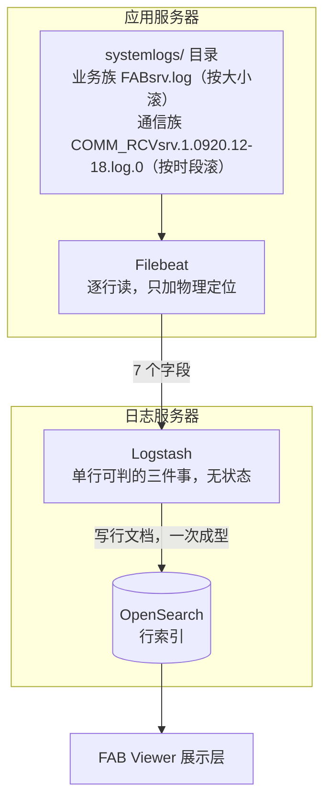

# 后台链路与数据模型 · 行文档

本文只讲一件事：一条日志怎么变成行文档，行文档长什么样。分三层——**采集（Filebeat）→ 加工（Logstash）→ 存储（OpenSearch）**，每层按「吃什么 / 怎么加工 / 吐什么」讲。

- 字段名就是落库名。
- **行文档写一次、不改**，是整条链路唯一的事实底稿。
- 派生层（块文档）、告警服务、业务字段解析不在本文范围，各有各的权威文档。

---

## 一、链路总览

### 1.1 链路图



### 1.2 每层吃什么 / 怎么加工 / 吐什么

| 层 | 组件 | 吃 | 怎么加工 | 吐 |
|---|---|---|---|---|
| **采集** | Filebeat | `systemlogs/` 下的 `.log` 与**全部**滚动件（业务族按大小滚、通信族按时段滚；FAB / LIST / COMM_RCV / COMM_SND / POLL 等多类 Server，各文件独立策略，§2.1） | 逐行读文件，**只有 `COMM_SND` 一族按时间戳做多行合并**；其余不改内容、不解析时间、不跨行、不认业务语义，只附物理定位与系统名 | 事件 7 字段（§2.3） |
| **加工** | Logstash | 采集层 7 字段 | 单行内可判的三件事：粗解析前缀、造行身份串、打消息类型标签 | **行文档**，一条物理行一篇（§3.3） |
| **存储** | OpenSearch | 行文档 | 按月切行索引；写一次、不改 | 可查询的行索引（字段见 `09` §三） |

### 1.3 分工判据

**只看一条判据：这件事，光看一行能不能办完。**

- **采集层**：什么都不解析，只搬字节 + 物理定位——它跑在应用服务器上，多吃一口都是业务风险。
- **加工层**：一行能判完的都在这里算一次，重放也不会再算。
- 要看见多行才能做的（切块、配对、解析业务参数），不在本文——那是派生层的事。

> 这条判据看的是「**语义上依赖什么**」，不只是「字面上要不要跨行」。业务参数解析字面上单行就能做，但它只在请求开始行上有意义，而「这行是不是请求开始行」是加工层打的标签、参数解析本身归派生层。

### 1.4 一条日志的旅程

后文拿这条**真实日志**对照（业务方给料原文，`FABsrv.10`）：

```text
08/11/26 17:19:49.38 FABsrv.10:FwEventManager:message to process: :>>L FwSrvExecuteRuleTxn msgTag=_INBOX.0A14232E.5C00D2590D367AF20D.1 ruleName=AMAJPJIJORULE attributes={ { class=ASSOC { class=A1 "PARAMETER" } { class=A1 "VALUE" } } … }
```

环境元信息（示意）：主机 `10.20.30.40`，文件 `FABsrv.log`，该行字节偏移 `8012000`。

| 阶段 | 产出 |
|---|---|
| 采集 | `message` = 原文一字不改；`log.file.fingerprint` = 文件指纹；`log.offset` = 8012000；`host.ip` = 10.20.30.40；`ENV` = PROD；`system.name` = MES-300Works |
| 加工 · 粗解析 | `LOG_TIME` = 2026/08/11 17:19:49.380；`SERVER_ID` = FABsrv.10；`LOG_BODY` = 去掉前缀的本体 |
| 加工 · 行身份串 | 行 `_id` = `PROD_10.20.30.40_<指纹前16位>_8012000_20260811171949380`（§3.2.2，不另存字段） |
| 加工 · 标签 | `MSG_KIND` = `REQ_BEGIN`（只判「这里是一条边界」） |
| 加工 · 写入 | 行文档以身份串作 `_id`，写一次，此后不再修改 |

---

## 二、采集层（Filebeat）

采集器直接跑在应用服务器上，它多吃掉的每一口都是业务的风险。所以这一层什么都不做：不做跨行的事，不做要缓存的事，不做要懂业务的事。

### 2.1 输入

**采什么**

| 项 | 内容 |
|---|---|
| 部署位置 | **多台物理独立主机，各自挂各自的日志盘**，采集路径统一为 `/mes/<env>/systemlogs/`。跑 `FABsrv` / `LISTsrv` / `QUERYsrv` / `OCAPsrv` / `TRANSsrv` / `XSITEsrv` / `IDEsrv` / `RTDLOGsrv` 等业务服务，以及 `COMM_RCVsrv` / `COMM_SNDsrv` / `POLLsrv` |
| 目录 | 各机器日志盘上的 `/mes/<env>/systemlogs/`——`PIRUN` → `/mes/pirun/systemlogs/`、`PROD` → `/mes/prod/systemlogs/`。**一个目录里并存多类 Server 的日志文件**（`FABsrv.log` / `LISTsrv.log` / …）。某台机器挂到别处，只改那台那份配置里的路径前缀（§2.4） |
| 文件 | `.log` 及其**全部滚动件** `.log.1` … `.log.N`，**一并纳入、不挑份数**。**两族命名并存**：**业务族** `<MBX 名>.<类别>srv.log[.N]`（如 `DT_PRD_MBX.FABsrv.log` / `.log.1`），**按大小滚**；**通信族** `<类别>srv.<编号>.<MMDD>.<起小时>-<止小时>.log.<编号>`（如 `COMM_RCVsrv.1.0920.12-18.log.0`），**按时段滚**。滚多大、滚多长、保留几份，由**各文件自己的配置**决定（10MB 只是其中一批的取值）。通信族编号**从 0 起**，会有 `.log.0` |
| 归档件 | 各自达到最大归档数后打包到文件存储服务器的文件——**最大归档数每个文件也不同**。**不回采**：只采 `systemlogs/` 下的活动件；若在**原地**压缩或改名，由采集配置的排除表挡掉（§2.4） |
| 不采 | 非 `systemlogs` 目录、不符合 `.log` 命名规则的文件、**已归档的文件**（打包搬走，或原地压缩 / 改名） |

**`systemlogs/` 里有什么，就采什么。** 一个目录、多类 Server，分三族：

| 族 | 服务 | 行首形态 |
|---|---|---|
| **业务族** | `FAB` / `LIST` / `QUERY` / `OCAP` / `TRANS` / `XSITE` / `IDE` / `RTDLOG` | `MM/dd/yy HH:mm:ss.cc <类别>srv.<编号>:` |
| **通信族** | `COMM_RCVsrv` / `COMM_SNDsrv` | 另一套前缀（§3.2.1.2），采进来只为**全量留存与检索**：一条记录行数固定——`COMM_RCV` 一个请求两行（收到、转发），`COMM_SND` 一次发送多行（报文跨行） |
| **定时器族** | `POLL` | 格式同业务族 |

- **每个文件一套自己的滚动策略，两种触发方式。** 业务族按**大小**滚（`.log` → `.log.1` …）；通信族按**时段**滚——每到一个时段换一个新文件，文件名写清哪天哪几个小时（滚动是改名 + 建新文件后立刻写下一行，开销常小于 10ms）。保留几份、时段多长由各 Server 自己配置，彼此不同——**统一按 10MB 理解是错的**。采集侧不读这些配置，也不假设大家一样。
- **采集规则是一个一个 Server 点名列出来的，不用目录通配。** 每个 Server 在采集配置里各占一行（`*FABsrv.log*` / `*LISTsrv.log*` / …，见 §2.4），**不写 `systemlogs/*.log*` 这种一把捞的写法**——没点到名的文件不会被采走。**每多一个 Server，就要在配置里加一行**；漏加不报错，只是那个 Server 的日志一直没人采。每行盖住该 Server 的 `.log` 与全部滚动件。
- **首次部署会自动补齐滚动件里的历史。** registry 为空时，Filebeat 会从头读每个现存文件，上线不用为 `.log.N` 单独跑补采。注意 `ignore_older` 一旦设值，比它更老的滚动件会被跳过。

**读到的原料**

| 输入 | 说明 |
|---|---|
| 文件行原文 | 一行一条，含行首时间戳前缀 |
| 文件元信息 | 路径、inode、当前读到的字节偏移 |
| 主机信息 | Filebeat 自动采集的主机 IP、主机名。**多网卡取哪一张不在采集层定**：采集层只带全部地址，由加工层按 CIDR 挑（§2.4 末） |
| 环境名 | `PIRUN` / `PROD`，**在 Filebeat 配置的 `fields` 里按日志目录写死**。理由：环境变量与链路口径的环境名不是一回事，且这类 source 变量**不是自动注入**的——读它等于把「采到的是哪个环境」押在运维当时有没有 source 过。同一台 AP（共享 IP）上两套环境并存时，一份 `filebeat.yml` 里按目录分两组 input、各带各的 `ENV`。**不能拿文件名当环境名**——业务族文件名 `DT_PRD_MBX` 里的 `PRD` 与链路口径的 `PROD` 不是一回事 |
| 系统名 | 采集器配置里的**常量** `MES-300Works`，随每行事件发出。用来把本系统日志与其他系统的日志分开（§2.3） |

滚动带来一个必须满足的前提：**Filebeat 必须跟得上滚动**。文件改名（`.log` → `.log.1`）那一瞬间采集要是落后，就会漏行。靠 Filebeat filestream 的文件身份（device + inode / 指纹）跟踪改名，不靠路径。

**全采滚动件不会把顺序搞乱。** 同一个 Server 的行会散在 `.log`、`.log.1` 好几个文件里；一次执行正好跨滚动点，行就跨文件。顺序在存储层还原时按 `LOG_FINGERPRINT` 分堆、堆间按文件时序、堆内按 `LOG_OFFSET` 排，拼出来就是写入顺序（§4.3），到达顺序交错无所谓。同一行被两个文件同时采到也不会变成两条：滚动是改名不是复制，两份文件装的是不同的行。

**部署注意。** 目录里的文件数是「服务族数 × 各自的滚动份数」，比只采 `.log` 时多好几倍——`harvester_limit` 取 **256**（理由见 §2.4），**部署前确认 `ulimit -n ≥ 4096`**。另外，**首次部署是一次性写入洪峰**：目录里所有现存滚动件会被一起读进来，上线窗口要留出写入余量。

### 2.2 加工逻辑

只做物理标注，不做任何语义加工：按行切，给每行标上「它来自哪个文件的哪个字节位置」，然后发送。三条约束：

| # | 约束 | 原因 |
|---|---|---|
| 1 | **按文件分组做多行处理：业务族不做，`COMM_SND` 要做** | 业务族与 `COMM_RCV` 每行自带前缀、不含跨行结构，不做 multiline 配置；**`COMM_SND` 的 XML 报文跨多行，必须合并**——规则是**行首是时间戳就另起一条，不是时间戳的行并入上一行** |
| 2 | 不解析时间戳 | 行首时间戳在加工层解析，采集层只搬字节 |
| 3 | 不缓存业务状态 | 唯一允许的状态是 Filebeat 自己的 registry（记录读到哪个位置） |

**不识别 Server ID / Rule 这类业务语义**——一旦识别，就等于把业务规则绑进跑在应用服务器上的组件，业务一改它就得跟着改。

**多行合并只在一个地方开、也只对它开。** 合并放在 Filebeat 的 `multiline` 配置上，**按 input 分开写**：业务族与 `COMM_RCV` 不配；`COMM_SND` 配 `pattern: '^\d{4}/\d{2}/\d{2} '` + `negate: true` + `match: after`（行首不是时间戳，就并进上一行）。合并之后一条记录仍是一条事件：`message` 里含换行，`log.offset` 取这条记录**首行**的偏移，`@timestamp` 也落在首行。加工层的行首解析因此只会见到「以时间戳开头」的行——这是「一条物理行 = 一篇文档」在通信族身上的唯一例外（§3.3）。

### 2.3 输出字段（全部产出，共 7 项）

| 输出字段 | 来源 | 说明 | 落到行文档 |
|---|---|---|---|
| `message` | 文件行原文 | 一字不改，含行首前缀 | `LOG_RAW` |
| `log.file.path` | Filebeat | 原文件绝对路径 | `LOG_FILE`（取文件名部分）。**通信族的 `SERVER_ID` 从这里推出来**：文件名开头到月日之前那一截——`COMM_RCVsrv.1.0920.12-18.log.0` → `COMM_RCVsrv.1`（§3.2.1.3） |
| `log.file.fingerprint` | Filebeat filestream（≥ 9.5，默认输出） | 文件身份 = **文件头 1KiB 内容的 SHA-256**。指纹跨滚动改名稳定、永不复用——新文件即使复用旧 inode，内容头不同即不同指纹，**inode 复用问题在采集侧根除**。**二级重排第一步按它分堆**（§4.3） | `LOG_FINGERPRINT`（keyword，64 hex；行身份串里取前 16 位） |
| `log.offset` | Filebeat | 该行在文件中的字节偏移。**二级重排第三步——同一堆内按它升序就是写入顺序**（§4.3） | `LOG_OFFSET` |
| `host.ip` | Filebeat | 主机 IP。**全部网卡**、不挑网段；挑的动作在加工层（§2.4 末） | 加工层按 CIDR 挑出 `HOSTIP` |
| `ENV` | 采集器配置 | 采集配置里的**常量**，跟日志目录绑定：哪组 input 采哪个目录，就写死哪个 `ENV` | `ENV` |
| `system.name` | 采集器配置 | 系统名，固定值 `MES-300Works`。不是从日志里解析出来的，也不随日志内容变 | `system.name` |

**为什么要有 `system.name`。** 这套链路的集群只服务 MES 一个系统，但采集器是**通用组件**——哪天别的系统也往同一个 OpenSearch 送日志，索引里就会混进两份来源。与其事后靠索引名或字段特征去认，不如在**源头**标死：每行都带系统名，查询侧一律带上这个 `term`，混进来什么都不影响结果。它是个常量、不是解析出来的，所以归采集层管，不归加工层。

**大小写敏感，统一写 `MES-300Works`。** `system.name` 落库是 `keyword`，`MES-300Works` 与 `MES-300works` 是两个不同的值，查询过滤会对不上。定值只此一处，采集配置与查询条件都照它写。

### 2.4 采集配置（Filebeat）

**落地位置**：`deploy/filebeat/filebeat.yml`。**部署形态**：多台**物理独立主机**，每台挂自己的日志盘，采集路径统一 `/mes/<env>/systemlogs/`；同一台机器上 `PIRUN` 与 `PROD` 两套环境的日志可能并存（共享 IP）。所以是**一台机器一份配置**——覆盖这台机器上的全部环境与全部服务族，机器之间只差 `output.logstash` 地址（哪台把盘挂到别处，只改那台那份的路径前缀）。

**环境名为什么写在配置里、不读环境变量。** 环境变量与链路口径的环境名不是一回事，而且这类 MBX 的 source 变量**不是自动注入**的——采集器去读它，等于把「采到的是哪个环境」押在运维当时有没有 source 过。**环境名是采集配置里的常量，跟日志目录绑死。**

**四组 input**（按「环境 × 处理方式」拆：两组 plain、两组 `COMM_SND`）：

| input id | 采什么 | 多行合并 | `ENV` |
|---|---|---|---|
| `mes-pirun-plain` | `PIRUN` 的业务族 + `POLL` + `COMM_RCV`（逐族显式列，天然不含 `COMM_SND`） | 否 | `PIRUN` |
| `mes-pirun-comm-snd` | `PIRUN` 的 `COMM_SNDsrv`（`*COMM_SNDsrv*.log*`） | **是**（§2.2） | `PIRUN` |
| `mes-prod-plain` | `PROD` 同左 | 否 | `PROD` |
| `mes-prod-comm-snd` | `PROD` 的 `COMM_SNDsrv`（`*COMM_SNDsrv*.log*`） | **是** | `PROD` |

- **`COMM_SND` 单独列出来，不靠排除规则**：plain 组把服务族一条一条写出（`*FABsrv.log*` / `*LISTsrv.log*` / … / `*RTDLOGsrv.log*` / `*POLLsrv.log*` / `*COMM_RCVsrv*.log*`），`COMM_SND` 根本不在清单里，两组路径天然不重叠、同一文件不会被两组同时采。
- **新增 Server 要跟着加配置**。`paths` 是**逐条枚举**的，不是目录通配——**每多一个 Server（或服务族），就得在对应那组 input 的 `paths` 里补一条**；漏加不会报错，只是那个 Server 的日志一直不被采集。同一台机器两个环境各一组，**两边都要加**。
- **单环境机器**：删掉另一环境的两组 input 就行；留着也只是空跑（路径不存在时只在 Filebeat 日志里提示一声）。
- **共享 IP 不影响唯一性**：两环境 `HOSTIP` 相同、`ENV` 不同，加上 `SERVER_ID` 仍唯一。

**机器与挂载点。** 主机是**物理独立**的、日志盘各挂各的，但**挂载点统一**：日志盘挂到 `/mes`，日志目录就是 `/mes/<env>/systemlogs/`。所以 `paths` 里写的就是这两个根，**一台机器一份配置**；哪台把盘挂到别处，只改那台那份的前缀。同一台机器上两个环境各占一个目录，目录名只是给人看的——**`ENV` 由它所在的那组 input 写死，不从路径反推**。

**归档件不回采。** 采集范围只到 `/mes/<env>/systemlogs/` 下的**活动日志**（`.log` 与滚动件 `.log.N`）。三种归档形态分开处置：

| 形态 | 怎么挡住 |
|---|---|
| 打包后**搬到文件存储服务器** | 天然不在范围内——`paths` 只盖住 `systemlogs/` 这一级，搬走了就够不着 |
| 留在原地**被压缩**（`FABsrv.log.1.gz` 之类） | `*` 通配会把压缩件一起匹配进来，必须靠 `prospector.scanner.exclude_files` 挡（下表）。**不加这条，就会被当成滚动件采走** |
| 留在原地**被改名**（`.bak` / `.old` / `.tmp` 之类） | 同上，同一张排除表兜住 |

现场若还有别的归档命名，**只往排除表里加一条**就行，别处不动。

**`harvester_limit` 取 `256`。** Filebeat 官方默认是 `0`（不限制）——目录被灌满时会把进程 fd 吃光，所以不取默认值。256 的来源：稳定态文件总数是「服务族数 × 各自的滚动份数 + 通信族按时段滚的文件」，量级几十到两百，常态不触顶；异常增长时让新文件**排队**而不是打爆 fd。**部署前确认 `ulimit -n ≥ 4096`**——fd 还要分给 registry、output 连接这些。

核心片段（完整版见配置文件；`mes-prod-*` 两组同形，只换路径与 `ENV`）：

```yaml
filebeat.inputs:
  - type: filestream
    id: mes-pirun-plain
    paths:                                   # 逐服务族显式列：除 COMM_SND 以外的全部
      - /mes/pirun/systemlogs/*FABsrv.log*
      - /mes/pirun/systemlogs/*LISTsrv.log*
      - /mes/pirun/systemlogs/*QUERYsrv.log*
      # … 其余业务族 / *POLLsrv.log* / *COMM_RCVsrv*.log* 同形，完整清单见配置文件
    prospector.scanner.exclude_files:        # 归档件不回采（§2.1）
      - '\.(gz|zip|bz2|xz|zst|tar|tgz)$'
      - '\.(bak|old|tmp)$'
    fields: {ENV: PIRUN, system.name: MES-300Works}
    fields_under_root: true
    ignore_older: 0                          # 禁用：首次部署要补齐全部现存滚动件
    tail_files: false
    # file_identity 用 9.x 默认的 fingerprint（文件头 1KiB 的 SHA-256，不再依赖 inode）；
    # include_file_fingerprint: true（9.5+ 默认）把指纹输出为事件字段 log.file.fingerprint
    prospector.scanner.check_interval: 5s
    close.on_state_change.renamed: false     # 滚动改名不关 harvester，继续读完
    close.on_state_change.inactive: 5m
    harvester_limit: 256

  - type: filestream
    id: mes-pirun-comm-snd
    paths:
      - /mes/pirun/systemlogs/*COMM_SNDsrv*.log*    # 唯一开合并的一组
    prospector.scanner.exclude_files:
      - '\.(gz|zip|bz2|xz|zst|tar|tgz)$'
      - '\.(bak|old|tmp)$'
    fields: {ENV: PIRUN, system.name: MES-300Works}
    fields_under_root: true
    multiline:                               # 只有这一组开
      pattern: '^\d{4}/\d{2}/\d{2} '
      negate: true
      match: after
      max_lines: 500
      timeout: 5s
    # 其余参数与上一组相同
```

**关键参数与理由**

| 参数 | 取值 | 为什么 |
|---|---|---|
| `check_interval` | `5s` | 默认 10s 对滚动跟踪偏慢；「Filebeat 必须跟得上滚动」是硬前提（§2.1） |
| `ignore_older` | `0`（禁用） | 一设值，比它老的滚动件就被跳过，与「首次部署补齐历史」冲突 |
| `tail_files` | `false` | 从文件头读，不跳历史 |
| `file_identity` | `fingerprint`（**9.x 默认**；**版本门槛 ≥ 9.5**） | 文件身份 = 文件头 1KiB 的 SHA-256：`include_file_fingerprint` 输出事件字段（9.5+ 默认 true）、`growing` 让不足 1KiB 的小文件先行采集。**指纹跨改名稳定、不复用——inode 复用问题在采集侧根除**。旧理由「追加型大文件读哈希不值」作废：哈希只算文件头一次，成本可忽略 |
| `close.on_state_change.renamed` | `false` | **漏行就出在这里**：改名（滚动）不该关 harvester |
| `close.*.removed` / `inactive` | `true` / `5m` | 文件被删就收手；没有新行的句柄 5 分钟回收，控住打开文件数 |
| `harvester_limit` | `256` | 官方默认 `0` = 不限制，目录灌满会打爆 fd；取值＝稳定态文件总数上浮，常态不触顶、异常增长时排队。**部署前提 `ulimit -n ≥ 4096`** |
| `prospector.scanner.exclude_files` | 压缩件 + `.bak` / `.old` / `.tmp` | 归档件不回采：`*` 通配会把 `.log.1.gz` 这类也匹配进来，不排除就会被当成滚动件采走 |
| `multiline` | **只给 `COMM_SND` 组** | §2.2 唯一的多行来源；业务族 / `COMM_RCV` / `POLL` 都不配 |
| `fields` + `fields_under_root` | 每组写 `ENV` 与 `system.name` | 落成**顶层**字段，正好是 §2.3 要的两项；若 `fields_under_root: false`，键会变成 `fields.ENV`，加工层对不上 |
| `add_host_metadata` | 开 | 提供 `host.ip`（**全部网卡**，多值）与 `host.name` |
| `queue.mem` | `4096` / `512` / `1s` | 输出抖动时不丢事件，又不无界占内存 |
| `output.logstash` | 多地址 + `loadbalance: true` + `ttl: 60s`；**端口 = MES 管道专用口**（§3.4，示例 5048） | 加工层多实例；`ttl` 让实例增减后一分钟内重新分配 |
| `filebeat.registry.path` / `flush` | 独立目录 / `1s` | registry 是采集进度的唯一凭据；`flush: 1s` 把重启后的重读窗口压到最小（重投递靠行 ID 去重，§3.2.2） |

**取 IP 这一步落在加工层，不在采集层。** 采集层只把 `host.ip` 全量带出来（多网卡就是多个值），**不挑网段**——`HOSTIP` 由加工层按 CIDR 从数组里挑出落在内网网段的那个（§3.4）。采集配置里没有网段这一项。

**自定义字段只加两个**（`ENV` / `system.name`）。Filebeat 自带的 `agent.*` / `ecs.*` / `host.*` / `log.file.*` / `input.*` 等元字段，一律由加工层裁掉、不进文档（见 `09` §三）。

---

## 三、加工层（Logstash）

### 3.1 输入字段

采集层的 7 个字段（§2.3），原样进来。其中 `system.name` 是常量，**加工层不解析它、也不改它**，只是跟着这一路带到行文档里，给后面的查询过滤用。

### 3.2 加工逻辑

就做三件事，件件都满足「只看这一行就能算出来」：

```text
原始行 ──① 粗解析行前缀──→ LOG_TIME + SERVER_ID + LOG_BODY
                  （行首 DTPFsrv + `Command mailbox name:` 那行还要再修一次 SERVER_ID）
       ──② 造行身份串────→ _id（五段拼接，不落字段；粗筛/翻页打 LOG_TIME）
       ──③ 打消息类型标签─→ MSG_KIND
                         ↓
                    写行文档
```

**加工层不解析业务参数。** 参数解析要看见整块才能做（只在请求开始行上有意义），不在这一层。写进行文档的只有原文与上面三件事的产物。

#### 3.2.1 ① 粗解析行前缀

`LOG_RAW` 原样保留，另外从行首前缀里抠出三样：**`LOG_TIME`**（数据自己带的时间）、**`SERVER_ID`**（身份）、**`LOG_BODY`**（剥掉前缀后的本体）。

**分两道做**：**第一道**解析行首前缀，两族各一套，按文件来源分流；**第二道**只管「行首是框架名 `DTPFsrv`」的那些行、只动 `SERVER_ID`——取到 `mailbox name` 就覆盖，取不到就留空（§3.2.1.3）。

**分流靠文件名，不靠猜。** `COMM_RCVsrv` / `COMM_SNDsrv` 的文件走**通信族**那套前缀，其余（业务族 + `POLL`）走**业务族**那套。判据是 `LOG_FILE` 的文件名前缀，**不搞试错匹配**——试错会把业务族里那些长得像的行错收进来。

行首一共三种形态，两族各管各的：

| 形态 | 例子 | 归哪一族 | 身份（`SERVER_ID`）从哪来 |
|---|---|---|---|
| 业务行 | `08/11/26 17:19:49.38 FABsrv.10:…` | 业务族（§3.2.1.1） | 行首 token，原样 |
| 启动行 | `08/11/26 17:00:18.62 DTPFsrv:…` | 业务族（§3.2.1.1） | 行内另取，第二道覆盖或留空（§3.2.1.3） |
| 通信行 | `2026/09/20 07:34:26.869 AMESPA01-68858 ::R:: RequestCallback:onCmMsg Received: …` | 通信族（§3.2.1.2） | 行内没有，从文件名取（§3.2.1.3） |

```text
LOG_RAW + LOG_FILE
   └─ 按文件名分流 ┬─ 业务族（其余）──────→ 2 位年 / 厘秒 / 行内带身份 ─┐
                   └─ 通信族（COMM_*srv）→ 4 位年 / 毫秒 / 行内无身份 ─┤
                                                                        ↓
                                              LOG_TIME / SERVER_ID / LOG_BODY
```

##### 3.2.1.1 业务族：月在前、两位年、厘秒、编号可省

**先说问题**

| # | 问题 | 不处理会怎样 |
|---|---|---|
| 1 | 日期是 `MM/dd/yy`——**月在前、日在中**、两位年、**不带时区** | 按国内习惯读会错位；按 UTC 解释整体偏 8 小时。`04/05/26` 错位后**仍是合法日期**，肉眼看不出来 |
| 2 | 小数位只有两位（`.54`） | 它是**厘秒**（= 540 ms）；当毫秒直读差 10 倍，解析不报错 |
| 3 | 服务名段的「`.编号`」是**可选**的 | 启动行（框架进程名、没编号）整行匹配不上 |
| 4 | 本体内部带冒号，还可能带 `FwEventManager:message to process:` | 末段截错，本体只剩前半截 |
| 5 | 存在**行首不是时间戳的纯文本行** | 行首没有时间可用 |

**解法 ① · 正则与 grok**

「`.编号`」那一截写成**可选**——启动行的行首是不带编号的框架进程名：

```regex
^(\d{2}/\d{2}/\d{2} \d{2}:\d{2}:\d{2}\.\d{2}) ([A-Za-z]+srv(?:\.[0-9]+)?):(.*)$
```

```
MES_RULE_LINE %{DATE_US:log_date} %{TIME:log_time}\.%{INT:log_cs} %{DATA:server_id}:%{GREEDYDATA:log_body}
```

两处写法不能错：

| 位置 | 必须写成 | 写错会怎样 |
|---|---|---|
| 末段 | `GREEDYDATA` | 用 `DATA` / `WORD` 会在 `FwEventManager:message to process:` 的第一个冒号处截断 |
| `server_id` 段 | `DATA`（非贪婪） | `WORD` 会被点号断掉（`FABsrv.63` 只取到 `FABsrv`）；`NOTSPACE` 会一路吃到最后一个冒号 |

产出：

| 产出 | 来源 |
|---|---|
| `LOG_TIME` | 行首时间戳，数据自身的时间。解析后按落库格式归一（解法 ③）。**行首解析不出前缀的行不解析，`LOG_TIME` 直接取采集时刻 `@timestamp`**（解法的 ⑤） |
| `SERVER_ID` | 行首 token 原样（如 `FABsrv.63`）；行首是 `DTPFsrv` 的行由第二道接走——取到 `mailbox name` 就覆盖，取不到就留空（§3.2.1.3） |
| `LOG_BODY` | 去掉前缀后的本体，内部仍含冒号 |
| （不落字段）行首是否框架名 | 行首 token 是否等于 `DTPFsrv`。**这是第二道的前置条件**，只在本行判定里用，不写成字段 |

**解法 ② · 时间有五个坑**

| # | 坑 | 后果 | 处理 |
|---|---|---|---|
| 1 | 月在前日在中（`04/27/26` = 4 月 27 日） | 按国内习惯读会错位 | 固定按 `MM/dd/yy` 解析 |
| 2 | 两位年份 | `26` 补成哪一年 | 定世纪补全阈值，如 `YY >= 70 → 19YY`，否则 `20YY` |
| 3 | 无时区信息 | 默认按 UTC 解释会整体偏 8 小时 | 解析时显式指定 `Asia/Shanghai` |
| 4 | 原始格式含 `/` | 直接当文件名非法 | 落库的文件名归一化为 `yyyyMMddHHmmss` |
| 5 | 小数位只有两位（`.54`） | 它是**厘秒**（= 540 ms）；当成毫秒直读会差 10 倍 | 按厘秒解释，入库时**补齐成三位毫秒**（`.54` → `.540`），见解法 ③ |

**解法 ③ · `LOG_TIME` 的落库格式：`yyyy/MM/dd HH:mm:ss.SSS`，保留厘秒**

| 项 | 值 |
|---|---|
| 业务口径 | `2026/08/11 17:19:49.38` |
| OpenSearch `format` | `yyyy/MM/dd HH:mm:ss.SSS` |
| 入库值 | `2026/08/11 17:19:49.380` |
| 为什么末段是三位 | Java 时间格式里的 `S` 是**毫秒数**。源串两位是**厘秒**，原样交给 ES 会被读成 `38 ms`（真值 `380 ms`）——与坑 1 / 坑 3 同类，**解析不报错，只是时间差了 10 倍**。所以解析时把两位厘秒补齐成三位毫秒，物理时刻不变 |

行 `_id` 的末段时间段也是它的 17 位毫秒紧凑形（§3.2.2）。

**解法 ④ · 静默错误要留验法**

坑 1 和坑 3 是**静默错误**：解析不报错，只是时间整体错位。像 `04/05/26` 这种月、日都 ≤ 12 的日期，错位之后还是个合法日期，肉眼看不出来。**上线前必须拿一条已知时间的真实日志，端到端验一次时间。**

**解法 ⑤ · 纯文本行（行首不是时间戳）——不解析、也不合并**

一行就是一条日志，内容可能就一句话；它是**正常输出、不是畸形数据**，也不需要合并。这类行**不解析**：

| 项 | 处置 |
|---|---|
| `SERVER_ID` | 留空 |
| `LOG_TIME` | 取 `@timestamp` 归一后的值 |
| 判据 | 「**行首不匹配前缀正则**」，**不是**「`LOG_TIME` 为空」——兜底之后这个字段永远非空 |
| 代价 | 时间基准换成了采集链路时钟，可能破坏同文件内的 `LOG_TIME` 单调性（§3.2.2）——它们 `SERVER_ID` 为空、进不了记录维度，哨子对它们单独计数 |
| 计数 | **按文件统计为存量、不报警**（§3.2.1.3 守门哨） |

`_id` 末段时间段怎么兜底、落库后有什么影响，统一写在 §3.2.2 末尾的「纯文本行兜底」。

##### 3.2.1.2 通信族：斜杠、三位毫秒、行内没有 `SERVER_ID`

**先说问题**

| # | 问题 | 不处理会怎样 |
|---|---|---|
| 1 | 前缀是**另一套**：四位年 + 斜杠 + 三位毫秒 | 沿用业务族正则，一行也匹配不上 |
| 2 | 段间是**空白**（现场实际是 Tab） | 写死 `\t` 时空格分隔的行不匹配；写死空格时反过来 |
| 3 | `COMM_SND` 的报文**跨多行**（采集层已并成一条，§2.2） | 末段截到第一个换行——合并进来的报文全丢、只剩首行 |
| 4 | 内置 `TIMESTAMP_ISO8601` 要求日期是**横杠** | 通信族是斜杠，对不上 |
| 5 | 行内**没有** `SERVER_ID` | 身份缺位（处置见 §3.2.1.3 来源 ③） |
| 6 | `::R::` / `::S::` / `::P::` 是方向标记 | 当开放文本落字段会撑爆 mapping |

**解法 ① · 正则与 grok**

这条正则匹配的是**合并后一条记录**的形态——`COMM_SND` 的报文被采集层并进了同一条里、正文带换行，所以末段写成跨行 `([\s\S]*)`；段间空白 `\s+`，Tab 和空格都吃得下：

```regex
^(\d{4}/\d{2}/\d{2}\s+\d{2}:\d{2}:\d{2}\.\d{3})\s+([A-Za-z0-9]+-\d+)\s+(::[RSP]::)\s+([\s\S]*)$
```

```
COMM_TS   \d{4}/\d{2}/\d{2}\s+\d{2}:\d{2}:\d{2}\.\d{3}
COMM_LINE %{COMM_TS:log_time}\s+%{DATA:proc_info}\s+%{DATA:dir_flag}\s+(?<log_body>[\s\S]*)
```

`COMM_LINE` 与 `MES_RULE_LINE` 并列，**按 input 分开挂**。

**解法 ② · 两个写法坑**

| 位置 | 必须写成 | 写错会怎样 |
|---|---|---|
| 段间空白 | `\s+` | 写死 `\t` 时空格分隔的行整条不匹配；写死空格时反过来 |
| 末段 | 跨行 `(?<log_body>[\s\S]*)` | 用 `GREEDYDATA`（等于 `.*`、不跨行）只吃到第一个换行——`COMM_SND` 合并进来的报文全丢、只剩首行（§2.2） |

**辅助模式 `COMM_TS`**：不能用内置 `TIMESTAMP_ISO8601`——它要求日期是**横杠**（`%{YEAR}-%{MONTHNUM}-%{MONTHDAY}`），通信族是**斜杠**，对不上。

**为什么末段不能沿用 `GREEDYDATA`**：它等于 `.*`，而 `.` 不匹配换行。通信族这条记录里带换行（§2.2 已合并），沿用只会把**首行**吃进 `log_body`、报文段全丢——报文全文只剩 `LOG_RAW` 里那一份，那里不可检索（`09` §三）。

**这一族的行首口径**

| 项 | 内容 |
|---|---|
| 行首形态 | `yyyy/MM/dd HH:mm:ss.SSS` + **空白** + **进程信息**（`<主机名>-<进程号>`，如 `AMESPA01-68858`）+ **空白** + `::R::` / `::S::` / `::P::` + **空白** + 日志本体（**可跨行**）。段间空白 **Tab 与空格都接受**（grok 写 `\s+`），现场实际是 Tab |
| 与业务族的三点不同 | ① 时间戳是**四位年 + 斜杠 + 三位毫秒**（业务族是两位年 + 厘秒）② 段间用**空白**，没有 `SERVER_ID:` 这样一段 ③ **行内没有 `SERVER_ID`** |
| `::R::` / `::S::` / `::P::` | **打标签、不落字段**：粗解析把行首第三段切进中间字段 `dir_flag`，按它打 `MSG_KIND` = `COMM_R` / `COMM_S` / `COMM_P`（判据见 §3.2.3）。三个方向是封闭枚举 ⇒ 直接做标签；`dir_flag` **判完即弃**，被 §3.4 的白名单裁掉、不进文档 |

##### 3.2.1.3 `SERVER_ID` 的解析（含第二道修正）

这一节把 `SERVER_ID` 的**三种来源**收在一起讲。它是 `SERVER_CATEGORY` / `SERVER_NUMBER` 的**唯一上游**，也是行身份里最容易出错的一位。

| 来源 | 什么时候用 | 从哪取 |
|---|---|---|
| ① 行首 token | 业务行（绝大多数） | 前缀正则里的 `server_id` 段，**原样** |
| ② 行内 `mailbox name:` | 行首是 `DTPFsrv` 的启动行 | `mailbox name: ` 后**第一个空白分隔的 token**，**覆盖**来源 ①；**取不到就留空**，不退回行首那个 `DTPFsrv` |
| ③ 文件名 | 通信族（行内没有身份） | `LOG_FILE` 文件名开头到「月日」之前那一截 |

**来源 ① · 行首 token。** 第一道正则已经切出来了，**原样取、不做形态校验**，直接进下面的反推。

**来源 ② · 启动行处置（第二道）。** 第二道只看一个前置条件——**行首 token 是 `DTPFsrv`**；命中后有两条出口：行内含 `Command mailbox name:` 就**覆盖**，取不到就**留空**。同一台服务器启动时前后相邻的两行（业务方给料原文），**只有第一行需要处置**：

```text
08/11/26 17:00:18.62 DTPFsrv:FwServerBase::processArgv:Command mailbox name: FABsrv.25
08/11/26 17:00:18.66 FABsrv.25:FABsrv.25:Connected to database.
```

| 行 | 行首拿到什么 | 要不要修 |
|---|---|---|
| `Command mailbox name:` | `DTPFsrv`——框架进程名，**没有实例编号** | **要修**。真正的实例 `FABsrv.25` 在 `mailbox name: ` 后面 |

规则：

> 若**行首 token 是 `DTPFsrv`**：行内含 `Command mailbox name:` ⇒ 取 `mailbox name:` 后**第一个空白分隔的 token** 作为 `SERVER_ID`，**覆盖**行首取到的值；**取不到 ⇒ `SERVER_ID` 留空**，不退回行首那个 `DTPFsrv`。

| 项 | 说明 |
|---|---|
| 取值规则 | **恒等**——`mailbox name` 是什么，`SERVER_ID` 就是什么，**不做形态校验**，也不做二次推断 |
| 覆盖范围 | 只覆盖本行。每行独立判定，不做状态记忆——这是单行可判的事，留在加工层 |
| 第二道的两种出口 | ① **命中 `mailbox name:`** ⇒ 覆盖为实例名；② **取不到** ⇒ `SERVER_ID` **留空**，不退回 `DTPFsrv`（按协议第 ② 种不该出现，出现就是异常，落进守门哨）。行首不是 `DTPFsrv` 的行，第二道根本不碰，行首值原样保留（业务行，**绝大多数行走这条**） |
| `SERVER_CATEGORY` / `SERVER_NUMBER` | 用**处置后**的 `SERVER_ID` 反推（`FAB` + `25`）。**没有实例名的行不反推**——行首 `DTPFsrv`、第二道又取不到 `mailbox name` 的行已留空，拿 `DTPFsrv` 直接推只会得到 `DTPF` + 空编号这种垃圾值 |
| 行首那个值 | **不存**。它是框架进程名，不代表实例；真要追，原文就在 `LOG_RAW` 里 |

**为什么第二道要加行首条件。** 判据若只有「行内含 `Command mailbox name:`」一条，会**对所有 server 生效**。`DTPFsrv` 是框架名、运行期不打行，行首 `DTPFsrv` 是「这一行属于启动序列」的**干净信号**，可以当前置条件；不能保证「行首是实例名、行内却含 `mailbox name`」不存在（还有其他 server），只看行内容会**误改别人的 `SERVER_ID`**。

**为什么必须修，不能将就。** `SERVER_ID` 是行身份和检索分组维度的一部分。启动行若带着 `DTPFsrv` 进链路，它会**自成一条假记录**，而且这行的 `SERVER_CATEGORY` 反推出来也是垃圾值。**所以取不到 `mailbox name` 时宁可留空**——留空的行 `SERVER_ID` 缺位、只累加计数；带着 `DTPFsrv` 进去反而安安静静造出一条假身份，比留空更坏。

这一条的验法：拿一条真实启动行过一遍粗解析，看落库的 `SERVER_ID` 是不是 `FABsrv.NN`。

**来源 ③ · 通信族取文件名。** 通信族行内没有身份，文件名是唯一来源——这也是「不从文件名取 `SERVER_ID`」的**唯一例外**（业务族反过来：行内给得出实例名，文件名只有类别、给不出编号）。

| 项 | 内容 |
|---|---|
| 从哪取 | 文件名**开头到「月日」之前那一截**——`COMM_RCVsrv.1.0920.12-18.log.0` → `COMM_RCVsrv.1`。**带编号**，与 `FABsrv.25` 同形，`SERVER_CATEGORY` / `SERVER_NUMBER` 照常反推 |
| 为什么这里可以 | 行内没有身份可用，而文件名**带编号**（业务族的文件名不带编号、推不出编号，所以业务族只能从行内取） |
| 取不到时 | 文件名不符合 `COMM_*srv.<编号>.<MMdd>.<起>-<止>.log.<编号>` 形态 → `SERVER_ID` 留空、只计数。**与业务族纯文本行不同**：通信行的行首形态照旧能解析，`LOG_TIME` 取的是行首真值、不走兜底 |

**反推 `SERVER_CATEGORY` / `SERVER_NUMBER`**

这两个字段都不单独采，一律从**最终的** `SERVER_ID` 上切出来。形态定死为 `<类别>srv.<编号>`：

```regex
^(.+?)srv(?:\.(\d+))?$
```

| 最终的 `SERVER_ID` | `SERVER_CATEGORY` | `SERVER_NUMBER` | 场景 |
|---|---|---|---|
| `FABsrv.63` | `FAB` | `63` | 业务行常态 |
| `FABsrv.25` | `FAB` | `25` | 启动行经第二道修正后的值 |
| `COMM_RCVsrv.1` | `COMM_RCV` | `1` | 通信族，身份来自文件名（来源 ③） |
| `LISTsrv.3` | `LIST` | `3` | 其余业务族同形 |
| `FABsrv` | `FAB` | 空 | 编号缺失：类别照取、编号留空 |
| 空（`DTPFsrv` 启动行取不到 `mailbox name`） | 空 | 空 | 第二道取不到就留空，不反推；计入守门哨 |
| 空（纯文本行） | 空 | 空 | 不反推 |

四条口径：

- **一次切分，不做二次推断。** `srv` 之前那一截**整段**就是类别（`COMM_RCVsrv.1` 的类别是 `COMM_RCV`，不是 `RCV`），最后一个 `.` 之后的纯数字就是编号。**不拿白名单校验类别**——`FAB` / `LIST` / `COMM_RCV` … 这个集合还会继续长，新类别零配置。
- **取值原样，不做大小写归一。** `LISTsrv.3` 的类别就是 `LIST`，既不转小写也不转大写——它是 `keyword`，筛选用它时逐字匹配。真出现同一类别两种写法（大小写分裂），再补一条归一化规则（外置配置），不在链路里猜。
- **必须先处置、后反推。** 行首 `DTPFsrv` 的行，等第二道把 `SERVER_ID` 换成 `FABsrv.25` **之后**再反推；**取不到 `mailbox name`、`SERVER_ID` 留空的行不反推**。
- **推不出来就留空，不兜底。** 不写 `UNKNOWN` / `-` 这类占位。编号为空只说明「这个 `SERVER_ID` 里没有编号」，**不影响该行落库与检索**——类别与编号只是分组维度，`SERVER_ID` 本身才是身份。

**守门哨**

行形态是协议约定，不是物理性质。真出现匹配不上的行，症状固定落在**结果的 `SERVER_ID` 为空**上。判据只看结果，不能拿 `LOG_TIME` 为空来判：纯文本行的 `LOG_TIME` 已有 `@timestamp` 兜底、永远非空。所以自监控加一条零成本的守门哨：

| # | 哨 | 为什么 |
|---|---|---|
| 1 | **结果的 `SERVER_ID` 为空的行数** | 判据只看结果。行形态是协议约定、不是物理性质——拿形态做判据，就得给每种异常单列一条；落在结果上，一条管住全部。来源 ② 取不到 `mailbox name` 的行也已留空，同样落进这一格。两种来源分开看：**业务族的纯文本行**（业务方确认为正常输出）**按文件统计为存量**；**通信族的文件名不符合命名式样**才算异常。哨子本身只做计数 |

**这条哨只作自监控计数**。它反映的是框架层的问题，不是业务异常。**命中的行视为不匹配任何数据**——不落任何业务维度，只累加计数、**不落库**（自监控指标层本期不做）。

#### 3.2.2 ② 行身份串（`_id`）

每行落地时只算**一个身份串**，它当 `_id` 用，**不另存为文档字段**：

| | 行身份串（`_id`） |
|---|---|
| 组成 | `ENV` + `HOSTIP` + `LOG_FINGERPRINT` 前 16 位 + `LOG_OFFSET` + `LOG_TIME` 的 17 位毫秒串（`yyyyMMddHHmmssSSS`），**段间用 `_`** |
| 回答 | 这是哪一行 |
| 举例 | `PROD_10.20.30.40_3f2a9c1d0b7e4f68_8012000_20260811171949380` |
| 用途 | 行文档 `_id`、幂等去重；**比对与区间截断直接读搜索结果每条 hit 自带的 `_id`** |

- **为什么不再落字段：** 搜索结果的每条 hit 天然带 `_id`（同一个值）——区间截断、锚点比对全部从 `hit._id` 读。省一份 keyword 倒排 + `_source` 里的重复存储。构造在加工层现算现用（管道中间字段，被白名单裁掉，§3.4）。
- 五段值域都不含 `_`（字母 / 点分数字 / hex / 数字 / 数字），拼出来可唯一还原；只当 `_id` 与 `ids` 点查用，不需要人读。第三段取**指纹前 16 位 hex**（64 bit，文件数量级下碰撞可忽略；完整 64 hex 存在行文档 `LOG_FINGERPRINT` 里）。
- **末段时间段（17 位毫秒）的来历。** inode 时代它是防复用补丁；指纹身份永不复用后此动机消失，保留作**唯一性余量**。精度取毫秒（17 位）而非旧 `SORT_KEY` 的厘秒（16 位），唯一性更强。
- **它不能比大小。** 哈希段无序，拿它排序等于随机排——顺序从来不由它承担（§4.3）。

**区间粗筛与翻页直接打 `LOG_TIME`（`SORT_KEY` 退役）。** 原来由 `SORT_KEY` 承担的两件事，`LOG_TIME`（date）全程接管，且粒度从厘秒升到毫秒：

- **粗筛**：行查询的 `range` 打 `LOG_TIME`；同毫秒多带的行，交回还原后由排序与行 ID 截断（§4.2）。
- **翻页**：分页排序 `[LOG_TIME 升序, _doc 升序]`，`search_after` 带两个值——`LOG_TIME` 同值时靠 `_doc` 补；`_doc` 在单分片索引内全局唯一（行索引 1 分片，`09`），分片数一旦大于 1 这个 tie-break 要换。
- **为什么粗筛打 `LOG_TIME` 而不是 `@timestamp`：** 它是行级属性、加工层零状态就能拿到；它表达的就是日志写入时刻——回采历史滚动件时老行落回自己的位置，不被打上「现在」；它与链路快慢完全解耦。

**用 `LOG_TIME` 的一个已知弱点与它的守门哨**

| 弱点 | 表现 | 处置 |
|---|---|---|
| 时间来自业务机时钟 | 时钟被校正或人工改动、或应用异步写日志时，同一文件内 `LOG_TIME` 可能不再随偏移递增 | 加一条守门哨：同一 `LOG_FINGERPRINT` 内按 `LOG_OFFSET` 升序，`LOG_TIME` 必须单调不减，违例按文件计数。**不做自动修复**——值已经写进索引，改不回来，只能靠这条哨把它暴露出来 |
| 纯文本行的时间来自采集链路而不是业务机 | 这类行的 `LOG_TIME` = `@timestamp`（采集时刻），几乎必然晚于同文件里相邻那几行自带的日志时间，夹在中间就是一记**假回跳** | 单调性那条哨子**对这类行不做判定、单独计数**（判据是「该行没有行首时间戳」，不是「`LOG_TIME` 为空」）。它们 `SERVER_ID` 为空、不进任何检索维度，回跳也不影响还原顺序 |

它只影响「顺序」，不影响「区间完整性」——粗筛照旧不漏行。

**纯文本行兜底（行首解析不出前缀的行怎么办）**

业务方补料确认过：**业务族里一行就是一条日志**，但不是每一行的行首都是时间戳——有的行就是一整句纯文本。这类行**不解析**，落到行文档上时按下面五条办：

| 项 | 取值 |
|---|---|
| 解析 | **不做**。不打 `MSG_KIND` 标签、不取 `SERVER_ID`、不做任何跨行判断 |
| `LOG_TIME` | **直接取该行的采集时刻 `@timestamp`**。注意 `@timestamp` 是 UTC 的 ISO 串，要**按 `LOG_TIME` 的落库格式（`yyyy/MM/dd HH:mm:ss.SSS`、本地时区）归一后写入**，不能原样塞进去 |
| `_id` 末段 | 照 §3.2.2 的规则从 `LOG_TIME` 造（17 位毫秒串），自然等于 `@timestamp` 归一后的紧凑形——「兜底在 `LOG_TIME` 上、串从 `LOG_TIME` 造」是一条链，改一处就够 |
| `SERVER_ID` | **留空**。`SERVER_ID` 缺位，进不了按服务的检索维度 |
| 落库与检索 | **照常落行文档、全文检索搜得到**，`LOG_RAW` / `LOG_BODY` 与别的行一样 |

判定这类行的**依据是「行首不匹配前缀正则」，不是「`LOG_TIME` 为空」**——兜底之后这个字段永远非空，拿它当判据，会把纯文本行与真正的异常行混在一起；§3.2.1.3 那条守门哨因此只看结果的 `SERVER_ID`。

代价有两条：一是这类行的时间基准换成了采集链路时钟，可能破坏同文件内的 `LOG_TIME` 单调性（见上面「已知弱点」表最后一行）——它们不进任何维度，回跳不影响还原顺序，哨子对它们单独计数。二是 Filebeat 重启重读这类行时，`LOG_TIME`（= 采集时刻）变了、`_id` 跟着变，**同一行会多出一篇**——这类行 `SERVER_ID` 为空、影响面只在存量计数，按可接受处理（§3.4）。

#### 3.2.3 ③ 打消息类型标签（`MSG_KIND`）

加工层给每一行打一个「这行是什么」的枚举标签。它是行文档的一个字段，每行**只打一个**，规则链第一个命中即停（§3.4）。

**标签表**

| `MSG_KIND` | 判据（行内含，除注明外） | 落行级字段 |
|---|---|---|
| `REQ_BEGIN` | `FwEventManager:message to process: :>>L` 或 `:>>T` | — |
| `SERVER_START` | 行首 token = `DTPFsrv` **且**行内含 `Command mailbox name:`（两个条件同时成立） | 顺带修正 `SERVER_ID`（§3.2.1.3） |
| `PUB_SEND_SMALL` | 行首 `server_id` 非空且不以 `COMM_` 开头，且行内含 `FwPublication::sendSmall:\d+ byte msg .*? reply is \S+` | — |
| `CALL_REQ` | `IntUtil::sendMessage:### xmlData for sending to (\S+)`；或 RTD / SPC 两个通道的锚点 | `CALL_SYS` |
| `CALL_RSP` | `IntUtil::sendMessage:### Received Message from (\S+)`；或 RTD / SPC 返回锚点 | `CALL_SYS` |
| `CALL_NOWAIT` | `IntUtil::sendMessage:### Waiting time for (\S+):0$` | `CALL_SYS` |
| `CALL_WAIT` | `IntUtil::sendMessage:### Waiting time for (\S+):\d+` | `CALL_SYS` |
| `CALL_ERR` | `IntUtil::sendMessage:ERROR -`（判据只取前缀） | `ERR_CODE`（`match_all`，见下） |
| `LOCK_BEGIN` / `LOCK_END` | `\bLOCK (?P<OBJ>\w+) OBJECT START/END(?:\s+\w+:(?P<ID>\S+))?` | `LOCK_OBJ` / `LOCK_ID` |
| `RULE_ERR_LINE` | `Error\(([^)]+)\)`（**首字母大写 `Error`**，一行多个全局匹配） | `ERR_CODE`（多值，保留出现顺序、不去重） |
| `RULE_REPLY` | `ExecuteRuleTxn::store:rule reply =\s*(\S+)\s*$` | `RULE_RESULT`（原样） |
| `INNER_RULE_START` / `INNER_RULE_END` | `fwsrvExecServerRule:start / finish executing rule (\S+)`（**小写 `f`**） | `INNER_RULE_NAME` |
| `COMM_R` / `COMM_S` / `COMM_P` | 粗解析切出的中间字段 `dir_flag` 分别 = `::R::` / `::S::` / `::P::`（**相等比较**，排规则链最前） | —（`dir_flag` 判完即弃） |
| `OTHER` | 以上都不是 | — |

**设计范式：值进字段，不进标签。** 标签只表达**类别**（封闭枚举，越少越稳），会持续长大的取值放**行级字段**（开放集合，不设清单）：

| 标签 | 开放取值落到哪 | 加取值要改什么 |
|---|---|---|
| `CALL_REQ` / `CALL_RSP` / `CALL_NOWAIT` / `CALL_WAIT` | `CALL_SYS` | 零配置 |
| `LOCK_BEGIN` / `LOCK_END` | `LOCK_OBJ`（+ `LOCK_ID`） | 零配置 |
| `RULE_ERR_LINE` | `ERR_CODE` | 零配置 |
| `RULE_REPLY` | `RULE_RESULT` | 零配置 |
| `INNER_RULE_START` / `INNER_RULE_END` | `INNER_RULE_NAME` | 零配置 |

若把取值写进标签（`CALL_SPL_REQ` …），每加一个子系统就要动标签枚举、动 mapping、动配置——维护成本跟着子系统数线性涨。`COMM_R` / `COMM_S` / `COMM_P` 不违反这条范式：三个方向是协议定死的**封闭枚举**（不会长），也没有别的取值要落字段，所以直接做标签。

**几条判据的为什么**

- **`REQ_BEGIN` 只认两个字面量，后面跟什么都不看。** 方法名区分不出形态（标准 API2 与 XML 用同一个方法名），且前缀随服务而异（`FwSrvExecuteRuleTxn` / `FwLISTSrvExecuteRuleTxn`），拿它当判据就得给每个服务写一条。通信族里出现的 `>>L …`（`COMM_RCV` 的转发行、`COMM_SND` 的报文体）不带 `FwEventManager:message to process: ` 这一段，两个判据都不会误命中。
- **`SERVER_START` 两个条件同时成立才打标签。** 单看行内 `Command mailbox name:` 会对**所有 server** 生效；`DTPFsrv` 是框架名，把行首当**护栏**只动框架行。这行同时被粗解析用来修正 `SERVER_ID`（§3.2.1.3），两个动作共用同一个条件。`Connected to database.` 不当启动标志：它与启动行不是同一行，而加工层逐行视角、没有状态，落成独立规则就变成「无条件也算启动」。
- **`RULE_REPLY` 判据取共同后缀。** `ExecuteRuleTxn::store:rule reply =` 是各服务族执行器方法名的共同后缀——`FABsrv` 侧写 `FwSrvExecuteRuleTxn`、List 侧写 `FwLISTSrvExecuteRuleTxn`，前缀随服务变、后半段不变。去掉前缀后一条规则覆盖两种写法，不必按服务各加一条。
- **`INNER_RULE` 前缀是小写 `f` 开头的 `fwsrvExecServerRule`**，与请求开始行那个大写 `F` 的 `FwSrvExecuteRuleTxn` 不是同一个方法名，别当成笔误改齐。
- **两类错误别混在一起。**

| | **MES 业务错误** | **Oracle 错误** |
|---|---|---|
| 形态 | `Error(<数字>-<数字>)` | `ORA-00001: unique constraint violated` 这类 |
| 在链路里 | 打 `MSG_KIND = RULE_ERR_LINE`，错误码进 `ERR_CODE` | **不打任何标签**（落 `OTHER`），就是一行普通文本 |
| 能否按结构检索 | **能**：有标签、有 `ERR_CODE` 字段，可按字段精确筛选 | **不能**：无标签、无字段，只能按 `LOG_BODY` 文本命中 |

`RULE_ERR_LINE` 只覆盖 MES Rule 的业务错误；按 `LOG_BODY` 做行文本命中（`match_phrase`）的那条路**不读 `MSG_KIND`**，两类错误互不干扰。标签名定为 `RULE_ERR_LINE` 而不是 `ERROR_LINE`，正是为了把「只覆盖 MES Rule 的业务错误」写进名字里。

**分类规则不写死在 pipeline 里，走外置配置**（`fabviewer.yaml` 的 `msg_kinds` 段，§3.4）。新增一个标签 = 加一条配置，不改代码。

### 3.3 输出字段（行文档）

一条物理行一篇文档，写入后不再修改。字段类型与含义见 `09` §三（本节只讲怎么赋值）。

| 字段 | 来源 |
|---|---|
| `ENV` / `HOSTIP` / `SERVER_ID` / `SERVER_CATEGORY` / `SERVER_NUMBER` | 采集 + 粗解析。**`SERVER_ID` 以修正后的值为准**，类别与编号再从它反推（§3.2.1.3） |
| `system.name` | 采集层。常量 `MES-300Works`，加工层原样透传 |
| `LOG_TIME` | 粗解析，落库格式 `yyyy/MM/dd HH:mm:ss.SSS`（保留厘秒，§3.2.1）。**区间粗筛与翻页的直接载体（§3.2.2）**。**行首解析不出时取 `@timestamp` 归一后的值**（纯文本行，§3.2.1.1 解法 ⑤） |
| `LOG_FILE` / `LOG_FINGERPRINT` / `LOG_OFFSET` / `LOG_RAW` | 采集层 |
| `LOG_BODY` | 粗解析。唯一需要分词的字段 |
| `MSG_KIND` | §3.2.3 |
| `CALL_SYS` | §3.2.3。**仅调用类行有值**（`CALL_REQ` / `CALL_RSP` / `CALL_WAIT` / `CALL_NOWAIT`），如 `SPL` / `R2R`；`CALL_ERR` 行不带。开放集合，不设清单 |
| `LOCK_OBJ` | §3.2.3。**仅锁类行有值**（`LOCK_BEGIN` / `LOCK_END`），如 `LOT` / `CARRIER` / `EQP`。开放集合，不设清单 |
| `LOCK_ID` | §3.2.3。**仅锁类行有值**，尾巴 `LOTID:` / `CARRIERID:` / `EQPID:` 之后的值，如 `P1H5486` / `AEASH01`。开放集合、**形态不固定** |
| `ERR_CODE` | §3.2.3。**仅报错行有值**（`RULE_ERR_LINE`），如 `1234-5678`。一行可多个，**保留出现顺序、不去重**。它只表示「这一行报了错」 |
| `RULE_RESULT` | §3.2.3。**仅结果行有值**（`RULE_REPLY`），取值取自日志原文并**原样落库**（`PASS` / `CANCELRULE` / …）。开放集合，不设清单 |
| `INNER_RULE_NAME` | §3.2.3。**仅内部 Rule 起止行有值**（`INNER_RULE_START` / `INNER_RULE_END`），如 `EAPReqJobInEx`。开放集合，不设清单 |

行文档**不存**任何业务参数（`RULENAME` / `LOTID` 等）、块 ID、块首行 ID。参数解析归派生层，块级字段存进行文档就要回写。

**一行提醒**：行文档上根本没有块级业务字段。任何消费方要用它们，必须另找来源，不是读行文档。

**还有一个不由加工层产出的字段：`@timestamp`。** 它是**摄入时间**，由采集 / 加工组件在写入时自动打上、ES 自动建映射，加工层不需要产出。**它不是日志自己的时间**——日志时间在 `LOG_TIME`，两者用途不同：

| 字段 | 是什么 | 用来干什么 |
|---|---|---|
| `LOG_TIME` | 日志行首那个时间戳，业务机写日志的时刻 | 耗时计算、**区间粗筛与翻页的载体**、行 `_id` 末段的来源（§3.2.2） |
| `@timestamp` | 日志落进链路的时刻 | 所有时间窗。**兼作纯文本行的 `LOG_TIME` 兜底**（§3.2.1.1 解法 ⑤） |

时间窗一律打 `@timestamp`，因为业务机的时钟可能偏移——窗口打在 `LOG_TIME` 上，采集延迟一大就漏判，而且不报错。

### 3.4 加工配置（Logstash）

**落地位置**：`deploy/logstash/`。**部署形态**：接在采集层后面（`beats` 输入对应 Filebeat 的 `output.logstash`），可多实例、可单机。**现场按追加部署**：本链路自己的文件全放新目录 `/etc/logstash/conf.d/mes-conf/`，与现有系统互不干扰——`pipeline/*.conf`、`fabviewer.yaml` 与 `tools/` 一并拷进去；`patterns/mes` 进同一基础路径下的 `patterns/`（`20-parse.conf` 里的 `patterns_dir` 写死 `/etc/logstash/conf.d/mes-conf/patterns`）；`conf/pipelines.yml` 那一段**追加**到现场 `/etc/logstash/pipelines.yml` 末尾、`conf/logstash.yml` 只补缺的开关，不覆盖现场已有配置。**日常改规则只动 `fabviewer.yaml` 并重跑渲染**，不碰 conf。

**端口原则**：追加部署下同一实例还跑着现有系统的管道，**多管道靠端口物理分道**——`mes-lines` 管道的 `beats` 输入必须绑 **MES 专用口**（示例 `5048`），现场现有管道一律不动；`5044` 是 beats 默认口、大概率被占用，**部署时逐台核对、不得共用**。配套两层：Filebeat 的 `output.logstash` 指向该专用口；`15-guard.conf` 守门哨判 `system.name` 兜底（非 MES 事件丢弃并计数，不落库）。**不用 `type` / `tag` 在管道内区分来源**：那要求现有管道对称加过滤、违背「不动现有」的原则。

**文件构成**

| 文件 | 作用 |
|---|---|
| `conf/logstash.yml` | 管道行为与队列 |
| `conf/pipelines.yml` | 只声明一条管道（`mes-lines`）；`path.config` 用 glob，**按文件名顺序**拼接 `10 → 20 → 30 → 40 → 50`；DLQ 开关写在节点内 |
| `conf/jvm.options` | 堆（**新装独立实例**才用；追加部署**不动现场实例**的 JVM 配置） |
| `patterns/mes` | 两套行首 grok，外置（§3.2.1） |
| `pipeline/10-input.conf` | `beats` 输入——**MES 专用端口** |
| `pipeline/15-guard.conf` | **守门哨**：`system.name ≠ MES-300Works` 的事件直接丢弃、不进解析不落库——防端口误接的兜底 |
| `pipeline/20-parse.conf` | 粗解析第一道：按文件名分流两套前缀，产出时间段与 `LOG_BODY` |
| `pipeline/30-msgkind.conf` | **生成物**——由 `tools/render_msgkinds.py` 从 `fabviewer.yaml` 渲染，别手改 |
| `pipeline/40-derive-fields.conf` | 时间、`SERVER_ID` 修正与两个派生字段、`HOSTIP`、行键、**字段白名单** |
| `pipeline/50-output.conf` | 写行文档 |
| `fabviewer.yaml` | 加工层标签规则源，只有 `msg_kinds` 一段（派生层参数不在此维护）。Logstash 不直接读它——读的是渲染出来的 conf |
| `tools/render_msgkinds.py` | 渲染脚本；`--check` 只校验生成物与 yaml 是否一致（挂 CI 用） |

**两套前缀按文件名分流，不试错。** `^COMM_(RCV|SND)srv` 的文件走 `COMM_LINE`，其余（业务族 + `POLL`）走 `MES_RULE_LINE`（§3.2.1）。**解析不出来的就是纯文本行**：不打标签、`SERVER_ID` 留空、`LOG_TIME` 取 `@timestamp` 归一，但 `LOG_BODY` 照旧等于原文——这类行也要能全文检索到（§3.2.1.1 解法 ⑤）。

**标签规则外置、可热加载。** `pipeline/30-msgkind.conf` 是**生成物**：改 `fabviewer.yaml` 的 `msg_kinds` 段 → 重跑 `render_msgkinds.py` → `logstash.yml` 里开着 `config.reload.automatic: true`，3 秒内生效。加一条标签规则不改代码、不重启进程。渲染时做三件事：把 `capture` 写的字段名转成 grok 的命名捕获、把 `set` 写成常量、把 `match_all` 写成多值扫描；**多条规则按 yaml 顺序生成 `if / else if` 链——第一个命中即停**，对应「每行只打一个标签」。

**字段白名单不是可选项。** 行索引模板是 `dynamic: strict`（`09` §三），多出一个字段，整篇写入失败。所以 `40-derive-fields.conf` 末段按模板字段表做一次裁剪：Filebeat / Logstash 的元字段（`host` / `agent` / `ecs` / `log` / `input` / `event` / `tags`）与中间字段（`log_date` / `log_time` / `log_cs` / `server_id` / `proc_info` / `dir_flag`）全部清掉，只留 `09` §三那 **20 个字段**（与行模板 `properties` 数一致）。**`@timestamp` 在裁剪里必须保留**——它是所有时间窗的落点（§3.3）。**ECS 兼容口径写在 `pipeline/50-output.conf`（`ecs_compatibility => disabled`），`conf/logstash.yml` 留实例级兜底**——开着的话 Logstash 会自己补 ECS 字段，白名单就白做了。

**时间与 `HOSTIP` 的两条硬约束。**

| 项 | 做法 | 为什么 |
|---|---|---|
| 时区 | **不动现场实例的 `jvm.options`**：时间全部在管道里显式按 `+08:00` 构造 | 业务族时间戳不带时区（§3.2.1.1 坑 3）；显式构造就不依赖运行环境的 JVM 时区，也不用去改别人整个实例的设置 |
| 厘秒 | 业务族两位**厘秒补齐成三位毫秒**再落 `LOG_TIME` | 落库格式只有一种（`yyyy/MM/dd HH:mm:ss.SSS`），range/sort 都按 date 走（§3.2.2） |
| `HOSTIP` | 从 `host.ip` 数组里按 **CIDR** 挑内网那个；网段是 pipeline 里的常量（默认 `10.18.0.0/16`），按现场改 | 采集层带全部网卡、不挑网段（§2.3）；挑的动作在加工层 |

**索引名与文档 id。** 行索引 `mes-log-line-{yyyy.MM}`（**不带环境段**：环境由框架 `prefix` 前置区分，§4.1），**月份取 `LOG_TIME` 的月份**——回采历史滚动件时，老行落回它自己那一个月，而不是全挤进当月索引（§4.1）。`_id` = 行身份串，`action = index`：同一行重复投递（Filebeat 重投、Logstash 重放）覆盖成同一篇，天然幂等（§3.2.2）；**纯文本行例外**——它们的 `LOG_TIME` 取自采集时刻，重投时 `_id` 会变、同一行多出一篇（§3.2.2）。

核心片段（完整版见 `deploy/logstash/`）：

```
# conf/pipelines.yml —— mes-lines 节点（现场 pipelines.yml 末尾追加这一段）
- pipeline.id: mes-lines
  path.config: "/etc/logstash/conf.d/mes-conf/pipeline/*.conf"
  pipeline.workers: 4
  pipeline.batch.size: 500
  dead_letter_queue.enable: true
  queue.type: persisted

# pipeline/20-parse.conf —— 按文件来源分流，不试错匹配
if [@metadata][fname] =~ /^COMM_(RCV|SND)srv/ {
  grok { patterns_dir => ["/etc/logstash/conf.d/mes-conf/patterns"]
         match => { "message" => "%{COMM_LINE}" } tag_on_failure => ["_mes_plain_line"] }
} else {
  grok { patterns_dir => ["/etc/logstash/conf.d/mes-conf/patterns"]
         match => { "message" => "%{MES_RULE_LINE}" } tag_on_failure => ["_mes_plain_line"] }
}
mutate { rename => { "message" => "LOG_RAW" } }

# pipeline/30-msgkind.conf（生成物）—— 第一条命中的规则生效
# 通信族方向标记在最前（匹配粗解析切出的 dir_flag，§3.2.3）
if [dir_flag] == "::R::" {
  mutate { replace => { "MSG_KIND" => "COMM_R" } }
}
else if [dir_flag] == "::S::" {
  mutate { replace => { "MSG_KIND" => "COMM_S" } }
}
else if [LOG_BODY] =~ /FwEventManager:message to process: :>>[LT]/ {
  mutate { replace => { "MSG_KIND" => "REQ_BEGIN" } }
}
else if [LOG_BODY] =~ /Command mailbox name:/ {
  mutate { replace => { "MSG_KIND" => "SERVER_START" } }
}

# pipeline/40-derive-fields.conf —— 时间（业务族分支，纯文本行走 @timestamp 兜底）
t = Time.new(year, md[0].to_i, md[1].to_i, tm[0].to_i, tm[1].to_i, tm[2].to_i, '+08:00')
cs = event.get('log_cs').to_s.rjust(2, '0')[0, 2]
event.set('LOG_TIME', t.strftime('%Y/%m/%d %H:%M:%S') + '.' + (cs.to_i * 10).to_s.rjust(3, '0'))
# _id 的时间段 = LOG_TIME 的 17 位毫秒紧凑形（yyyyMMddHHmmssSSS），现算现用，不落字段

# pipeline/50-output.conf —— 写行文档
index => "%{[@metadata][index]}"
document_id => "%{[@metadata][line_id]}"   # 40 拼好存 [@metadata]（管道内可引用、天然不进文档）
action => "index"
manage_template => false
ssl_certificate_verification => false
ecs_compatibility => disabled
```

**关键参数与理由**

| 参数 | 取值 | 为什么 |
|---|---|---|
| `ecs_compatibility`（50 段） | `disabled` | **不关会写入失败**：Logstash 补的 ECS 元字段不在 `dynamic: strict` 的模板里；`conf/logstash.yml` 留实例级同名兜底 |
| `ssl_certificate_verification`（50 段） | `false` | 仓库默认关证书校验（插件自带默认 `true`）：厂区自签 / 内网证书不用装 CA 即可连通；现场要强校验改 `true` 并按 `50-output.conf` 第 30 行注释带 `cacert` |
| `config.reload.automatic` / `interval` | `true` / `3s` | 规则渲染完自动生效，不重启进程（§3.2.3） |
| `pipeline.workers` | `4` | 单条事件的处理是纯 CPU（grok + ruby），与核数相当；压测后再定 |
| `pipeline.batch.size` / `delay` | `500` / `50ms` | 批量写；行文档写一次不再改，不需要保序（`pipeline.ordered: false`） |
| `queue.type` / `max_bytes` | `persisted` / `8gb` | 进程重启不丢事件；重复投递靠 `_id` 幂等（§3.2.2） |
| `dead_letter_queue.enable`（mes-lines 节点） | `true` | 映射不符、类型错的事件落死信，不静默丢；容量 `1gb` 仍留在 `conf/logstash.yml` |
| `manage_template` | `false` | 模板按 `deploy/opensearch/*.json` 由部署侧统一装入，不让 Logstash 自己管 |
| 堆 / 时区 | `4g` / `Asia/Shanghai` | 见上表两条硬约束 |
| 输出插件 | `logstash-output-opensearch` | OpenSearch 官方插件；`hosts` / 账号密码按现场填 |

---

## 四、存储层（OpenSearch · 行索引）

### 4.1 索引划分与别名

| 索引 | 命名 | 滚动 | 理由 |
|---|---|---|---|
| 行索引 | `mes-log-line-{yyyy.MM}` | 按月 | 行量大，按月便于 ILM 与冷热分层。**月份取 `LOG_TIME` 的月份、不是摄入时间**——回采历史滚动件时老行落回它自己那个月，不挤进当月索引（§3.4） |
| 读别名 | `mes-log-line-read` | — | 查询方只认别名，索引滚动对新旧数据都透明 |
| 写别名 | **不设** | — | 索引按月命名、不用 rollover，写入侧直接指定当月索引名（§4.4） |
| 环境区分 | **索引名不带环境段**：`PRD` / `PIRUN` 默认都算 **Production**，写进同一套索引；不同环境由**框架 `prefix` 配置**前置前缀区分（索引名 / 读别名 / 模板 `index_patterns` / ISM `ism_template` 要同一前缀） | — | |

> 本文各表写的是**去掉 `prefix` 的基名**；实际索引名 = 框架 `prefix` + 基名，`prefix` 取空即默认的 Production 那套。

**基名的前缀 `mes-` 表示这套索引专放 MES 的日志**（部署时由框架 `prefix` 再前置一层环境前缀）。它与文档级的 `system.name`（§2.3）各管一头——前缀管「这一堆索引属于谁」，字段管「这一行长在谁家」；查询侧的隔离仍靠 `system.name`。

一次执行可能跨月（月末 23:59 开始、次月 00:01 结束），它的行会落进两个行索引。这不影响按条件捞行——查询用 `ENV` + `HOSTIP` + `SERVER_ID` 加 `LOG_TIME` 区间，两个端点的时间已经决定了要开哪一两个月索引（§4.2）；查询侧按端点算出索引名直接打，不要用读别名把全部月索引打开。

### 4.2 按条件捞行（行索引区间查询）

四个 `term` 加一个区间端点，条件齐全、上界必给：

```
索引:   起点月份 ~ 终点月份（据时间窗算出，通常一个月索引）
filter: ENV = ...
        HOSTIP = ...
        SERVER_ID = ...
        system.name = MES-300Works
        LOG_TIME >= 下界                       （位置下界）
        LOG_TIME <= 上界                       （位置上界，闭）
sort:   LOG_TIME asc, _doc asc                  （翻页用，_doc 作 tie-break）
然后:   按 LOG_FINGERPRINT 分堆 → 堆间按文件时序 → 堆内按 LOG_OFFSET 升序（§4.3）
```

```json
{
  "query": {"bool": {"filter": [
    {"term":  {"system.name": "MES-300Works"}},
    {"term":  {"ENV": "PROD"}},
    {"term":  {"HOSTIP": "10.20.30.40"}},
    {"term":  {"SERVER_ID": "FABsrv.63"}},
    {"range": {"LOG_TIME": {"gte": "2026/08/11 17:19:49.380",
                               "lte": "2026/08/11 17:19:50.230"}}}
  ]}},
  "sort": [{"LOG_TIME": "asc"}, {"_doc": "asc"}]
}
```

五个要点：

- **上界必须给。** 只给下界，会把「这条流从某时刻起的全部行」都捞回来——一条一直在写的流是几十万行的量级，捞回来只为在内存里丢掉。上界把一次查询扫的行钉在目标规模上。
- **上界用 `lte`（闭）、不用 `lt`。** 上界取的是目标末行自己的时间，用 `lt` 会把落在同一毫秒的末行排除掉。多带的那几行（同毫秒的其它行）由重排后的行序按行 ID 截断——**粗筛允许带多，归属只认行 ID**。
- **索引只开涉事的那一两个月。** 行文档按自己的 `LOG_TIME` 落月索引（§4.1），时间窗内的行只可能落在「起点月份」到「终点月份」之间：通常一个、跨月两个。**不要拿读别名 `mes-log-line-read` 去扫全部月索引**——那会把 360 天的分片全打开，比多捞几行贵得多。
- **四个 `term` 必须齐全。** 缺了会跨流误捞——`LOG_TIME` 不唯一，只有这四个条件能定住一条流；`system.name` 防的是**跨系统**，另外三个防的是跨流。
- **翻页必须带 `_doc`。** `LOG_TIME` 会重值，`search_after` 只靠它会静默漏行；`_doc` 在单分片索引内全局唯一（`09`）。

为什么不把行 ID 列表存进另一处：也能捞，但要在写入时回写，量大时数组还会膨胀；区间法零回写。

### 4.3 二级重排（日志还原的唯一公共排序方案）

用区间捞行能保证不漏行，但**不等于顺序正确**。要精确还原写入顺序，必须走「先分文件、再排文件内」的**二级重排**，不能把 `LOG_OFFSET` 平铺当全局排序键——跨滚动点会排反：`.log.1` 尾部的偏移 8,012,345 其实早于 `.log` 头部的偏移 120。

**排序方式（只有这三步）**

| 级 | 怎么排 |
|---|---|
| 1. 分堆 | 按 `LOG_FINGERPRINT` 分组——一个文件一堆 |
| 2. 堆间（文件先后） | 按**各堆内 `LOG_OFFSET` 最小那一行**的 `LOG_TIME` 升序；**两堆相等（tie）时改比各自「文件首行」的 `LOG_TIME`**（见下） |
| 3. 堆内 | 按 `LOG_OFFSET` 升序 |

本文别处说的「堆间按文件时序」＝ 第 2 步这一个键，没有别的含义。

**键什么时候相等、怎么办。** 堆间键用的是**片段内**的最小 offset 行——只取窗口内的行，不是整个文件。滚动是同步动作（改名 + 建新文件后立刻写下一行），开销常小于 10ms，**边界两行同厘秒**在高频 Server 上常见；窗口锚点恰好切在这个厘秒时，两堆的片段首行 `LOG_TIME` 相等——不定 tie-break 的话先后取决于排序实现的稳定性，行序**静默错**。tie-break：取各自**文件首行**（同流同 `LOG_FINGERPRINT` 下已采集行中 `LOG_OFFSET` 最小那行）的 `LOG_TIME` 再比——首行对首行差一个滚动周期，正常不会再相等；首行不在行索引的极端情形（采集起点非文件头），按哨计数、维持片段序，不硬排。

**不设兜底键。** 堆间只比 `LOG_TIME`，不比滚动序号、不比文件名字符串、不比任何别的派生量——多一把尺子，只会让还原结果随实现漂移。tie 时退到文件首行**不是第二把尺子**，是同一把尺子换个取样点（片段起点 → 文件起点）。

**这是全系统唯一的日志排序方案。** 凡是需要「日志顺序」的地方都用它，不另立第二套：

| 用途 | 取哪些行 | 产物 |
|---|---|---|
| **执行级还原** | 一次执行的全部行 | 按写入顺序拼接的一段日志，**不等于**还原出原文件 |
| **文件级还原** | 某个文件（`LOG_FINGERPRINT`）的全部行 | **可逐字节等价还原原文件**——下载原文件走这条 |

文件级还原是这套方案在「只有一堆」时的退化，仍按第 3 步排。两种用途取的行不同、产物不同，**排序规则是同一套**。

**执行级还原可以游标式分批取。** 游标用的就是 `(LOG_FINGERPRINT, LOG_OFFSET)` 这一对键——与二级重排同源：先定 inode（哪个文件），再定 offset（文件内哪一位置）。

**为什么堆间键取「`LOG_OFFSET` 最小那一行的 `LOG_TIME`」。** 它就是行上 `LOG_TIME` 的聚合用法：取**每堆的最小值**排文件之间的先后；行上的 `LOG_TIME` 则做区间粗筛与翻页（§3.2.2）。滚动时，新文件的第一行必然晚于旧文件的任何一行，所以它天然表达文件先后；又是行级属性，取一次聚合即可。

**为什么不取「文件的创建时间」。** 采集层拿不到这个量——Filebeat 的 `log.file.*` 家族只有 `path` / `device_id` / `inode`（Windows 另加 `idxhi` / `idxlo` / `vol`），**不产出任何文件时间戳**（`mtime` 已废，`ctime` / birth time 同样没有；6.8 到 9.x 各版本一致）。而「堆内首行时间」与它等价、可以替代：滚动文件的写入时间段互不重叠，所以「谁的首行早」就等于「谁的文件在前」，文件名怎么编都不影响。这一级因此不必让采集层多带一个字段。

### 4.4 ILM 保留策略

> 可执行的策略与索引模板（OpenSearch 的 ISM 写法、别名、分片副本）见 `09-OpenSearch索引模板.md`，文件在 `deploy/opensearch/`。本节只定口径。

| 数据 | 热 | 温 | 冷 | 到期 |
|---|---|---|---|---|
| 行索引 `mes-log-line-*` | 0 ~ 30 天 | 30 ~ 180 天 | 180 ~ 360 天 | 360 天后删除 |

行索引用三档：写入后 30 天内是热数据（可写、高副本、SSD）；30 天后转温（只读、副本降到 1、force merge 成单段）；180 天后转冷（低配节点或可搜索快照）；360 天到期删除。

```yaml
# 行索引 ILM（示意）：按月命名 ⇒ 不需要 rollover 动作
phases:
  hot:    { min_age: 0d,   actions: { set_priority: { priority: 100 } } }
  warm:   { min_age: 30d,  actions: { set_priority: { priority: 50 }, forcemerge: { max_num_segments: 1 } } }
  cold:   { min_age: 180d, actions: { set_priority: { priority: 0 } } }
  delete: { min_age: 360d, actions: { delete: {} } }
```

滚动方式：**按月命名**（§4.1）。ILM 的阶段判据就是**索引年龄**——索引名里带月份，哪月到期一眼能对上，按月核对数据也方便。

### 4.5 行文档字段

**字段清单、类型与含义的唯一权威在 `09-OpenSearch索引模板.md` §三**（含完整 `11-template-line.json`、20 字段表与关键口径）。本文只讲怎么给字段赋值（§3.3）和查询/还原怎么用它们（§4.2 / §4.3），不复述字段表，避免两处维护漂移。

两条与赋值直接相关、09 表内不展开的口径照旧：

- 行文档**不含** `RULENAME` / `LOTID` / `EQPID` / `PORTID` / `CARRIERID` / `USERID` / `TID` 七个业务参数，也不含块 ID、块首行 ID——参数解析归派生层，块级字段写进行文档就要回写。
- `@timestamp`（摄入时间）**不由加工层产出**，写入组件自动打；白名单裁剪时必须保留——所有时间窗都打在它上面（§3.3）。
