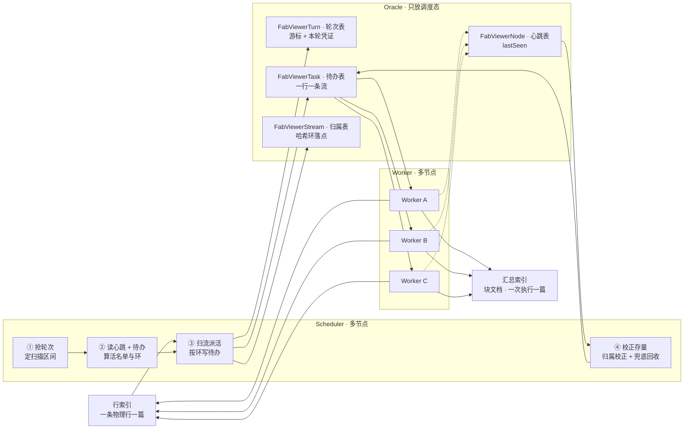
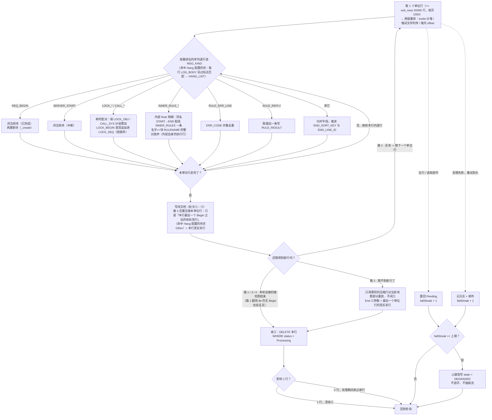

# 派生服务工程实现

> **状态：已结项。** 冻结改动；**任何需要动刀本文的地方，先与薛建明确认。**

本文是派生层的**实现权威** —— 机制、算法、SQL、并发、容错、配置都在这边写全。

04 讲链路与数据模型：数据从采集到存储经过哪几层、每层吃什么吐什么、**块文档的字段与状态**长什么样。本文讲这一层怎么跑起来，以及每条口径**为什么**这么定。

**分工**：会落到数据模型上的口径 —— 锁流三元组、块 `_id`、四个终态、静默期 N、水位线 `L`、重放与切块闭口的流程 —— **只在本篇写全**；04 只保留**块文档的字段定义**（§5.3.2）。两边若对不上，**以本文为准**。

> **业务参数解析由加工层移交派生层**（04 §7）。派生层的职责多了一项：建块时解析块首行，把七个业务字段与**请求类型**写进块文档（§八）。

---

## 一、服务形态（Scheduler + Worker）

派生服务拆成两个角色：**Scheduler 只做计划，Worker 干活**。两个角色都多实例部署，Worker 用容器拉起，节点失联由 Oracle 里的调度态兜住。



顺着箭头读一遍：Scheduler 抢到本轮，按持久游标区间去行索引捞增量行、按锁流三元组归出流清单、按哈希环把每条流写进待办表（`FabViewerTask`）—— **已存在就覆盖回 `Pending`**，同一事务里推游标，再走一遍第 4 步的校正存量（归属校正 + 兜底回收）。Worker 单线程轮询待办表，领走属于自己分片的 `Pending`，回行索引重放，把结果 UPSERT 进汇总索引。两个角色都往心跳表报活，Worker 心跳的用处是**决定环的成员与节点健康度**（谁有资格接新活）。

两个循环（快轮次 / 慢轮次）共用这套角色与表，只有「怎么发现该处理的流」不同：快轮次问「谁刚写了日志」，慢轮次问「谁好久没写日志了」（§1.2.1、§1.2.2）。

**Scheduler 一行日志都不搬。** 它只产出「哪些流该被处理」的清单（`composite` 聚合出 `ENV + HOSTIP + SERVER_ID` 与每流 `max(@timestamp)`），日志行由 Worker 自己按区间拉（§七）。分发量只与流数有关，与日志量无关。

**分发是拉，不是推。** Scheduler 只把待办写进 Oracle，不向 Worker 推送。推模式要额外维护一套在途确认 —— 发出去了没有、发一半自己挂了算谁的，补到最后还是要落盘；拉模式把这些全省掉：Scheduler 只管写，Worker 扫自己分片的 `Pending`，掉线与重启都由表兜住。

### 1.1 启动：注册与心跳

**只用 Docker / docker compose 拉起。** 两个角色启动走同一段序列；下表右边是**这一步要落进表的字段与值**。

| 步 | 动作 | 写哪张表 | 写的值 |
|---|---|---|---|
| 1 | 取 `NODE_ID` | 进程环境 | 部署层注入，见下 |
| 2 | 注册 —— 写或接管自己那一行 | `FabViewerNode` | `nodeId` = `NODE_ID`；`role` = `SCHEDULER` / `WORKER`；`state` = `ONLINE`；`startedAt` = `now`；`lastSeen` = `now`；`failStreak` = `0`；`lastOkAt` / `degradedAt` = 清空 |
| 3 | 起心跳，每 T 秒 upsert 一次 | `FabViewerNode` | `lastSeen` = `now`；Worker 另带四个健康字段，见下 |
| 4 | **仅 Scheduler**：确保轮次表两行存在 | `FabViewerTurn` | `MERGE` 补 `cycle = 'FAST'` 与 `'SLOW'` 两行、缺哪行补哪行；`fromTs` / `toTs` / `owner` / `startedAt` / `streamCnt` 先留空 |
| 5 | 进循环 | — | Scheduler 按 cron 每周期抢轮次（§1.2.1、§1.2.2）；**Worker 不等周期**，单线程轮询待办表（§1.3.1） |

第 4 步只有 Scheduler 需要，理由见 §1.2.1：`SKIP LOCKED` 返回 0 行的含义是「别人在跑」，两行一旦缺失，所有节点都会以为别人在跑而集体永久跳过，并且不报错。

**注册是「接管」，不是「抢注」。** 表里那一行可能是三种状态：

| 表里这一行 | 含义 | 动作 |
|---|---|---|
| 不存在 | 首次上线 | `INSERT` |
| 存在，但 `lastSeen` 早于判死阈值（超过**3次心跳间隔时间**） | 上次的进程已死（正常重启、崩溃、宿主机重启） | `UPDATE` 接管：刷新 `startedAt` / `lastSeen` / `state = 'ONLINE'` / `degradedAt` 清空 |
| 存在，且 `lastSeen` 还在阈值内 | 还有另一个活着的同号进程 | 退出报错 |

判据落在影响行数上：`UPDATE FabViewerNode SET … WHERE nodeId = :me AND lastSeen < :now − :判死阈值`，返回 1 行即接管成功，返回 0 行即「那行还活着」，退出。**判死阈值分得清「那行是别人」还是「那行是上次的自己」** —— 旧进程死了行还留着，只按「行已存在」退出会让正常重启起不来。

**心跳是节点自己上报，不是被别人来问。** 两个角色每 T 秒往 `FabViewerNode` upsert 自己那一行：

| 角色 | 字段 | 写的值 |
|---|---|---|
| 两个角色 | `lastSeen` | `now` —— 判活的唯一依据 |
| Worker 另带 | `state` | `ONLINE`；人为优雅下线前置 `DRAINING`；连续失败到上限自置 `DEGRADED` |
| Worker 另带 | `failStreak` | 连续处理失败次数，成功一次归零 |
| Worker 另带 | `lastOkAt` | 最后一次成功处理完的时刻 |
| Worker 另带 | `degradedAt` | 进 `DEGRADED` 的时刻，回 `ONLINE` 时清空 |

落表之后任何 Scheduler 读同一份，判活就是 `now − lastSeen > 判死阈值`。用途两个角色分开：

- **Worker 心跳决定哈希环的成员。** 掉线、`DEGRADED` 的节点都不进环，它名下的流顺延到顺时针下一个可用节点 —— 落地靠「每轮派活都按当前环写 `worker`」加上校正存量那两句（§1.2.1）。心跳捎带 `failStreak`，让「节点还活着、但活一直干不成」这类故障在调度侧可见；`lastOkAt` 只作诊断、不参与判活（§1.3.2）。**「活着但卡死」心跳报不出来，判据看它名下的待办**，见 §1.2.1 第 2 步。
- **Scheduler 心跳不参与任何决策。** Scheduler 无状态、不持有活，挂掉一台下一轮另一个节点抢到即可；加它的唯一用途是让「**Scheduler 全挂**」这个静默故障能报出来（§1.2.4）。

**`NODE_ID` 由部署层注入，进程不自己生成。** 它是节点身份：重启后不能变（变了环就变、所有流的归属重算、待办全被回收重派）、同一时刻不能撞（撞了摘环与归属校正会互相误伤），并且同时出现在四处 —— `FabViewerNode.nodeId`、`FabViewerTask.worker`、`FabViewerStream.worker`、`FabViewerTurn.owner`。

| 拉起方式 | 给法 | 得到的值 |
|---|---|---|
| `docker run` | `--name worker-2`，进程读 `$HOSTNAME` | `worker-2` |
| docker compose | 服务里**不传 `NODE_ID`**，进程读容器自己的 `$HOSTNAME`，`--scale worker=20` | `fabviewer-worker-1` … `-20` |

两处要守：compose 服务里**不能写 `container_name`**（写了就只能起一个，`--scale` 报冲突）；号**按序号发、不用随机数**（随机号重启后换身份，环重算、待办白回收一轮）。重启时 `docker compose up --scale worker=20` **只补缺的那几个**，已有节点原样不动、不重启不换号。

### 1.2 Scheduler：快慢两个轮次

**这一节只讲 Scheduler 这一侧，只有它分快慢。** 快慢两个轮次各占轮次表的一行、各一把独立的行锁、各一套「发现」逻辑：快轮次按时间区间找「刚写了日志的流」，慢轮次按块状态找「好久没写日志的流」（§1.2.1、§1.2.2）。发现之后的处理全在 §1.3 —— **两条路走的是同一段处理代码**：`reason` 只说明这条流是被哪一侧发现的，不再让处理路径分岔。

**一轮只跑一次。** 快慢两个循环各占轮次表的一行、各一把独立的行锁；多节点用一个共同的时间基准同时醒，只有一个抢得成（§1.2.1）。

#### 1.2.1 快轮次：一轮的动作

快循环一轮就做四件事，全在**抢到轮次的那一台** Scheduler 上跑；Worker 不掺和这一轮（它自己轮询领活，§1.3.1）：

| # | 做什么 | 落在哪 | 节 |
|---|---|---|---|
| 1 | 抢轮次，确定本轮扫描区间 | `FabViewerTurn` | §1.2.1 |
| 2 | 读心跳表 + 待办表，算出「进环名单 + 退活名单」（含摘环过滤） | `FabViewerNode` + `FabViewerTask` | §1.2.1 |
| 3 | 查增量行、**剔除不切块的流**、按锁流三元组分流、按环写待办（**已存在覆盖回 `Pending`**） | 行索引 + `FabViewerTask` / `FabViewerStream` | §1.2.1 |
| 4 | **校正存量**：归属校正（环变了）+ 兜底回收（卡住 / 节点死了 / 节点降级了） | `FabViewerTask` + `FabViewerStream` | §1.2.1 |

第 1、2、3、4 步**同一个事务**，抢到锁的那台天然唯一、不会重复执行。**分工**：第 3 步管「本轮新发现的活」；第 4 步管「表里那些第 3 步不会再碰到的行」—— 节点没了、环变了这两种情况，都不会出现在本轮的增量行里，只能靠这一步扫出来。

一轮从头到尾的伪代码（①~④对应上表，细节与理由在后面分步展开）：

```text
快轮次（cron 0/30 * * * * *：每分钟第 0 秒与第 30 秒）:
    if 本机上一轮还没跑完:  跳过本次触发                # 同机防重入
    BEGIN 事务
    if SELECT * FROM FabViewerTurn WHERE cycle='FAST'
       FOR UPDATE SKIP LOCKED 没抢到（0 行）:
        COMMIT;  本轮结束                              # 别人在跑；什么都没改，等于没跑
    # ① 定本轮扫描区间（持久游标）
    fromTs   = 上一轮的 toTs；为空则 now − W           # 首次部署 / 游标被清
    右端上限 = min(now, fromTs + 1 小时)                # 单轮别扫太长
    # ② 读心跳表 + 待办表，算三份名单（整轮只算一次，③派活与 4a 校正共用）
    进环名单 = 心跳未过期 且 ONLINE 且 failStreak 没到顶 且 名下没有卡住的待办
    基础名单 = 心跳未过期 且 ONLINE                    # 兜底用，不看后两条
    退活名单 = 已判死（心跳停）或 DEGRADED              # 给 4b 立刻回收用
    if 基础名单也是空:  ROLLBACK;  本轮作废             # 没有落点：游标不推、待办不写
    环 = 哈希环（进环名单；进环名单为空时退用基础名单）  # §1.2.5
    # ③ 归流 + 派活
    流清单 = 行索引 composite 聚合（ENV / HOSTIP / SERVER_ID 三源）
             + term(system.name)                       # 写法 §1.5 Q1
             + @timestamp ∈ [fromTs, 右端上限]（左闭 >=）
             − must_not(SERVER_CATEGORY ∈ COMM_RCV / COMM_SND / POLL)
             翻完页才算归完
    for 流 in 流清单:                                   # 一条流一句 MERGE
        落点 = 环.lookup(murmur3_128(ENV + HOSTIP + SERVER_ID))
        MERGE FabViewerTask：没有则插；已存在覆盖回 'Pending'
             （worker = 落点, reason = 'NEW_LINE'；Processing 也照样覆盖）
    # ④ 校正存量（管第 3 步管不到的老行）
    4a 归属校正: Pending 且 worker ≠ 当前环落点 → 改到新落点（不写 updatedAt）
    4b 兜底回收: Processing 且（距上次进度刷新超 reclaim_after_seconds  # 触发①：卡住了
                或 worker ∈ 退活名单）                                    # 触发②：死了/降级了
                → 覆盖回 'Pending'、按新环改归属、updatedAt = now
    toTs = min(本批真看到的 max(@timestamp), now − L)   # 推游标，恒停延迟区左沿
    COMMIT                                              # 放锁
```

**抢轮次（第 1 步）**

- 定时器按秒级 cron 对齐：快轮次 `0/30 * * * * *`（每分钟 0 秒与 30 秒），慢轮次 `0 * * * * *`。**必须写 6 位（带秒位）**。各节点时钟靠 NTP 同步，这就是「多节点同时醒」的基准。**两个周期本期固定：快轮次 30 秒、慢轮次 60 秒**，不做成可调项 —— 快轮次周期与重放水位线 `L` 之间是硬约束（`L ≥ 周期`，§四 第 4 段）。
- `SELECT CYCLE FROM FabViewerTurn WHERE CYCLE = 'FAST' FOR UPDATE SKIP LOCKED`：返回 1 行即抢到，行锁从这条 `SELECT` 一直持到 `COMMIT`；返回 0 行即别人在跑，**本轮事务直接结束**（还没做任何改动，提交与回滚等价）。
- **锁只包 Scheduler 本轮这几件事，不含 Worker。** Worker 的处理跑在锁外 —— 等 Worker 干完再放锁，会把其他节点挡在门外几十秒到几分钟，调度周期直接失效。
- **本机也要防重入。** cron 是固定速率触发，上一轮没跑完下一次照样来；跨机互斥靠 `SKIP LOCKED`，同机用「正在跑就跳过本次触发」的标记。
- **一轮耗时的行为要清楚。** 秒级是常态；接近 30 秒时，后醒的节点会在前一个 `COMMIT` 之后抢到，同一周期跑两次（幂等重扫，不出错数据）；超过 30 秒则持锁跨过下一个触发点，那个周期被整轮跳过（**是漏不是重**，下一轮从同一个 `fromTs` 接着推）。相位固定的节点可能长期抢不到轮次，它不报错、也不影响正确性，排查时先看这一处。

**扫描区间（持久游标）**

| 项 | 取值 |
|---|---|
| 左端 `fromTs` | 上一轮的 `toTs`；值为 `NULL`（首次部署、游标被清）时取 `now − W`，`W` = 冷启动回看宽度（§四） |
| 右端上限 | `min(now, fromTs + 1 小时)` |
| 本轮 `toTs` | `min(本批真看到的 max(@timestamp), now − L)`；一条都没捞到时取 `min(右端上限, now − L)` |
| 比较 | 左闭 `>=` —— `@timestamp` 是毫秒精度，同一毫秒多条很常见，用 `>` 会漏掉与游标同毫秒的行 |
| 时间基准 | **入库时间 `@timestamp`**，不是日志自身的时间。日志自身的时钟可能偏移，拿它做窗口会漏判或误判；`@timestamp` 由采集链路统一产生，不受业务机时钟影响 —— 发现活跃流的区间与重放水位线因此是同一个时间基准 |

**`(now − L, now]` 这一段叫延迟区。** 一行日志从业务机写出来，到能在索引里被检索到，中间要过采集、加工、写入、刷新四跳，有秒级延迟 —— 落在这一段里的行，此刻**不保证已经落库**。`L` 就是给这段延迟留的宽度，两头都靠它卡住：这类行**读不得**（读了会把还没写完的块误判成已结束），也**跳不得**（跳过就再没人管它）。宽度至少要盖住一个快轮次周期，否则被遮住的行重扫时追不回来（§四）。

**两个上限管两件不同的事。** 表里 `now − L` 只出现在最后算 `toTs` 那一步，前三个值都不含它。

| 上限 | 卡什么 | 为什么是这个值 |
|---|---|---|
| `fromTs + 1 小时` | 单轮别扫太长 | 停摆三天时多轮追上，单轮的行数与耗时可控 —— Scheduler 的持锁时长就是查询时长 |
| `now − L` | 游标别贴到墙钟上，也就是**别越过延迟区** | 推 `now` 等于把墙钟请回来：Scheduler 的钟只要比采集端慢一点，`@timestamp` 已越过 `now` 的行就被永久跳过；推进延迟区，则那些还没落库的行先读不到、之后也不会再被扫到 |

**`now − L` 是落库值，不是查询条件。** 它写进 `FabViewerTurn.toTs`，作用是让游标恒停在延迟区的左沿：

```
@timestamp ─────────────────────────────────────────────────────────►

  [─────────────── 本轮扫描区间 ───────────────]
  ↑                      ↑                     ↑
fromTs                  toTs                  now
（上一轮的 toTs）         │                     │
                        └── 延迟区（32 秒）───┘
                            这段的行可能还没落库

  Worker 领活时读行：@timestamp < now − L  ← 同一条线、同一段延迟区
```

**重扫 32 秒是故意的，不是错。** 游标落后使下一轮的左端同样落后 `L` 秒，延迟区那段（入库还没满 `L` 秒的行）因此被扫第二遍 —— 而被扫到的行不可能在**同一轮**就被 Worker 读到（Worker 的读行资格线同样是 `now − L`，§七），它得靠这次重扫拿到第二次派活，那一次已经落稳。跨轮不重复扫靠的是「左端取上一轮 `toTs`」，不靠墙钟窗口；左闭换来的正是「不漏」，代价是重叠 —— **「游标不越过水位线」把重叠从凑巧变成保证**。重叠的后果只是这条流被再派一次活：Worker 领活后按最新块的状态重新判路（§1.3.1 第 3 步），多一次空转，不是错数据。

**读心跳（第 2 步）**

一条查询读 `FabViewerNode` 里 `role = 'WORKER'` 的行，按两把尺子筛出名单 —— 正式的是进环 / 退活两份，另备一份兜底用的基础名单：

| 名单 | 判据 | 用途 |
|---|---|---|
| **进环名单** | 三档全过：心跳未过期（`now − lastSeen ≤ 3 × 心跳间隔`）、`state = 'ONLINE'`、`failStreak < fail_streak_limit`，**且名下没有卡住的待办**（见下） | 搭环：新活落点（第 3 步）、旧行归属校正（4a） |
| **基础名单**（兜底用） | 只留前两档：心跳未过期 + `state = 'ONLINE'`（**不看 `failStreak`、不看名下待办**） | 进环名单为空时，兜底拿它搭环（见下） |
| **退活名单** | 已判死（心跳停），或 `state = 'DEGRADED'` | 4b 立刻回收它名下的 `Processing` |

- **健康度达标只有一条：`failStreak < fail_streak_limit`。** 这个字段由 Worker 自己写进心跳（§1.3.2），Scheduler 只读不改 。摘环的另一条判据不看健康度、看它名下有没有活（见下）。
- **`DRAINING` 三份名单都不进。** 优雅下线的节点还在正常干活，只是不接新活：它名下的 `Pending` 由 4a 改派给别人，手上那条 `Processing` 让它跑完，不打断。
- 一轮只读一次、本节只读不写。**进环名单只算一次、两处共用**（第 3 步派新活、4a 校正落点）：重算会得到两个不一样的环，新活写一个落点、旧行改另一个落点。
- **第 4 步不能提到第 3 步之前** —— 提上去的话名单还是上一轮的，第 3 步仍可能把新流派给刚死的节点，白等一轮才被 4a 校正回来。

**卡住的节点不进环。** 心跳只证明进程没死，证明不了它在干活。这一条判据看它**名下的待办**，与心跳无关：

> 该 Worker 名下**没有** `Processing`，且存在 `Pending` 且 `updatedAt < now − pending_stale_seconds`（默认 30 秒）→ **不进环**。

四种情形对一遍：名下没有活（空闲）→ 进环；名下有 `Processing`（正在跑，跑多久都算）→ 进环；名下只有刚派下来的 `Pending`（1 秒内就会被领走）→ 进环；名下只剩一批没人捞的老 `Pending` → **摘**。判据抓的是「名下有活却没人动」，心跳在不在不影响。

**归流与派活（第 3 步）**

- `composite` 的三个源就是锁流三元组 `ENV` / `HOSTIP` / `SERVER_ID`，另加一个 `system.name` 的 `term` 过滤；分页翻完才算归完（**查询写法见 §1.5 Q1**）。
- **不切块的流在这一步就被剔掉**：`must_not` 掉 `SERVER_CATEGORY` ∈ `COMM_RCV` / `COMM_SND` / `POLL` 的桶。这三族的行照采、照落行文档、照可检索，但**派生层不给它们建块** —— 剔除放在**归流**这一步、**不放加工层**：采集与加工层不为此多产出一个字段（04 §4.2.1）。
- **判据用 `SERVER_CATEGORY`，不用 `SERVER_ID`** —— 通信族的 `SERVER_ID` 是 `COMM_RCVsrv.1` 这种带编号的形态（04 §3.2.1），按**类别**比才不会因为编号不同而漏掉。
- 逐条算环落点 `worker = ring(hash(ENV + HOSTIP + SERVER_ID))`（§1.2.5），写 `FabViewerTask`：`streamKey` = 锁流三元组、`reason = 'NEW_LINE'`、`status = 'Pending'`、`worker` = 环落点。
- **已存在的待办直接覆盖回 `Pending`，不分类。** 活跃流每轮都会被扫到，这条流上一次的待办可能是 `Pending`（再置一次没有副作用）或 `Processing`（覆盖的语义是「这条流在我处理期间又来了新行」）。表里只有这两个状态可回（§1.2.4），所以**状态**上的覆盖不需要看原状态 —— `updatedAt` 是唯一的例外（见下面那句 SQL 的注释）。
- **覆盖不会打断正在跑的 Worker，而是给它一个自检。** Worker 收工那句是 `DELETE … WHERE status = 'Processing'`。行一旦被覆盖成 `Pending`，这句就影响 0 行 —— 删不掉，行留在表里等下一轮被领走。**这就是收工侧的 CAS：拿 `status` 字段本身当版本号，不需要额外的令牌列。** 处理期间被覆盖过就一定发现得了，没被覆盖过就一定收得干净。
- **待办只表示「这条流有活没干完」，不携带「哪一段」。** Worker 处理时是「从锚点重放到追平」，不是「处理某一批指定的行」（§1.3.1），所以晚到的行会被同一次处理一并覆盖 —— 这也是「覆盖」而不是「排队」的原因：`FabViewerTask` 按 `streamKey` 唯一，一行一条流，压根没有「再加一行」这个选项。
- **来源只有两种，靠 `reason` 区分**（`NEW_LINE` / `SILENCE`）。`reason` 取最后一次写入的值：同一条流先被慢轮次判静默、又被快轮次发现新行，就写成 `NEW_LINE` —— 封口最多晚一轮，能收敛。

```sql
-- 3a 不存在则插，已存在则覆盖回 Pending（含 Processing）
-- 时间戳只在状态迁移时写：本来就在等的行保留入队时刻（见下「updatedAt 的两段语义」）
MERGE INTO FabViewerTask t
USING (SELECT streamKey, worker FROM TABLE(:本轮流清单)) s
   ON (t.streamKey = s.streamKey)
 WHEN MATCHED THEN UPDATE
   SET t.status = 'Pending', t.worker = s.worker,
       t.reason = :reason,
       t.updatedAt = CASE WHEN t.status = 'Processing' THEN :now ELSE t.updatedAt END
 WHEN NOT MATCHED THEN INSERT (streamKey, status, worker, reason, updatedAt)
   VALUES (s.streamKey, 'Pending', s.worker, :reason, :now);
```

`:本轮流清单` 是 `(streamKey, worker)` 的数组 —— 环落点逐行不同，不能当单值绑定变量。**一条流一句，中途没有别的读改写。**

- **待办的单位是「流」，不是「块」。** 块由 Worker 自己切，Scheduler 连行的正文都不看。`FabViewerTask` 按 `streamKey` 唯一，快慢两个循环共用一张表、用 `reason` 区分来源（`NEW_LINE` / `SILENCE`），同一条流不会同时挂两条待办，「快慢轮次同时封同一个块」也就没有机会发生。
- **基础名单仍为空时，本轮整体作废。** 没有可用的 Worker 就没有落点，写进去也只是挂在一台不在线、或已经被判降级的机器名下。所以第 2 步读出空环就**直接回滚本轮事务**：游标不推、待办不写，等同本轮没跑。等 Worker 回来从原来的 `fromTs` 重扫，那批行还老实待在区间里，一行不少（§1.2.5）。**能走到这一句的只有两种：全员掉线（心跳停）、全员 `DEGRADED`** —— 只要还有一台心跳活且 `ONLINE`，上一小节的兜底就把名单救回来了，见 §1.3.2 的「大家一起降」。
- **慢轮次同理。** 它也要按当前环写 `worker`，**兜底之后基础名单仍为空**一样没落点、一样写不了，所以同样回滚本轮；慢轮次没有游标可推，作废的含义只是「本轮不派活」，下一轮环回来了接着扫。

**校正存量（第 4 步）**

第 3 步只负责「本轮新发现的活」；这一步负责表里那些**不会再被第 3 步碰到**的行，擦两种屁股：**环变了**（活节点增减，旧行的 `worker` 成了没人领的地址）和**节点没了 / 坏了**（判死、降级）。两句，都用 `FabViewerStream` 关联出当前环落点 —— `:新环落点` 逐行不同，不能当单值绑定变量：

```sql
-- 4a 归属校正：环变过，把非处理中的行改到新落点。只搬地址，不动时间戳
MERGE INTO FabViewerTask t
USING (SELECT streamKey, worker AS newWorker FROM FabViewerStream) s
   ON (t.streamKey = s.streamKey
       AND t.worker <> s.newWorker
       AND t.status <> 'Processing')
 WHEN MATCHED THEN UPDATE
   SET t.worker = s.newWorker;

-- 4b 兜底回收：领走之后没下文的行，放回队列重领。两个触发源，任一命中
MERGE INTO FabViewerTask t
USING (SELECT streamKey, worker AS newWorker FROM FabViewerStream) s
   ON (t.streamKey = s.streamKey
       AND t.status = 'Processing'
       AND (t.updatedAt < :now - :兜底阈值     -- ① 节点还活着，但这条卡住了
            OR t.worker IN (:退活名单)))       -- ② 节点死了 / 降级
 WHEN MATCHED THEN UPDATE
   SET t.status = 'Pending', t.worker = s.newWorker, t.updatedAt = :now;
```

**4a 是「环挪了」。** 死节点摘下环之后，它名下的流顺延到顺时针下一个可用节点，可表里那些行的 `worker` 列还写着死者 —— 拉模式下没人会去领。这一句把归属重贴到新落点。**跳过 `Processing`**：那条活还在原 Worker 手上跑，此刻动归属只会制造半截状态 —— 它要么正常收工（那一行被 `DELETE` 掉），要么由 4b 回收。**它不写 `updatedAt`** —— 搬地址不改变「这条流从什么时候开始等人捞」，把它刷成 `now` 会让摘环判据永远看不到老行（见下）。

**4b 有两个触发源，一个都不能少。**

- **触发 ①「领走之后没动静」**：`updatedAt` 不是「领活时刻」，是**进度时间戳** —— 领活写一次，处理途中还要在关键节点持续推进（分页拉行、写块、读库这些长 IO 之前各推一次，写法见 §1.3.1）。所以判据是「距上一次进度刷新超过阈值」，而不是「这条流已经跑了多久」：**兜底阈值只需大于「两次进度刷新的最大间隔」**，一条合法跑十分钟的大流不会被误放回，而某一跳卡死时不管它已经跑了多久，最多一个阈值就被捞回来。误放只白做一段（重放幂等），不出错数据。
- **触发 ②「归属节点不可信」**：判死阈值只有 3 × 心跳间隔（默认 30 秒），比兜底阈值（默认 300 秒）快一个数量级。**节点都被判死了，它手下那条 `Processing` 没必要再干等四分半** —— 立刻退回来。降级（`DEGRADED`）同理：这台机器已经被认定干不好活，活押在它手上只会拖时间。

**退活不是交接。** 放回队列后归属按当前环重写，下一轮由（自己或别人的）轮询领走，从锚点重新重放 —— 进度在块文档上，不在 Worker 的内存里（§三）。

**处理过程中的异常不走 4b。** 解析失败、写块失败这类由 Worker 自己的逻辑兜底：分情况重试，重试到头就记日志、发邮件给 Admin（§五），并把这次失败计进 `failStreak`。**它们不落任务库** —— 表里只有 `Pending` / `Processing` 两个状态；`failStreak` 推上去之后由节点降级接手（§1.3.2）。

**4b 本身不计数，也不为此加表列。** 同一条流反复被放回（每次都卡在同一处）不会自动停下，可见性靠告警限频：同一 `streamKey` 15 分钟内只发一封、附累计次数（§四），持续命中即持续可见；待办表是热路径，不加列。

**`updatedAt` 的两段语义，与一条数据库护栏。** 这一列在有活被领走之后是**进度戳**（Worker 在每一跳长 IO 之前推进，§1.3.1 第 4 步），在这之前是**入队戳**（这条流从什么时候开始等人捞）。判据据此分工：`Processing` 上它偏老 = 「卡住了」（4b 触发①）；`Pending` 上它偏老 = 「没人捞它」（上面那条摘环判据）。

规则一句话：**它只在状态迁移那一刻写，同状态覆盖一个字不动。**

| 路径 | 状态迁移 | `updatedAt` |
|---|---|---|
| 3a 新插入 | 无 → `Pending` | 写 `now` |
| 3a 覆盖 | `Pending` → `Pending` | 不动（保留入队时刻） |
| 3a 覆盖 | `Processing` → `Pending` | 写 `now`（处理期间来过新行，算重新入队） |
| 4a 归属校正 | `Pending` → `Pending` | 不动 |
| 4b 兜底回收 | `Processing` → `Pending` | 写 `now` |
| 领活 | `Pending` → `Processing` | 写 `now` |

靠 SQL 自觉不够：将来谁新写一句覆盖就可能把它刷掉，而判据失效的表现是「永远不命中」，不报错。加一个触发器，把规则钉在库上：

```sql
CREATE OR REPLACE TRIGGER FabViewerTask_keep_enqueue
BEFORE UPDATE ON FabViewerTask
FOR EACH ROW
WHEN (OLD.status = 'Pending' AND NEW.status = 'Pending')
BEGIN
  :NEW.updatedAt := :OLD.updatedAt;
END;
```

它管的正是「本来就在等、更新后还在等」这一种情况，与上表一致：状态没变就把时间戳压回原值，状态一变（被领走 / 被覆盖 / 被退回）才写新值。上面 3a 那句 `CASE` 与 4a 的「不写」，是同一规则在 SQL 里的显式表达，写出来是为了读代码时不必去翻触发器。

#### 1.2.2 慢轮次：一轮的动作

**慢轮次按块状态找活。** 它跟快轮次共用同一对角色、同一张待办表、同一套校正，差别只在「发现」这一步 —— 快轮次问「谁刚写了日志」，它问「谁好久没写日志」。它只负责**把超了静默期的流交出去**；一条流上那些进行中的块怎么封由 Worker 处置 —— 比最新块更早的未闭口块走路 5、静默封口走路 2 的入口探测（§1.3.1 第 2、3 步、§1.3.3）。

```text
慢轮次（cron 0 * * * * *：每分钟第 0 秒）:
    if 本机上一轮还没跑完:  跳过本次触发                # 同机防重入
    BEGIN 事务
    if SELECT * FROM FabViewerTurn WHERE cycle='SLOW'
       FOR UPDATE SKIP LOCKED 没抢到:  COMMIT;  本轮结束
    # ① 读心跳，算名单与当前环（与快轮次同一套；基础名单仍为空同样整轮回滚）
    # ② 找超静默期的流：只碰汇总索引，不回行索引（写法 §1.5 Q5）
    流清单 = 汇总索引查询：EXEC_STATUS = 进行中
             且 now − LAST_LINE_TIME ≥ N（5 分钟）
             按 streamKey 聚合去重 → 一条流一条待办
             （不排序、不限流；超期的是哪一篇块不区分，Worker 领活后自己看）
    # ③ 写待办（与快轮次同一句 MERGE，只有 reason 不同）
    for 流 in 流清单:
        MERGE FabViewerTask：没有则插；已存在覆盖回 'Pending'
             （reason = 'SILENCE'；不刷 updatedAt —— 走 3a 那一句的规则）
    # ④ 校正存量：4a + 4b，与快轮次同一套两句
    COMMIT                                              # 慢轮次不推游标，fromTs/toTs 留空
```

**取数就一个条件：`EXEC_STATUS = 进行中` 且 `LAST_LINE_TIME` 距今 ≥ N（5 分钟）。** 未超 N 的不拉；超了就是「这条流该去看一眼了」。取回来按 `streamKey` 聚合去重，**一条流一条待办** —— 待办表本来就按 `streamKey` 唯一，一条流上无论挂着几篇超期块，都只对应一行（§1.2.1）。

**慢轮次不区分超期的是哪一篇块。** 它只回答「这条流有没有超期未封的块」，不回答是哪一篇、超了多久 —— 那些等 Worker 领活后自己看（§1.3.1 第 3 步）。聚合去重因此不只是省一行待办，而是把「一条流派一次活」写死在调度侧：同一条流挂几篇超期块，也只会被派一次。

`N` 就是静默期 **5 分钟**。基准是**块文档上的 `LAST_LINE_TIME`** —— **每个进行中的块各记一个**「重放推进到的末行日志时间」，不是「这条流的最后一行」，也不是「`now` − 上次扫描时间」。所以它必须在块未闭口期间就有值，写在批次②（§二）。

**判的是块，不是流。** 一条流可能同时挂着好几篇进行中块（成因见下），这条查询逐块判：**任一篇**块满足「`EXEC_STATUS = 进行中` 且 `LAST_LINE_TIME` 距今 ≥ N」，它所属的那条流就入选；聚合去重后仍是一条流一条待办。慢轮次因此不需要知道是哪一篇超期。

**慢循环只碰「超了静默期」的块。** 未超 N 的块一个不拉、一个不动 —— 它们要么还在跑、要么还没到该封的时候，慢循环对它们没有任何动作，也就没有机会与正在重放的 Worker 抢同一篇块。

**为什么不按块派活。** 一个 `SERVER_ID` 是串行的，同一时刻只跑一个请求；块又是「撞见下一个 `REQ_BEGIN` 才封上一块、再建新块」。所以一条流的进行中块多于一篇，只可能是更早那篇终结的那一刻没写进去。三条成因：

| 成因 | 落点 |
|---|---|
| 服务器重启（人为 / 调试 / 自动） | 重启后重新开块，旧块若没被 `SERVER_START` 认出来，就留成残留 —— 同一条流、多篇 |
| 同一 IP 上 `SERVER_ID` 变少 | 被去掉的是**流**不是块：那些流各自只有一篇进行中的块，不再有新行，静默期一到就被派出去 |
| 同一 IP 上**环境名变了** | 同上，旧环境名的那些流整条静默 |

三种情况落同一条路径：**静默期一到，这条流被派一次活，Worker 一次把它名下的进行中块全部结清**。封口细节见 §1.3.1 第 2、3 步（老块归路 5、静默归路 2 的入口探测）—— 慢循环不管怎么封，它只回答「哪条流该去看一眼了」。

**为什么不在慢循环里直接封。** 封口要动汇总索引，而汇总索引的写入方只有 Worker（§三）。慢循环在调度事务里跨库去改块，会把这条分层破掉。交出去多走一条待办，换回来的是一条干净的边界。

**不排序、不限流。** 静默最久的先派没有意义：待办表按 `streamKey` 唯一，写待办是 `UPSERT`（已存在覆盖回 `Pending`），派几次都只是同一行被覆盖一次，堆不起来；一条流什么时候被处理，由 Worker 的轮询顺序决定，不由派活顺序决定。

**覆盖回 `Pending` 不刷 `updatedAt`。** 慢轮次走的是 3a 那一句（§1.2.3 两条搭配规则），一分钟一轮；一条流只要一直挂着超静默期的块，就每轮都会被覆盖一次。`updatedAt` 一旦在这里被刷成 `now`，等于每 60 秒给它的入队时刻续一次命，摘环判据（§1.2.1 第 2 步，阈值 30 秒）永远不命中 —— 这是这条判据唯一的静默失效点。

**慢循环不回行索引。** 判静默要的「这个块末行的日志时间」，块文档的 `LAST_LINE_TIME` 现成提供（§二）；它只碰汇总索引一个索引，按 `streamKey` 聚合、翻页翻完（查询写法见 §1.5 Q5）。

**慢轮次不推游标**，`fromTs` / `toTs` 两列在慢轮次的行上留空：它查的是「现在还有哪些块挂着」，**状态驱动**，与时间区间无关 —— 停摆再久，只要块还挂在「进行中」，恢复后照样扫得到。

#### 1.2.3 快慢对照表

**Scheduler 侧：快慢各一套**（Worker 侧那张表见 §1.3 开头 —— 处理侧不分快慢，只在一处有分岔）

| 维度 | 快轮次（30 秒） | 慢轮次（60 秒） |
|---|---|---|
| 触发 | cron `0/30 * * * * *` | cron `0 * * * * *` |
| 行锁 | `FabViewerTurn` 里 `cycle = 'FAST'` 那一行 | `cycle = 'SLOW'` 那一行 |
| 驱动方式 | 时间驱动（增量） | 状态驱动（存量） |
| 摘环判据（第 2 步） | 名下没有 `Processing` 且最早 `Pending` 超 `pending_stale_seconds` → 该节点不进环 | 同，一句不差 |
| 读哪个索引 | 行索引（Q1） | 汇总索引（Q5） |
| 扫描区间 | 持久游标 `[上一轮 toTs, min(now, 左端 + 1 小时)]`，左闭 | 无区间。按 `streamKey` 聚合，只要挂着任一篇 `EXEC_STATUS = 进行中` 且 `LAST_LINE_TIME` 距今 ≥ N 的块就入选 |
| 找的是 | 刚写了日志的流 | 这段时间不再写日志的流 —— 只判「有没有超期块」，不区分是哪一篇 |
| 负责的闭口方式 | 方式 1（下一条请求到达）、方式 2（服务器重启）—— 有标志，秒级 | 方式 3（异常宕机不重启）、方式 4（下一条请求一直不来）—— 无标志，等静默期（路 2 的入口探测判到就封）；**在册老块残留不分快慢**，谁领到活谁走路 5 清掉（§1.3.1 第 2 步） |
| 派活粒度 | 归出的每条流一条待办 | 同 —— `streamKey` 聚合去重后派，一条流一条待办；**不排序、不限流** |
| 待办 `reason` | `NEW_LINE` | `SILENCE` |
| 推不推游标 | 推 `toTs = min(本批结果, now − L)` —— **不得越过重放水位线** | **不推**，`fromTs` / `toTs` 留空 |
| 基础名单仍为空 | 本轮整体作废（§1.2.1） | 同 |
| 第 4 步校正存量 | 跑（4a + 4b） | **同，一句不差** |
| 事务边界 | 四步同一事务 | 同 |

**两条搭配规则**：

1. **源数据互补。** 一条流要么正在写日志（只被快循环看见），要么已经静默（只被慢循环看见），同一时刻不会两边都算「新活」—— 它们不是重复劳动，是按「有没有下文」切开的两个半区。
2. **写待办是同一句 SQL，冲突不打架。** 都是「已存在就覆盖回 `Pending`」（§1.2.1 的 3a），只有 `reason` 不同；两轮同时扫到同一条流，最多白写一次。

**接力关系**：快循环负责绝大多数正常闭口（下一条请求一到、或重启标志一出现就秒级闭口），慢循环只管剩下那批**永远等不到下一条**的尾巴（由路 2 的入口探测封成 `超时封口`）；两个循环派出去的活，Worker 都会顺手清掉更早的老块残留（路 5，§1.3.1 第 2 步）。缺了谁都不行 —— 没有慢循环，方式 3、4 的块永久挂在「进行中」；没有快循环，所有块都要干等 N 分钟才封，`超时封口` 泛滥、`已完成` 失去区分意义。

**两个循环各有各的源数据，合并会丢一半。** 快循环按时间区间扫，找的是「刚写了日志的流」；慢循环要找的恰恰是**这段时间里没有再写过日志的流** —— 它们在快循环的源数据里根本不会出现（04 §4.2.1）。

#### 1.2.4 Oracle 里放什么

只放**调度态**，不放业务数据。四张表，表名与栏位照下面建。

**`FabViewerTurn` · 轮次表**

**只有两行**，建表时预置（`cycle = 'FAST'` 与 `'SLOW'`），不随轮次增长。它既是本轮的行锁（`SELECT … FOR UPDATE SKIP LOCKED`，§1.2.1），又是调度游标的账。

| 栏位 | 类型 | 说明 | 示例 |
|---|---|---|---|
| `cycle` | VARCHAR2(8) | **主键**。只两个值，各一把独立的行锁 | `FAST` |
| `fromTs` | TIMESTAMP(3) | 本轮扫描区间左端 = 上一轮 `toTs`；**慢轮次行留空** | `2026/09/16 14:03:10.482` |
| `toTs` | TIMESTAMP(3) | 游标 = `min(本批真看到的 max(@timestamp), now − L)`；一条都没捞到时取 `min(右端上限, now − L)`；**慢轮次行留空** | `2026/09/16 14:03:40.117` |
| `owner` | VARCHAR2(64) | 抢到本轮的 Scheduler 节点 | `scheduler-01` |
| `startedAt` | TIMESTAMP(3) | 本轮开始时刻 | `2026/09/16 14:03:41.006` |
| `streamCnt` | NUMBER(6) | 本轮归出的流数，供核对 | `12` |

**`FabViewerTask` · 待办表**

一行一条流（不是一块），快慢两个循环共用一张。**四张表里只有这张会被 Worker 改。**

| 栏位 | 类型 | 说明 | 示例 |
|---|---|---|---|
| `streamKey` | VARCHAR2(160) | 主键。`ENV` / `HOSTIP` / `SERVER_ID` 三段以竖线相连 | `PIRUN\|10.20.30.41\|FABsrv.63` |
| `reason` | VARCHAR2(16) | 来源：`NEW_LINE`（快轮次发现新行）/ `SILENCE`（慢轮次发现这条流静默超期） | `NEW_LINE` |
| `worker` | VARCHAR2(64) | 当前归属，Scheduler 每轮按当前环校正（§1.2.1） | `worker-2` |
| `status` | VARCHAR2(16) | 只有两态：`Pending`（待领取）/ `Processing`（已领走、尚未收工）。**没有 `Retry` / `Dead` / `Idle`** | `Processing` |
| `updatedAt` | TIMESTAMP(3) | **两段语义**：`Processing` 时是进度戳（领活时写、处理途中在每一跳长 IO 之前推进，§1.3.1），`Pending` 时是入队戳（这条流从什么时候开始等人捞）。所以 `Processing` 且它偏老，是「距上一次进度刷新超过阈值」，不是「这条流跑了多久」（4b 触发①的判据）。**只在状态迁移那一刻写，同状态覆盖不动它** —— SQL 里显式写出来，触发器 `FabViewerTask_keep_enqueue` 兜底（§1.2.1） | `2026/09/16 14:03:41.902` |

索引 `(worker, status)` —— 就是 Worker 轮询加领活那条原子 UPDATE（§1.3.1）的走法，**摘环判据（§1.2.1 第 2 步）也走它**：按 `worker` 看有没有 `Processing`、有没有老的 `Pending`。

**一行一条流，处理完就删。** 表只回答两个问题：**这条流有没有活**（有没有这一行）、**有没有人在处理**（`status`）。处理失败的计数不在这里 —— 它由 Worker 自报进节点心跳（§1.3.2）。

**`FabViewerNode` · 心跳表**

一台节点一行，节点自己 upsert，Scheduler 只读。

| 栏位 | 类型 | 说明 | 示例 |
|---|---|---|---|
| `nodeId` | VARCHAR2(64) | 主键，节点标识 | `worker-2` |
| `role` | VARCHAR2(16) | `SCHEDULER` / `WORKER` | `WORKER` |
| `state` | VARCHAR2(16) | `ONLINE`（正常）/ `DRAINING`（人为优雅下线）/ `DEGRADED`（连续失败被降级）。后两种都不进环、不接新活（§1.3.2） | `ONLINE` |
| `lastSeen` | TIMESTAMP(3) | 最后一次心跳；判死 = `now − lastSeen > 3 × 心跳间隔` | `2026/09/16 14:03:35.220` |
| `failStreak` | NUMBER(6) | 连续处理失败次数，成功一次归零；≥ `fail_streak_limit` 即自降 `DEGRADED`（§1.3.2） | `0` |
| `lastOkAt` | TIMESTAMP(3) | 最后一次成功处理完的时刻。**只作诊断，不参与判活** —— 空闲节点这个值天然陈旧，拿它当判据会误摘（§1.2.1） | `2026/09/16 14:03:29.771` |
| `startedAt` | TIMESTAMP(3) | 节点启动时刻，换机器 / 重启可识别 | `2026/09/16 09:10:02.009` |
| `degradedAt` | TIMESTAMP(3) | 本次进 `DEGRADED` 的时刻，回 `ONLINE` 时清空。**退出判决的基准**：`now − degradedAt ≥ suicide_after_seconds` 即退出进程（§1.3.2） | `2026/09/16 13:48:57.310` |

**`FabViewerStream` · 流归属表**

哈希环的落点，Scheduler 每轮重算一遍写进来。它是待办表归属列的**唯一依据**：4a 用它校正归属，4b 兜底回收时一并用它把行改到正确落点（§1.2.1）。

| 栏位 | 类型 | 说明 | 示例 |
|---|---|---|---|
| `streamKey` | VARCHAR2(160) | 主键，同待办表 | `PIRUN\|10.20.30.41\|FABsrv.63` |
| `worker` | VARCHAR2(64) | 当前环上该流的落点 | `worker-2` |
| `ringVer` | NUMBER(10) | 环版本号，Worker 增减时 +1 | `7` |
| `updatedAt` | TIMESTAMP(3) | 归属最后重算时刻 | `2026/09/16 14:03:41.116` |

索引 `(worker)`。

**几条口径**：

- `FabViewerNode` 是唯一带**自报健康度**的表：`state` / `failStreak` / `lastOkAt` / `degradedAt` 都由 Worker 自己写、Scheduler 只读；其中参与判活的只有 `state` 与 `failStreak`，`lastOkAt` 用于诊断，`degradedAt` 只给 Worker 自己的退出判决用（调度侧不读）。故障可见性走心跳，不走任务表（§1.3.2）。
- 时间列统一 `TIMESTAMP(3)`（毫秒），与行索引的 `@timestamp` 对齐。
- Oracle 里不加双引号的标识符会被转成大写：写 `FabViewerTurn` 与写 `FABVIEWERTURN` 是同一张表，驼峰只是写法。**表名用大驼峰、栏位用小驼峰**，全项目统一不加引号。
- **Scheduler 也往 `FabViewerNode` 写一行**（`role = 'SCHEDULER'`，`state` 恒为 `ONLINE`）。它不参与任何调度决策 —— Scheduler 无状态、不持有活，挂掉一台不影响别的，下一轮另一个节点抢到即可。加它的唯一实打实的用途是让「**Scheduler 全挂**」这个故障能报出来：没有这条心跳，Scheduler 全挂是静默的 —— 新日志不再被发现，而 Worker 仍在照常消耗存量待办，从表面看不出异常。判据是 `role = 'SCHEDULER'` 的行全部 `now − lastSeen > 阈值`，阈值比 Worker 判死阈值宽松（如 3 分钟），避免一次 GC 停顿就误报。
- 四张表的关系：`FabViewerTurn` 固定两行、不增长；`FabViewerTask` 与 `FabViewerStream` 都以 `streamKey` 为主键、逐行对应；`FabViewerNode` 一台节点一行。

日志与块文档一概不进 Oracle —— 它们属于 OpenSearch（04 §五）。

#### 1.2.5 环：一条流固定一个 Worker

一条流只交给一个 Worker，靠哈希环。键是锁流三元组 `ENV + HOSTIP + SERVER_ID`；把每台 Worker 按 `nodeId + '#' + 0 … V` 展开成 V 个虚拟点，贴到 0 ~ 2^64 的环上；对三元组算 `murmur3_128` 得到一个 64 位无符号数 `h`，**从 `h` 顺时针走，碰到的第一个点就是它的主人**。`h` 落在两个点之间不用管 —— 环上没有「正好相等」这回事；`h` 比最大的点还大就绕回环的第一个点，首尾相接。同一条流的 `h` 不变，落点就不变；Worker 增减只挪动相邻的一段，不会整体重排。

环的成员放的是**进环名单**里的 Worker：活着（`lastSeen` 够新）、`state = 'ONLINE'`、`failStreak` 没到顶、**名下没有卡住的待办**（§1.2.1 第 2 步）。所以「顺时针碰到的第一个一定可用」不是分发时去跳过死者，而是**判死 / 降级都不进环、环重算**，原来归它的流自然落到顺时针下一个 —— 落地分两步：新流派活时直接按新环写 `worker`，表里那些老行由 4a 校正归属（§1.2.1 第 4 步）。分发本身不做存活判断；**基础名单仍为空时本轮整体作废**（游标不推、待办不写），等同本轮没跑。名单被兜底退回时只剩前两条，「一定可用」这条保证暂时不成立 —— 这是带病运行的代价，见 §1.2.1 末尾。

四个参数必须固定死，否则两台 Scheduler 会算出两个不同的环：

| 参数 | 取值 |
|---|---|
| 哈希函数 | `murmur3_128` 取 64 位无符号（用无符号比较；`Math.abs()` 对 `Long.MIN_VALUE` 仍是负，落点会算歪） |
| 虚拟节点数 V | 100 ~ 200 |
| 挂点与排序 | 按 `nodeId` 字典序，逐点挂 `nodeId + '#' + i` |
| 取点 | 顺时针第一个 `≥ h`（`ceilingEntry`），越过最大点取 `firstEntry` |

虚拟节点不进表、不注册，是 Scheduler 算环时临时展开的。**环只有 Scheduler 算**，落点写进 `FabViewerTask.worker` 与 `FabViewerStream.worker`；Worker 不自己算环，领活读的是待办表（§1.3.1）。

这套「分流哈希」与 `COST_BREAKDOWN` 里按 `LOCK_OBJ` / `CALL_SYS` 分组是两回事：一个回答「这条流归哪台机器」，一个回答「这段耗时归哪一项」。

### 1.3 Worker：处理侧（快慢共用）

**Worker 不分快慢 —— 快慢的差别只在 Scheduler 层扫什么。** 领到活之后，Worker 的动作对快慢完全一致：**取最新一块 → 先把比它更早的未闭口块封掉（路 5）→ 看最新块的状态分四路 → 按路取行处理**。`reason` 不再改变处理路径。

**一条活 = 一次「取块 → 封老块 → 分四路 → 取行 → 收工」**，七步逐条对照：

| 步 | 做什么 | 出处 |
|---|---|---|
| ① 轮询领活 | 原子 UPDATE 置 `Processing` | §1.3.1 第 1 步 |
| ② 取块 | 按 `ORDER_BY` 降序取该流**最新一块**（`size: 1`） | §1.3.1 第 2 步 |
| ③ **路 5 · 老块收尾** | 比它更早、仍是 `进行中` 的块 ⇒ 直接封 `中断`（不重放） | §1.3.1 第 2 步 |
| ④ 分四路 | 一块都没有 ⇒ 路 1；`进行中` ⇒ 路 2；已正常闭合 ⇒ 路 3；已超时封口 ⇒ 路 4 | §1.3.1 第 3 步 |
| ⑤ 按路取行、逐行处理 | 取**单位行**（≤ 20000 行）→ 两级重排 → 切块 / 闭口 / 重放 | §1.3.1 第 4 步 |
| ⑥ 写块 | 幂等 UPSERT | §1.3.1 第 5 步 |
| ⑦ 收工 | `DELETE … WHERE status = 'Processing'` | §1.3.1 第 6 步 |

**四路对照（判别 + 每路的取数区间）**

| 路 | 最新块是什么 | 取数下界 `gte` | 取几个单位行 | 本轮什么时候结束 |
|---|---|---|---|---|
| 路 1 | 这条流一块都没有 | **初始为空**；每取一单位行就推到**该单位行真实末行的 `SORT_KEY`**（`lte` 不变） | 翻找阶段**一格一格往后取**（不带 `REQ_BEGIN` 的放弃）；**只处理命中 `REQ_BEGIN` 的那 1 个** | 命中单位行处理完即收；翻到 `lte` 仍没有 `REQ_BEGIN` ⇒ 收工、什么都不建 |
| 路 2 | `进行中` | 入口探测 `END_SORT_KEY`；主体 `START_SORT_KEY` | 入口探测 **1 个**；主体**连续取** | 主体：**`gte` 与 `lte` 之间取不到新行** |
| 路 3 | 已正常闭合（`已完成` / `中断`） | `END_SORT_KEY` | 翻找阶段**一个单位行一个单位行往后取**（不带 `REQ_BEGIN` 的放弃）；**只处理命中 `REQ_BEGIN` 的那 1 个** | 命中单位行处理完即收；`gte` 与 `lte` 之间取不到行 ⇒ 收工（块不动） |
| 路 4 | 已超时封口 | `END_SORT_KEY` | **只取 1 个** | 三支之一（见 §1.3.1 第 3 步） |

**`lte` 一律 = `now − L`。** 路 1 / 路 3 / 路 4 只负责**把未闭口块打开或新建出来**：路 1 与路 3 的**翻找**都可以在单位行之间一路往后走（只为找 `REQ_BEGIN`），**真正处理的只有命中的那 1 个单位行**，处理完本轮即收；路 4 就在它那 1 个单位行里处理完、本轮即收。**只有路 2（检测到未闭口块时）才完整走完区间** —— 这条分工见 §1.3.1 第 4 步「分路分工」。

**路 1 的取法：下界从空起，一格一格往后翻，翻到含 `REQ_BEGIN` 的单位行为止。** `lte = now − L` 全程不变、`gte` 最初为空；每取 1 个单位行（≤ `unit_rows` 行）两级重排后只判一件事 —— **有没有 `REQ_BEGIN`**：没有 ⇒ 放弃这一行，**用该单位行真实末行的 `SORT_KEY` 当新的 `gte`** 去取下一个单位行；有 ⇒ 停下，**这一个就是本轮待处理的单位行**。翻找阶段不建块、不算重放、不压缩；翻找过的那些行不进任何块。

#### 1.3.1 Worker：单线程轮询（快慢共用）

**Worker 不等周期，是「处理完就再查」。** 每台 Worker 一个单线程循环：没有 cron 定时器、没有并发，因此也不需要「本机防重入」那套标记。从领活到收工分六步，主循环写成伪代码（①~⑥对应六步，四路怎么走展开在伪代码后面）：

```text
Worker 主循环（单线程）:
    loop:
        候选 = 查 FabViewerTask：worker = 我 且 status = 'Pending'
        if 候选为空:  睡 poll_interval_seconds（1 秒）;  continue
        for pick in 候选:
            # ① 领活：原子 UPDATE，影响 1 行才算领到
            if UPDATE FabViewerTask SET status='Processing', updatedAt=now
               WHERE streamKey=pick AND status='Pending' 影响 0 行:
                continue                                # 被别人领走 / 已被覆盖，跳过
            # ② 取块 + 路 5
            最新块 = 按 ORDER_BY 降序取该流第 1 条（size: 1）
            for 同流更早（ORDER_BY 更小）且仍「进行中」的块:   # 路 5 · 老块收尾
                直接封「中断」—— 不重放、不动 End 三参数
            # ③ 看最新块状态分四路（快慢轮次派来的活走同一段代码）
            if 这条流一块都没有:     路 1   # 翻找含 REQ_BEGIN 的单位行，建第一个块
            elif 最新块.进行中:      路 2   # 先 2-A 入口静默探测，没封上再 2-B 走完区间
            elif 最新块.已正常闭合:  路 3   # 从闭口块 End 往后翻找下一个开始行
            elif 最新块.已超时封口:  路 4   # 只取 1 个单位行，三支处置
            #   四路内部都是 ④：取单位行 → 两级重排 → 逐行处理（§十）；
            #   每一跳长 IO（分页拉行 / 写块 / 读库）之前先推进度时间戳
            # ⑤ 写块文档（幂等 UPSERT，写前同样先推进度）
            # ⑥ 收工：DELETE WHERE streamKey=pick AND status='Processing'
            #    影响 0 行不是错误 —— 处理期间来过新行，已被覆盖回 Pending；
            #    行还在表里，下一轮轮询自然领走、从锚点重放到追平
```

**第 1 步 · 轮询领活。** 一轮轮询的起点是「当前进程里没有正在处理的流」—— 上一批处理完才去查下一批，不等任何周期。空闲睡 `poll_interval_seconds`，有活时不留间隔。查到的只是候选，占位靠这句原子 UPDATE：

```sql
-- 领活：影响 1 行才算领到
UPDATE FabViewerTask
   SET status = 'Processing', updatedAt = :now
 WHERE streamKey = :pick AND status = 'Pending';
```

影响 1 行才算领到；影响 0 行说明别人先领走了（或这一行已经被覆盖），跳过即可。**进程内不设缓存**：`FabViewerTask` 是唯一来源，内存里那份「本轮候选」快照随时会过期，靠这句里的 `status = 'Pending'` 兜住。这句也是 `updatedAt` 从入队戳切成进度戳的那一刻（§1.2.1）。

**第 2 步 · 取块与老块收尾（路 5）。** 取块**不分 `reason`，基准永远是「最新一块」**：

- 按块的 **`ORDER_BY`** 降序取 1 条 —— 它是这条流当前的边界所在，新行只会落在它之后。`ORDER_BY` = **单位时间戳 14 位（`yyyyMMddHHmmss`）+ 5 位序号**，就是「同一轮里建的那个块」的先后序（构造规则见 §2.2）。
- **路 5 · 老块收尾**：同一条流上 **`ORDER_BY` 比最新块小、且仍是 `进行中`** 的块，**直接封成 `中断`** —— 不重放、不动右端三参数（右端取块上已有的 `END_LINE_ID` / `END_SORT_KEY` / `LAST_LINE_TIME`）。**不论快循环还是慢循环派来的活都做** —— 快慢的差别只在 Scheduler 层扫的范围（快循环覆盖增量行、慢循环覆盖老块，§1.2.2）。这批块本该由路 2 / 路 3 / 路 4 正常收尾，留在册上只说明 Worker 当时不在场（处理期间宕机、重启、环境名变更留下的残留）。
- 一条流上**一块都没有**（路 1）⇒ 跳过这一步，直接进第 3 步。

**第 3 步 · 看最新块的状态，分四路。** 取到最新一块之后，先按第 2 步把老块封掉，再按最新块的状态决定这一轮走哪条路（取数区间见 §1.3 的四路对照表）：

- **路 1 · 这条流一块都没有** ⇒ `gte` 初始为空、`lte = now − L`，取一个单位行两级重排后判有没有 `REQ_BEGIN`：没有 ⇒ 放弃，以**该单位行真实末行的 `SORT_KEY`** 作新 `gte` 取下一个；有 ⇒ 停，它就是本轮待处理的单位行。
- **路 2 · 最新块 `进行中`** ⇒ 先跑一次**入口静默探测**（2-A），没封上就进**主体**（2-B）完整走完区间。
- **路 3 · 最新块已正常闭合**（`已完成` / `中断`）⇒ `gte = END_SORT_KEY`、`lte = now − L`，一个单位行一个单位行往后翻，**翻到含第一个 `REQ_BEGIN` 的单位行就停**（没翻到的单位行放弃、`gte` 推到它真实末行）；`gte` 与 `lte` 之间取不到行 ⇒ 本轮结束。
- **路 4 · 最新块已超时封口** ⇒ `gte = END_SORT_KEY`，**只取 1 个单位行**，找第一个开始节点，按「`≥ 3` 行 / `< 3` 行 / 找不到」三支处置。

**路 1 · 建第一个块。** 先**翻找**，翻到才开始处理，处理完本轮就收：

```text
路 1（这条流一块都没有）:
    gte = 空;  lte = now − L                            # lte 全程不变
    # ── 翻找：一格一格往后取，只看有没有 REQ_BEGIN ──
    while 以 (gte, lte) 还取得到单位行:
        单位行 = 取 1 个（≤ unit_rows 行）→ 两级重排 → 标 5 位序号
        if 本单位行含 REQ_BEGIN:  它就是本轮待处理单位行;  break
        gte = 该单位行真实末行的 SORT_KEY                # 没有 ⇒ 放弃这一行，接着翻
    else:  收工，什么都不建                              # 截止 lte 没有开始行；
                                                        # 只有 SERVER_START 也一样：不建块、没块可闭
    # ── 只处理这一个单位行，处理完不再往后接 ──
    从第一个 REQ_BEGIN 建块（首行解析只在这一刻）
    块.ORDER_BY = 系统当前时间到秒（14 位）+ 该 REQ_BEGIN 在本单位行里的 5 位序号
    自上而下找边界：
        撞 REQ_BEGIN    ⇒ 闭当前块 + 建新块（解析首行、算重放）
        撞 SERVER_START ⇒ 只闭当前块（整块算重放）、不建新块
    走完本单位行还没撞到边界 ⇒
        用「开始行到本单位行末行」算部分重放，不闭口
        End 三参数 = 本单位行真实末行的三参数
    本轮结束
    # 翻找阶段取过的行不进任何块；
    # 留下的未闭合块下一轮归路 2：从 START_SORT_KEY 重扫整块、按全部重放重算
    #   （见第 4 步末「未闭合块：每一轮都全额重放」）
```

翻找阶段不建块、不算重放、不压缩；这一路整体也不需要压缩 —— 处理完这一个单位行就收，不存在跨单位行接续（压缩是路 2 用的，§1.3.1 第 4 步）。

**路 2 · 入口静默探测（2-A）+ 主体（2-B）。**

**2-A · 入口静默探测**（只在最新块是未闭口块时做；封上了就本轮结束，没封上才进 2-B）：

```text
2-A:
    # 1. 前置筛选，省一次 OS 查询：< 5 分钟时反正判不到静默期，先查是白费
    if now − L − 块.LAST_LINE_TIME < 5 分钟:  直接进 2-B
    # 2. 探测查询：以块的 END_SORT_KEY 为 gte、lte = now − L，取 1 个单位行、两级重排
    #    （2-B 第一次取行从 START_SORT_KEY 起，END_LINE_ID 可能正好落在取回单位行的
    #     最后一行，判不出它后面还有没有行 —— 所以这里单查一次，用「新增行」佐证预判）
    # 3. 滤掉 END_LINE_ID 及它之前的行，看剩没剩：
    剩余 = 两级重排后滤掉 END_LINE_ID 及它之前的行
    if 剩余还有行:  进 2-B                              # 有新增行 ⇒ 不是真静默
    if now − L − LAST_LINE_TIME ≥ N:
        # 4. 静默封口：不重放、不动 End 三参数
        状态 → 超时封口；不再以 START_SORT_KEY 往下查；本轮结束
    else:
        收工，块保持进行中                               # 没到静默期，不封
```

**2-B · 主体**（完整走完区间）。**主体不只看一个单位行**：从 `START_SORT_KEY` 起**一个单位行接一个单位行往后取**，`lte = now − L` 全程不变，一直取到「`gte` 与 `lte` 之间再也取不到新的行」才收。区间多长就跑多久，与「单位行取没取满 `unit_rows`」无关：

```text
2-B:
    gte = 块.START_SORT_KEY;  lte = now − L;  留存行 = []
    while 以 (gte, lte) 还取得到新行:
        单位行 = 取 1 个 → 两级重排 → 标 5 位序号
        第一个单位行：滤掉 START_LINE_ID 及它之前的行    # 不含首行本身，首行字段建块时已落
        自上而下边找边处理：        # 其余行走行级动作：配对 / 归并 / Hang 匹配（§十）
            撞 SERVER_START ⇒ 闭当前块（整块算重放、封「中断」）、不建新块
            撞 REQ_BEGIN    ⇒ 闭当前块（整块算重放）+ 建新块（解析首行、生成 ORDER_BY）
        走到本单位行末尾仍是未闭合块 ⇒ 不闭口，End 三参数 = 本单位行真实末行
        压缩本单位行（完整规则见第 4 步「（4）压缩」）：
            界线 = 本单位行最后一个 REQ_BEGIN
            留存行 = 界线之后有标签的行（命中 Hang 配置的块：界线后全留，含 Other）
                     + 本单位行真实末行                   # 界线之前一行不留（重放已做完落库）
        gte = 本单位行真实末行的 SORT_KEY                # lte 不变
    # 区间取干了（收尾条件＝「gte 与 lte 之间取不到新行」，与取没取满 20000 行无关）：
    用留存行对当前块算部分重放
    End 三参数 = 最后一个单位行的真实末行；块保持进行中
```

跨单位行的**拼接**就发生在「撞 `REQ_BEGIN` 建新块」之前：用料 = 上一单位行**压缩后留下的行** + 这一单位行里 `REQ_BEGIN` **之前的那批行**，对当前块算**全部重放**，再按这个 `REQ_BEGIN` 建新块。

**路 3 · 最新块已正常闭合。** `gte = 闭口块的 END_SORT_KEY`、`lte = now − L`。与路 1 同一套**翻找**法，只是起手带一个下界，也**一次只处理一个含 `REQ_BEGIN` 的单位行**：

```text
路 3:
    gte = 块.END_SORT_KEY;  lte = now − L
    # ── ① 翻找待处理单位行 ──
    while 以 (gte, lte) 还取得到单位行:
        单位行 = 取 1 个 → 两级重排
        剩余 = 滤掉闭口块的 END_LINE_ID 及它之前的行（不含该行）
        if 剩余里出现第一个 REQ_BEGIN:  本单位行 = 待处理;  break
        gte = 该单位行真实末行的 SORT_KEY                # 没找到 ⇒ 放弃、接着翻
    else:
        本轮结束，什么都不建，块不动                      # END_SORT_KEY 不变；下一轮仍走路 3、
        #   仍从同一个 End 重算；该流只要还在写，窗口右移、迟早撞上 REQ_BEGIN
    # ── ② 处理这一个单位行（同路 1 第 2 段）──
    从第一个 REQ_BEGIN 建块（解析首行），往后找边界：
        撞 REQ_BEGIN    ⇒ 闭上一块（全部重放）+ 建新块（解析首行）
        撞 SERVER_START ⇒ 只闭上一块（全部重放）
    新块 End 三参数 = 下一块开始前那一行
    最后一个新块 = 本单位行真实末行（不闭口、算部分重放）
    本轮结束    # 分路分工：路 3 不走完整段区间；翻找阶段取过的行不进任何块
```

翻找阶段同样不建块、不算重放、不压缩。

**路 4 · 最新块已超时封口。** `gte = 该块的 END_SORT_KEY`、`lte = now − L`，**只取 1 个单位行**：

```text
路 4:
    if 块首行距今 ≥ 360 天:          # 老块守卫（2026-10-09，防御性口径）：
        不写老块 —— 不 REOPEN、      # 块所在的月索引已被 ISM 转 cold + read_only，
        不改「已完成」，状态定格。    # 对它的任何 UPSERT 都会被拒。隔了一年的「同一执行
        迟到行里第一个开始节点之前    # 续行」不再认账：开始节点前的行不归任何块；
        的行不归任何块；撞 REQ_BEGIN  # 撞 REQ_BEGIN 照常建新块（同 else 支的建块部分）。
        建块、解析首行、算重放；本轮结束
    单位行 = 取 1 个 → 两级重排
    起点 = 滤掉 END_LINE_ID 及它之前的行之后，剩下的第一行
    从起点往下找第一个开始节点（SERVER_START 或 REQ_BEGIN），按「起点到它之间差的行数」分三支：
    if 找不到 或 行数差 ≥ 3:        # 重启支
        写 REOPEN_LOG；块改「进行中」
        End 三参数 = 第一个开始行之前那一行（找不到 ⇒ 取本单位行真实末行）
        本轮结束，下一轮交路 2 完整走区间
    else:                            # 行数差 < 3：不重启
        块改「已完成」，End 三参数不动（保持原值）
        从第一个开始行往下走：撞 REQ_BEGIN 建块、解析首行、算重放；撞 SERVER_START 不建块
        走到本单位行最后一行 ⇒ 本轮结束
```

| 支 | 处置 | 当前块状态 | End 三参数 |
|---|---|---|---|
| **找到 · 行数差 `≥ 3`** | **重启**：写 `REOPEN_LOG`、块改 `进行中` ⇒ **本轮结束**，下一轮交路 2 处理这个未闭块 | `进行中` | **变** = 第一个开始行**之前那一行** |
| **找到 · 行数差 `< 3`** | **不重启**：当前块正常收尾，再**从第一个开始行往下走**（撞 `REQ_BEGIN` ⇒ 建块、解析首行、算重放；撞 `SERVER_START` ⇒ 不建块），**直到本单位最后一行** ⇒ 本轮结束 | `已完成` | **不变**（保持原值） |
| **找不到** | **也走重启**：写 `REOPEN_LOG`、块改 `进行中` ⇒ **本轮结束**，下一轮交路 2 | `进行中` | **变** = 该单位真实末行 |

- **`REOPEN_LOG` 记什么**：**重开的点 = 当前块的 `END_SORT_KEY`**（含该行）；**重开的终点 = 两级重排后把 `END_LINE_ID` 及它之前的行滤掉、剩下的第一行**。两头夹住，正好标出「静默期超过 5 分钟」的位置在哪（字段结构见 §2.2）。
- **阈值是 `≥ 3` 行重启**；`< 3` 行那一支虽然不重启，但**块要改 `已完成`、且 `End` 三参数不动** —— 它已经不是「临时终态」了，边界由往下走的那批行给出。
- **三支里 `≥ 3` 行与「找不到」都只处理这 1 个单位行**，之后不再往下取 —— 交给下一轮的路 2 完整走区间。

**第 4 步 · 取单位行与重放。** 「取行 → 重排 → 逐行处理」三小步，路 1 / 路 2 / 路 3 / 路 4 共用同一套，只有「取几个单位行、什么时候收」按路分（见 §1.3 的四路对照表）。

**（1）取单位行。** **1 单位行 = 一次取行、最多 `unit_rows`（默认 20000）行日志**：按页拉、每页 `replay_page_size`（默认 1000 行），**拉满 20000 行按上限截、不够 20000 按 `lte` 边界截**（参数见 §四、翻页写法见 §七）。**内存里同时只驻留一个单位行** —— 防止 Go 侧 OOM；跨单位之间的接续只留「参与重放的行」与「该单位真实末行」（下一小步的压缩）。

**（2）两级重排。** 拉回来的行**不按到达顺序处理**，先摆回它们写进日志文件时的顺序 —— 与文件级还原用的是同一套规则（04 §5.2.4）：

1. 按 `LOG_INODE` 分堆 —— 一个文件一堆；
2. **堆间**按各组首行（`LOG_OFFSET` 最小的那一行）的 `LOG_TIME` 升序 —— 文件之间的先后；
3. **堆内**按 `LOG_OFFSET` 升序 —— 同一个文件里的写入顺序。

排完得到的序列就是这批行的真实写入顺序，逐行标 **5 位序号**（建块时要用它拼 `ORDER_BY`）。**它不等于 `SORT_KEY` 序**，三个理由：同一厘秒里的多行在 `SORT_KEY` 上完全同值，谁先谁后只有 `LOG_OFFSET` 知道；一次执行若跨滚动点，它的行分散在 `.log` 与 `.log.1` 里，两个文件各自从 0 起算偏移，**把 `LOG_OFFSET` 平铺当全局排序键会排反**（`.log.1` 尾部 offset 8,012,345 其实早于 `.log` 头部 offset 120）；业务机时钟被校正或人工改动时，同一文件内 `LOG_TIME` 可能不再随偏移递增（这条有守门哨盯着，§五）。

**（3）逐行处理。** 拿排好的序列逐行走切块 / 闭口 / 耗时配对 / **内部 Rule 配对** / **Server Hang 匹配** / 归并（§十）。**切块撞的是这个序列里的下一个 `REQ_BEGIN`，与 `SORT_KEY` 的大小无关。**

**（4）压缩（路 2 跨单位行接续用；每处理完一个单位行都要做）。** **压缩不是「把整个单位行压掉」** —— 界线是**当前单位行里最后一个 `REQ_BEGIN`**，也就是刚在那儿建出来、还没闭口的那个新块的起点。以这条界线切开，**界线之后默认只留有 `MSG_KIND`（≠ Other）的行**：

| 切法 | 处置 | 为什么 |
|---|---|---|
| **界线之后的行 · 有 `MSG_KIND`** | **压缩留下**，带去下一个单位行 | 它们属于那个刚建、还没闭口的新块；等下一个开始行出现，要拿它们算**全部重放** |
| **界线之后的行 · Other（无标签）** | **默认不留**；**例外 —— 块 `RULENAME` 命中「启用」的 Hang 配置 ⇒ 界线后全留（含 Other）** | Other 行对块文档字段**零贡献**（配对 / 归并都吃有标签行），End 三参数由真实末行兜底 ⇒ 敢剔。**唯独 Hang 匹配吃「块内所有行」的 `LOG_BODY`（§2.2）**：命中块若剔了 Other 的标志行、块又在本轮后续单位行内闭口，那次「全部重放」的用料缺这行 ⇒ `HANG_LIST` 漏配且**永久**（终态块不再重放）。**判据与 §4.7 同一口径：只认启用配置** —— 配置停用后该块回到「默认剔 Other」，不为无产出的匹配多留行 |
| **界线之前**的行 | **一行不留** | 它们归属的块都已经在本单位行内处理完：闭口块的三元组已落库、当前块的整块重放已算过 |
| **本单位行真实末行** | **永远留** | ① 下一个单位行的取数下界锚点；② 最后一个块的右端 |

- **归属只认「行在重排后序列里的位置」** —— 不看 `MSG_KIND`，也不看 `SORT_KEY` 大小。切块撞的是序列里的下一个 `REQ_BEGIN`（§十）。
- **一个单位行里切出两块及以上时，界线取最后那一个**：「上一条开始行的前一行」就是上一块的末行，它落在界线之前、天然属于上一块；**在把该块的三元组写进块文档之前不能丢**，三元组一落库，它就随整块的行一起丢掉。（这里的「开始行」**含 `SERVER_START`** —— 它不建块、但把上一块收尾，它前面那一行同样是上一块的末行。）
- **本行里一个 `REQ_BEGIN` 都没有**（**第一个单位行**最常见：当前未闭合块起点之后的行里没有开始行）⇒ 这些行**全部压缩留下**，跟着后面每一个单位行一起，对**当前未闭合块**做**整块重放**。
- 「**没建新块**」与上一条同义：本行剩余的行全属于当前块，**全压缩带走**。
- 因为是「界线之后的有标签行 + 末行」，**内存里留下的行数十有八九远小于 `unit_rows`**（例外：命中 Hang 配置的块界线后全留，留存行数回到该块未处理行数的真实大小 —— 命中块是少数配置瞄准的 Rule，量可控）。

**压缩与行级状态逻辑的关系。** 行级状态 —— 内部 Rule 配对（`INNER_RULES`）、锁序列（`LOCK_SEQ`）、错误码并集（`ERR_CODE`）、耗时配对（`COST_BREAKDOWN`）—— 吃的全是**有标签行**，而界线后默认留的恰是有标签行 ⇒ 这些逻辑**天然不受压缩影响**，且都不随压缩携带状态：轮内靠「压缩留下的行拼接进对当前块的**全部重放**」从头重建，轮间靠未闭合块每轮从 `START_SORT_KEY` 重扫整块从头重建；一律按「每次重放重建、批次②整体覆盖」落库（§2.2）。

**Hang（`HANG_LIST`）是唯一的例外源，靠例外规则保住，不是靠界线。** 界线本身切不开 Hang 对 —— 界线 = 块边界（最后一个 `REQ_BEGIN`），而 Hang 判定**不跨块**（模块 5 `01` §一已核 1），跨界的 Start / End 本来就不配对。但「界线后剔 Other」**能**切掉 Hang 行 —— Hang 标志行是业务文本，大概率无标签：所以命中 Hang 配置的块必须走上面的例外（界线后全留，含 Other）。不走的后果：块跨单位行、Other 的标志行被剔出留存行、块又在本轮后续单位行内闭口 ⇒ 漏配**永久**（终态块不再重放）；若块本轮未闭口则能自愈 —— 下一轮路 2 重扫整块，行索引是唯一持久事实，全部行拉回重配。

**分路分工。** **路 1 / 路 3 / 路 4 只负责「把未闭口块打开或新建出来」** —— 各按自己的规则处理完那 1 个单位行（路 1 / 路 3 都先翻找、命中之后才算「那 1 个」），**本轮即结束**，不负责把整段区间走完。**只有路 2 主体才完整走完区间** —— 跨单位行连续取、边找边处理，直到**当前 `gte` 与 `lte` 之间取不到新的行**。所以「**边找边处理、一路走到底**」这个终止条件**只属路 2** —— 路 1 / 路 3 也会连着取多个单位行，但那是**翻找**，取到含 `REQ_BEGIN` 的就停。

**未闭合块：每一轮都全额重放，不接着上一轮往下续。** 一轮结束时**只要最后一个块没闭合**（路 1 / 路 3 都这样收），它保持 `进行中`；**下一轮它落到路 2**，而路 2 主体是**从块的 `START_SORT_KEY` 重扫整块**（2-B 伪代码首行）—— 上一轮那次**部分重放**的结果因此被**整块重算**覆盖：既不在上一轮的基础上累加，也不从上一轮的断点续算。这就是为什么**不管上一轮算没算过、算到哪，新一轮只要找到下一个开始行，这个未闭合块算的就是「全部重放」** —— 用料 = 重扫回来的那批行（也就是按压缩规则留下的那批）+ 新到的单位行。

反过来，**下一轮一路查到 `lte` 仍然没找到下一个开始行** ⇒ 就着**累积下来的那批压缩行**再算一次**部分重放**，块仍保持 `进行中`（2-B 伪代码末段）。两条出路都不丢行：闭口靠下一个开始行定案，封口靠静默期止损。

**进度刷新。** 读行的资格条件是 `@timestamp < now − L`（§七），它管「哪些行能读」，不管「该干多少活」。一次活可能跨很多页、跑很久，**每一跳长 IO 之前先推一次进度时间戳**（分页拉行、写块文档、读 Oracle 各一次）：

```sql
-- 进度刷新：只推时间，不动状态
UPDATE FabViewerTask
   SET updatedAt = :now
 WHERE streamKey = :pick AND status = 'Processing';
```

- **节流**：距上次刷新不足 `reclaim_after_seconds` 的三分之一就跳过，翻页很密时不必每页刷库。
- **影响 0 行不用管**：状态已被覆盖或已经收工，产物幂等，跑完即可。
- 不推的话，4b 分不清「跑得久」和「卡死了」（§1.2.1 触发①）。

**通义 · 重放与 End 三参数（横贯四路）。** 闭合当前块时「计算重放」分两种：

- **能找到下一个开始块** ⇒ 算**全部重放**，End 三参数 = **「下一个开始行之前那一行」的三参数**；
- **不能找到** ⇒ 算**部分重放**，End 三参数 = **「最终真实行」的三参数**。

故各路里的「计算 End」/「计算重放」/「计算全部重放」是同一件事 —— **写 End 三参数 + 重放**。**一个块闭合时，右端三件套都取本块自己的行**：`END_LINE_ID` = 本块末行的 `LOG_LINE_ID`、`END_SORT_KEY` = 本块末行的 `SORT_KEY`、`LAST_LINE_TIME` = 本块末行的日志时间。

**第 5 步 · 写块文档。** 幂等 UPSERT（§三）；写之前同样先推进度时间戳。批次与字段见 §2.2。

- **路 5 的老块在这一步之前就封掉了**（第 2 步），写它们只改状态与右端，**不看静默期、也不看 `LAST_LINE_TIME`** —— 那批块的这个字段可能只推进到一半，拿它当判据只会把自己绕进去。
- **静默封口是临时终态，不是终局。** 它只代表「这一刻不再等了」，边界本身还没定：这次执行的尾行若后来又到，下一篇重放会按路 2 把它重新打开、整块重算，直到下一个开始标志出现才按真边界定案。所以这里不追求一次封准，追求**封了之后能改** —— 静默期是止损，边界只由行内容给。
- **被重新打开过的块（路 2 / 路 4 的重启支），定案时补一条 `REOPEN_LOG`**：`PREV_END_SORT_KEY`（解封前右端）、`FIRST_SORT_KEY`（解封后扫到的第一行）、`GAP_MS`（这次重新定案的 `END_TIME` − 解封前的 `END_TIME`）。一次解封一条、只增不改（§2.2）。

**第 6 步 · 收工。** 追平之后删掉本行：

```sql
-- 收工：只有「还没被别人覆盖过」才删得掉
DELETE FROM FabViewerTask
 WHERE streamKey = :pick AND status = 'Processing';
```

**影响 0 行不是错误，是自检命中**：说明这条流在本次处理期间又来了新行，Scheduler 的派活那句已经把它覆盖回 `Pending`（§1.2.1 第 3 步）。行还在表里，下一轮轮询自然把它领走、从锚点重放到追平。**「我处理期间有没有新活」交给数据库的原子写，不交给时间窗或状态猜测** —— 收工侧因此不再需要「再查一次」。

> 处理上下文不是缓存。一次重放期间要握住锚点、`END_SORT_KEY` 与块内累加器 —— 它们是这次处理的局部变量，处理完即弃、不跨轮持有。**未闭合块的压缩行是唯一的例外**：它们跨**单位行**留在内存里，直到该块闭合为止；但**不跨轮** —— 下一轮由（可能是另一台机器的）Worker 从块的 `START_SORT_KEY` 重新取回来。这也是未闭合块**每一轮都算全部重放**的原因：上一轮那次部分重放的结果会被整块重算覆盖，不接着往下续。

**兜底策略按条列。** Worker 侧能出的岔子就下面七条，一条一条给处置。判据用到的阈值统一在 §四 配置，**每个值怎么来的见 §1.3.2 末尾那张表**。

| # | 岔子 | 怎么发现 | 处置 | 计 `failStreak` |
|---|---|---|---|---|
| 兜 1 | 领活没抢到 | 领活 UPDATE 影响 0 行 | 跳过本条，回轮询 | 否 |
| 兜 2 | 查待办 / 取块文档失败 | 查询报错 | 本条退回 `Pending`，本轮不再碰它 | 是 |
| 兜 3 | 进度刷新失败 | 刷新 UPDATE 报错 | 只记日志，继续处理 —— 它是「让 4b 别误伤」的辅助动作，失败不该中断正事 | 否 |
| 兜 4 | 分页拉行超时（读写行索引） | 客户端超时 | 本条退回 `Pending`，下一轮从锚点重放 | 是 |
| 兜 5 | 写块文档失败 | UPSERT 报错 | **进程内重试 3 次，退避 1s / 2s / 4s**（唯一带重试的一档）；3 次仍失败则退回 `Pending`，记日志 + 发邮件 | 是 |
| 兜 6 | 解析失败（脏行 / 字段缺失） | 逐行解析异常 | 跳过该行并计数，不中断这条流（§五） | 否 |
| 兜 7 | 进程内重试到头 | 本条流最终失败 | 记日志、按 `alert.mail_to` 发邮件；`failStreak + 1`（累计到 `fail_streak_limit` 即降级），再顺手判一次要不要退出（§1.3.2） | 是（+1） |

三条补充：

- **失败计数按「本机累计」算**：任一条流没处理成就 `failStreak + 1`，成功一次归零；累计到 `fail_streak_limit`（默认 3）即降级。不区分是不是同一条流 —— 第 3 次失败落在哪条流上都一样。
- **退回 `Pending` 也可能写不成功**（库不可达）。那就什么都不用做：`updatedAt` 停在上一次进度刷新，到点由 4b 把这条捞回去（§1.2.1 触发①）。
- **退回不是交接**。进度在块文档上、不在内存里（§三），但**退回时要把 `worker` 一并按当前环改写** —— 否则这条活可能原样回到已经不可信的那台机器名下。
- **重试只挂在写库上。** 解析不重试 —— 同一段文本喂给同一个解析器，结果是确定的，重试只会把同一次失败重复三遍，解析异常一次即计入失败；读库（拉行 / 读 Oracle）超时也不重试，走「退回 `Pending`、下一轮从锚点重放」那一支（兜 2 / 兜 4）。

**待办的状态机只有两态**：`Pending`（待领取）/ `Processing`（已领走、尚未收工）。没有 `Retry`、没有 `Dead`、没有 `Idle`（**节点**侧另有三态 `state`，§1.3.2）—— 失败重试全在进程内，不进表。

**心跳**：每 T 秒 upsert 一次 `lastSeen`，并带上 `state` / `failStreak` / `lastOkAt` / `degradedAt`（§1.1、§1.3.2）。

#### 1.3.2 兜底的三档：重试 → 降级 → 退出

单条流处理失败有三档处置，一档比一档硬。三档都只看同一个量 —— **本机的失败累计**（`failStreak`，成功一次归零）—— 因为偶发抖动与持久故障的差别，不在失败次数，而在换台机器能不能好：

| 档 | 谁做 | 触发 | 动作 | 怎么退出 |
|---|---|---|---|---|
| ① 进程内重试 | Worker 自己 | **写块文档失败**（解析与读库不重试） | 重试 3 次、退避 1s / 2s / 4s；重试到头记日志、发邮件 | 成功即归零（`failStreak = 0`、刷新 `lastOkAt`）；仍失败 → `failStreak + 1` |
| ② 降级 | Worker 自己写 `state`，Scheduler 认 | 本机累计失败 `failStreak ≥ fail_streak_limit` | `state = 'DEGRADED'`：**不进环、不接新流**；继续心跳；手上那条继续跑完；**同时写下 `degradedAt = now`** | 成功一次 → `failStreak = 0`、`state = 'ONLINE'`、`degradedAt` 清空，下一轮重新进环 |
| ③ 退出 | Worker 自己 | `state = 'DEGRADED'` 且 `now − degradedAt ≥ suicide_after_seconds`（基准是降级时刻，与 `lastOkAt` 无关），且手上那条活没有在推进 | 手上那条退回 `Pending`，进程退出 | 编排重建容器（很可能换台宿主机），注册自检通过即转 `ONLINE`，`degradedAt` 清空 |

**降级的作用是止损。** 一台 Worker 处理失败，原因无非两种：**它自己坏了**（连不上 OpenSearch、时钟漂移、磁盘满），或**它手上的流是毒丸**。前者换台机器就好，后者换谁都一样。降级只做一件事：把它从环上摘掉、不再派新流给它，防止更多流被一起拖下水。它能不能自愈，交给手上那条活去证明 —— 只按结果处置，不猜原因。

**第三档解决的是「降级之后一直没恢复」。** 降级之后不再有新活派进来，它只在手上那条活上还有机会证明自己；那条活若也是毒丸，失败会一轮轮重来，停在 `DEGRADED` 只是干耗。窗口一到就让进程退出、由容器编排重建（很可能换到另一台宿主机），是唯一能真正改变环境的动作。

**900 秒怎么算：基准是降级时刻，判定挂在心跳上。**

- **触发点在心跳上**，每 T 秒比一次。挂在失败路径上只覆盖「还有失败事件可发」的情形 —— 降级后卡死（干活线程卡住、心跳线程照发）、降级后无活可干，两种都走不到判定点；挂在心跳点上两者都覆盖：前者满窗退出，后者满窗退出后由编排重建、回环接活，不需要人工改 `state`。
- **基准取 `degradedAt`**（本机进 `DEGRADED` 那一刻，心跳一并上报）。语义是「降级后观察了多久」，与「距上次成功多久」是两件事 —— 拿 `lastOkAt` 当基准会两头跑偏：它是跨生命周期的值，跨度可以是几小时到几天，节点久未成功时一降级就 `now − lastOkAt ≥ 900s`，观察窗一秒没等就自杀；反过来重建后再失败，又永远等不满窗口。
- **判据**：`state = 'DEGRADED'` 且 `now − degradedAt ≥ suicide_after_seconds`，语义就是「降级状态持续满一个窗口且仍没恢复」。成功一次即 `failStreak = 0`、回 `ONLINE`、`degradedAt` 清空，计时自然作废 —— 所以不用再写「降级后又在处理中失败」这个限定。
- **退出前看手上那条活有没有在推进。** `Processing` 且 `updatedAt` 在 `reclaim_after_seconds` 内被刷过，说明它其实在正常干活，本次不退出 —— 降级是过去的事，不必为它杀掉一个正在推进的长任务。
- **`degradedAt` 为空视为不满足**，防脏数据一上来就命中。
- **心跳线程也停的那一类不归这档。** 那是判死（`now − lastSeen > 3T`），由 4b 回收它名下的活；进程不退出这件事归容器编排的健康检查管。

**判据由 Worker 自己上报，Scheduler 只做兜底。** 只有 Worker 自己知道每次重试的结果，所以 `failStreak` / `state = 'DEGRADED'` 都由它写进心跳（`FabViewerNode`）。Scheduler 侧的兜底**不写表、只在算环时过滤**：`state = 'ONLINE'` 且 `failStreak < fail_streak_limit` 才进环，`DEGRADED` 与判死的一并进退活名单。

**不拿 `lastOkAt` 判活。** 它记的是「最后一次成功收工」，而节点没活干就不会收工 —— 一台空闲一整天的健康节点，这个值必然陈旧，拿它当判据会在流量来的那一刻把好机器摘出环。要区分「闲着」与「卡着」，光看节点上的时间戳不够，得看它名下有没有活挂着却没人动 —— **这一条补上了**：判据落在待办表上（名下没有 `Processing` 且最早 `Pending` 超 `pending_stale_seconds` → 不进环，§1.2.1 第 2 步），心跳照旧只用来判死与判降级。`lastOkAt` 仍写、只作诊断，用来回答「这台上一次干成活在什么时候」—— 它不再参与任何判定。

**判决值：在哪、怎么来。** 兜底的判据全是 §四 配置里的数，没有一个写死在代码里。当前取值与来路如下：

| 判决值 | 参数（§四 段位） | 当前取值 | 怎么来的 |
|---|---|---|---|
| 心跳间隔 T | `heartbeat_seconds`（第 4 段） | 10s | 基准量。取「一次 GC 停顿 / 网络抖动」的量级；再小只会把噪声当故障 |
| 判死阈值 | `dead_threshold_seconds`（第 4 段） | 30s = 3 × T | 容忍连丢 2 个心跳再判死。**必须远小于 `reclaim_after_seconds`** —— 节点都没了，它手上那条活没必要再干等五分钟（4b 触发②吃这份名单） |
| 待办卡住阈值（摘环） | `pending_stale_seconds`（第 4 段） | 30s = 判死阈值 | **不跟 `reclaim_after_seconds` 拉齐**：`Pending` 没有长 IO 要容忍，正常存活就是「空闲轮询 1s + 领活」的秒级，定太大只会让流在坏节点上多烂一会儿（§1.2.1） |
| 进度刷新的最小间隔 | 无独立参数，取 `reclaim_after_seconds / 3` | 100s | 由回收阈值反推：刷新本身是任务表上一句 UPDATE，要稀疏到不成库压力，又要密到「漏掉两次刷新也不至于马上被回收」 |
| 卡住判据（4b 触发①） | `reclaim_after_seconds`（第 4 段） | 300s | 先定「一跳长 IO 最长允许多久没有下文」，再乘 3 留容错。**它约束的是「两次进度刷新的最大间隔」，不是整条流的处理耗时**（§1.3.1 第 4 步） |
| 连续失败上限 | `fail_streak_limit`（第 5 段） | 3 | 一次抖动很少连着打坏三次处理（一条流没处理成就算一次，累计口径）。定太大，毒节点拖很久才被摘；定太小，一次存储抖动就能把整批节点打光 |
| 降级观察窗 | `suicide_after_seconds`（第 5 段） | 900s = 3 × `reclaim_after_seconds` | 取兜底回收阈值的 3 倍：降级后连着三个回收窗都没恢复，说明只有换台机器才有救。**基准是 `degradedAt`，从降级那一刻起按墙钟计满一个窗口**，与 `lastOkAt` 无关（§1.3.2） |
| 写库重试次数与退避 | `retry_write_times` / `retry_write_backoff`（第 4 段） | 3 次 / 1s · 2s · 4s | **只重试写块文档** —— 解析结果确定、重试无意义，读库超时走退回队列。口径：**重试耗时的总量要明显小于 `fail_streak_limit` 次失败所需的时长** |
| 空闲轮询间隔 | `poll_interval_seconds`（第 4 段） | 1s | 新活到达延迟的上限。一次空转只是查「有没有 Pending」，成本极低 |
| 告警收件人 | `alert.mail_to`（第 6 段） | 空 = 只记日志 | 运维配置项，不是阈值 |

**档次关系（时间尺度从密到疏）**：T 10s ＜ 判死 30s ＝ `pending_stale_seconds` 30s ＜ 进度刷新 100s ＜ `reclaim_after_seconds` 300s ＜ `suicide_after_seconds` 900s。任何一层被调到与相邻层同量级，都会出「正常处理被误杀」或「故障迟迟不被发现」；调参只动这张表里的值，不动判定逻辑。这些都是当前取值，压测后回填（§九 第 3、5 条）。

**降级与优雅下线是两个状态，同在一张表，处置不同：**

| `state` | 由来 | 进环 | 名下 `Processing` | 告警 |
|---|---|---|---|---|
| `ONLINE` | 正常 | 是 | 不动 | — |
| `DRAINING` | 人为优雅下线（发版、缩容） | 否 | **不动**，让它跑完 | 不需要 |
| `DEGRADED` | 被动降级（连续失败到顶） | 否 | 由 4b **立刻退回队列** | 要（邮件） |

**最容易踩的坑是「大家一起降」。** 存储侧（OpenSearch / Oracle）整体故障时，每台 Worker 都会连续失败、一起自降，正式名单被清空，**基础名单也补不出人**（它只认 `ONLINE`）→ 本轮整体作废（游标不推、待办不写）。数据一行不丢，但派生停摆 —— 这是**正确的保守行为**（好过把失败的活反复吞掉），但必须有一条告警盯着它，判据是「一台 `ONLINE` 且心跳活的 Worker 都没有」。

**残留：毒丸流会让节点反复重启。** 降级 → 退出 → 重建，重建后 `NODE_ID` 不变 → 环不变 → 同一条毒丸流还是落在它头上，变成 crash loop。本期只保证可见：每次降级发邮件（限频见 §四），反复重建按 `NODE_ID` 合并为每小时一封（§五）；真要根治得让**流**本身能被隔离 —— **接受为已知限制，二期再评估**。

#### 1.3.3 路 5 与静默的收敛

**路 5 是「把历史遗留的未闭口块清掉」，不是「等出来的」。** 一条流上出现「比最新块更早、仍是 `进行中`」的块，只可能是更早那篇块的边界没被识别到：处理期间宕机、重启、环境名变更、`SERVER_ID` 变少。这类块的边界已经不可能再靠「下一条开始标志到达」补上（后面的行早被新块切走了），所以**直接封 `中断`、不重放**，右端保持块上已有的值。**快慢都做** —— 快循环的活、慢循环的活领到之后走的都是同一段代码。

**这四种成因落同一条路径：**

| 成因 | 落点 |
|---|---|
| 服务器重启（人为 / 调试 / 自动） | 重启后重新开块，旧块若没被 `SERVER_START` 认出来，就留成残留 —— 同一条流、多篇 |
| Worker 处理到一半就没了（宕机 / 退出） | 与上同形：界在，但没人写；由下一轮的活顺手清掉 |
| 同一 IP 上 `SERVER_ID` 变少 | 被去掉的是**流**不是块：那些流各自只有一篇进行中的块，不再有新行，静默期一到就被派出去 |
| 同一 IP 上**环境名变了** | 同上，旧环境名的那些流整条静默 |

**长期静默的流不需要单独一档。** 环境下线、`SERVER_ID` 退役只会留下**一篇**进行中的块，走的就是路 2：入口静默探测（2-A）判到「`END_LINE_ID` 之后没有别的行」且静默期已到 ⇒ 封 `超时封口`。封一次就变终态，慢循环下一轮扫不到它 —— 这就是收敛。

**「封了又被打开」是慢执行的信号，不是异常。** 同一篇块若反复走「静默封口 → 尾行到达 → 重新打开」，说明这次执行一次次跨过静默期 —— 块状态会回摆（`超时封口` → `进行中`），那是数据在说真话。它自会收敛：下一个开始标志一到，块按真边界定案（路 2 主体）。**路 4 的重启支同理** —— 它写的也是「块改 `进行中` + `REOPEN_LOG`」，下一轮交路 2 完整走区间。

**派出去的活与快循环走同一条处理路径。** 慢循环写下的判断只是「这条流该看一眼了」，不是「该封了」；到 Worker 真领到活时，这条流可能又写了新行、甚至已经开了新块。三种情况都在已有机制里落位，不需要额外对账：

| 新块什么时候到 | 怎么落位 |
|---|---|
| Worker **领活之前** | 快循环扫到这批新行 → 归流 → 同一条待办被 MERGE 覆盖回 `Pending`、`reason` 变 `NEW_LINE`。Worker 领到时最新块已经不是当初那一篇，按第 3 步重新判路 —— 慢循环那次判断被整个覆盖掉 |
| Worker **处理期间 / 收工前后** | 同一次覆盖让 `status` 变回 `Pending`，收工的 `DELETE … WHERE status = 'Processing'` 影响 0 行 → 行留在表里，下一轮轮询重新领走、从锚点重放（§1.3.1 第 6 步） |
| 慢循环**下一轮**又扫到它 | 待办表按 `streamKey` 唯一，覆盖同一行，不会多出一条。这条流若已经重新活跃，`LAST_LINE_TIME` 也新，下一轮根本不会被筛出来 |

**静默封口前 Worker 会当场重算一次 `now − L − LAST_LINE_TIME ≥ N`**（2-A 开头的前置筛选），静默期没到就什么都不封，块保持「进行中」等下一轮。

### 1.4 部署与调度框架

Scheduler 与 Worker 是两个进程，可分开部署、也可同机；**Worker 用容器拉起**，加一个 Worker 就是起一个容器（环变更由 Scheduler 侧自动完成，§1.2.5）。单机起步时同进程内跑两个角色，接口不变。同一台宿主机上起 N 个 Worker 共享一个故障域，宿主机宕机时它们一起掉线 —— HA 靠分摊到多台宿主机。

**部署位置：Logstash 服务器**。派生服务与采集 / 加工层同机，**不搭在 MES 的应用服务器上，也不与 MES 现有服务的发布节奏对齐** —— 它自己部署、自己发布，与 MES 的版本解耦；同机还省掉了为它单独申请机器这件事。

**部署前提：各节点 NTP 必须在跑、偏差 < 1 秒。** 多节点「同一秒醒、一轮只跑一次」靠它（§1.2.1），`ORDER_BY` 的 14 位时间戳与 `updatedAt` 的比较也都吃系统时钟（§2.2、§1.2.1）。部署时逐台核 `chronyc tracking`（或 `ntpq -p`）的偏差，超了先修 NTP 再上线 —— 时钟散开，轻则重复扫描、重则环上两台算出不同的账。

**起步规模：3 台 AP 服务器、每台 5 个 Worker，共 15 个**。这是起步值，不是定数 —— 什么时候要加、一次加几个，按日增行数与流数压测后再定（§九 第 1 条）。

**不引调度框架**（Quartz / XXL-Job / K8s CronJob）。它们提供的是「按 cron 唤起一个任务」，而这里需要的三样得落在自己的表上：轮次唯一性（§1.2.1）、按锁流三元组分流（§1.2.5）、按心跳摘环、降级与兜底回收（§1.2.1、§1.3.2）。引框架只是把这些逻辑从代码搬进框架配置，再添一个运维对象。

### 1.5 OpenSearch 查询一览

快慢循环一共只打下面这几条查询。逐条列「谁打、什么时候打、打到哪、回答什么」；示例里用到的字段，本节末尾有一张汇总表。

**每条查询的 `filter` 里都带 `{ "term": { "system.name": "MES-300Works" } }`。** 它不是业务筛选条件，是这道链路的准入条件 —— 同一个 OpenSearch 集群里若混进别的系统的日志，漏掉它的查询就会把别人的行当成自己的。示例里逐条写全，不要省。

| # | 谁 | 什么时候 | 打到哪 | 回答什么 |
|---|---|---|---|---|
| Q1 | Scheduler | 快轮次第 3 步 | 行索引 | 游标区间里有哪些流写了日志 |
| Q2 | Worker | 领活后的第 2 步 | 汇总索引 | 最新一块是哪个（定分路与取数起点）；另取一批更早的遗留老块（路 5 直接封 `中断`） |
| Q3 | Worker | 第 2、3 步 | 行索引 | 路 2 入口探测：`END_LINE_ID` 之后还有没有新增行（判静默）；路 4：从 `END_LINE_ID` 之后找第一个开始节点 |
| Q4 | Worker | 第 4 步 | 行索引 | 按路把要处理的行拉回来，**一次 1 个单位行（≤ 20000 行）**，页大小 1000 |
| Q5 | Scheduler | 慢轮次 | 汇总索引 | 哪些流有块静默超过 N、该派活了（按 `streamKey` 聚合） |
| Q6 | Worker | 第 4 / 5 步 | 汇总索引 | 写块文档（建块 / 推进 / 闭口） |

**读走别名，写走物理索引名**：读用 `mes-log-line-read`（行索引）与 `mes-log-exec-read`（汇总索引）；写入侧直接指定当天 / 当月的索引名 —— 汇总索引没有写别名（04 §5.2.1）。

#### Q1 快循环归流：行索引的 composite 聚合

每个快轮次打一次。三个 `composite` 源就是锁流三元组，一个桶 = 一条流；`after_key` 翻页，翻完才算归完（§1.2.1 第 3 步）。

```json
POST mes-log-line-read/_search
{
  "size": 0,
  "track_total_hits": false,
  "query": { "bool": {
    "filter": [
      { "term": { "system.name": "MES-300Works" } },
      { "range": { "@timestamp": { "gte": "2026-09-17T16:00:00.000+08:00",
                                   "lt":  "2026-09-17T16:00:30.000+08:00" } } }
    ],
    "must_not": [
      { "terms": { "SERVER_CATEGORY": ["COMM_RCV", "COMM_SND", "POLL"] } }
    ] } },
  "aggs": {
    "streams": {
      "composite": {
        "size": 1000,
        "sources": [
          { "env":      { "terms": { "field": "ENV" } } },
          { "hostip":   { "terms": { "field": "HOSTIP" } } },
          { "serverId": { "terms": { "field": "SERVER_ID" } } }
        ]
      },
      "aggs": { "lastTs": { "max": { "field": "@timestamp" } } }
    }
  }
}
```

- **区间左闭右开**：`gte fromTs` + `lt 右端上限`（右端上限 = `min(now, fromTs + 1 小时)`）。左端取上一轮的 `toTs`，不取墙钟 —— 墙钟窗口一旦停摆再恢复，`now − W` 已经把停摆那段跳过去，中间的行永久漏扫。
- **翻页**：响应里的 `after_key` 原样填进 `composite.after` 再打一次，直到响应里没有 `after_key`。这里的 `size` 是每页的**桶数**，不是行数。
- **游标推哪个值**：`lastTs` 子聚合给出每页桶的 `max(@timestamp)`；本轮 `toTs` 取的是**本批真看到的全局 `max(@timestamp)` 与 `now − L` 里的较小者**，不是每流各推一个。
- `size: 0`、不取 `_source` —— 归流只认三个 `composite` 源，行的内容由 Worker 自己拉（§一）。

| 字段 | 用在哪 | 说明 |
|---|---|---|
| `@timestamp` | 区间过滤、`lastTs` 子聚合 | 行级入库时间（date）。窗口基准是它，不是日志时间 |
| `ENV` / `HOSTIP` / `SERVER_ID` | `composite` 三个源 | 锁流三元组（keyword）。三个落在同一个桶里，才是一条流 |
| `system.name` | 区间过滤 | 系统名常量。把这批行先收窄到 MES，再谈分桶 |
| `SERVER_CATEGORY` | `must_not` 过滤 | 剔掉不切块的流（`COMM_RCV` / `COMM_SND` / `POLL`）。按**类别**比、不按 `SERVER_ID` 比 —— 通信族的 `SERVER_ID` 带编号（04 §3.2.1） |

#### Q2 Worker 取块：汇总索引的两个形态

Worker 领到活，**先取该流「最新一块」—— 这一步快慢同一条查询**（§1.3.1 第 2 步）—— 按 `ORDER_BY` 降序取 1 条：

```json
POST mes-log-exec-read/_search
{
  "size": 1,
  "track_total_hits": false,
  "sort": [{ "ORDER_BY": "desc" }],
  "_source": ["START_LINE_ID","END_LINE_ID","ENV","HOSTIP","SERVER_ID","START_TIME",
              "ORDER_BY","START_SORT_KEY","END_SORT_KEY","LAST_LINE_TIME","EXEC_STATUS","REOPEN_LOG","RULENAME"],
  "query": { "bool": { "filter": [
    { "term": { "system.name": "MES-300Works" } },
    { "term": { "ENV": "PROD" } },
    { "term": { "HOSTIP": "10.20.30.40" } },
    { "term": { "SERVER_ID": "FABsrv.63" } }
  ] } }
}
```

**再打一条：老块清单（路 5）。** 取「`ORDER_BY` 比最新一块小、且仍是 `EXEC_STATUS = 进行中`」的块 —— 就是上一条查询拿到的「最新一块」的老前辈，**不论快慢**。同一组 `term`，加一个范围条件与一个状态条件。这批块**直接封 `中断`、不重放**，所以**不排序也行**（示例按 `ORDER_BY` 升序，便于看「最老的一篇是哪篇」）：

```json
POST mes-log-exec-read/_search
{
  "size": 100,
  "track_total_hits": false,
  "sort": [{ "ORDER_BY": "asc" }],
  "_source": ["START_LINE_ID","END_LINE_ID","ORDER_BY","END_SORT_KEY","LAST_LINE_TIME","EXEC_STATUS"],
  "query": { "bool": { "filter": [
    { "term": { "system.name": "MES-300Works" } },
    { "term": { "ENV": "PROD" } },
    { "term": { "HOSTIP": "10.20.30.40" } },
    { "term": { "SERVER_ID": "FABsrv.63" } },
    { "range": { "ORDER_BY": { "lt": "2026081117194900001" } } },
    { "term": { "EXEC_STATUS": "进行中" } }
  ] } }
}
```

- **块文档上也有 `system.name`。** 它由派生层从行文档照抄（块内每行同值），所以汇总索引这几条查询能跟行索引用同一个条件。
- **别用 `_id` 前缀去捞某个流的块。** `_id` 是 `REQUEST_EXEC_ID`（三元组 + 块首行 `LOG_LINE_ID`），用 `wildcard` 打 `_id` 拿不到倒排剪枝，等于扫全索引；`term` 过滤才是正路。
- 老块那条的 `range` 上限**就是最新一块的 `ORDER_BY`** —— 上一条查询拿到它，直接当参数用，不另算。
- 老块那条的 `size`（示例里 100）是「一次最多封几篇遗留老块」的上限，正常是 0~1 篇；出现几十篇说明有 Worker 长期不在场、边界一直没人认（§1.3.3），值得留意。截断了也不自锁 —— 封掉一批，下一轮的过滤条件自然变小。

| 字段 | 用在哪 | 说明 |
|---|---|---|
| `system.name` | 过滤 | 系统名常量，照抄自块首行。汇总索引与行索引用同一个条件 |
| `RULENAME` | **Server Hang 判定的入口**：Worker 按「最新一块」的 `RULENAME` 查 `FabViewerSrvHangConfig`（§4.7，启用配置精确命中才判） | 块文档字段、可多值容器（业务上单值）。建块场景（路 1）RULENAME 是本轮流自己解析出来的，不走这条查询 |
| `ORDER_BY` | 取最新块的排序键（§1.3.1 第 2 步）、老块清单的范围上限 | 块的处理序 = 单位时间戳 14 位 + 5 位序号，共 19 位（long）。构造见 §2.2 |
| `START_SORT_KEY` | 路 2 主体的取数起点 | 块首行 `SORT_KEY`（keyword）。定长拼接串，字节序就是位置序（04 §3.2.1） |
| `END_SORT_KEY` | 最新一块的交给 Q3；路 3 / 路 4 的取数起点 | 区间右端，取**本块末行自己的** `LOG_TIME`（**不是「末行 + 1」** —— 它是厘秒时间串，加不出下一行来）。闭口与未闭口**同义**，都是「当前末行」：未闭口随重放推进、闭口定格。取数写法：`gte`，`END_LINE_ID` 留在结果里当锚点 |
| `EXEC_STATUS` | 老块清单（路 5）的过滤、路 2 / 路 3 / 路 4 的分路判据 | 进行中 / 已完成 / 中断 / 超时封口。**分路只看最新一块这一个字段**（§1.3.1 第 3 步） |
| `LAST_LINE_TIME` | 静默期判据（路 2 入口探测） | 重放已推进到的末行日志时间，未闭口期间也有值（§二 批次②） |
| `REOPEN_LOG` | 解封判据 | nested 数组，非空说明这篇块被打开过（§2.2） |
| `START_LINE_ID` | 落 `REOPEN_LOG` 用、路 2 主体的取数起点 | 块首行 `LOG_LINE_ID`，**不等于** `_id` |
| `END_LINE_ID` | 路 2 入口探测（判「后面还有没有行」）、路 3 / 路 4 的锚点行、路 5 封老块的右端 | 块末行 `LOG_LINE_ID`；未闭口期间随重放推进 |

#### Q3 Worker 静默探测与找起点：行索引往后看

这一句有两个用场：**路 2 的入口静默探测**、**路 4 找第一个开始节点**。两者都从块的 `END_SORT_KEY` 那一行往后看，判据不同。

**（一）路 2 · 入口静默探测（2-A）。** 只在最新块是未闭口块时做。**先做前置筛选**：算 `now − L − LAST_LINE_TIME ≥ 5 分钟`——

- **不满足** ⇒ 跳过这次查询（省一道，反正静默期判不到），直接进主体（2-B）。
- **满足** ⇒ 才发下面这一次探测，用「有没有新增行」佐证预判。

以该块的 `END_SORT_KEY` 作为 `gte`、`lte = now − L`，取 **1 个单位行**（≤ 20000 行，翻页见 §七）、两级重排（§1.3.1 第 4 步）：

```json
POST mes-log-line-read/_search
{
  "size": 1000,
  "track_total_hits": false,
  "_source": ["MSG_KIND","LOG_LINE_ID","SORT_KEY","LOG_TIME","LOG_INODE","LOG_OFFSET"],
  "sort": [{ "SORT_KEY": "asc" }, { "_doc": "asc" }],
  "query": { "bool": {
    "filter": [
      { "term": { "system.name": "MES-300Works" } },
      { "term": { "ENV": "PROD" } },
      { "term": { "HOSTIP": "10.20.30.40" } },
      { "term": { "SERVER_ID": "FABsrv.63" } },
      { "range": { "SORT_KEY": { "gte": "2026081117195000" } } },
      { "range": { "@timestamp": { "lt": "now-32s" } } }
    ]
  } }
}
```

- **`gte` 用该块的 `END_SORT_KEY`，`END_LINE_ID` 留在结果里当锚点** —— 两级重排后**把 `END_LINE_ID` 及它之前的行滤掉**，问的是「它之后还有没有别的行」。**这一行不能剔**：`gte` 是闭区间，同一厘秒里排在它之前的那几行本来就会被捞回来，要靠它在序列里当参照才认得出哪些是「之前的」；一剔就没了锚点。
- **用 `gte`，不是 `gt`。** `SORT_KEY` 只有厘秒精度，末行之后的行可能与末行算出同一个值；用 `gt` 会把「同厘秒但确实更靠后的行」挡掉，判成「没有新增行」→ 误封。多带回来的那些同厘秒行**由重排后的行序筛掉** —— 与重放查询同一条原则：**粗筛允许带多，归属只认行 ID**（04 §5.2.2）。
- **`size` 是翻页的页大小**，不是「只看前几行」—— 拉满 1 个单位行（或到 `lte`）为止，判据落在重排后的序列上。
- 判法：两级重排后**滤掉 `END_LINE_ID` 及它之前的行** —— **还剩着行** ⇒ 不是真静默，跳过封口、进 2-B；**一行不剩** ⇒ 算 `now − L − LAST_LINE_TIME ≥ N`，到了就把块封 `超时封口`（不重放、不动 End 三参数）、本轮结束；没到就收工、块保持 `进行中`。
- **为什么要从 `END_SORT_KEY` 起另取一次**：主体（2-B）第一次取行是从 `START_SORT_KEY` 起的，`END_LINE_ID` 可能**正好落在取回的单位行的最后一行**，那样判不出「它后面还有没有别的行」。

**（二）路 4 · 找第一个开始节点。** 最新块是 `超时封口` 时用：同样以它的 `END_SORT_KEY` 作为 `gte`、`lte = now − L`，**只取 1 个单位行**、两级重排，**起点 = 两级重排后把 `END_LINE_ID` 及它之前的行滤掉、剩下的第一行**；从这个起点往下找**第一个开始节点**（`REQ_BEGIN` / `SERVER_START`）。查询写法与上面同一条，`_source` 要多带 `MSG_KIND`（判开始节点）：

```json
POST mes-log-line-read/_search
{
  "size": 1000,
  "track_total_hits": false,
  "_source": ["MSG_KIND","LOG_LINE_ID","SORT_KEY","LOG_TIME","LOG_INODE","LOG_OFFSET"],
  "sort": [{ "SORT_KEY": "asc" }, { "_doc": "asc" }],
  "query": { "bool": {
    "filter": [
      { "term": { "system.name": "MES-300Works" } },
      { "term": { "ENV": "PROD" } },
      { "term": { "HOSTIP": "10.20.30.40" } },
      { "term": { "SERVER_ID": "FABsrv.63" } },
      { "range": { "SORT_KEY": { "gte": "2026081117195000" } } },
      { "range": { "@timestamp": { "lt": "now-32s" } } }
    ]
  } }
}
```

- **找到** ⇒ 数「起点到它之间差了几行」：`≥ 3` 行、`< 3` 行两支的处置见 §1.3.1 第 3 步路 4（三支行）。
- **找不到** ⇒ 也走重启那一支（写 `REOPEN_LOG`、块改 `进行中`、End 三参数 = 该单位真实末行）。
- **这条路只取 1 个单位行** —— 之后不再往下取，剩下的交给下一轮的路 2 完整走区间。

#### Q4 Worker 分页重放：行索引区间查询

区间条件是两个：`SORT_KEY >= 起点`（位置下界，**起点按路定** —— 路 1 的下界从空起（一个单位行一个单位行往后翻，翻到含 `REQ_BEGIN` 的才建块）、路 2 主体用 `START_SORT_KEY`、路 2 探测与路 3 / 路 4 用 `END_SORT_KEY`，见 §1.3.1 第 3 步）与 `@timestamp < now − L`（资格上界，无位置上的上界），另加锁流三元组与 `system.name` 四个 `term`；翻页排序是 `[SORT_KEY asc, _doc asc]`，`search_after` 带两个值，**翻到拉满 1 个单位行（≤ 20000 行）或到 `lte` 为止**。**取回来的行不按到达顺序处理** —— 先两级重排（inode 分堆 → 堆间文件时序 → 堆内 offset），再逐行走 §十（§1.3.1 第 4 步）。**完整示例与逐条说明见 §七**，这里不重复。

#### Q5 慢循环扫静默流：汇总索引

每个慢轮次打一次，答「哪些流有块静默已超 N」。**按 `streamKey` 聚合去重**：一条流无论挂着几篇超期块，只出一个桶 —— 慢轮次不关心是哪一篇超期，也不关心超了多久（§1.2.2）。翻页翻完，把桶的三元组写成待办。

```json
POST mes-log-exec-read/_search
{
  "size": 0,
  "track_total_hits": false,
  "query": { "bool": { "filter": [
    { "term":  { "system.name": "MES-300Works" } },
    { "term":  { "EXEC_STATUS": "进行中" } },
    { "range": { "LAST_LINE_TIME": { "lt": "now-5m" } } }
  ] } },
  "aggs": {
    "silentStreams": {
      "composite": {
        "size": 200,
        "sources": [
          { "env":      { "terms": { "field": "ENV" } } },
          { "hostip":   { "terms": { "field": "HOSTIP" } } },
          { "serverId": { "terms": { "field": "SERVER_ID" } } }
        ]
      }
    }
  }
}
```

- **桶 = 流，不是块。** 三个 `composite` 源就是锁流三元组，拼起来就是 `streamKey`，直接拿去写待办。与 Q1 同款，差别只在过滤条件（那边按 `@timestamp` 取增量，这边按块状态取存量），并且不需要子聚合。
- **`now-5m` 就是 `now − LAST_LINE_TIME ≥ N`**（N = `silence_minutes`，当前 5 分钟）。`LAST_LINE_TIME` 是 date，日期数学由 ES 现算，不用自己算字符串。
- **`size` 是每页的桶数**，与 Q1 同一个意思；翻完为止，不设一轮派活上限。
- **翻页**：响应里的 `after_key` 原样填进 `composite.after` 再打一次（形如 `{"env": "PROD", "hostip": "10.20.30.40", "serverId": "FABsrv.63"}` —— 键名跟 `sources` 里的**别名**一致，不是字段名 `ENV` / `HOSTIP` / `SERVER_ID`），直到响应里没有 `after_key`。**首屏不带 `after`** —— 上面那个示例就是首屏形态，与 Q1 同款。
- **不排序、也不带 `sort`。** 静默最久的先派没有意义（§1.2.2）—— 慢轮次只回答「哪些流有块超期了」，谁先谁后不影响结果；翻页靠 `composite.after`，与排序无关。
- **不查行索引。** 判静默要的「这个块末行的日志时间」，块文档上有（`LAST_LINE_TIME`），慢循环只碰汇总索引一个。
- **慢轮次不推游标**，所以这条查询没有任何时间区间参数 —— 停摆再久，块还挂在「进行中」就照样扫得到。

| 字段 | 用在哪 | 说明 |
|---|---|---|
| `system.name` | 过滤 | 只扫 MES 的块。混进集群的其他系统块不会进待办 |
| `EXEC_STATUS` | 过滤 | 只取 `进行中`。终态块进不了这条查询，「封一次就收敛」是查询层保证的 |
| `LAST_LINE_TIME` | 过滤 | 静默期的唯一判据，格式同 `LOG_TIME` |
| `ENV` / `HOSTIP` / `SERVER_ID` | `composite` 三个源 | 合成 `streamKey`（keyword），直接写待办 |

#### Q6 写块文档：汇总索引

**写入不走别名**，直接指定索引名，而且**必须写进「块首行时刻」那个月的索引** —— 跨月执行的块若写进当前月，按月捞块会把它漏掉（04 §5.2.1）。索引名里的 `{env}` 取**小写**（ES 索引名不允许大写字符），字段值 `ENV` 仍是 `PROD`。

建块用 `_create`，已存在返回 409，忽略即可（幂等，§三）：

```
PUT mes-log-exec-prod-2026.08/_create/PROD10.20.30.40FABsrv.63PROD10.20.30.40882508012000
{
  "system.name": "MES-300Works",
  "ENV": "PROD",
  "HOSTIP": "10.20.30.40",
  "SERVER_ID": "FABsrv.63",
  "START_SORT_KEY": "2026081117194938",
  "ORDER_BY": "2026081117194900001",
  "EXEC_STATUS": "进行中",
  "...": "首行解析结果（§八）"
}
```

重放推进与闭口用 `doc_as_upsert`，只带这一次动过的字段：

```
POST mes-log-exec-prod-2026.08/_update/PROD10.20.30.40FABsrv.63PROD10.20.30.40882508012000
{
  "doc_as_upsert": true,
  "doc": {
    "END_SORT_KEY": "2026081117195000",
    "LAST_LINE_TIME": "2026/08/11 17:19:50.000",
    "EXEC_STATUS": "进行中"
  }
}
```

- `doc` 是**部分更新**，不带整篇；`doc_as_upsert` 让「文档不存在」时按 `doc` 补建 —— 晚到的重放不会把块丢掉。
- 哪里写什么字段见 §2.2 的三批表，别凭印象加列。
- **`REOPEN_LOG` 不能靠 `doc` 追加**：nested 数组要先读整篇、追一条、再整篇写回（§2.2）。
- `_id` 在块的整个生命周期里不变（`REQUEST_EXEC_ID`），所以 `_update` 天然幂等（§三）。

#### 本节查询用到的字段

类型的权威定义在 04 §5.3.1 / §5.3.2，两处必须一致；这里只列上面几条查询真正碰到的。

| 字段 | 索引 | 类型 | 含义 | 谁写 |
|---|---|---|---|---|
| `@timestamp` | 行 | date | 行落进链路的时刻。Q1 的窗口、Q4 的资格条件打在它上面 | 采集链路 |
| `SORT_KEY` | 行 | keyword | 16 位 `LOG_TIME`（`yyyyMMddHHmmssCC`），**只有时间一段**。同厘秒会重值，流内不唯一。Q3 / Q4 的区间粗筛与翻页定位走它，**顺序不由它给** | 加工层 |
| `LOG_INODE` | 行 | long | 文件身份。两级重排的**第一级**：按它把行分成几堆（§1.3.1 第 4 步） | 采集层 |
| `LOG_OFFSET` | 行 | long | 行在文件内的字节偏移。两级重排的**第二级**：堆内按它升序就是写入顺序 | 采集层 |
| `LOG_LINE_ID` | 行 | keyword | 行的 `_id`；块首行那一份另存为 `START_LINE_ID` | 加工层 |
| `LOG_TIME` | 行 | date | 日志自身时间，格式 `yyyy/MM/dd HH:mm:ss.SSS`。**行首解析不出前缀的纯文本行取采集时刻 `@timestamp` 归一后的值**（04 §3.2.1）—— 这类行 `SERVER_ID` 为空、进不了流，重放取不到它们 | 加工层 |
| `MSG_KIND` | 行 | keyword | 切块 / 耗时 / 报错的判据。Q4 拉行时必须带上（§2.3） | 加工层 |
| `system.name` | 行 + 块 | keyword | 系统名常量（`MES-300Works`）。**每条查询都带它**，隔离混进同一集群的其他系统日志。写入时用点号键名，ES 会当路径建字段 | 采集端；派生层照抄进块 |
| `ENV` / `HOSTIP` / `SERVER_ID` | 行 + 块 | keyword | 锁流三元组。**三个必须齐全**，缺一个就跨流误捞 | 加工层；派生层照抄进块 |
| `SERVER_CATEGORY` / `SERVER_NUMBER` | 行 + 块 | keyword | 服务类目与编号（`FAB` + `63`），都是加工层从 `SERVER_ID` 反推的（04 §3.2.1），查询与分组用 | 加工层；派生层照抄进块 |
| `ORDER_BY` | 块 | long | 块的处理序 = 单位时间戳 14 位 + 5 位序号（19 位）。**取「最新一块」按它降序**（§1.3.1 第 2 步）。19 位已超 JS 安全整数（2^53），前端读它按字符串接 | 派生层 |
| `START_SORT_KEY` / `END_SORT_KEY` | 块 | keyword | 块的区间两端（16 位时间串）。左端是块首行时间；右端**始终是本块末行**（未闭口随重放推进、闭口定格）—— **16 位时间串不唯一**，精确截断靠行 ID | 派生层 |
| `EXEC_STATUS` | 块 | keyword | 进行中 / 已完成 / 中断 / 超时封口 | 派生层 |
| `LAST_LINE_TIME` | 块 | date | 重放推进到的末行日志时间。慢循环判静默只看它 | 派生层 |
| `REOPEN_LOG` | 块 | nested | 解封账：解封前右端 / 解封后首行 / 这段耗时（§2.2） | 派生层 |
| `REQUEST_EXEC_ID` | 块 | keyword | 块的 `_id` = 三元组 + 块首行 `LOG_LINE_ID`。**不是** `START_LINE_ID` | 派生层 |

四处容易混的写法：块的 `_id` ≠ `START_LINE_ID`；块上的 `START_SORT_KEY` ≠ 行上的 `SORT_KEY`；索引名里的 `prod`（小写）≠ 字段值 `PROD`；`system.name` 里的**点号是路径分隔符**、值 `MES-300Works` **大小写敏感**，改任一处所有查询同时失配。

## 二、输入与输出

派生服务只碰两个索引：**读行索引，写汇总索引**。下面两节是完整清单 —— 改字段时照这里对齐，不要凭印象。

### 2.1 输入（读行索引）

一次处理读三次，用途不同：

| # | 读什么 | 条件 | 回答什么 |
|---|---|---|---|
| ① | 行索引 `composite` 分桶 | 落在调度游标区间 `[上一轮 toTs, 右端上限]` 内 | 哪些流刚写了日志（快轮次第 3 步，见 §1.2.1） |
| ② | 汇总索引 | 锁流三元组，按 `ORDER_BY` **降序取 1 条**（§1.3.1 第 2 步），外加一条「更早、仍 `进行中`」的老块清单 | 这条流现在处理到哪了 —— **最新那一块**给出分路判据（状态）、锚点（它是「进行中」时）与右端 `END_SORT_KEY`；老块那批由路 5 直接封 `中断` |
| ③ | 行索引区间查询 | 锁流三元组 + `system.name` + `SORT_KEY >= 起点`（**起点按路定**，§1.3.1 第 3 步）+ `@timestamp < now − L`，按 `[SORT_KEY, _doc]` 升序翻页，**取满 1 个单位行（≤ `unit_rows` = 20000 行）为止** | 把这些行**取齐后两级重排**（inode 分堆 → 堆间文件时序 → 堆内 offset），按重排后的顺序重放（**两个条件量纲不同，不是一个区间**，实际写法见 §七） |

**③ 拉回来的每行都取这些字段：**

| 字段 | 派生的哪一步用 | 缺了会怎样 |
|---|---|---|
| `ENV` / `HOSTIP` / `SERVER_ID` | 锁流三元组；写进块文档 | 区间查询会跨流误捞。**三个必须带全** |
| `system.name` | 照抄进块文档；同时是查询条件 | 汇总索引那几条查询没有条件可用，块文档上的这条过滤会失效 |
| `SERVER_CATEGORY` / `SERVER_NUMBER` | 照抄进块文档（查询与分组用） | 块文档少两个可用字段，不阻塞 |
| `LOG_LINE_ID` | 构成 `_id`（`REQUEST_EXEC_ID` 的末段）；首行进 `START_LINE_ID`，末行进 `END_LINE_ID` | 块建不起来、闭口写不出末行 |
| `SORT_KEY` | 区间端点、翻页定位、`END_SORT_KEY` 推进。**不承担顺序** | 全盘失效 |
| `LOG_TIME` | `START_TIME` / `END_TIME` / `LAST_LINE_TIME`、总耗时。落库格式 `yyyy/MM/dd HH:mm:ss.SSS`（厘秒补齐三位，04 §3.2.1） | 耗时算不出、静默期判不出 |
| `LOG_INODE` | 两级重排的第一级：按它分堆（§1.3.1 第 4 步） | 跨滚动点的行被当成同一个文件，堆内 offset 交错、顺序全乱 |
| `LOG_OFFSET` | 两级重排的第二级：堆内按它升序 | 同上，且「同厘秒里谁在前」失去唯一判据 |
| `MSG_KIND` | **切块 / 闭口 / 耗时配对 / 报错归并**（见 §2.3） | 剩一堆没有标注的文本行 |
| `LOG_BODY` | ① **建块那一次**解析块首行（§八）；② **Server Hang 匹配**——块 `RULENAME` 命中启用配置时，块内每一行（不论 `MSG_KIND`）的 `LOG_BODY` 都要过标志匹配（§2.2、§4.7） | ① 七字段与 `REQUEST_TYPE` 全空；② `HANG_LIST` 不产出 |
| `LOCK_OBJ` | 锁类耗时项的**分组值**（`COST_BREAKDOWN[].GROUP`） | 锁类分不出 `LOT` / `CARRIER` / `EQP`，全合成一项 |
| `LOCK_ID` | **锁顺序**（`LOCK_SEQ` 的另一半：`LOCK_OBJ\|LOCK_ID` 拼对象身份，首现定序，§2.2） | 块文档的 `LOCK_SEQ` 拼不出对象身份，永远空 |
| `INNER_RULE_NAME` | **内部 Rule 明细**（`INNER_RULES` 的 `NAME`，配对与同名放弃判据都用它，§2.2） | `INNER_RULES` 记不了名字，配对与「同名==块 `RULENAME` 放弃」都失灵 |
| `CALL_SYS` | 调用类耗时项的分组值 | 调用类分不出系统，全合成一项 |
| `ERR_CODE` | 块级 `ERR_CODE` 并集 | 块上的 `Error Code` 永远空 |
| `RULE_RESULT` | 块级 `RULE_RESULT` | 块文档上的这个字段永远是空 |

**不取**（行文档上有，派生层用不到）：

| 字段 | 为什么不用 |
|---|---|
| `LOG_FILE` | 排顺序用的是 `LOG_INODE`（已取），不是文件路径；路径本身派生层用不到 |
| `LOG_RAW` | 建块只解析 `LOG_BODY`，不回读原文 |

> **对齐**：块文档的业务字段与重排键都在本表内 —— `LOCK_OBJ` / `LOCK_ID`（后一个进 `LOCK_SEQ` 的首现序列，§2.2）、`CALL_SYS` / `ERR_CODE`、`RULE_RESULT`、`REOPEN_LOG`、`LOG_INODE` / `LOG_OFFSET`（两级重排的两级键）、`SERVER_NUMBER`（加工层从最终 `SERVER_ID` 反推，与 `SERVER_CATEGORY` 同批，04 §3.2.1）、`USERID`（块首行解析的第七个业务字段，与其余六个同路径，04 §7.1 / §7.3）。**输入清单以本表为准。**

### 2.2 输出（写汇总索引）

输出只有一份：**块文档**，一次请求执行一篇，`_id` = `REQUEST_EXEC_ID`，用 `doc_as_upsert` 写。它分三批长出来：

| 批次 | 时机 | 写什么 | 写入方式 |
|---|---|---|---|
| ① 建块 | 第一次看到该流的 `REQ_BEGIN` | 身份 + 区间左端 + 状态 + **块首行解析结果** | `_create`（已存在即忽略） |
| ② 重放 | 每轮按路取回的单位行 | 归并字段、耗时项、`END_SORT_KEY` 与 `END_LINE_ID` 右移 | `doc_as_upsert` |
| ③ 闭口 | 撞下一边界 / 路 2 入口探测判到静默 / 路 4 的 `< 3` 行支收尾 / 路 5 的老块收尾 | 区间右端 + 末尾时间 + 终态 + `CLOSE_TIME` | `doc_as_upsert` |

| 分组 | 字段 | 类型 | 取值 / 算法 | 哪批写 |
|---|---|---|---|---|
| 身份 | `_id` = `REQUEST_EXEC_ID` | keyword | `ENV + HOSTIP + SERVER_ID + 首行 LOG_LINE_ID` | ① |
| | `START_LINE_ID` | keyword | 块首行 `LOG_LINE_ID`，**不等于 `_id`** —— `_id` 是 `REQUEST_EXEC_ID` | ① |
| 流 | `ENV` / `HOSTIP` / `SERVER_ID` / `SERVER_CATEGORY` / `SERVER_NUMBER` | keyword | 照抄行文档 | ① |
| | `system.name` | keyword | 常量 `MES-300Works`，照抄行文档（块内每行同值）。**块上必须有**，汇总索引的查询靠它过滤 | ① |
| 区间 | `START_SORT_KEY` | keyword | 块首行 `SORT_KEY` | ① |
| | `ORDER_BY` | long | **块的处理序** = 单位时间戳 14 位（`yyyyMMddHHmmss`，取该单位处理时的系统时间）+ 5 位序号（该单位行里这个 `REQ_BEGIN` 的行号、始终补零）。**取「最新一块」按它降序**（§1.3.1 第 2 步）。定义与模板落地见 `04` §5.3.2、`09` §四 | ① |
| | `END_SORT_KEY` | keyword | 区间右端，= **本块末行自己的** `LOG_TIME`（**不是「末行 + 1」** —— 厘秒时间串加不出下一行来）。未闭口随重放推进、闭口定格在末行。取数写法：`gte END_SORT_KEY`，`END_LINE_ID` 留在结果里当锚点（§1.5 Q3） | ①②③ |
| 时间 | `START_TIME` | date | 块首行 `LOG_TIME`，格式同它（`yyyy/MM/dd HH:mm:ss.SSS`） | ① |
| | `END_TIME` | date | 块末行 `LOG_TIME` | ③ |
| | `LAST_LINE_TIME` | date | 重放已推进到的末行 `LOG_TIME`。**未闭口期间也写**，是慢循环判静默的输入（§1.2.2）；闭口后与 `END_TIME` 同值 | ②③ |
| | `END_LINE_ID` | keyword | 块末行 `LOG_LINE_ID`。**未闭口期间随重放推进到当前末行** —— 路 2 的入口探测靠它判「后面还有没有行」 | ②③ |
| | `CLOSE_TIME` | date | 判定闭口那一刻的墙钟，**仅审计、不参与计算** | ③ |
| 状态 | `EXEC_STATUS` | keyword | 进行中 / 已完成 / 中断 / 超时封口 | ①③ |
| 业务<br/>（首行解析 §八<br/>/ 结果行） | `REQUEST_TYPE` | keyword | `Rule` / `TXN` / 空（只这两类；Rule 的三个形态只在解析时选分支、不落字段） | ① |
| | `RULENAME` / `LOTID` / `EQPID` / `PORTID` / `CARRIERID` / `USERID` / `TID` | keyword<br/>**可多值** | 块首行解析值（**只解析块首行这一行**，取不到就留空，§八）；**按出现顺序追加、同值去重**，不取单值 | ① |
| | `RULE_RESULT` | keyword | 取自块内 `RULE_REPLY` 行的行级 `RULE_RESULT`（04 §3.2.3），**取值原样**（`PASS` / `CANCELRULE` / …，开放集合）。**不是首行解析的产物**；**多条取最后一条**，不记异常 | ② |
| 归并<br/>（逐行扫） | `ERR_CODE` | keyword<br/>**多值** | 块内 `RULE_ERR_LINE` 行 `ERR_CODE` 的**并集去重** | ② |
| | `LOCK_SEQ` | keyword<br/>**多值** | **锁顺序**：按重放序列首次出现的 `LOCK_OBJ\|LOCK_ID` 逐个追加，**首现定序、同值去重**（04 §3.2.3）；空 `LOCK_ID` 的加锁行不进序列。每轮全额重放整条重建、随批次②**整体覆盖**，天然幂等 | ② |
| 耗时<br/>（配对算） | `TOTAL_COST_MS` | long | `END_TIME − START_TIME` | ③ |
| | `COST_SUM_MS` | long | Σ 各项 `SUM_MS` | ②③ |
| | `UNACCOUNTED_COST_MS` | long | `TOTAL_COST_MS − COST_SUM_MS` | ③ |
| | `COST_BREAKDOWN` | nested | 一项一条：`ITEM`（`LOCK`/`CALL`）+ `GROUP` + `COUNT` + `SUM_MS` + `MAX_MS` + `FIRST_BEGIN_TS` + `LAST_END_TS` | ② |
| 内部 Rule<br/>（配对明细） | `INNER_RULES` | nested | **一次调用一条**：`NAME` + `START_TIME` / `END_TIME`（同名 `START` → 紧随其后同名 `END`，取两行 `LOG_TIME`）。**`NAME` ∈ 块 `RULENAME` ⇒ 整对放弃**——外层自身的执行行不是嵌套调用（04 §3.2.3）；条目按 `START_TIME` 升序；未等到 `END` 的 `START` 照记、`END_TIME` 留空。每轮全额重放重建、批次②整体覆盖 | ② |
| Server Hang<br/>（标志配对） | `HANG_LIST` | nested | **一处 Hang 一条**：`START_LINE_ID` / `END_LINE_ID`（两行 `LOG_LINE_ID`）+ `START_LINE_LOG` / `END_LINE_LOG`（两行完整原文）+ `HANG_REASON`（带自 Oracle 配置）+ `HANG_COST_MS` + `START_TIME` / `END_TIME`（取两行 `LOG_TIME`）。**只对块 `RULENAME` 命中 `FabViewerSrvHangConfig`「启用」配置的块才判**（块处理时按需查、内存缓存 5min，§四）：对重放行 `LOG_BODY` 按配置 `startLineLike` / `endLineLike` 做 SQL LIKE 四式匹配（看库值首尾 `%`）；同一配置（一类标志）内**栈式配对**——每个 Start 开候选行、End 配最近的未闭合 Start，多余 End 忽略；`End.LOG_TIME − Start.LOG_TIME > 0` 才记、≤ 0 不记，块闭口仍未等到 End 的候选丢弃。条目按 `START_TIME` 升序（同刻按重放序列序）；不同配置（不同 `hangReason`）各自独立配对，区间可嵌套 / 交叉。每轮全额重放重建、批次②整体覆盖；**存量块不回算**（§四）；**压缩例外见 §1.3.1(4)**（命中块留存行含 Other） | ② |
| 解封<br/>（逐次追加） | `REOPEN_LOG` | nested | 静默封口被尾行打开时的一条账，**一次解封一条、只增不改**，见下 | ③ |

**`REOPEN_LOG` 记什么。** 它记的是「这篇块被静默封口截短了多少、又续上了哪一段」。**两个写入点**：路 2 把 `超时封口` 的块重新打开时、路 4 的重启支（`≥ 3` 行 / 找不到开始节点）把 `超时封口` 的块改回 `进行中` 时：

| 子字段 | 类型 | 说明 |
|---|---|---|
| `PREV_END_SORT_KEY` | keyword | **解封前的 `END_SORT_KEY`** —— 封口那一刻写下的右端，也就是「当时认为后面没有行了」的那个位置 |
| `FIRST_SORT_KEY` | keyword | **解封后扫到的第一行 `SORT_KEY`** —— 被误封在外面那批尾行的首行（路 4 那一支就是「1 个单位行排序过滤后的起点」那一行） |
| `GAP_MS` | long | **这段期间的总耗时** = 重新定案后的 `END_TIME` − 解封前的 `END_TIME`。量化「这块原本被记成在 T 结束，实际一路延伸到 T+X」。**两端都取日志时间，不是墙钟** —— 要能跟行日志对得上（同日另有 `REOPENED_AT` 走墙钟，只做审计，两者别混） |
| `REOPENED_AT` | date | 判定解封那一刻的墙钟，**仅审计**，不参与计算 |

五条口径：

- **它是回查行日志的入口。** `[FIRST_SORT_KEY, 重新定案后的 END_SORT_KEY)` 就是「被误封的那批行」在原地上的位置，按 `SORT_KEY` 范围回行索引即可捞出具体日志 —— 那一段正是这次执行最慢的地方，是以后查「执行慢」的入口。
- **一次解封一条，反复打开就攒成一张时间线**：同一篇块每被打开一次追加一条，每条 `GAP_MS` 各算自己那一段，不做累计。想看「这块被截了几次、每次多久」，读数组即可。
- **告警判据：同一篇块 `REOPEN_LOG` 长度 ≥ 3。** 反复「封口 → 打开」说明这次执行一次次跨过静默期（慢执行的信号，§1.3.3）；nested 数组长度现成可查，命中即告警（限频同 §四）。
- **写入靠读-改-写**：先读当前块文档、追加一条、再整篇 `doc_as_upsert` 写回。之所以安全，是因为一条流任一时刻只有一个执行体在动它（§三）。
- **重叠也不会膨胀**：4b 误放回导致两次处理重叠时，两次写进的那一条内容相同（两个 `SORT_KEY` 都是行里的客观位置，不随时间变），谁后写谁生效。

**块文档里故意不存的东西**（能靠区间回捞，就不再存第二份真相）：

- 块的**全部行** —— 04 §5.2.2 区间法捞回
- **单次调用明细** —— `COST_BREAKDOWN` 一项一条，不是一次一条
- **逐次加锁明细** —— `LOCK_SEQ` 只记首现定序的去重序列；反复加锁的逐次清单靠区间回捞（04 §5.2.2）

> 字段类型与 mapping 见 04 §5.3.2，**两处必须一致**，改一处就要同步另一处。

### 2.3 派生层用到的 `MSG_KIND`（快慢循环核对表）

| 环节 | 看的标签 | 用途 |
|---|---|---|
| 快循环 · 找活跃流 | **不看标签** | 只按 `@timestamp` 落在调度游标区间里分桶，**并剔除不切块的流**（`SERVER_CATEGORY` ∈ `COMM_RCV` / `COMM_SND` / `POLL`，§1.2.1 第 3 步） |
| 快循环 · 切块 | `REQ_BEGIN` | 判据是两个字面量：`:>>L`（Rule 族）与 `:>>T`（TXN 族），两类共用；命中的行就是块首行（04 §3.2.3） |
| 快循环 · 闭口 | `SERVER_START` | 行首 `DTPFsrv` + 行内 `Command mailbox name:` 两个条件都命中，才把上一块封成「中断」（04 §3.2.1） |
| 快循环 · 其余行 | 不看标签 | 逐行归并字段；行级另要取 `LOCK_OBJ` / `LOCK_ID` / `CALL_SYS` / `ERR_CODE` / `INNER_RULE_NAME` 五个字段 |
| 耗时配对 | `LOCK_BEGIN` / `LOCK_END` / `CALL_REQ` / `CALL_RSP` | 分组值从行级字段取（`LOCK_OBJ` / `CALL_SYS`），不从标签取 |
| 内部 Rule 明细 | `INNER_RULE_START` / `INNER_RULE_END` | 配成 `INNER_RULES`（一次一条，按开始时间升序）；**名字==块 `RULENAME` 的整对放弃**（04 §3.2.3） |
| Server Hang 匹配 | **不看标签** | 按配置标志对块内行 `LOG_BODY` 做 SQL LIKE 四式文本匹配，**不按 `MSG_KIND` 预筛**（块内所有行都可能匹配上）；只对 `RULENAME` 命中 Oracle 配置的块判（§四、§2.2） |
| 块级 `ERR_CODE` | `RULE_ERR_LINE` | 只覆盖 MES Rule 错误（`Error(<码>)`）；Oracle 的 `ORA-` 行不打这个标签，只能按正文命中（04 §3.2.3） |
| 块级 `RULE_RESULT` | `RULE_REPLY` | 直接把行级 `RULE_RESULT` 抄进块级字段（加工层原样取值），不做文本解析 |
| 慢循环 | **完全不看 `MSG_KIND`** | 按 `streamKey` 聚合，挑出「有块超静默期 N」的流，一条流一条待办；封口由 Worker 做 —— 路 2 的入口探测封 `超时封口`、路 5 封老块 `中断`（§1.3.3） |

**通信族的三个方向标签（`COMM_R` / `COMM_S` / `COMM_P`）不在上表里。** 那三族在**第 1 行**就被 `SERVER_CATEGORY` 剔掉了，派生层一次也读不到它们；它们只让通信行可按方向筛（04 §3.2.1 / §3.2.3）。

**慢循环不回行索引查 `max`。** 判静默要知道「这个块末行是什么时候的」，这个值由块文档的 `LAST_LINE_TIME` 现成提供 —— 批次②随重放推进末行时就一起写。慢循环因此只碰汇总索引一个索引，不必对每个进行中的块回行索引做一次 `max(LOG_TIME)`，跨天时还要并多个行索引。**这也是它在批次②就要写、不能并进批次③的原因**：慢循环要判的恰恰是「还没闭口的块」。

**`SERVER_START` 只有一个来源**：行首 `DTPFsrv` + 行内 `Command mailbox name:` 两个条件都命中才打标签。**若启动序列哪天变了，派生层不报错，只是重启闭口悄悄回落到静默期**（最长 N 分钟）—— 这条风险由加工层的守门哨盯着，见 04 §3.2.1.3。

## 三、幂等

- 块文档 `_id` = `REQUEST_EXEC_ID`（`ENV + HOSTIP + SERVER_ID + 块首行 LOG_LINE_ID`），重放与闭口用 `doc_as_upsert` 写。
- **建块（批次①）用 `_create`，不用 upsert。** 若建块也走 upsert，重叠重放时会把**已经闭口的终态覆盖回「进行中」** —— 块状态闪回，慢循环还会再去封它一次。建块只在文档不存在时发生，已存在就返回 409、直接忽略；已存在的块只做重放与闭口，**绝不回写「进行中」**。
- **块文档写入带单调校验。** 批次②（重放推进）与③（闭口，含路 5 的老块收尾）UPSERT 前先比已存的 `END_SORT_KEY`：新的**不小于**它才写，比它小就丢弃本次写并计数。判据是「不小于」、不是「严格大于」—— **封口那一次写根本不推进右端**（`END_SORT_KEY` 还是末行那一行），严格大于会把封口本身挡在门外。`_create` 管的是「不把终态覆盖回进行中」，管不住「终点回退」—— 4b 误放回后新旧两次处理重叠时，靠这道校验保证终点只前进。
- **一条流任一时刻只有一个执行体在动它**：哈希归属（§1.2.5）把流固定到一台 Worker，那台又是单线程、一次只跑一条（§1.3.1）。真并发也不出错，见 §五。
- 同一段重放两遍结果一致，不产生重复块。
- 「进行中 → 终态」是原地更新，不是新增一行。
- 一个待办被 4b 放回队列后，由**自己或别的 Worker** 按当前环接手，同样从锚点重放，结果与前一个一致 —— 所以回收不需要交接（§1.2.1）。
- 所有派生值（`TOTAL_COST_MS`、`COST_BREAKDOWN`、终态、归并字段）都是输入的确定函数，不含随机或时间相关成分。**唯一例外是 `CLOSE_TIME`，它取墙钟，只用于审计，不参与任何业务计算。**

汇总索引必须 UPSERT，不能 append，否则一次执行会出现两篇块。

## 四、配置

外置配置，热加载。文件落在 `deploy/logstash/fabviewer.yaml`（加工层与派生层共用一份）。分六段，各有一个消费方：**第 1 段给加工层**（由 `deploy/logstash/tools/render_msgkinds.py` 渲染成 Logstash 的条件块，加工层不直接读本文件，04 §3.4），其余五段给派生层。

```yaml
# fabviewer.yaml —— 加工层与派生层共用
version: 2026-09-15

# 第 1 段：加工层消费。行文本特征 → MSG_KIND
# 注意：不切块的流（COMM_RCV / COMM_SND / POLL）不打任何**切块用**的标签 —— 派生活动流那一层就按
#       SERVER_CATEGORY 剔掉它们了，加工层不为它们多产出切块字段（04 §4.2.1）。
#       唯一例外：通信族的三个方向标记 COMM_R / COMM_S / COMM_P（04 §3.2.3）
msg_kinds:
  # 通信族方向标记。匹配粗解析切出的 dir_flag（相等比较）；放最前 ⇒ 不被 RULE_ERR_LINE 抢走
  - kind: COMM_R
    flag: '::R::'
  - kind: COMM_S
    flag: '::S::'
  - kind: COMM_P
    flag: '::P::'
  - kind: REQ_BEGIN
    regex: 'FwEventManager:message to process: :>>[LT]'  # Rule 族走 :>>L、TXN 族走 :>>T（04 §3.2.3）
  - kind: SERVER_START
    prefix: '^DTPFsrv$'              # 前置条件：行首 token 必须是框架名（04 §3.2.1）
    regex: 'Command mailbox name:'   # 行内锚点。两个条件都命中，才打标签、才修正 SERVER_ID
  # 调用通道两对。同一 kind 可有多条规则，命中任一条即打标签
  - kind: CALL_REQ
    regex: 'IntUtil::sendMessage:### xmlData for sending to (\S+)'
    capture: CALL_SYS     # 捕获组写进行字段，不进标签 ⇒ 新增子系统零配置（04 §3.2.3）
  - kind: CALL_RSP
    regex: 'IntUtil::sendMessage:### Received Message from (\S+)'
    capture: CALL_SYS
  - kind: CALL_REQ
    regex: 'FabApfUtilImpl::callRtdDispatchRule:RTD: Return Format is:'
    set: {CALL_SYS: RTD}  # RTD / SPC 这对锚点里没有系统名可捕，直接写常量（04 §3.2.3）
  - kind: CALL_RSP
    regex: 'FabApfUtilImpl::callRtdDispatchRule:RTD: Success\.\.\.!No Error'
    set: {CALL_SYS: RTD}
  - kind: CALL_REQ
    regex: 'DTPFSSRSupport::dtpfExecuteServerSideRule:Input attributes before executing rule: _sendEdcSpaceData'
    set: {CALL_SYS: SPC}
  - kind: CALL_RSP
    regex: 'DTPFSSRSupport::dtpfExecuteServerSideRule:Output attributes before executing rule: _sendEdcSpaceData'
    set: {CALL_SYS: SPC}
  - kind: LOCK_BEGIN
    regex: '\bLOCK (?P<OBJ>\w+) OBJECT START(?:\s+\w+:(?P<ID>\S+))?'
    capture: {OBJ: LOCK_OBJ, ID: LOCK_ID}   # 尾巴缺值不报错，LOCK_ID 留空（04 §3.2.3）
  - kind: LOCK_END
    regex: '\bLOCK (?P<OBJ>\w+) OBJECT END(?:\s+\w+:(?P<ID>\S+))?'
    capture: {OBJ: LOCK_OBJ, ID: LOCK_ID}
  - kind: RULE_ERR_LINE
    regex: 'Error\(([^)]+)\)'
    capture: ERR_CODE
    match_all: true        # 一行可多个 ⇒ 全局匹配，捕获组全部收进 ERR_CODE（多值）。
                           # 错误码进字段不进标签 ⇒ 新错误码零配置（04 §3.2.3）
  - kind: RULE_REPLY
    regex: 'FwSrvExecuteRuleTxn::store:rule reply =\s*(\S+)\s*$'   # 判据取整串（04 §3.2.3）
    capture: RULE_RESULT      # 等号之后的值原样落字段，不做映射
  # … 其余标签同理

# 第 2 段：派生层消费。耗时项由哪一对 MSG_KIND 界定
cost_items:
  - item: LOCK              # 一条覆盖全部锁对象，不按对象分裂配置
    cn: 对象锁耗时
    begin: LOCK_BEGIN
    end:   LOCK_END
    group_by: LOCK_OBJ      # 按对象类型分组 ⇒ 一项变 N 项（LOT / CARRIER / EQP）
  - item: CALL              # 一条覆盖全部子系统，不按系统分裂配置
    cn: 调用外部系统耗时
    begin: CALL_REQ
    end:   CALL_RSP
    group_by: CALL_SYS      # 按被调系统分组 ⇒ 一项变 N 项（SPL / R2R / EAP …）

# 第 3 段：派生层消费。块首行参数解析（由加工层移交）
biz_fields:
  - std: RULENAME
    source: header          # 在请求头里，不在 attributes 内
    regex: 'ruleName="?([^"\s]+)"?'   # 自动 Rule（PRE / POST）的 ruleName 带引号，要一并吃得下（04 §7.4 样例 C）
  - std: LOTID
    source: dynamic_key     # 没有固定键时的兜底，靠「以值锚定键」拿，见 04 §7.2 E 类；本期不启用（只解析固定键）
    also: header_key        # 自动 Rule 的 lotId= 直接在请求头里（04 §7.4 样例 C 结论 3）
  - std: EQPID
    aliases: [EQPID, EQP, EQUIPMENTID, MACHINEID]
    also: header_key        # 同上：自动 Rule 的 eqpId= 在请求头里
  - std: CARRIERID
    aliases: [CARRIERID, CARRIER, CASSETTEID, CASSETTE, FOUPID, FOUP]
  - std: PORTID
    aliases: [PORTID, PORT, PORTNO]
    # 无固定键时由动态键条目的 value（`PORTID=…`）带出 ⇒ 本期不收入
  - std: USERID
    aliases: [USERID, USER]   # 三个形态写法不同：API2 的 `USERID` / XML 的 `<userId>` / 自动 Rule 的 `USER`（04 §7.3）
  - std: TID
    aliases: [TID, TRACEID, TRANSACTIONID, TRXID, TXID]
  # 完整字段表见 04 §7.3

# 第 4 段：派生层调度参数（Scheduler / Worker 共用）
derive:
  fast_cycle_seconds: 30        # 快轮次周期，cron 对齐 0/30 * * * * *；**本期固定**（§1.2.1）
  slow_cycle_seconds: 60        # 慢轮次周期，cron 对齐 0 * * * * *；**本期固定**
  max_scan_span: 1h             # 单轮最多推进的扫描区间（§1.2.1）
  cold_lookback: 1h             # 冷启动回看宽度 W：轮次表 toTs 为空时的区间左端（1 小时，可配）
  replay_watermark_seconds: 32  # 重放水位线 L = 延迟区宽度：只读 `@timestamp < now − L` 的行；**必须 ≥ 快轮次周期**（30s），当前留 2s 余量（§七）
  silence_minutes: 5            # 静默期 N，慢循环筛「该看的流」的依据（§1.2.2）
  heartbeat_seconds: 10         # 心跳间隔 T
  dead_threshold_seconds: 30    # 判死阈值，取 3 × T；用于摘环与注册接管
  pending_stale_seconds: 30     # 摘环判据：名下无 Processing 且最早 Pending 超过这么久 → 该节点不进环（§1.2.1）
  poll_interval_seconds: 1      # Worker 空闲时的轮询间隔；有活时不等待（§1.3.1）
  retry_write_times: 3          # 写块文档失败时的进程内重试次数；解析与读库不重试（§1.3.1 兜 5）
  retry_write_backoff: [1, 2, 4]  # 上面每次重试的等待秒数，逐步拉大（§1.3.1 兜 5）
  unit_rows: 20000              # 1 单位行的上限：一次取行最多这么多行，拉满即截（§1.3.1 第 4 步、§七）
  replay_page_size: 1000        # 单位行按页拉，每页多少行（§七）
  reclaim_after_seconds: 300    # 4b 触发①阈值：Processing 超过这么久没有进度刷新就放回 Pending（§1.2.1）

# 第 5 段：节点健康。Worker 自报，Scheduler 只读（§1.3.2）
worker_health:
  fail_streak_limit: 3          # 本机累计失败这么多次就自降 DEGRADED，不再接新流（成功归零）
  suicide_after_seconds: 900    # 降级状态持续这么久仍未恢复 → 退出进程（基准是降级时刻 degradedAt，§1.3.2）

# 第 6 段：告警出口。Worker 内部重试到头、节点降级时用
alert:
  mail_to: ''                   # Admin 邮箱；留空则只记日志，不发邮件（§五）
```

**第 4 段是调度参数。** 前两个周期量是 Scheduler 的定时器周期（cron 对齐，§1.2.1），`replay_watermark_seconds` 是重放水位线 L，`max_scan_span` 与 `cold_lookback` 是 §1.2.1 那两个端点约束，`heartbeat_seconds` 与 `dead_threshold_seconds` 是心跳与摘环的配套取值，`pending_stale_seconds` 是「名下待办卡住」的摘环阈值（**与判死同档，不跟 `reclaim_after_seconds` 拉齐**，理由见 §1.3.2 末尾），`poll_interval_seconds` 是 Worker 空闲时的轮询间隔，`unit_rows` 是 1 个单位行的行数上限（一次取行最多多少）、`replay_page_size` 是取这个单位行时每页拉多少行（§七），`reclaim_after_seconds` 是 4b 触发①的兜底阈值（**必须大于「两次进度刷新的最大间隔」**，不是整条流的处理耗时 —— 长任务靠 Worker 在关键节点推进 `updatedAt`，§1.3.1）。这里的数都是当前取值，压测后再定（§九 第 3、5 条）；每个判决值的来路与档次关系见 §1.3.2 末尾那张表。`cold_lookback` 已定为 **1 小时**；`retry_write_times` / `retry_write_backoff` 是**写库重试**的次数与退避 —— 只重试写块文档，解析与读库都不重试（§1.3.1 兜 5）。

**`replay_watermark_seconds` 与快轮次周期之间有一条硬约束：`L ≥ 快轮次周期`**（当前 32 ≥ 30）。它保证「入库还没满 `L` 秒」的那段区间下一轮还会被完整重扫一次，让刚入库的行在落稳后拿到第二次派活机会；小于周期就会出现「派活那一轮读不到、下一轮不再扫」的静默缺口（§1.2.1、§七）。

**第 5 段是节点健康**。两个阈值**必须拉开档次**：`fail_streak_limit` ≪ `suicide_after_seconds`，否则一次 GC 停顿就会把一台好节点降级（§1.3.2，档次的完整推导与取值来路见该节末尾的表）。另外 `suicide_after_seconds` 的基准是降级时刻 `degradedAt`：判定挂在心跳点上，降级后卡死、降级后无活可干两种都按时退出，不再等人工（§1.3.2）。注意 4b 的触发②不需要新参数 —— 它吃的是第 2 步已经算出来的退活名单。

**第 6 段是告警出口。** Worker 内部重试到头、节点降级时按 `mail_to` 发一封自定义邮件给 Admin；留空则只记日志（§五）。**它不落任务库**，与调度态无关。

**告警一律限频。** 同一个 `streamKey`（同一条流反复失败、4b 反复回收）15 分钟内只发一封，正文附这 15 分钟内的累计次数；节点类告警（降级、退出重建）按 `NODE_ID` 同样 15 分钟一封，反复重建再进一步合并为**每小时一封**（§五）。限频只做在发送侧，不影响日志与计数本身。

**配置怎么管版本：以仓库里的 `deploy/logstash/fabviewer.yaml` 为唯一口径源。** 改它必须走 git 提交，且**同步更新文件头的 `version` 字段**（日期即可）；拷到现场前先自动备份上一份为 `fabviewer.yaml.bak`，回滚就是把 `.bak` 拷回来重跑渲染。不按环境分段 —— 两个环境的规则本就同源，环境差异只体现在采集层的 `ENV` 常量上。本节那段 yaml 是节选示例，字段以仓库文件为准。

**`prefix` 是行首前置条件**。它匹配的是**粗解析产出的行首 token**，不是 `LOG_BODY`；`regex` 匹配的才是 `LOG_BODY`。两者**都命中**才算这个 kind。目前只有 `SERVER_START` 用它 —— 因为「行内有 `Command mailbox name:`」会对**所有 server** 生效，而 `DTPFsrv` 是框架名、运行期不打行，用它当**护栏**只动框架行（详见 04 §3.2.1）。

**`flag` 是通信族的行首匹配源。** 它匹配的是**粗解析切出来的方向标记**（中间字段 `dir_flag`，取值 `::R::` / `::S::` / `::P::`），**相等比较、不走正则** —— 取值是封闭枚举，相等比正则更严也更快。它与 `prefix` / `regex` 是「与」的关系，可同时出现。用它的是 `COMM_R` / `COMM_S` / `COMM_P` 三条，**位置在规则链最前**：通信行的正文里可能含 `Error(…)`，排在 `RULE_ERR_LINE` 之后就会被抢走（04 §3.2.3）。`dir_flag` 判完即弃、不落文档。

**`capture` 有两种写法**：写一个字符串时，取**第 1 个捕获组**（如 `CALL_SYS` / `ERR_CODE`）；写映射时，按**命名捕获组 → 字段名**对应（如锁那两条，一个规则同时产出 `LOCK_OBJ` 与 `LOCK_ID`）。命名捕获组的写法也让「中间那层引子键不落字段」变得直白 —— 不给它命名即可。

**`RULE_REPLY` 的判据取整串**：判据是 `FwSrvExecuteRuleTxn::store:rule reply =`，方法名与 `store:` 一并带上，等号之后的值**原样**落 `RULE_RESULT`，不过映射、不截断。它与 `REQ_BEGIN` 的取舍不同 —— 那边只认 `:>>L` / `:>>T` 两个字面量（方法名区分不出形态，04 §3.2.3）；这边整串只命中一种行，带上更稳。

**`map` 是可选的取值映射键，当前没有规则用到它。** 它做的是「捕获到的值 → 落字段的值」这层翻译，只有取值需要换一种写法落库时才写这个键；**取值原样落字段就不写**。当前 `RULE_REPLY` 直接取等号之后的值，走的是不映射这条路。

加一个耗时项的做法：在 `msg_kinds` 加两条匹配规则，在 `cost_items` 加一条定义。加一个业务字段的做法：在 `biz_fields` 加一条，必要时补别名。三处都热加载，两层都不改代码。

**有三类「加取值」是零配置的** —— `cost_items` 里 `LOCK` 那条靠 `group_by: LOCK_OBJ`（锁对象 `LOT` / `CARRIER` / `EQP`）、`CALL` 那条靠 `group_by: CALL_SYS`（被调系统 `SPL` / `R2R` / `EAP` …）自动分组；错误码则靠 `RULE_ERR_LINE` 这条规则的 `capture: ERR_CODE` —— **新错误码零配置**（一行可多个，规则配 `match_all: true`，捕获组全部收进多值字段）。**多一种锁对象、加一个被调子系统、多一个新错误码，都不用动配置**（04 §3.2.3）。只有当出现了**新的锚点形态**（第二类调用通道、另一种锁写法）时，才在 `msg_kinds` 加两条规则。这与 `04-后台链路与数据模型.md` §7.2 的结论同源 —— 日志格式和耗时口径都会演进，改动成本要落在配置上。

**两条耗时口径。**

- **未配对的锚点按 0 计。** 一项耗时只有在 begin 行与 end 行都齐时才算得出来。只等到 begin、end 一直没来的那一次，耗时记 **0**，不是留空、也不是跳过 —— 留空会被读成「没有这一项」，跳过则各项之和与总耗时对不上，还会让未归因时间虚高。配不上的次数单独计数，供「未上报的调用数」取用。
- **分组耗时取 `SUM`。** 每一个 `GROUP`（锁对象 / 被调系统）在本块内的耗时取 `SUM_MS` 落块文档；`MAX_MS` 一并落库，但不作主口径。

### 4.7 第二条配置来源：Oracle 表 `FabViewerSrvHangConfig`（2026-10-09 起）

Server Hang List 的判定配置（`ruleName` + `startLineLike` + `endLineLike` + `hangReason`，业务唯一键 `ruleName`+`hangReason`、不分环境、`enabled` 启停）**不进 `fabviewer.yaml`** —— 它是人工维护的业务规则（模块 5 `Server Hang Reason Config` 页面增删改），按 `04` §六的同一条道理（规则是数据不是代码）落 Oracle。

| 环节 | 口径 |
|---|---|
| 读取时机 | Worker **每开始处理一个块**，按该块 `RULENAME`（业务上单值，块文档字段）查一次，**不全量抓** |
| 缓存 | **各自内存短缓存，TTL 5 分钟**（当前配置仅一条；配置增多后迁 **Redis**，改为配置保存时更新缓存、Worker 不再自管）⇒ 变更最迟一个缓存周期生效 |
| 匹配语义 | SQL LIKE 四式：看库值**首尾是否含 `%`** 定包含 / 前缀 / 后缀 / 精确；`ruleName` 一律精确 |
| 未命中 | 块 `RULENAME` 没命中任何启用配置 ⇒ 零成本跳过，不产出 `HANG_LIST` |
| 查询失败 | 读 `FabViewerSrvHangConfig` 超时 / 报错 ⇒ 与四张调度表同一条路：**退回 `Pending`、计 `failStreak`，下一轮从锚点重放**（§五「拉行超时 / 读 Oracle 超时」、§1.3.1 兜 2 / 兜 4）；**不降级处理**（不按「未命中」静默跳过——否则配置明明在、块却悄悄不出 Hang） |
| 存量块 | **不回算** —— `HANG_LIST` 与 `LOCK_SEQ` / `INNER_RULES` 同口径：已终态的块不再重放，天然不产出；配置上线前的历史块保持无值，除非人工触发重放 |

这是派生层读 Oracle 的**唯一新路径**（四张调度态表之外的第一张配置表）；它与 `fabviewer.yaml` 分工明确：yaml 管「怎么判」（匹配规则框架），Oracle 管「判什么」（业务配置数据）。

## 五、异常处理

| 情况 | 处理 |
|---|---|
| 单条流处理失败（解析 / 写块） | 捕获后跳过，不影响其他流。**在 Worker 进程内分情况重试**，重试到头就记日志，并按 `alert.mail_to` 发邮件给 Admin。**不落任务库**（§1.3.1 兜 5、兜 7） |
| 某条流反复处理失败 | 每次失败都记日志，并按 `alert.mail_to` 发邮件（同一 `streamKey` 15 分钟内只发一封、附累计次数，§四）。本机失败累计到 `fail_streak_limit` 即降级（§1.3.2） |
| `SORT_KEY` 不是 16 位 | 判脏数据，跳过该行并计数，不中断该流（§1.3.1 兜 6） |
| 同一 `LOG_INODE` 内 `LOG_TIME` 回跳 | 两级重排的第 3 步顺带就检查了：堆内按 `LOG_OFFSET` 升序走一遍，`LOG_TIME` 必须单调不减；违例按文件累计并告警。**纯文本行不参与这条判定、单独计数** —— 它们的 `LOG_TIME` 是采集时刻 `@timestamp`，夹在中间必然造成假回跳；判据是「该行没有行首时间戳」，**不是「`LOG_TIME` 为空」**（那个字段已有兜底、永远非空，04 §3.2.1）。**重排照旧执行**，回跳那几行的相对顺序仍按 `LOG_OFFSET` 定。**不回溯已拼好的 `SORT_KEY`** —— 值已经写进索引，改不回来，只能靠告警暴露（04 §3.2.2） |
| `COST_SUM_MS > TOTAL_COST_MS` | 记异常，告警 |
| 拉行超时 / 读 Oracle 超时 | 这条活退回队列重试：`status` 置回 `Pending`，并计一次 `failStreak`。若连退回都没写成，`updatedAt` 变老后由 4b 兜住。见 §1.2.1、§1.3.1 兜 4 |
| Worker 掉线（心跳超阈值） | 从环上摘掉、重算归属；表里非 `Processing` 的行由 4a 校正 `worker`，`Processing` 那一行**立刻**由 4b 退回 `Pending`（不必等兜底阈值）。接手方从锚点重放，不交接。见 §1.2.1 |
| 节点活着但某条待办卡住（重放超时、外部调用无超时） | 4b 触发①：`Processing` 且 `updatedAt`（进度时间戳）超过兜底阈值 → 置回 `Pending`，并一并按当前环改归属。长任务每次翻页 / 写块 / 读库前会推进该时间戳（§1.3.1 第 4 步），所以只有真卡住才会命中。心跳抓不到这类故障。见 §1.2.1 |
| 同一条流被两个执行体同时处理 | 正常不该发生（哈希归属 + Worker 单线程 + 原子领取）；真发生也不出错 —— 块文档 UPSERT 幂等（§三） |
| 同一条流被 4b 反复放回 | 不会自动停下，靠告警发现：4b 每命中一条就发一封邮件，同一条流连续命中 N 轮即持续可见（§1.2.1） |
| 一台 Worker 的失败累计到 `fail_streak_limit` | 自降 `DEGRADED`：不进环、不接新流，手上那条继续跑完；发邮件给 Admin。成功一次即 `failStreak = 0`、复归 `ONLINE`。见 §1.3.2 |
| 降级后满 `suicide_after_seconds` 仍未恢复（基准是降级时刻 `degradedAt`） | 退出进程：手上那条退回 `Pending`，由编排重建（很可能换宿主机）。判定挂在心跳点上，所以降级后卡死、降级后无活可干两种也按时退出，不再等人工；重建后 `degradedAt` 重新计时。见 §1.3.2 |
| 节点卡死、心跳线程仍在发（它自己报不出来） | **自动摘环**：第 2 步的摘环判据只看它名下的待办 —— 没有 `Processing` 且最早 `Pending` 超 `pending_stale_seconds`（30 秒）就不进环，同轮 4a 把它名下那批 `Pending` 改到新落点；命中即发邮件。它心跳照发、`state` 仍是 `ONLINE`，重启后名下活清空即自动回环（§1.2.1）。 |
| 全员 `ONLINE` 但都被摘环判据挡光（进程卡死一类） | **兜底**：退回基础名单（心跳未过期 + `ONLINE`），至少留一台在环里，本轮照常跑完、游标照常推进，同时打告警。退回来的机器可能仍是卡的，所以这只是**带病运行**，那些卡住的活仍靠 4b（`Processing` 超兜底阈值）或重启后清空回环。见 §1.2.1 末尾 |
| 存储侧整体故障，所有 Worker 一起降级 | 正式名单被清空，**基础名单也补不出人**（它只认 `ONLINE`）→ 本轮整体作废（游标不推、待办不写），**数据一行不丢**，派生停摆。这是正确的保守行为，但要有一条告警盯「退回后一台能派的机器都没有」。见 §1.3.2 |
| 毒丸流让节点反复「降级 → 退出 → 重建」 | 本期只保证可见：降级邮件按 `NODE_ID` 限频（§四）；根治要**流级隔离** —— 已知限制，二期再评估（§1.3.2） |
| 同一条流堆了多个未结块 | 说明更早那篇的边界没被识别到（重启 / 环境名变更 / `SERVER_ID` 变少）。派到活之后：**更早的那些未闭口块由路 5 直接封 `中断`**（不重放），**最新那一篇**若也静默超期则由路 2 的入口探测封 `超时封口` —— 两件事在同一次派活里做完（§1.3.1 第 2、3 步、§1.3.3） |
| 一条流长期没动静（环境下线、`SERVER_ID` 退役） | 只会留下一篇进行中的块，走同一条静默路径：派活 → 路 2 的入口探测判到「`END_LINE_ID` 之后没有别的行、且静默期已到」→ 封 `超时封口`。**不需要再单开一条存量清理通道**（§1.3.3） |
| 静默封口之后又来了同一次执行的尾行 | 这篇块已是 `超时封口` ⇒ 下一篇走**路 4**：起点到第一个开始节点 `≥ 3` 行、或这 1 个单位行里找不到开始节点 ⇒ 写 `REOPEN_LOG`、把这篇块改回「进行中」，交下一轮路 2 与尾行一起整块重算，直到真边界到达才定案（`< 3` 行那一支不重开，直接改 `已完成` 后往下建块）。尾行不会变孤儿，也不会被误算进新块；那条 `REOPEN_LOG`（解封前右端 / 解封后首行 / 这段耗时）就是回查那段日志的入口（§1.3.1 第 3 步、§2.2） |
| 抢轮次锁失败 | 本轮直接放弃，什么都不做（§1.2.1）。下一轮自有节点来跑 |
| Scheduler 在锁内挂掉 | 事务整体回滚 —— 游标没推、待办没写、归属没改，下一轮从「上一轮 `toTs`」原样重来，不漏也不重 |
| **基础名单仍为空**（全员掉线，或全员 `DEGRADED`） | 本轮整体作废：游标不推、待办不写。恢复后从原来的 `fromTs` 重扫，那批行一行不少。**堆着不会漏**：游标只管「扫描扫到哪」，「处理到哪」由块文档的 `END_SORT_KEY` 决定（§1.2.1） |
| Scheduler 全挂 | 不再产生新待办，但已有待办仍在表里，Worker 照常干活；新日志靠持久游标在恢复后补上（§1.2.1） |
| 环变更导致待办挂在旧 Worker 名下 | Scheduler 每轮按当前环校正 `worker` 列（4a，§1.2.1），下一轮即回到正确分片 |
| 快轮次游标持续落后（`now − toTs > 10 分钟`） | 告警。Scheduler 停摆、抢锁长期失败或单轮查询过慢都长这样（§1.2.1）；恢复后从原 `fromTs` 重扫，不漏行 |
| 同一 `NODE_ID` 反复退出重建 | 1 小时内退出 ≥ 2 次 ⇒ 告警合并为每小时一封（复用 §四 的限频机制）；根治（毒丸流隔离）是已知限制、二期再评估（§1.3.2） |

## 六、启动与恢复

进程重启不需要恢复任何状态。锚点在块文档里，下一轮从锚点重新重放即可。这是选择「重放」而非「内存状态机」的主要收益。

分工到 §一 之后仍然成立，而且因为没有进程内缓存，这一条更彻底：

- **Worker 重启**：什么都不用恢复。`FabViewerTask` 里 `worker = 我` 且仍是 `Pending` 的行本来就是活的，下一次轮询直接捞回来（§1.3.1）；重启时手上那条若停在 `Processing`，`updatedAt` 变老后由 4b 放回 `Pending`。既然没有「内存态」，也就无所谓丢。
- **Scheduler 重启**：无影响。轮次由定时器触发（§1.2.1），游标与待办都在 Oracle，错过一轮下一轮自然补上。
- **两个角色都重启**：进行中的块仍是 `进行中`，慢轮次迟早扫到它并按静默期封口，不会永久悬挂。

## 七、拉行分页与重放排序

一次执行可能有很多行，**重放按「单位行」取** —— **1 个单位行最多 `unit_rows`（20000）行**，按页拉、**每页 1000 行**（§四 `replay_page_size`）：**够上限按上限截、不够按 `lte` 边界截**；**内存里同时只驻留一个单位行**，跨单位之间只留「参与重放的行」与「该单位真实末行」（§1.3.1 第 4 步）。**取回来的行不能直接按到达顺序处理** —— 要先摆回它们写进日志文件时的顺序（本节末的两级重排）。

**两个条件量纲不同，不能合成一个区间。**

- **下界是位置**：`SORT_KEY >=` 起点（**起点按路定** —— 路 1 的下界从空起（一个单位行一个单位行往后翻，翻到含 `REQ_BEGIN` 的才建块）、路 2 主体用 `START_SORT_KEY`、路 2 探测与路 3 / 路 4 用 `END_SORT_KEY`，§1.3.1 第 3 步），**位置这一侧没有上界**（截断靠「1 个单位行」与 `lte`）。`SORT_KEY` = 16 位 `LOG_TIME`（04 §3.2.2），回答的是「这一行什么时候写的」，**只够粗筛、不够排顺序** —— 同厘秒会重值，跨滚动点还要分文件。
- **上界是资格**：`@timestamp < now − L`。`@timestamp` 是行级入库时间，回答的是「这行落稳了没」。`(now − L, now]` 这一段是**延迟区** —— 行从业务机写出到可被检索要过采集、加工、写入、刷新四跳，有秒级延迟，落在这里的行不保证已经落库；`L` 就是给这段延迟留的宽度（§1.2.1）。

**基准是墙钟 `now`，不是「该流最大 `@timestamp`」。** 用「该流最大 `@timestamp`」有个死角：该流最后一批行就在这个基准上，基准减 `L` 之后它们整批落在右侧，只要没有新行来把基准抬上去，这批行永远不满足条件。静默封口走的正是这条路径 —— 静默期一到，流上已经没有新行，「最大 `@timestamp`」停在最后那批行上，尾巴读不到，于是封口封在残缺的末行上。

**这道上界是必须的，不是保守取值。** 行的**位置序**（`SORT_KEY`）与它到达索引的**可见序**（`@timestamp`）不是同一个序 —— 同一文件里相邻两行可能被 Logstash 的不同 worker 分到不同批次，入库先后就会颠倒。不设上界，Worker 会把「此刻可见的最后一行」当成边界：位置在它之前、却后到达的那一行，连同它归属的块，就永远落在重放起点左边，既不进任何块、也不会自愈（索引里行还在，块上少了它，从块文档上看不出来）。上界把「能读的行」整体推迟 `L` 秒，给出时间让这种倒换收敛，它也因此含住了 OpenSearch 的刷新延迟。它是**概率收敛、不是硬保证**：超过 `L` 的倒换照样漏。

**漏点只在「块闭口之后」这一种情形。** 块未闭口时走路 2，而路 2 每一轮都**从块首 `START_SORT_KEY` 重扫**（§1.3.1 2-B 伪代码首行）—— 只要它还开着，先前被 `L` 挡过的行会在下一轮重扫时被捞回来。块一旦闭口（路 3 / 路 4），视野就收到 `END_SORT_KEY` 之后，落在它**之前**的那种行才真的永久漏。

落进查询是两个 `range`：一个卡位置，一个卡资格。完整写法（一条流 `PROD` / `10.20.30.40` / `FABsrv.63`，锚点 `2026081117194938`）：

```json
POST mes-log-line-read/_search
{
  "size": 1000,
  "track_total_hits": false,
  "sort": [{ "SORT_KEY": "asc" }, { "_doc": "asc" }],
  "_source": ["ENV","HOSTIP","SERVER_ID","SERVER_CATEGORY","SERVER_NUMBER","LOG_LINE_ID",
              "SORT_KEY","LOG_TIME","MSG_KIND","LOG_BODY",
              "LOG_INODE","LOG_OFFSET",
              "LOCK_OBJ","LOCK_ID","CALL_SYS","ERR_CODE","RULE_RESULT","INNER_RULE_NAME"],
  "search_after": ["2026081117194939", 168438],
  "query": {
    "bool": {
      "filter": [
        { "term":  { "system.name": "MES-300Works" } },
        { "term":  { "ENV": "PROD" } },
        { "term":  { "HOSTIP": "10.20.30.40" } },
        { "term":  { "SERVER_ID": "FABsrv.63" } },
        { "range": { "SORT_KEY":   { "gte": "2026081117194938" } } },
        { "range": { "@timestamp": { "lt": "now-32s" } } }
      ]
    }
  }
}
```

几点说明：

- **首屏不带 `search_after`**，此后每页把上一页末行的**两个排序值**按序填回去（上例里的 `2026081117194939` 与 `168438` 就是上一页末行的 `SORT_KEY` 与 `_doc`）。**`_doc` 这一键不能省** —— `SORT_KEY` 会重值，只按它翻页会静默漏行或重复（04 §3.2.2）。
- **`_doc` 只管翻页，不管顺序。** 它由 Lucene 内部给出、跨副本不保证一致，作用只是把「同一个 `SORT_KEY` 上的那几行」稳定地翻完；业务顺序由下面那套重排给。
- **`search_after` 只推位置，与上界无关**：`now − L` 每页现算、一直往前滚。上一页被资格挡掉的行不会因此漏掉 —— 下一轮重放仍从锚点起（§1.3.1 第 3 步），把它连同新到的那批行一起读。
- **空页不等于区间走完**：本页 0 行只说明当下没有满足资格的行，不是「没活了」。**收工条件按路分**：路 2 是「`gte` 与 `lte` 之间取不到新的行」（它会一路取到 `lte`）；路 1 / 路 3 是「翻到含 `REQ_BEGIN` 的单位行并把它处理完」（路 1 翻到 `lte` 仍没有、路 3 是 `gte` 与 `lte` 之间再取不到行，都直接收工）；路 4 是「当前单位行处理完」—— 三路都只**处理** 1 个单位行（§1.3.1 第 3、4 步）；都不是「拉不到行」。
- **四个 `term` 缺一不可**：`system.name` 挡跨系统，另外三个挡跨流。`SORT_KEY` **跨流不唯一、流内也会重值**，所以过滤条件不能省。
- **`_source` 就是 §2.1 那张字段表，不多不少。** 这里必须带上 `LOG_INODE` 与 `LOG_OFFSET` —— 它们是重排的两级排序键，不带就排不回去；`LOG_RAW` / `LOG_FILE` 这类不进查询。
- **路 1 的起点是空的**：它没有位置下界，按同一套 `sort`（`SORT_KEY asc` + `_doc asc`）从最早的行往后取，取满 1 个单位行判有没有 `REQ_BEGIN`；没有 ⇒ **用这一行真实末行的 `SORT_KEY` 当下界**接下一格、`lte` 不变（§1.3.1 第 3 步）。四路的翻页写法完全一样，差别只在起点。

**取齐之后先重排，再逐行处理。** 重排只做三件事，与文件级还原同一套规则（04 §5.2.4）：

1. 按 `LOG_INODE` 分堆 —— 一个文件一堆；
2. 堆间按各组首行（该堆里 `LOG_OFFSET` 最小的那一行）的 `LOG_TIME` 升序 —— 文件之间的先后；
3. 堆内按 `LOG_OFFSET` 升序 —— 这个文件里的写入顺序。

排完的序列才是这批行的真实写入顺序，也是 §十 那个循环要走的顺序；**逐行标 5 位序号** —— 建块时要拿它拼 `ORDER_BY`（§2.2）。切块撞的是这个序列里的下一个 `REQ_BEGIN`，与 `SORT_KEY` 的大小无关。

---

## 八、块首行参数解析

**只解析块首行这一行，一块一次。** 建块的那一刻，拿块首行 `LOG_BODY` 调一次 —— 不是独立线程、不是定时任务，就是「建块」这个动作的一部分。**块内其余的行一律不看**：首行里取不到的字段就留空（`RULE_RESULT` 例外，它不来自首行，见本节末）。

**解析规则一律见 `06-附录A-块首行解析方案.md`。** 剥壳、切块、合成 KV 集合、XML 转对象、TXN 取 TxnName、兜底清单、四份样例的实跑结果，全在附录A；两端（派生层与前端）**照同一套算法实现**也是附录A 开头那条。本节只留口径，不写实现。

**入口有类型门禁，分流两条路。** `REQUEST_TYPE = Rule` 走 Rule 那三步；`REQUEST_TYPE = TXN` **只取 TxnName 落 `RULENAME`**，其余六个业务字段留空 —— 见下方「第一级：类型」与 `06-附录A-块首行解析方案.md` §四；口径见 `04-后台链路与数据模型.md` §7.4 样例 D 结论 4。

> **实现状态**：工程里 Tcl 风格列表解析器**尚未实现** —— 块文档上七个业务字段与 `REQUEST_TYPE` 暂时**全为空**，与「解析不到就留空」是同一个语义。

**做几次**：一块一次。先按 `REQUEST_TYPE` 分流（`Rule` 走三步、`TXN` 只取 TxnName），再看块文档上七个业务字段有没有值：

| 情况 | 动作 |
|---|---|
| 块文档 `REQUEST_TYPE = TXN` | **只取 TxnName** —— 剥壳后取请求体第一个 token，当 `ruleName` 落 `RULENAME`；其余六个字段留空（见下方「第一级：类型」） |
| 新建块（`REQUEST_TYPE = Rule`） | 解析块首行 → 七字段与建块**同一次写入**，不拆成两次 UPSERT |
| 块已存在且七字段已有值 | **不解析**，只做归并 / 闭口 |
| 块已存在但七字段为空 | 重解析一次（兜重放与历史块） |

**取值口径**：只解析**固定键** —— 键名可归一到标准字段的条目才落字段；**动态键条目（键本身是业务对象 ID）本期不落字段**。字段归类见 `04-后台链路与数据模型.md` §7.2，取法只有一条：**按配置表查固定键，查到就取、查不到留空**。

**块级业务结果不在这里解析。** `RULE_RESULT` 取自块内 `RULE_REPLY` 那一行（`04` §3.2.3），重放时扫到标签直接读行级字段即可 —— 它是**重放途中**取的，不来自首行。两者共用同一趟重放，触发时机不同：首行解析在**建块**那一刻，结果行在**重放**途中。

## 九、待定

本表只剩两类：**等压测 / 实测数据**的（第 1~7、9 条）与**等业务方材料**的 TXN（第 8 条）。治理类已全部定案落进口径：配置版本管理与邮件限频（§四）、游标落后告警与反复重建合并告警（§五）、4b 不加计数列（§1.2.1）、毒丸流为已知限制（§1.3.2）、REOPEN 告警判据（§2.2）、NTP 为部署前提（§1.4）。

| # | 待定 | 影响 |
|---|---|---|
| 1 | 扩容阈值：日增行数 / 流数到多少要加、一次加几个 Worker（§1.2.5、§1.4） | 起步规模已定 3 台 × 5 个；取行每页 1000 行、1 个单位行 20000 行也已定（§1.4、§四）；什么时候扩、扩多少要压测 |
| 9 | **Server Hang 两笔成本压测**（§2.2、§4.7） | ① 命中配置的块，每行 `LOG_BODY` 都要做四式文本匹配（contains 是子串搜索），成本 ≈ O(块行数 × 启用配置数)，配置条数多了之后单块重放耗时要量；② 块文档 `_source` 膨胀 —— `HANG_LIST` 每条两段原文（上限各 4000 字符）× 条数 + `INNER_RULES`，Hang 密集的块可能到几百 KB，量块文档平均 / P99 大小与写放大 |
| 2 | **重放**水位线 L 的最终取值（当前 32 秒，§四） | 读行的资格条件 `@timestamp < now − L`（§七）：让链路写入倒换有时间收敛，不碰还没落稳的行，避免把「还没写完的块」误判成已结束，也避免把晚到的行甩在边界左边。基准是墙钟而非该流最大 `@timestamp`，理由见 §七。**它与快轮次周期是硬约束关系：`L ≥ 快轮次周期`**（当前 32 ≥ 30），并且调度游标必须压在 `now − L` 之后（`toTs ≤ now − L`）—— 两条合起来才保证「刚入库的行」落稳后还能拿到第二次派活。它与**调度**游标（`FabViewerTurn.toTs`）仍是两个数（§1.2.1）。静默期 N 已定 5 分钟（§1.2.2） |
| 3 | 4b 触发①的阈值 `reclaim_after_seconds`（§1.2.1、§1.3.1） | 卡住的活多久被放回。**必须大于「两次进度刷新的最大间隔」**（不是整条流的处理耗时），否则正常的大流会被误放回；误放只浪费、不出错 |
| 4 | Worker 轮询的批大小与 `poll_interval_seconds`（§1.3.1） | 一次拉多少条待办、空闲时空转多密；流数涨到几百条后的库压力 |
| 5 | 调度与节点健康的参数取值：心跳 T / 判死阈值 / `pending_stale_seconds` / `reclaim_after_seconds` / `fail_streak_limit` / `suicide_after_seconds`（§1.3.2、§四 第 4、5 段） | 六个参数维持 10s ＜ 判死与待办卡住 30s ＜ 300s ＜ 900s 的档次：太松则坏节点迟迟不摘、坏活被一直拖着；太紧则一次 GC 停顿就误降级或误摘环。当前值见 §四，压测后回填 |
| 6 | 慢循环一轮翻完的规模：按 `streamKey` 聚合一次能翻出多少条流（§1.2.2、§1.5 Q5） | 派活侧不限流（一条流一行、写待办是 UPSERT，堆不起来）；待摸的是**存量规模** —— 首次上线或长时间停摆后可能一次翻出很多条流，单轮耗时与对汇总索引的压力待压测 |
| 7 | **`unit_rows`（1 单位行 = 20000 行）的取值**（§1.3.1 第 4 步、§四） | 它同时是「一页取多少」与「一个块能不能被全量重放」两条线的交点：取大了内存与单轮耗时长，取小了跨越多单位的块要走更多轮。**要先量出一个正常块最多多少行**。另：**块行数 > `unit_rows` 时，下界取 `START_SORT_KEY` 的那两支会原地踏步** |
| 8 | **`TXN` 参数的业务口径**：`TXN` 块除 TxnName 外还要不要解析别的字段（§八） | **本期定了前半**：只取 TxnName 落 `RULENAME`、其余六个业务字段留空，块照建。再往下就得拿到 MES 侧的 TXN 规则（哪类 `TXN` 关心哪个参数）—— 不是链路自己能推的。**状态：业务方稍后提供材料，到手后再定** |

## 十、重放内部：逐行怎么处理

§1.3.1 第 4 步进来之后，一次重放从拉行到收工内部怎么走。



读图的七处要点：

- **进这个循环之前先重排**：G 那一步不只是「拉行」，取齐之后还要按 `LOG_INODE` + `LOG_OFFSET` 两级重排（§七），H 的「逐行」走的是重排后的序列。`SORT_KEY` 只用来翻页定位，不用来定顺序。
- **闭口与建块发生在扫描途中**（I、J），不是扫完才做。扫到一个 `REQ_BEGIN`，当前块当场闭、新块当场建，块的边界由相邻两个开始标志给出。
- **`DELETE` 影响 0 行是正常分支**：说明这条流在本次处理期间又来了新行，Scheduler 的派活那句（§1.2.1 第 3 步）已经把它覆盖回 `Pending`。此时什么都不用做，行还在表里，下一轮轮询自然领走（§1.3.1 第 6 步）。
- **水位线是读行的资格条件**（O）：`@timestamp < now − L`，给出时间让写入倒换收敛，不是「该干多少活」的上界；位置下界另由 `SORT_KEY` 给（§七）。它与调度侧的游标 `toTs` 是两个数，但有硬约束 `toTs ≤ now − L`（等价于 `L ≥ 快轮次周期`）—— 缺了它，刚入库的行既不会被本轮读到、下一轮也不再被扫到（§1.2.1、§七）。
- **更早的未闭口块（老块）不在这条路径上**：路 5 在取块之后就把它直接封 `中断` 了（`< 3` 行那一支例外 —— 它在 §1.3.1 第 3 步就地收尾并往下建块），不重放、也不占重放的段（§1.3.1 第 2 步）。
- **最后一个块没闭合时，每一轮都按「全部重放」重算，不接着上一轮往下续。** 未闭合块保持 `进行中`，下一轮由路 2 从它的 `START_SORT_KEY` 重扫整块 —— 上一轮那次部分重放的结果被覆盖。所以下一轮只要找到下一个开始行，算的就是全部重放，用料 = 重扫回来的那批压缩行 + 新到的单位行（§1.3.1 第 3、4 步）。
- **失败有两条出口**（T / T2）：拉行或读库超时是「这条活没法继续」，退回队列让下一轮重来；解析 / 写块失败是「这次处理没成」，在进程内重试到头。两条都推高 `failStreak`，到顶就把这台节点自降 `DEGRADED`，从环上摘掉、不再接新流（§1.3.2）。
- **Server Hang 匹配旁挂在逐行循环上**（不在图里单独画）：块 `RULENAME` 命中 Oracle **启用**配置（`FabViewerSrvHangConfig`，块处理时查、缓存 5min，§4.7）时，**每一行不论 `MSG_KIND`** 的 `LOG_BODY` 都过一遍标志匹配（SQL LIKE 四式）；栈式配对、时差 > 0 记进 `HANG_LIST`（§2.2），随批次②整体覆盖。没命中配置的块零成本跳过。**压缩不单独做 Hang 判断，但命中块走压缩例外**（§1.3.1(4)）：留存行默认只留有标签行，而 Hang 标志行多为无标签 Other ⇒ 命中块界线后**全留（含 Other）**；压缩行在下一单位行拼接重放时同样参与匹配，配对被单位行切开也自然成立。
