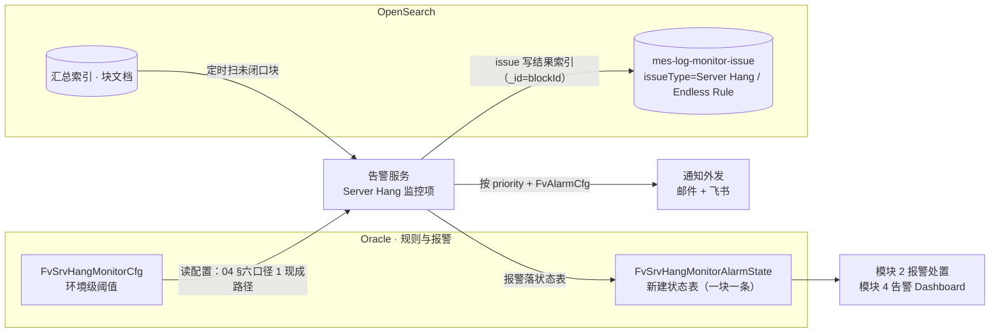

# MES Server Hang 监控与告警 · 运行时文档

> 模块 2 · 日志监控与报警 ｜ 功能 2 ｜ 状态：**需求沟通中**（2026-11-18 存储与索引口径已定）。配置表与字段见 [`03-MES Server Hang 监控配置.md`](03-MES%20Server%20Hang%20监控配置.md)；关键字监控的运行时实现见 [`02-MES关键字监控与告警.md`](02-MES关键字监控与告警.md) —— 本篇 §1 ~ §3 与之对齐。

| 项 | 内容 |
|---|---|
| 模块 | 模块 2 · 日志监控与报警 · 功能 2（第二类 · 报警） |
| 使用者 | IT 运维 |
| 上承 | `03-Halo功能盘点.md` 一期范围第 2 项 |
| 本篇范围 | **只管运行时**：两条判据怎么算、扫什么、报警怎么落库与通知 |
| 不在本篇 | 阈值 / 等级 / 通知目标怎么配 → 配置文档 §2 |
| 范围排除 | 原第一类「Server Hang List」2026-10-09 已拆出 → 配置归模块 5 `01-Server Hang Reason Config.md`；其**判定与运行口径暂存本篇附录**（动 `06` 时迁出） |
| 新增口径（2026-11-18） | 状态表**新建** `FvSrvHangMonitorAlarmState`（不复用功能 1）；OS **沿用** `mes-log-monitor-issue` 模板，`issueType` 写 `Server Hang` / `Endless Rule`，**`_id = blockId`** |

> 本篇前身含「记录（原话照录）」与「梳理落点」两块，拆分后记录部分集中在本篇 §4（判定口径来源），配置侧只看配置文档即可。

---

## 1. Oracle 表 · 状态表 `FvSrvHangMonitorAlarmState`

**结论：新建表，不复用功能 1 的 `FvLogMonitorAlarmState`**。两张表各自一张、共用同一套处置状态机与展示口径（模块 2 概览 §四）。本表**一次告警一行**，`BlockId` 作业务键 UK —— 一个块一条（§2.4）。

### 1.1 字段

| 字段 | 类型 | 必填 | 说明 |
|---|---|---|---|
| `ID` | VARCHAR2(50) | ✅ | 框架统一赋值，不出参 |
| `Environment` | VARCHAR2(30) | ✅ | 取自配置表，`PROD` / `PIRUN`；**配置表原字段快照** |
| `Priority` | VARCHAR2(20) | ✅ | 取自配置表，`P1` ~ `P4`；**配置表原字段快照** |
| `MaxDelay` | NUMBER(5) | ✅ | 最大 delay（秒），`1 ~ 65535`；**配置表原字段快照** |
| `MaxRuleCost` | NUMBER(5) | ✅ | 最大耗时（秒），`1 ~ 65535`；**配置表原字段快照** |
| `BlockId` | VARCHAR2(256) | ✅ | 块文档 `_id`（`REQUEST_EXEC_ID`），**UK**；跳模块 1 块详情的锚，与 OS `_id` 同值（§2.3） |
| `RuleName` | VARCHAR2(128) | — | 块 `RULENAME` 首值快照（业务上单值） |
| `IssueTime` | TIMESTAMP(3) | ✅ | **判据命中时刻**（告警服务墙钟）—— 与功能 1 不同，本功能没有「命中行」可取 `LOG_TIME`；OS 按月选索引用它（§2.2） |
| `ReportTime` | TIMESTAMP(3) | ✅ | 状态行生成墙钟，**首写后不变** |
| `ResolvedTime` | TIMESTAMP(3) | — | 处置时写；是否为空派生「已解决」 |
| `ResolvedUser` | VARCHAR2(64) | — | 处置人 |
| `ResolvedComment` | VARCHAR2(512) | — | 处置备注 |
| `Alarmed` | CHAR(1) | ✅ | 默认 `N`；通知器回写 `Y` |
| `LastAlarmTime` | TIMESTAMP(3) | — | 通知发出的时间，非生成时间 |

- 审计列 `createdAt` / `createdBy` / `updatedAt` / `updatedBy` 由底层统一补，不在此列。
- 错误码为「误报」时同样写处置字段（误报是一等状态，模块 2 概览 §4.2）。

### 1.2 唯一性与索引

| 项 | 口径 |
|---|---|
| 业务唯一键 | **`BlockId`** —— 一个块只报一次（§4.2 已核）；库层 UK 兜幂等，冲突跳过、不更新首次写入的行 |
| 辅助索引 | `(Environment, Priority, ReportTime DESC)` 服务汇总分组 + 明细分页；`(Alarmed, LastAlarmTime)` 通知器捞未发（与功能 1 同形） |
| 与 OS 的对应 | OS 文档 `_id = blockId`（§2.3），与本表 `BlockId` 一一对应 —— 两源同一业务键，Oracle 持状态、OS 持观测文本（§2 §7） |

### 1.3 配置字段快照的语义

`Environment` / `Priority` / `MaxDelay` / `MaxRuleCost` 四列在**建告警那一刻从 `FvSrvHangMonitorCfg` 复制**，之后不随配置变化：

- 告警是**历史证据** —— 配置后来改阈值、调等级甚至删掉，报警记录仍要显示「当时按什么阈值、几级报的」；
- 复盘与 MTTA / MTTR 统计按当时口径算，不被后续配置改写污染；
- 配置文档 §2.1 的字段名与值域原样落列，不做重命名或换算。

### 1.4 与功能 1 状态表的差异

| 项 | 功能 1 `FvLogMonitorAlarmState` | 本功能 `FvSrvHangMonitorAlarmState` |
|---|---|---|
| 表 | 各自一张，不共用 | 各自一张，不共用 |
| 业务键 | `LineId + Item`（同一行可被多规则命中） | **`BlockId`**（一个块一条） |
| 配置快照 | `Environment` / `Priority` | `Environment` / `Priority` + **`MaxDelay` / `MaxRuleCost`** |
| `IssueTime` 来源 | 命中行 `LOG_TIME` | **判据命中时刻（墙钟）** |
| 判据类型 | 恒为关键字 | 由 OS `issueType` 区分 `Server Hang` / `Endless Rule`（不进本表） |

---

## 2. OS 索引模板 · 沿用 `mes-log-monitor-issue`

### 2.1 结论

**不新建模板、不改 mapping**：沿用功能 1 的 `mes-log-monitor-issue`（定义见 `02` §2），本功能与关键字监控**写同一索引**，`issueType` 区分来源。`dynamic: strict` 硬约束 —— 四字段够用，不扩字段。

| 项 | 功能 1 | 本功能 |
|---|---|---|
| `issueType` | `Keyword` | **`Server Hang` / `Endless Rule`**（写死的入参，由命中的判据给定） |
| 文档 `_id` | `LineId\|Item` | **`blockId`** |
| `issueMessage` | 命中行 `LOG_BODY` 原文 | **判据描述文本**（含阈值与实测值，§2.3） |
| `IssueTime` 来源 | 命中行 `LOG_TIME` | 判据命中时刻（墙钟） |

### 2.2 命名与写入

以下全部沿用 `02` §2.1，本篇不重复展开：

- 索引名 `mes-log-monitor-issue-{yyyy.MM}`，**不带环境段、按月一个**；环境由框架 `prefix` 前置区分，不按 `ENV` 拼索引名。
- 按 **`issueTime` 所属月份**选索引，不按生成墙钟 —— 崩溃重扫跨月时仍落同一索引，幂等才稳。
- 读别名 `mes-log-monitor-issue-read`（写在模板里）；**不设写别名**，直接指定月索引名。
- 模板名 / PUT 路径 `mes-log-monitor-issue` / `_index_template/mes-log-monitor-issue`；`index_patterns` = `mes-log-monitor-issue-*`，`priority` 200。
- settings 沿用 `02` §2.2（1 分片 / 1 副本 / 5s 刷新 / best_compression），**`policy_id` setting 不写**。

### 2.3 mapping 四字段与写入值

沿用 `02` §2.3 的四个字段，不改 mapping：

| 字段 | 类型 | 本功能写入值 | 用途 |
|---|---|---|---|
| `issueMessage` | text | **判据描述文本**，如 `Server Hang: 停写 180s > 120s`、`Endless Rule: 写日志 360s > 300s` | 问题摘要（本功能没有「命中行原文」可写） |
| `blockId` | keyword | 块 `_id`（`REQUEST_EXEC_ID`） | 查询时回块取业务字段的锚点 |
| `issueTime` | date（`yyyy/MM/dd HH:mm:ss.SSS\|\|epoch_millis`） | 判据命中时刻 | 选索引、按时间检索、ISM 排序 |
| `issueType` | keyword | **`Server Hang` / `Endless Rule`** | 与关键字来源共存于同一索引，靠该字段区分 |

- **文档 `_id = blockId`**，兼作对外 `issueId`；`_id` 是 ES metadata、不占 mapping 字段，`blockId` 作为 keyword 字段用于过滤与回块，两者值相同但用途不同，不算冗余。
- `issueType` 是**写死的入参**，不读配置、不从日志解析：判据 A 命中写 `Server Hang`，判据 B 命中写 `Endless Rule`。
- `dynamic: strict` 硬约束：写进任何表外字段整篇拒写；后续加字段必须同时改本模板与写入代码。

### 2.4 幂等 · 一个块一条

`_id = blockId` 直接决定**同一块在 OS 只有一个文档**，与 Oracle `BlockId` UK 一起落实「一个块只报一次」（§4.2）：

| 场景 | 口径 |
|---|---|
| 同一块、同一判据重复命中 | OS 同 `_id` **不覆盖**、Oracle UK 冲突跳过 —— 先写为准，`ReportTime` / `IssueTime` 首写定格 |
| 同一块、A 与 B **先后都命中** | 仍只有一条：`issueType` / `issueMessage` 反映**先触发的那条判据**；后到的判据不再写 |
| 崩溃重扫 | 按 `_id` 幂等，不产生第二条；选月按 `issueTime`，不按扫描时刻 |

> 若后续要改成「A / B 各报一次」，`_id` 必须改为 `blockId|issueType`（与功能 1 的 `LineId|Item` 同思路），Oracle UK 同步改为 `BlockId + 判据类型`。当前按 **`blockId`** 执行。

---

## 3. ISM Policy · 与关键字共用

**结论：不新建 Policy、不改模板**——`mes-log-exec-keep` 的 `ism_template` 已含 `mes-log-monitor-issue-*`（`02` §3 已加），本功能写同一前缀的月索引，自动挂同一策略。

| 项 | 口径 |
|---|---|
| Policy 名 | `mes-log-exec-keep`（现成，`02` §3.1 定义） |
| 时间分层 | hot 0 ~ 360 天；360 天起 cold：只读、`set_priority: 0`，**不删除**（`02` §3.2） |
| 为什么不用改 | 索引模式 `mes-log-monitor-issue-*` 已覆盖本功能的月索引；`issueType` 只是文档字段，不影响索引命名与策略匹配 |
| 冷阶段 read_only | 无害：按月建索引、按 `issueTime` 选月，360 天前的月索引不会再被写 |

---

## 4. 两条判据

只做**主动推**的报警，两条判据都盯「一次 Rule 执行（一个块）」，阈值**环境级**（只看环境名，不需要 Rule Name）：

| 判据 | 名目 | 一句话 |
|---|---|---|
| A | **Server Hang** | Rule 未执行完成（块未闭口）便停止写日志，停写超 **Max Delay** 秒 ⇒ 报 |
| B | **Endless Rule** | Rule 写日志时长超 **Max Rule Cost** 秒 ⇒ 报（进行中就报；闭口后看总耗时） |

产出：报警事件落 **Oracle**（§1 状态表）+ 通知外发（邮件 / 飞书，复用 `FvAlarmCfg`）。

### 4.1 原话（2026-09-24）

> 「第二类是 Server Hang 报警：也是基于 Rule 来判定的，当 Rule 开始执行前到执行结束前：1，停止写 log 超过最大 delay 时间（秒）后通过钉钉、企业微信等等发送警报（这个叫 Server hang）。2. 持续写日志超过最大耗时（秒）后通过钉钉、企业微信发送警报（这个叫 Endless Rule）。第一类需要配置 Rule Name、带特殊标志的开始行日志和结束行日志。第二类需要配置环境名、最大 delay 时间、最大耗时时间，等级、发送邮件的地址、企业微信、钉钉等等。」

拆解（配置项部分已落配置文档 §2）：

| # | 要素 | 内容 |
|---|---|---|
| 1 | 判定对象 | **一次 Rule 的执行**（「Rule 开始执行前 → 执行结束前」这个窗口内） |
| 2 | 判据 A · **Server Hang** | **停止写 log 超过最大 delay 时间（秒）** ⇒ 报警，名目 `Server Hang` |
| 3 | 判据 B · **Endless Rule** | **持续写日志超过最大耗时（秒）** ⇒ 报警，名目 `Endless Rule` |
| 4 | 通知渠道 | 原口径钉钉 / 企业微信 / 邮件 → **已收口为邮件 + 飞书**（配置文档 §2.2） |
| 5 | 配置项 | 环境名、最大 delay、最大耗时、等级、收件人 → **见配置文档 §2** |

### 4.2 已核（2026-09-24 15:00 / 15:09；末行 2026-10-09）

| # | 判据 / 项 | 判定的口径 |
|---|---|---|
| A · Server Hang | `now − LAST_LINE_TIME >= delay` ⇒ 报。基准是**块末行的日志时间** |
| B · Endless Rule | **进行中**：`now − START_TIME >= 最大耗时` ⇒ 报；**闭口后**：看 `TOTAL_COST_MS >= 最大耗时` |
| 次数 | **一个块只报一次** —— 报过即落库标记，同一块不再重复报（已落 §1.2 UK + §2.4 幂等） |
| 配置范围 | **只看环境名**、**不需要 Rule Name** —— 该环境下的块都判 |
| 前提（2026-10-09 确认） | 判据 A 的「Rule **未执行完成**便停止写日志」= **块未闭口** |

> 原话（2026-09-24 15:09）：
> 「我觉得要记录块报过一次就不再报了。」（原话「包过」按「报过」理解）

---

## 5. 与现有口径的关系

### 5.1 已经对上的（不用改）

| 现有口径 | 位置 | 与本功能的对应 |
|---|---|---|
| 块上有 `START_TIME` / `LAST_LINE_TIME` / `TOTAL_COST_MS` / `EXEC_STATUS` | `06` §2.2 | 两条判据所需的事实值**都已有**，零字段缺口 |
| 静默判据（未闭口块 + `LAST_LINE_TIME`） | `06` §3.2.3 慢轮次（路 2 静默判据） | 与判据 A **同形**（差别只在阈值来源，见 §6.2） |
| 告警落 Oracle、通知外发 | `04` §六 | 本功能的落点 |
| 结果索引模板 / ISM | `02` §2 / §3 | 本功能**直接沿用**，不新建（§2 / §3） |

### 5.2 冲突 / 需要重新定口径的

| # | 冲突点 | 现状 | 结果 |
|---|---|---|---|
| 1 | 模块 2 概览 §五「Hang 数据同源」 | 「Hang 在采集/加工阶段判定并落库；模块 1 是详情视角、模块 2 是监控视角」 | **2026-10-09 拆分后失效**：第一类归模块 5 + 派生层 + 模块 1 展示，模块 2 只剩报警 —— 概览待同步 |
| 2 | 静默阈值硬编码 5 分钟 | `fabviewer.yaml` 的 `silence_minutes: 5`（派生层专用） | 判据 A 的 delay **按配置可调**且配在 `FvSrvHangMonitorCfg.Environment` 行上（**按环境各管各**）⇒ 与静默期的时序关系见 §6.2 |
| 3 | `04` §六只登记关键字监控 | 「本文所涉的告警服务只有一个」 | 本功能定稿后需**回补 `04` §六**（冻结文档，动前确认；§8-7） |

---

## 6. 落点与架构（2026-10-09 过图已核）

> 第一类（块文档 `HANG_LIST` / 派生 Worker 判定 / 模块 1 展示）已拆出，图与架构记录见模块 5 `01-Server Hang Reason Config.md` §三 / §四。

**架构上真正的新东西只有一件**：告警服务加「Server Hang 监控项」（定时扫未闭口块）—— 归 `10-告警服务工程实现.md` 重写时一并（已清空待重写，顺路）。其余全是现成路径：`FvSrvHangMonitorCfg` 归告警服务读、报警落 Oracle、数据源取链路已产出的块 —— `04` §六三条边界一条不破；结果索引与 ISM 直接沿用功能 1（§2 / §3）。

### 6.1 落点：独立 Alarm Application，定时读块文档（2026-10-09 拍板）

**拍板**：Alarm **单独一个 Application**，定时读取块文档产生报警 —— 数据源 = 汇总索引的块文档，**不回捞行**（`04` §六口径 3「数据源取自链路已产出的日志」落在这里）。待定：扫描周期量级（§8-9）、与功能 1（关键字监控）是同一个告警服务还是两个应用（§8-10）。

第二类判的是「**还没闭口的块**」，而块上现成就有 `START_TIME` / `LAST_LINE_TIME` / `EXEC_STATUS`。两条判据都不需要新字段：

| 判据 | 判定式（告警服务侧） | 用的现成字段 |
|---|---|---|
| A · Server Hang（停止写 log 超 delay） | 块未闭口 **且** `now − LAST_LINE_TIME >= delay` ⇒ 报 | `EXEC_STATUS` / `LAST_LINE_TIME` |
| B · Endless Rule（持续写超最大耗时） | **进行中**：块未闭口 **且** `now − START_TIME >= 最大耗时` ⇒ 报；**闭口后**：`TOTAL_COST_MS >= 最大耗时` ⇒ 报 | `EXEC_STATUS` / `START_TIME` / `TOTAL_COST_MS` |

⇒ **零字段改动、零派生层改动**，只在**告警服务**里加一个「Server Hang 监控项」。这与 `04` §六 的架构（告警服务是 OpenSearch 之后的独立应用层）一致。

**配置生效（`Enabled`，2026-11-18 补）**：告警服务**每轮重读 `FvSrvHangMonitorCfg`，只取 `Enabled = true` 的行**，`Environment` 去重成本轮环境集合；`false` 的环境整行不参与两条判据，配置保留不删。不缓存、不热加载，删改与启停都**下一轮生效**（配置侧字段与 `state` 接口见 `03` §2.1 / §4.1-5）。配置页 `list` 全量返回、不过滤，过滤只发生在运行时读配置这一步。

### 6.2 一条跨层约束（2026-10-09 修正方向 —— 首轮推演写反了）

**时序**：派生层在块停写满静默期（5min）后把它封成 `超时封口`；而判据 A 只认「进行中」的块 ⇒ 触发窗口只有**停写后 [maxDelay, 静默期) 这一段**：

| maxDelay 配置 | 结果 |
|---|---|
| **< 静默期** 且告警扫描周期 **< 静默期 − maxDelay** | 窗口内必有扫描点 ⇒ **报得出** |
| **≥ 静默期** | 窗口为空，块先被派生层封口 ⇒ **判据 A 永不触发**（首轮建议「delay ≥ 静默期」恰是这个死局，已纠） |

⇒ 二选一：**maxDelay 严格小于静默期并留扫描裕量**（简单，约束配置上限）；或**判据 A 扩认「超时封口」块**（delay 不受限，但封口可被尾行重开 ⇒ 假警与重开语义问题，归模块 2 `10` 拍）。**这条不拍，判据 A 会静默失效。**

---

## 7. 报警存储与通知

| # | 口径 | 说明 |
|---|---|---|
| 1 | 配置落 **Oracle** | 消费方是**告警服务** —— `04` §六口径 1 的现成路径，零架构改动 |
| 2 | **Alarm 存 Oracle，不进 OpenSearch** | `04` §六口径 2 既定边界，不破。理由：报警是**有状态事件**（新建/已确认/已恢复/已关闭/误报 + 处置记录 + 通知留痕，Oracle 行级更新干净）；「一个块只报一次」要**幂等标记**（§1.2 UK 兜死）；与功能 1 报警**同一套处置状态机与展示口径**（模块 2 处置页、模块 4 Dashboard 不跨源取数）—— **表各自一张**（§1），不是物理同表。观测性靠 OS 结果索引（§2）与「报警记录存 `BlockId`，点开跳模块 1 块详情看原始日志」补齐 —— `04` §六「两边靠键关联」现成口径 |
| 3 | 报警表名 | **已定 `FvSrvHangMonitorAlarmState`**（§1，新建）；与功能 1 的 `FvLogMonitorAlarmState` **各一张**，不混用 |
| 4 | 术语落定 | 阈值名 **Max Delay** / **Max Rule Cost**（Halo 术语），与模块 5 重做的「Server Hang 配置」页对上 |
| 5 | 通知渠道 | 本功能原口径为钉钉 / 企业微信 / 邮件；功能 1 本版只做邮件 + 飞书。**已收口（2026-11-10）**：复用功能 1 的 `FvAlarmCfg`（邮件 + 飞书 + 通知间隔），随配置 1:1，企微 / 钉钉后续扩 —— 见配置文档 §2.2 |

---

## 8. 待确认（运行时侧）

| # | 问题 | 归口 / 为什么必须问 |
|---|---|---|
| 4 | 报警的**恢复**怎么算（继续写日志即恢复？还是人工关闭） | 接模块 2 概览 §四 的状态机 |
| 7 | `04` §六**回补**：现写死「只有关键字监控一个告警服务」，本功能定稿后加入 | 冻结文档，动前确认 |
| 9 | **扫描周期**：Alarm App 多久扫一轮块文档？最坏报警延迟 ≈ `maxDelay + 扫描周期`，且须 < `静默期 − maxDelay`（§6.2）—— 三者互相咬 | `10-告警服务工程实现.md` |
| 10 | **应用形态**：本功能的 Alarm App 与功能 1（关键字监控）告警服务 = 同一个应用多监控项，还是两个独立应用？（倾向前者：`10` 本按「一个告警层」重写） | `10-告警服务工程实现.md` |
| 11 | **§6.2 二选一**：constrain `maxDelay` < 静默期并留扫描裕量，还是判据 A 扩认「超时封口」块 | 不拍则判据 A 静默失效 |

> 编号沿用原沟通稿（4 / 7 / 9 / 10 / 11）；原第 6 条（A / B 各报一次）已定为**整块一条**（§2.4），原第 8 条（表是否统一）已定为**新建各自一张**（§1）。

---

## 9. 下一步

1. **已答（2026-09-24 15:00）**：判据 A = `now − LAST_LINE_TIME >= delay`、判据 B 进行中就报 + 闭口后看总耗时、**只看环境名**。（首轮同时答的第一类口径已随拆分迁模块 5。）
2. **已答（2026-09-24 15:09）**：**一个块只报一次**（报过落库标记、不重复）—— 已落 §1.2 `BlockId` UK + §2.4 OS `_id` 幂等。
3. **已答（2026-10-09）**：配置表 `FvSrvHangMonitorCfg`（2026-11-10 定稿：Environment 唯一键 + 两阈值 + Priority + AlarmCfgId，见配置文档 §2）；**Alarm 存 Oracle**；判据 A 前提 = 块未闭口。
4. **已答（2026-10-09 续）**：**落点拍板** —— 独立 Alarm Application 定时读块文档（不回捞行）。**跨层约束方向修正**：`maxDelay` 须严格 < 静默期并留扫描裕量（原「delay ≥ 静默期」是死局）。
5. **已答（2026-10-09 · 拆分）**：第一类 Server Hang List 整体拆出 → 模块 5 **Server Hang Reason Config**（配置）+ 派生服务（运行）+ 模块 1（Rule Info 检索 §3.6 与 Rule 实效分析展示）；本功能只留第二类。（第一类两轮全部已定口径见模块 5 文档。实效分析出口**后取消**——不消费，2026-10-09 定，见附录 A.4-3。）
6. **已答（2026-11-10 · 拆分）**：本篇与原 `03` 按「配置 / 运行时」拆两篇，与功能 1 的 `01` / `02` 对齐。
7. **已答（2026-11-10；2026-11-18 更新）**：配置表 / 接口已定稿（配置文档 §2 / §4），`AlarmItems` 废弃、通知复用 `FvAlarmCfg`；**新增 `Enabled`**（布尔，新建默认 `true`，列表开关走 `state` 接口），运行时每轮重读配置只取 `Enabled = true` 的环境（§6.1）。
8. **已答（2026-11-18）**：状态表**新建** `FvSrvHangMonitorAlarmState`（§1，含环境 / 等级 / 两阈值快照 + 块与处置字段）；OS **沿用** `mes-log-monitor-issue` 模板，`issueType` = `Server Hang` / `Endless Rule`、**`_id = blockId`**（§2）；ISM 共用不新建（§3）。
9. 待拍：**§6.2** 二选一（maxDelay 上限约束 or 判据 A 扩认超时封口）；§8 其余四条归模块 2 `10`。

---

## 附录 · 第一类判定与运行口径速查（2026-10-09 已定；暂存于此，动 `06` 时迁出）

> 第一类 2026-10-09 拆分：**配置逻辑**（表结构 / 四式语义 / 页面骨架）归模块 5 `01-Server Hang Reason Config.md`；以下为**判定与运行侧**已定口径，暂存备查，动 `06` 时正式迁入。

### A.1 判定（2026-09-24 口述 + 已核 10 条）

> 原话（2026-09-24）：「一类是通过定义 Rule Name、开始行和结束行的带特殊标志的日志（两头模糊匹配）来在原始日志中瞄定开始行和结束行，计算每个开始行和结束行的时差，时差大于 0 时将其放入 Server hang list 并标注出来开始行完整日志与结束行完整日志。当一个 Rule 存在大于等于 1 个 Server Hang 时在 Rule Info 检索功能中展示。」
> （15:09 补）：「按匹配编号相邻。例如配置了两类，A和B，匹配的行分别是A1-Start，B1-Start， A1-End，A1-Start、A1-End，B1-End。那么分类也是1-3，2-6，4-5的关系。只有开始没有结束，那就是再多一个B1-Start的场景，找不到结束则忽略。只统计每个结束-开始时差 >0的。如果多个都时差大于0，展示层就显示多行。」

| # | 口径 | 说明 |
|---|---|---|
| 1 | **不跨块** | 开始行与结束行都在同一个 Rule（同一个块）内判断 |
| 2 | 匹配**块内所有行** | 由该条配置写的标志决定，不按 `MSG_KIND` 预筛 |
| 3 | 「一个 Rule」= **一个块** | Hang 数按这一次执行（这一个块）算，不按 Rule Name 汇总 |
| 4 | **同类内配对、跨配置不配** | 每条配置（一类标志）单独处理；不同配置的行互不配对 |
| 5 | **连续同类：End 配最近的未闭合 Start（栈式）** | 每个 Start 各开一行候选，End 配最后一个 Start；块闭口仍未等到 End ⇒ 丢弃；多余 End（无可配 Start）忽略；栈式天然产生同类内嵌套 |
| 6 | **只有开始行、找不到结束行 ⇒ 忽略** | 配不上结束行的开始行不计入 List |
| 7 | **时差 = 结束行时间 − 开始行时间** | 只统计 `> 0` 的对 |
| 8 | **一个块可产出多条** | 多对都 > 0 ⇒ 展示层显示多行 |
| 9 | **多 Reason 区间可嵌套 / 交叉** | 不同 Reason 各自独立配对、独立记录；R1 可完全包裹 R2 或交叉，共存不互斥 |
| 10 | 展示出口 | 该块 Hang ≥ 1 ⇒ 模块 1 Rule Info 检索展示（**唯一出口**；实效分析不消费，2026-10-09 定） |

### A.2 运行（派生服务 Worker 侧）

**拍板（2026-10-09）**：落点 = 派生服务 **Worker 端**，每次重放**全量重算、UPSERT 覆盖**（与 `LOCK_SEQ` / `INNER_RULES` 同构）—— 进行中块每轮只见已配对部分，闭口后最后一次重放定格全量。

| 环节 | 做法 |
|---|---|
| 配置加载 | **块处理时按块 `RULENAME` 现查** `FvSrvHangConfig`（不全量抓）；**内存短缓存 TTL 5min**（配置多时迁 Redis、配置保存时更新缓存）⇒ 变更最迟 5min 生效。`RULENAME` 为块文档字段（行文档无此字段，04 §3.3 / §4.5），业务上单值 |
| 匹配入口 | 块 `RULENAME` 精确命中配置的 `ruleName` 才判（没配的块零成本跳过）；原料 = 重放行 `LOG_BODY` |
| 压缩 | Hang 判断跟着重放走，**且命中块走压缩例外**（`06` §3.3.3）：留存行 = 界线后**有标签**行 + 末行，但 Hang 标志行多为**无标签 Other** ⇒ 命中 Hang 配置的块**界线后全留（含 Other）** —— 否则跨单位行的块若在本轮闭口，HANG_LIST 漏配且**永久**（终态块不再重放）；未闭口块可自愈（下一轮路 2 重扫整块、行索引全量拉回） |
| 计算与入列 | `End.LOG_TIME − Start.LOG_TIME`：**> 0 记入 `HANG_LIST`；≤ 0 不记录** |
| 为什么是这里 | 派生层重放时手上就有该块全量有序行 —— 放别处要重做「捞行 + 两级排序 + 块边界」 |
| 不要走的路 | 告警服务侧扫（重做重放的活）；塞加工层（`04` §六：Logstash 不做业务判定，配对有状态） |
| 代价 | 块 mapping 加字段 ⇒ 连动 `09` §四 / `deploy/opensearch/12-template-exec.json` —— **动块字段前必须拍板** |

### A.3 产出 `HANG_LIST` 与展示

**`HANG_LIST`（块文档嵌套数组）每条 8 项（2026-10-09 第二版形态）**：Hang Start Line ID、Hang Start Line（完整原文）、Hang End Line ID、Hang End Line（完整原文）、Hang Reason（带自配置）、耗时、开始行时间、结束行时间 —— 两行的行身份串（`hit._id`）即跳行索引原文的锚。

展示：模块 1 `01` §3.6 **唯一出口**（列数字 = `hangCount`、弹框 = 10 号接口 `rule_info/hang_list`，落库后启用；弹框加 Hang Reason 列**推后**，先做后端）；`02` 实效分析**不消费**（2026-10-09 定，列表无该列）。

### A.4 第一类待定

| # | 问题 | 归口 |
|---|---|---|
| 1 | ~~存量块不回算？~~ ✅ **已答（2026-10-09）**：不回算 —— `HANG_LIST` / `LOCK_SEQ` / `INNER_RULES` 三字段一个口径 | — |
| 2 | ~~`HANG_LIST` 英文命名~~ ✅ **已答（2026-10-09）**：8 项命名已定并落 `09` §四 / `12-template-exec.json`（块 32 字段、3 组 nested） | — |
| 3 | ~~实效分析怎么消费 Hang 数据~~ ✅ **已答（2026-10-09）**：**不消费**，列表无 `Server Hang` 列 | — |
